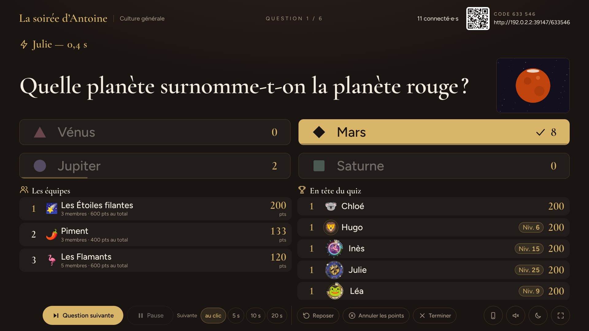
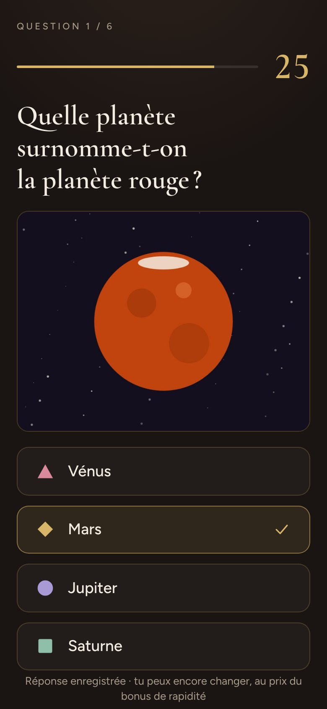

<p align="center"></p>

<h1 align="center">FiestApp</h1>

<p align="center"><strong>Le quiz de la soirée, sur ton téléphone.</strong><br>
Un écran pour la salle, un téléphone pour chacun, rien à installer. Gratuit et auto-hébergé.</p>

<p align="center">
  <a href="docs/README.md">La documentation</a> ·
  <a href="docs/guides/premiere-soiree.md">La première soirée</a> ·
  <a href="https://maxilyas.github.io/FiestApp/">La vitrine</a> ·
  <a href="docs/exploitation/mise-en-ligne.md">Mettre en ligne</a>
</p>

<p align="center"></p>

## Ce que fait FiestApp

**Une soirée de quiz, comme à la télé.** L'écran commun — une télé, un vidéoprojecteur — pose les questions à toute la salle ; chacun répond sur son téléphone après avoir scanné un QR code ou tapé le code du salon. Rien à installer, et aucun compte à créer : « Jouer sans compte » est le premier bouton de l'entrée. → [La soirée](docs/produit/la-soiree.md)

**Des questions de toutes les sortes.** QCM et vrai ou faux, estimations où le plus proche gagne, plusieurs bonnes réponses, réponses à remettre dans l'ordre, « Qui dans la salle ? », photo qui disparaît, blind test, et l'estimation en direct dont on tape la réponse à la révélation. → [Les questions](docs/produit/les-questions.md)

**Des quiz prêts en un geste.** L'éditeur dans le navigateur, une liste à coller (écrite par un ami ou par une IA), des modèles pour un anniversaire ou un mariage, l'import et le partage — ou le quiz tout prêt, composé d'un toucher dans une base de 21 887 questions relues. → [Les quiz](docs/produit/les-quiz.md)

**L'animateur aux commandes.** Une console pour révéler, mettre en pause, reposer, annuler des points ; une télécommande sur son téléphone ; une télé qui se branche par son code ; des équipes préparées avant d'ouvrir. → [Animer une soirée](docs/guides/animer-une-soiree.md)

**Une fin qu'on garde.** Un podium, des prix calculés tout seuls, des hauts faits ; sur chaque téléphone, sa fin de soirée et ses nouveaux trophées ; un souvenir à partager, un bilan question par question, des fiches à imprimer et l'historique de toutes les soirées. → [Après la soirée](docs/produit/apres-la-soiree.md)

**Le jeu continue entre deux soirées.** Avec un profil : le quiz du jour, la campagne et son défi de la semaine, les sentiers du savoir, les duels contre un autre joueur ou contre Automate. → [Le quiz du jour](docs/produit/le-quiz-du-jour.md) · [La campagne](docs/produit/la-campagne.md) · [Les sentiers](docs/produit/les-sentiers-du-savoir.md) · [Les duels](docs/produit/les-duels.md)

**Un profil qui se porte.** Des niveaux, des finitions autour de l'avatar, des trophées que la collection range mode par mode, vingt-six avatars légendaires peints, six Divins aux règles secrètes, une boutique de thèmes et de compagnons — et jamais un avantage de jeu. → [Le profil](docs/produit/le-profil.md) · [Les récompenses](docs/produit/les-recompenses.md) · [La boutique](docs/produit/la-boutique.md)

<p align="center">
  
  
  
  
</p>

## Démarrer en deux commandes

Il faut Node 20 ou plus récent.

```bash
npm install
npm run dev
```

Le client tourne sur `http://localhost:5173`, le serveur sur le port 3001. Sur une base neuve, le compte administrateur est `antoine` / `demo`, et son espace s'appelle `demo` (les variables `ADMIN_*` les changent) :

| Pour… | Ouvre |
|---|---|
| l'accueil, son profil, les modes solo | `http://localhost:5173/` |
| l'écran commun (connecte-toi d'abord) | `http://localhost:5173/host` |
| le téléphone d'un invité | `http://localhost:5173/demo` |
| écrire ses quiz | `http://localhost:5173/edit` |
| le QG de l'administrateur | `http://localhost:5173/admin` |

Pour jouer avec de vrais téléphones sur le wifi de la maison, puis mettre FiestApp en ligne gratuitement (Render et Turso) : [la première soirée](docs/guides/premiere-soiree.md) et [la mise en ligne](docs/exploitation/mise-en-ligne.md).

## Sous le capot

Un monorepo npm : `client/` (React et Vite), `server/` (Node, Express et Socket.io), et `shared/`, les types et les fonctions pures que les deux lisent.

- **Le serveur décide.** Toute la logique du jeu vit sur le serveur ; chaque écran ne reçoit que sa vue, et la bonne réponse n'arrive sur aucun téléphone avant la révélation.
- **Deux bases, deux rôles.** Une base SQLite locale, jetable, pour la partie en cours ; une base libSQL permanente (un fichier en local, Turso en ligne) pour les comptes, les profils, les quiz et les archives — et le miroir de la soirée en cours, qui survit à un redémarrage sur disque effacé.
- **Les pages se recalculent des journaux.** Le souvenir, le bilan, les prix et l'expérience se dérivent des journaux de chaque soirée, gardés tels quels : une amélioration d'aujourd'hui profite aux soirées passées.
- **Peu de dépendances**, six côté serveur, quatre côté client, et c'est voulu.

→ [L'architecture](docs/architecture/vue-d-ensemble.md)

## Vérifier une modification

```bash
npm run verify   # typage, tests, construction, puis une soirée entière rejouée sur un vrai serveur
```

C'est ce que fait l'intégration continue (`.github/workflows/ci.yml`) sur chaque proposition de modification. Les tests (`server/test/`, plus de deux cents fichiers) démarrent chacun leur serveur jetable quand il leur en faut un ; l'un d'eux relit cette documentation contre le code. → [Contribuer](docs/contribuer/demarrer.md) · [Les tests](docs/contribuer/tests.md)

Le dépôt se travaille aussi avec Claude Code : `CLAUDE.md` et les règles de `.claude/rules/` lui donnent les invariants et les pièges de chaque domaine. → [Travailler avec Claude](docs/contribuer/outillage-claude.md)

## La documentation

| | |
|---|---|
| [Le produit](docs/README.md#le-produit) | ce que fait chaque mode, pour tout le monde |
| [Les guides](docs/README.md#les-guides) | pas à pas : la première soirée, animer, jouer, administrer |
| [L'architecture](docs/README.md#larchitecture) | comment c'est construit, et pourquoi |
| [La référence](docs/README.md#la-référence) | chaque adresse, route, événement, table, variable et barème |
| [L'exploitation](docs/README.md#lexploitation) | mettre en ligne, surveiller, sauvegarder, dépanner |
| [Contribuer](docs/README.md#contribuer) | conventions, tests, recettes, historique |
