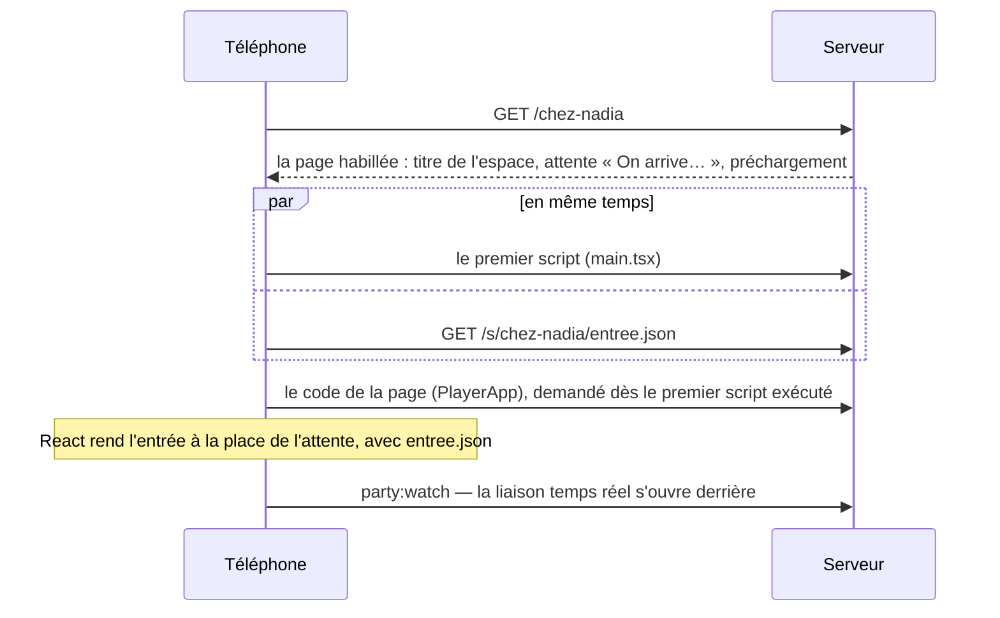

# Le client

> L'application qui tourne dans le navigateur — le téléphone d'un invité, l'écran commun, les pages d'un profil ou d'un animateur : comment elle est construite, servie, routée et chargée, ce qu'elle garde sur l'appareil, et les pièges qui coûtent une seconde à toute une salle. Pour qui touche à `client/`, ou à ce que le serveur pose dans la page.

**Dans cette page** : [en bref](#en-bref) · [la construction](#la-construction) · [ce que le serveur pose dans la page](#ce-que-le-serveur-pose-dans-la-page) · [le démarrage](#le-démarrage-dune-page) · [le routage](#le-routage) · [le chargement](#le-chargement) · [l'API et l'état](#lapi-cliente-et-létat) · [le stockage](#le-stockage-du-navigateur) · [l'application installée](#lapplication-installée) · [les thèmes](#les-thèmes-côté-technique) · [la mesure](#la-mesure) · [les pièges](#les-pièges) · [les tests](#les-tests-qui-gardent-le-client)

## En bref

- **Une application React** (React 19, construite par Vite 6, en TypeScript), sans routeur, sans bibliothèque d'état ni de style : ses dépendances d'exécution tiennent en quatre lignes — `react`, `react-dom`, `socket.io-client`, `qrcode.react` (`client/package.json`).
- **Une seule page HTML** (`client/index.html`) pour toutes les adresses. Le serveur la sert lui-même, habillée pour l'adresse demandée — statut, balises d'aperçu, données à précharger, attente déjà écrite —, mais sans rendu côté serveur : React prend la main dès que son code arrive.
- **Une page, un fichier** de `client/src/views/`, et un paquet à part : un téléphone qui répond à un quiz en 4G ne télécharge ni l'éditeur, ni l'écran commun.
- **La logique de jeu est au serveur** (invariant 1) : le client affiche des vues déjà filtrées pour son destinataire et n'envoie que des gestes. Ce qui se partage — les types, les dérivations pures, la lecture des adresses — vit dans `shared/`, importé tel quel des deux côtés.

| Où | Ce qu'on y trouve |
|---|---|
| `client/src/main.tsx` | le démarrage de toute page |
| `client/src/routes.ts` | la route de la page ouverte, les adresses des pages et des données d'un espace |
| `client/src/views/` | les pages : `PlayerApp` (le téléphone de l'invité), `HostApp` (l'écran commun), `ProfilApp` (l'accueil, le profil, la boutique), `EditorApp` (« Mes quiz »)… |
| `client/src/components/` | les composants partagés entre les pages |
| `client/src/games/quiz/` | les vues du quiz : le téléphone (`PlayerView`), l'écran commun (`HostView`), la régie |
| `client/src/api.ts` · `client/src/socket.ts` | l'API HTTP, la liaison temps réel |
| `client/src/state.ts` | l'état de la page |
| `client/src/styles.css` · `client/src/themes/` | la feuille de style (Velours et Ivoire), et celle de chaque thème |
| `client/public/` | servi tel quel : le service worker, le manifeste, les icônes, les polices, les images peintes |

## La construction

- **`npm run build`** construit le client (`vite build`, dans `client/dist/`), puis le serveur. Chaque fichier de `client/dist/assets/` porte son empreinte dans son nom ; `client/public/` est recopié à la racine.
- **Précompressé une fois pour toutes.** Le greffon `precompresser` de `client/vite.config.ts` écrit, à côté de chaque fichier JS, CSS, SVG, JSON ou HTML d'au moins 1 Ko de `client/dist/assets/`, un `.br` (brotli au plus fort) et un `.gz` (gzip 9) ; `server/src/core/precompresse.ts` sert celui que le téléphone accepte. Recompresser à chaque téléphone prenait la moitié du processeur d'une arrivée — le prix de toute une salle qui scanne le QR en même temps.
- **`client/index.html`** pose ce que toute page partage : le `viewport` (le zoom reste permis ; `interactive-widget=resizes-content` loge la page au-dessus du clavier sur Chrome Android), la couleur de la barre du navigateur, le manifeste et les icônes, et le préchargement d'**une seule** police — la serif du nom de la soirée, que l'attente d'un invité écrit en grand avant tout script. Précharger aussi la sans, ou les morceaux de la route (`modulepreload`), retardait l'écran d'entrée en 4G : le goulot est la bande passante, pas la cascade.
- **En développement**, `npm run dev` lance le serveur et Vite (port 5173, ouvert aux téléphones du même wifi). Vite sert `client/index.html` lui-même et ne relaie au serveur (port 3001) que `/socket.io`, `/api`, `/media`, `/s/` et les anciennes adresses : rien de ce que le serveur pose dans la page n'existe à 5173 ([les pièges](#les-pièges)).

## Ce que le serveur pose dans la page

Hors des fichiers et des données, toute adresse passe par `servirPage` (`server/src/server.ts`), dans cet ordre :

1. **`Cache-Control: no-cache`** : la page se redemande toujours — c'est elle qui désigne les bons fichiers à empreinte.
2. **Le statut** (`decrirePage`, `server/src/core/apercus.ts`) : 200 ; 404 pour une adresse qui ne mène à rien ; 429 pour l'adresse qui a épuisé ses essais de codes de salon ; ou une redirection 302 — vers le nom exact d'un espace, vers `chez-‹saisie›`, vers l'espace d'un code de salon. Une soirée archivée se vérifie dans la base permanente, 1,5 seconde au plus (`DELAI_VERIFICATION_ARCHIVE_MS`) : muette, la page part en 200 et dira elle-même ce qu'elle peut lire. Le détail : [Les adresses](../reference/adresses.md).
3. **Les balises d'aperçu** (`habillerPage`) : le titre, la description, Open Graph et `twitter:card` — un lien collé dans une messagerie montre le nom de la soirée, alors qu'un aperçu de lien n'exécute aucun script. Le titre vient des réglages de l'espace, **jamais d'un prénom**. Hors de l'accueil, `noindex` et l'en-tête `X-Robots-Tag` : une soirée est privée.
4. **L'en-tête de l'entrée** (`pageDEntree`, `server/src/core/page.ts`) : sur `/<espace>`, le titre de l'espace, et deux balises, `soiree-eyebrow` et `soiree-headline`, que le client relit.
5. **Les données de départ** (`prechargerDonnees`) : un `<link rel="preload" as="fetch" crossorigin>` par adresse que la page demandera dès son code arrivé (`donneesDeDepart`, [plus bas](#les-données-de-départ)).
6. **L'attente** (`ecrireAttente`), écrite dans `#root` : le nom de la soirée et « On arrive… » pour un invité, « Chargement… » ailleurs — le même balisage que `Patience` (`client/src/annonce.tsx`), que React remplace sans que rien ne bouge. Elle ne paraissait qu'une fois React exécuté : 0,7 s en 4G, 2 s en 4G lente, sur un écran noir.

Hors production, la page gardée en mémoire porte en plus `<meta name="app-env">`, glissée une fois au démarrage d'après `APP_ENV` : le client en fait une pastille en bas à gauche et préfixe le titre de l'onglet (`[preprod] …`). Deux onglets sur deux instances se distinguent ainsi d'un coup d'œil — projeter la préproduction un soir de fête, ou écrire ses quiz dans une base qui sera effacée, coûte cher. Les en-têtes de sécurité de chaque réponse : [La sécurité](securite.md).

Le chemin d'un scan, du QR à l'écran d'entrée :

## Le démarrage d'une page

`client/src/main.tsx`, dans l'ordre :

1. **La route** : `parseRoute(location.pathname)`, lue une fois (`route`, `client/src/routes.ts`) — et, sous Vite, l'adresse réécrite au nom exact de l'espace (`history.replaceState`), ce qu'en ligne le serveur a déjà fait par une redirection.
2. **La page et son code** : `ACCOUNT` (les pages sans espace) et `PUBLIC` (celles d'un espace) associent chaque page à son chargeur ; le code part aussitôt (`const code = App()`), avant tout le reste du démarrage.
3. **Le titre de l'onglet** des pages sans espace (`titreDePage`, `client/src/titres.ts` : « Mes quiz · FiestApp »), ou « Adresse introuvable · FiestApp ».
4. **Le thème**, avant le premier rendu pour que rien ne clignote : l'écran commun pose Velours ou Ivoire (`applyTheme`) ; les autres pages, le dernier thème porté sur cet appareil (`poserThemeRetenu`), confirmé au serveur par celles qui ne lisent pas le profil (`confirmerTheme`) ; les fiches du bilan s'impriment en Ivoire.
5. **Le fragment** : ce que la page demandera et que le serveur n'a pas vu passer (`#sentiers`, `#carnet` sur `/campagne`) part en préchargement d'ici (`donneesDuFragment`).
6. **Hors de l'écran commun** : `installerClavier` (le bouton principal d'un écran d'entrée reste au-dessus du clavier) et `ecouterLInstallation` (l'invitation de Chrome à installer, gardée pour la carte de l'accueil).
7. **La pastille d'environnement**, si la page porte `app-env`.
8. **Un seul rendu**, quand le code est là : `StrictMode`, le filet (`Filet`), un `Suspense` de secours, la page, et `DialogHost` (`client/src/components/Dialog.tsx` : un seul dialogue à la fois). Les pages qui posent leurs propres repères — l'écran commun, « Mes quiz », « Mon compte », le QG, le souvenir, le bilan, l'historique — s'affichent telles quelles ; les autres sont enveloppées d'un `<main>` (`REPERE_PROPRE`).

> [!NOTE]
> **Le filet.** Une erreur de rendu démonte toute la page : un invité restait devant un écran noir, sans un mot — un stockage refusé au chargement d'un module y suffisait. `Filet` montre « Oups », « Un souci d’affichage — rien n’est perdu. » et « Touche pour recharger » : recharger règle presque tout, jusqu'au paquet disparu après une mise en ligne, et la place et les points de l'invité sont au serveur.

## Le routage

Pas de routeur. Une adresse se lit une seule fois, **de la même façon des deux côtés** : `parseRoute` (`shared/adresses.ts`) la range en cinq sortes ; le client y choisit sa page, le serveur son statut et ses balises. Deux lectures divergeaient vite : l'une ouvrait ce que l'autre déclarait introuvable.

| Sorte (`Route`) | Adresses | Page |
|---|---|---|
| `landing` | `/` | `ProfilApp`, l'accueil |
| `account` | les quinze pages sans espace (`ACCOUNT_PAGES`) : `/host`, `/edit`, `/profil`… | une par page (`ACCOUNT`, `client/src/main.tsx`) |
| `join` | `/<espace>` | `PlayerApp`, le téléphone de l'invité |
| `public` | `/<espace>/souvenir`, `/stats`, `/bilan`, `/bilan/fiches`, `/soirees`, et `/<espace>/soirees/<id>/…` | `RecapApp`, `BilanApp`, `ArchivesApp` |
| `unknown` | tout le reste | `LandingApp` : « Rejoindre une soirée » |

- **Une page peut servir plusieurs adresses**, et lit la sienne : l'accueil, `/profil` et `/boutique` (`ProfilApp`) ; `/host` et `/tele` (`HostApp`, qui montre sans session le code de la télé à brancher) ; `/campagne` et `/duels` (`CampagneApp` — sur `/duels`, son code et celui des duels partent ensemble, `chargerLesDuels`) ; le souvenir et `stats` (`RecapApp`) ; le bilan et ses fiches (`BilanApp`).
- **Changer de page, c'est charger une page** : des liens, pas de navigation simulée. À l'intérieur d'une page, ses écrans ont leur adresse dans le fragment (`/profil#collection`, `/jour#classement`), et l'historique du navigateur porte de quoi revenir (`history.state`, [plus bas](#le-stockage-du-navigateur)). Une fin de partie mène ainsi à la page de l'album d'un trophée (`/profil#collection-trophees-jour`) ; son « Essayer » ouvre la loge par une requête que la loge lit une fois, puis efface de l'adresse (`/profil?essayer=nuit#fond`, `essaiDemande`, `shared/loge.ts`).
- **Les pages d'un espace lisent leurs données sous `/s/<espace>/…`** (`adresseDesDonnees`, `shared/depart.ts`) — la même adresse que celle que le serveur fait précharger.
- La table de toutes les adresses, leurs redirections et les noms réservés : [Les adresses](../reference/adresses.md).

## L'entrée d'une soirée

Le téléphone d'un invité (`/<espace>`) s'ouvre sur l'entrée, `client/src/components/Entree.tsx`, que porte `client/src/views/PlayerApp.tsx` : neuf écrans (`Etape`) — `entree` (les trois boutons), `connexion`, `secours` (le mot de passe oublié), `moi` (le prénom et l'avatar), `retour` (« Te revoilà »), `securiser` (le mot de passe d'un profil neuf), `code` (le code de secours à noter), `equipe` et `place` (« Reprendre ma place »). Ce que le téléphone porte décide du premier :

| Le téléphone porte | Premier écran |
|---|---|
| un jeton de cette soirée (`quizz.me.<espace>`) | aucun : il se re-présente par son seul jeton et retrouve sa place, en salle d'attente ou dans la question en cours ; l'attente le cache le temps de la réponse (`jetonEnVol`) |
| un jeton que la soirée ne connaît plus | le toast « On ne te retrouve plus dans cette soirée — rejoins-la » ; le jeton s'oublie, le choix retenu reste, et l'écran se décide comme ci-dessous |
| un jeton d'une soirée qu'on vient de clore | sa fin de soirée, s'il revient sur la page où il jouait ; arrivé par un lien ou le QR, l'entrée, qui propose la soirée close en une ligne |
| un cookie de profil (`qz_joueur`) | « Te revoilà » — ou l'équipe d'abord, pour le chef qui vient d'ouvrir son salon en équipes (`equipeDAbord`) |
| un choix retenu pour cet espace (`quizz.profile.<espace>`) | le prénom et l'avatar, pré-remplis |
| rien | les trois boutons, « Jouer sans compte » d'abord |

Le chef qui vient d'ouvrir son salon entre seul, sans voir l'entrée, s'il porte son profil et ne commence pas par une équipe (`entreeDemandee`, une fois, `client/src/chef.ts`). Ce que l'invité voit de chaque écran, et les messages qui bloquent l'entrée : [jouer](../guides/jouer.md).

## Le chargement

Le temps d'un téléphone en 4G se perdait en file : la page, son script, le code de sa vue, puis ses données. Le client le resserre de quatre façons.

### Le code de la page, avant le premier rendu

Chaque page est un paquet, chargé par `main.tsx` **avant** le premier rendu — jamais par `lazy`. Une route paresseuse suspend au moins une fois, même son code déjà en cache, et React retient alors la page trois dixièmes de seconde après son attente : un joueur qui revenait attendait 120 à 265 ms de plus. L'attente écrite par le serveur reste à l'écran jusqu'à la page elle-même (`server/test/depart.test.ts`).

### Le reste, à la demande : `aLaDemande`

Ce qui ne sert qu'après le premier écran vient par `aLaDemande(importer)` (`client/src/aLaDemande.ts`) : `charger()` lance le chargement une fois pour toute la page — un échec compris —, `charge()` rend le module s'il est déjà là ; `useALaDemande(source, voulu)` le donne au composant : `null` en chemin, `'perdu'` s'il ne viendra plus. Un module déjà là se rend tout de suite, sans suspendre.

Viennent ainsi la fin de soirée, la carte d'un joueur et ses gestes, la barre du chef, les panneaux du profil, la feuille des amis, le quiz tout prêt, la page des duels et le lancement d'un défi depuis la campagne. Ce que chaque chemin ne doit pas télécharger : [les pièges](#les-pièges).

### Les données de départ

`donneesDeDepart(route)` (`shared/depart.ts`) dit ce qu'une page demandera dès son code arrivé ; le serveur le fait précharger avec la page, et le premier `fetch` de la même adresse reprend la réponse déjà arrivée — un aller-retour de moins à chaque ouverture, 0,2 s en 4G, 0,6 s en 4G lente.

| Page | Données préchargées |
|---|---|
| `/` | `/api/auth/me`, `/api/joueur/moi?accueil`, `/api/joueur/missions` |
| `/profil`, `/boutique` | `/api/auth/me`, `/api/joueur/moi` |
| `/jour` | `/api/jour`, `/api/joueur/moi?leger` |
| `/campagne` | `/api/campagne`, `/api/joueur/moi?leger` — et, d'après le fragment, `/api/campagne/sentiers`, ou `/api/campagne/carnet` et `/api/campagne/sujets` |
| `/duels` | `/api/duels`, `/api/joueur/moi?leger` |
| `/edit` | `/api/quizzes`, `/api/auth/me`, `/api/joueur/theme` |
| `/<espace>` | `/s/<espace>/entree.json` |
| `/<espace>/souvenir`, `/<espace>/stats`, et leurs archives | `…/recap.json`, `/api/auth/me`, `/api/joueur/theme` |
| `/<espace>/bilan` | `…/bilan.json`, `/api/auth/me`, `/api/joueur/theme` |
| `/<espace>/bilan/fiches` | `…/bilan.json`, `/api/auth/me` |
| `/<espace>/soirees` | `/s/<espace>/soirees.json`, `/api/auth/me`, `/api/joueur/theme` |
| les autres | rien |

Les adresses viennent de `DEPART` et d'`adresseDesDonnees`, que les pages lisent aussi : un préchargement ne sert que si l'adresse est la même, lettre pour lettre.

**L'entrée d'un invité** a la sienne : `/s/<espace>/entree.json` rend ce que `party:watch` dirait — l'instantané des téléphones et le profil que le cookie reconnaît (`EntreeDeDepart`). L'entrée paraît dès son code arrivé, sans attendre la poignée de main et les deux échanges de la liaison temps réel (une demi-seconde en 4G, une seconde en 4G lente), pourvu que le téléphone n'ait rien à reprendre (`entreeUtilisable` : ni jeton à re-présenter, ni fin de soirée gardée, ni liaison qui a déjà parlé). La vie de la liaison : [Le temps réel](temps-reel.md).

**Les missions du jour** partent avec l'accueil : la page ne les demandait qu'une fois l'accueil lu, et leur ligne attendait vide, sous « À la une », un aller-retour de plus — 160 ms en 4G lente, cache plein (le 15 octobre 2026). L'accueil les demande à son ouverture, quel que soit le visiteur : un invité reçoit un refus (401), qui ne retire pas la ligne qu'il verra une fois connecté (`relireLesMissions`, `client/src/missions.ts`).

**La partie du jour préchargée** se dit telle : `/api/jour` demandé sans l'en-tête maison (`X-Requested-With`, que l'API cliente pose toujours) répond `prechargee`, et le client mesure alors l'heure du serveur dans la trace du préchargement (`mesureDeLaReponse`, `client/src/clock.ts`), pas autour d'un `fetch` qui a trouvé la réponse déjà là.

### Les polices

Une seule part avec la page, la serif du nom de la soirée (`client/public/fonts/cormorant-garamond-600.woff2`) ; la sans vient de la feuille de style ; la police d'un thème, avec la feuille de ce thème seulement.

## L'API cliente et l'état

### `req` et ses erreurs

Toute route HTTP du client passe par `req` (`client/src/api.ts`) :

- `credentials: 'same-origin'`, `Content-Type: application/json`, et **`X-Requested-With: quizz`** : le garde anti-CSRF du serveur (`csrfGuard`, `server/src/auth/http.ts`) refuse toute écriture qui ne le porte pas — une page tierce ne peut pas l'ajouter sans une pré-vérification que le serveur ne lui accorde jamais —, et, en ligne, toute écriture venue d'une autre origine.
- **L'abandon à vingt secondes** (`DELAI_REQUETE_MS`), corps compris : sans délai, un réseau qui avale les paquets laissait « Me connecter » grisé des minutes, et l'invité ne savait pas qu'il pouvait réessayer.
- **Un échec se lit en français.** Un 401 devient `UnauthorizedError`, avec le motif du serveur — un mot de passe faux n'est pas une session expirée ; un 409 qui porte `conflit.updatedAt`, `ConflitError` (le quiz a été enregistré ailleurs) ; tout autre refus, `ApiError` — son motif, l'identifiant libre suggéré s'il y en a un, s'il est passager, son statut, le corps du refus tel que le serveur l'a écrit (`corps` : un geste du Cabinet passé y rend la partie d'à présent) ; une requête qui n'est pas revenue, `ApiError` d'un des motifs de `shared/erreurs.ts` ; un corps qui n'est pas du JSON, « Réponse inattendue — recharge la page, puis réessaie ». Jamais le texte anglais du navigateur.
- **`refusDuServeur(e)`** : un 4xx — le refaire recevrait le même refus, au contraire d'un réseau coupé ou d'un serveur qui redémarre.
- **`api`** regroupe toutes les routes du client par domaine (`api.joueur`, `api.jour`, `api.campagne`, `api.admin`…) ; la table des routes : [L'API HTTP](../reference/api-http.md). `currentMe()` demande une fois par page qui tient la console (`null` sans bruit pour un invité) ; `seConnecter` essaie le profil avant un compte d'animateur d'avant ; `ouvrirParLeProfil` ouvre la console par le profil ; `compressImage` réduit une photo dans le navigateur avant l'envoi (1 280 px au plus, en WebP, sinon en JPEG).

### Attendre le réveil de l'hébergeur : `auReveil`

L'offre gratuite de l'hébergeur endort le serveur après un quart d'heure sans requête, et son réveil prend une minute : le premier « Enregistrer » d'un éditeur resté ouvert échouait à coup sûr, et l'invitation à recharger faisait perdre ce qui venait d'être écrit. `auReveil(appel)` rejoue un appel tant qu'il échoue d'un échec passager (`enAttendantLeReveil`, `shared/reveil.ts`) : deux minutes au plus (`ATTENTE_REVEIL_MS`), cinq secondes entre deux essais quand l'hébergeur a répondu aussitôt (`PAUSE_REVEIL_MS`). Seuls les appels qu'on peut rejouer sans dommage y passent — « Enregistrer » et l'envoi d'une photo dans l'éditeur —, un essai abandonné ayant pu arriver quand même.

### L'état d'une page

`client/src/state.ts` tient un magasin à abonnés, lu par `useSyncExternalStore` (`useAppState`) : `connected`, `snapshot` (l'instantané de la soirée), `me` (l'identité de l'invité, `playerId` et `token`), `views` (les vues de partie), `toast`, `fin` (la fin de soirée), `gain`, `cloture`, `progres`. Pas de bibliothèque d'état : la vérité est au serveur, et la page n'en garde que ce qu'elle affiche, avec de quoi se re-présenter.

- **L'identité d'un invité se range par espace** (`quizz.me.<espace>`) : son jeton ne vaut rien ailleurs. `forgetMe` l'efface avec le choix retenu (l'invité exclu) ; `oublierIdentite`, le jeton seul (un jeton que la soirée ne connaît plus : l'entrée repart pré-remplie).
- **La fin de soirée gardée** (`quizz.fin.<espace>`, `SoireeGardee`) se rouvre quand on **revient** sur la page — un rechargement, le retour du navigateur, dans les douze heures —, jamais quand on y **arrive** : qui arrive par un lien ou le QR vient jouer (`estUnRetour`, `shared/fin.ts`). La soirée elle-même se propose une semaine, à l'entrée et sur l'accueil. Une entrée rangée sous une autre forme ne se relit pas (`VERSION_GARDEE`) : une page d'une autre version restait sur « Oups ».

### La liaison temps réel

`client/src/socket.ts` ouvre la liaison Socket.io de la page — WebSocket d'abord, repli en long-polling — et tient `snapshot`, `views` et `connected` à jour. Son cycle, ses accusés, l'horloge du serveur : [Le temps réel](temps-reel.md). L'accueil ne la télécharge pas.

## Le stockage du navigateur

Ce que l'appareil garde n'est qu'une commodité : tout ce qui compte est au serveur. **Tout accès au stockage passe sous `try/catch`** — des cookies bloqués, le navigateur intégré d'une messagerie, Safari en navigation privée lèvent une exception à la moindre écriture, et un stockage refusé au chargement d'un module donnait une page noire. `writeSafe` (`client/src/state.ts`) en est le modèle. Aucun test ne le vérifie partout (seul `server/test/installation.test.ts` simule un stockage qui lève) : une clé de plus se relit à la main, et rejoint cette table.

| Clé | Stockage | Ce qu'elle garde | Écrite et lue par |
|---|---|---|---|
| `quizz.me.<espace>` | local | l'identité de l'invité dans cette soirée (`playerId`, `token`) | `client/src/state.ts` |
| `quizz.profile.<espace>` | local | le prénom et l'avatar choisis ici, le « choix local » — son nom d'avant est gardé : le changer ferait repasser chaque téléphone par l'entrée | `client/src/state.ts` |
| `quizz.fin.<espace>` | local | la dernière soirée close et, si elle a été montrée, sa fin (`SoireeGardee`) | `client/src/state.ts` |
| `quizz.plus-tard.<espace>` | local | l'invité qui a répondu « Plus tard » à l'invitation à créer un profil | `client/src/views/PlayerApp.tsx` |
| `quizz.chef` | local | les réglages du chef d'un salon : s'il joue, le rythme, les équipes préparées | `client/src/chef.ts` |
| `quizz.chef.entrer` | session | l'espace où « Ouvrir le salon » fait entrer le chef, une fois | `client/src/chef.ts` |
| `quizz.theme-joueur` | local | le thème du profil connecté ici, posé dès le démarrage | `client/src/themeJoueur.ts` |
| `quizz.theme` | local | Velours ou Ivoire, à l'écran commun | `client/src/theme.ts` |
| `quizz.gerbe` | local | la gerbe du profil connecté ici | `client/src/gerbe.ts` |
| `quizz.muted` | local | le son coupé, à l'écran commun | `client/src/sound.ts` |
| `quizz-telecommande` | local | la console tenue en télécommande | `client/src/telecommande.ts` |
| `quizz.installer.masquee` | local | « Ne plus afficher » sur la carte « Installer l'application » | `client/src/installation.ts` |
| `quizz.brouillon.<quiz>` | local | le brouillon d'un quiz dans l'éditeur | `shared/brouillon.ts`, `client/src/brouillon.ts` |
| `fiestappTriDesQuiz` | local | le rangement de « Mes quiz » | `client/src/views/EditorApp.tsx` |
| `quizz.quizToutPret` | local | le dernier choix du quiz tout prêt | `client/src/components/QuizToutPret.tsx` |
| `quizz.campagne.categories` | local | les catégories de la dernière série de campagne | `client/src/views/CampagneApp.tsx` |
| `quizz.campagne.sujet` | local | le sujet de la dernière série | `client/src/views/CampagneApp.tsx` |
| `quizz.cabinet.carte.<profil>` | local | la carte-bonus choisie la dernière fois au Cabinet, que l'annonce propose d'abord | `client/src/views/cabinet/retenu.ts` |
| `quizz.cabinet.regles-lues.<profil>` | local | les règles du Cabinet déjà ouvertes : le musée ne souhaite plus la bienvenue | `client/src/views/cabinet/retenu.ts` |
| `quizz.nouveautes` | session | le dernier compte de ce qu'il a de neuf à porter, que la barre du menu montre en attendant le serveur — ce qu'il a vu, lui, se retient au serveur (`profile_loge_vus`) | `client/src/nouveautes.ts` |
| `quizz.annonces.vues.<profil>` | local | les annonces de l'administrateur déjà montrées | `client/src/components/AccueilDesRoles.tsx` |
| `quizz.duels.resultatAnnonce` | local | le dernier résultat de duel annoncé par la bannière de l'accueil | `client/src/components/AccueilDesRoles.tsx` |
| `quizz.profil.ouvertes` | local | rien d'utile : écrite et lue par des fonctions que plus rien n'appelle | `client/src/views/ProfilApp.tsx` |

Hors du stockage, l'historique de la page (`history.state`) porte quelques repères : la garde du retour (`fiestappGarde`, `client/src/retour.ts`), l'écran « Rejoindre une soirée » de l'accueil et l'écran d'où l'on vient au profil (`fiestappRejoindre`, `fiestappProfilDepuis`, `client/src/views/ProfilApp.tsx`), les pas d'une page publique (`profondeurDeLaPage`, `client/src/components/SpaceNav.tsx`), un lancement et un duel de la campagne (`fiestappLancement`, `fiestappDuel`, `client/src/views/CampagneApp.tsx`), une partie du Cabinet ouverte par-dessus un écran du musée (`fiestappPartieDuCabinet`, `client/src/views/cabinet/ecrans.ts`). Les deux cookies — `qz_joueur` (le profil) et `qz_session` (la console) — sont `httpOnly` : la page ne les lit jamais ([La sécurité](securite.md)).

## L'application installée

- **Le manifeste** (`client/public/manifest.webmanifest`) : « FiestApp », départ et portée `/`, `standalone` (sans barre d'adresse), en portrait, aux couleurs de Velours, trois icônes. `client/index.html` le relie, avec les balises d'Apple et l'icône de l'iPhone (`client/public/icone-180.png`).
- **La carte « Installer l'application »** (`client/src/installation.ts`, `client/src/components/Installer.tsx`) : au pied de l'accueil d'un téléphone, jamais sur un ordinateur ni dans l'application installée. Sur Android, l'invitation de Chrome (`beforeinstallprompt`) est gardée dès le démarrage de chaque page hors de l'écran commun : elle arrive tôt, ne revient pas, et ne surgit plus d'elle-même en pleine question.
- **Le service worker** (`client/public/sw.js`) ne fait qu'une chose : la notification du rappel du soir. Ni cache, ni `fetch` : il couvre toute l'origine, et un cache servirait une vieille application à toute une salle, un `fetch` qui échoue ferait une page blanche. Écrit à la main hors du paquet — son adresse, `/sw.js`, décide de ce qu'il couvre —, il n'est inscrit que par l'application installée qui prépare le rappel (`client/src/rappel.ts`). Le rappel lui-même : [Le quiz du jour](../produit/le-quiz-du-jour.md).

## Les thèmes, côté technique

- **Une feuille, écrite en Velours** (`client/src/styles.css`) : ses couleurs, ses polices et ses mesures sont des variables sur `:root`. **Ivoire** — Velours passé sur papier, pour un vidéoprojecteur qui délave les noirs — les redéfinit sous `data-theme="ivoire"`, dans la même feuille.
- **L'écran commun** (et la télé) choisit entre les deux : `client/src/theme.ts` (`applyTheme`, `toggleTheme`), retenu sur l'appareil (`quizz.theme`).
- **Les autres pages portent le thème du profil connecté** (`client/src/themeJoueur.ts`) ; l'invité sans profil reste en Velours. Chaque thème a sa feuille, `client/src/themes/<clé>.css`, que Vite fait morceau à part et qui ne part qu'à la demande (`import.meta.glob('./themes/*.css')`) : un invité anonyme n'en télécharge aucune. Ses variables vivent sous `:root[data-theme='<clé>']`, son décor dans des couches fixes (`body::before`, `#root::after`…), ses animations s'arrêtent si le système demande moins de mouvement, ses polices sont dans `client/public/fonts/themes/`.
- **L'ordre compte** : la feuille d'abord, puis l'attribut `data-theme` sur `<html>` — posé avant, il laissait un instant ses couleurs sur les polices et le décor de Velours. Au démarrage, le dernier thème porté sur l'appareil (`poserThemeRetenu`, `quizz.theme-joueur`) ; puis celui du serveur, lu avec le profil par les pages qui le lisent (`porterTheme`), demandé seul par les autres (`confirmerTheme`, `GET /api/joueur/theme`, abandonné après vingt secondes). L'aperçu de l'écran commun passe devant l'essai de la loge, l'essai devant le thème porté ; une feuille arrivée en retard ne remplace pas une demande plus récente ; la barre du navigateur prend le fond du thème.
- Les thèmes à vendre, à gagner, et leurs prix : [La boutique](../produit/la-boutique.md).

## La mesure

`npm run mesure` (`server/scripts/mesure-pages.ts`) dit ce que chaque page fait attendre à un téléphone — mesuré, pas deviné. Il démarre un serveur jetable, y joue une soirée pour remplir les pages, puis ouvre chacune dans Chromium comme sur un téléphone moyen : le processeur ralenti quatre fois, le réseau bridé aux préréglages de Chrome (« 4G » : 165 ms par requête, 9 Mbit/s ; « 4G lente » : 563 ms, 1,6 Mbit/s), le cache vide puis plein.

- **Ce qu'il relève** : le premier affichage ; l'**écran utile**, le premier élément qui dit que la page est là, guetté dans la page ; le plus grand affichage et le temps bloqué ; le processeur ; les octets et les requêtes avant l'écran utile ; et, à chaque page, les données préchargées qu'elle n'a pas reprises.
- **Derrière un relais HTTP/2**, comme chez l'hébergeur : en HTTP/1.1, les trente morceaux d'une route font la queue sur six connexions, et toute conclusion sur le nombre de requêtes s'inverse (`--http1` s'en passe).
- **Ses options** : `--pages=`, `--reseaux=`, `--essais=`, `--cache=`, `--cascade` (chaque requête du premier chargement), `--couverture` (la part du script et du style vraiment servie avant l'écran utile), `--client=` (un autre client construit, pour comparer deux paquets), `--photos=`, `--json=`.
- **Ce n'est pas un test.** Le client doit être construit, et un chiffre bouge de ±120 ms d'une série à l'autre sur la même machine : une retouche se juge en séries entrelacées, ou au travail du fil principal (une trace, processeur ×4), jamais sur deux séries prises à une heure d'écart.

## Les pièges

- **Rien de ce qui sert après n'entre dans le premier écran.** L'écran d'entrée ne télécharge ni la carte d'un joueur, ni la fin de soirée, ni le quiz du jour ; l'accueil anonyme, ni les dessins des avatars, ni les onglets du profil, ni la liaison temps réel ; le quiz du jour, pas la fin de soirée : ses grandes cartes de fin vivent à part (`client/src/components/Ouverts.tsx`), l'écran des gains de toutes les fins aussi (`client/src/components/Gains.tsx`), qui lit la couleur des raretés dans `client/src/gemmes.ts` plutôt que dans la boutique, et la page de l'album d'un trophée dans `shared/pagesDesTrophees.ts` plutôt que dans tout l'album (`shared/trophees.ts`) — ces deux détours, aucun test ne les garde. Ce que partagent l'entrée et le formulaire du profil vit dans `client/src/components/inscription.ts` : pris à `Entree.tsx`, il faisait télécharger la liaison temps réel à l'accueil. `server/test/medaillons.test.ts` y veille ; un import statique de plus sur ces chemins les y remet.
- **Pas de `lazy`**, ni pour une page ni pour un composant : `aLaDemande`.
- **Pas d'`Intl` avant le premier écran.** Le premier formateur `Intl` d'une page charge les données du français — 94 ms au processeur d'un téléphone moyen, sur l'accueil d'un profil —, et, retiré d'un endroit, il passe au suivant. Un nombre s'écrit par `formatNumber` (`shared/typographie.ts` : le texte même de `toLocaleString('fr-FR')`, milliers groupés à partir de cinq chiffres seulement, « 1889 » mais « 35 000 ») ; l'accueil reçoit le jour de Paris du serveur ; une date passe par `shared/jour.ts`, dont les formateurs naissent à leur première lecture. Les `toLocaleDateString` de `client/src/format.ts` ne servent qu'aux pages d'animateur.
- **Une donnée préchargée se demande à l'ouverture, par tout visiteur, à l'adresse exacte.** Le navigateur rend la réponse préchargée au premier `fetch` de la même adresse, quel que soit son âge et même sous `no-store` (essayé : douze secondes après, il rendait encore celle du chargement). Une adresse que la page ne demanderait qu'après une connexion y lirait la réponse d'avant, celle d'un invité. Une page qui cesse de demander une adresse d'emblée la retire de `donneesDeDepart` dans le même commit.
- **`npm run dev` ne passe pas par `servirPage`** : à 5173, ni statut, ni redirection (`/482157` y tombe sur « Le code 482 157 ne mène à aucun salon — ou plus. »), ni balises d'aperçu, ni préchargement, ni attente écrite, ni pastille d'environnement. Ces comportements se vérifient sur le client construit servi par le serveur, ou au banc (`clientDist`, `server/test/portes.test.ts`).
- **Une page sans espace de plus** se déclare à plusieurs endroits, dont un que rien ne force : `RESERVED_SLUGS` (`shared/space.ts`). La marche à suivre : [Les recettes](../contribuer/recettes.md).
- **Le titre de l'onglet se change par son texte** (`document.title`), jamais en remplaçant l'élément `<title>` : le préfixe d'environnement s'y repose par un `MutationObserver` qui observe cet élément.
- **Aucun `autoFocus`** sur les écrans d'entrée — l'entrée d'une soirée, l'accueil sans profil, « Rejoindre une soirée », « Reprendre ma place » : le clavier qui monte pousserait le bouton principal hors d'un écran de 360 × 640. Les trois gros boutons doivent s'y voir sans défiler ; ça se regarde à l'écran (skill `regarder-le-rendu`), car `server/test/connexion-claire.test.ts` ne garde que leur ordre, leur format et l'absence de champ.
- **Le service worker ne cache jamais rien** ([plus haut](#lapplication-installée)).

## Les tests qui gardent le client

| Test | Ce qu'il garantit |
|---|---|
| `server/test/depart.test.ts` | les données de départ de chaque page, le préchargement du fragment, l'attente écrite identique à `Patience`, aucun `lazy` et un seul rendu, `entree.json` égal à ce que dirait `party:watch` |
| `server/test/medaillons.test.ts` | ce que chaque chemin n'importe pas (dessins, carte, fin de soirée, quiz du jour, Socket.io) ; `aLaDemande` |
| `server/test/page.test.ts` · `server/test/portes.test.ts` | le statut de chaque adresse, les redirections, les balises d'aperçu sans prénom, `noindex`, les fichiers absents |
| `server/test/chargement.test.ts` | les fichiers précompressés, servis selon ce que le téléphone accepte ; un téléchargement abandonné, ni au journal ni aux erreurs serveur |
| `server/test/connexion-claire.test.ts` | les trois gros boutons de l'entrée et de l'accueil, dans l'ordre, sans champ ; la création d'un profil en deux champs, la règle du mot de passe dite d'avance, que son refus fait taire sans rien déplacer (`MotDePasseChoisi`), chaque refus de l'inscription au champ qu'il vise (par le vrai serveur) ; le titre de premier niveau de l'accueil, de chaque écran de l'entrée d'une soirée et du formulaire de sa salle d'attente, et l'onglet de chaque écran du formulaire de l'accueil |
| `server/test/navigation.test.ts` | les barres de navigation, les sorties des pages d'erreur |
| `server/test/client.test.ts` | les motifs de `shared/erreurs.ts` : en français, courts, et qui disent quoi faire |
| `server/test/typographie.test.ts` | `formatNumber` égal à `toLocaleString`, sur des milliers de nombres |
| `server/test/design.test.ts` | entre autres, un titre d'onglet par page sans espace, posé au premier rendu |
| `server/test/petit-ecran.test.ts` | les onglets au clavier, les fenêtres modales (`client/src/modale.ts`) : la carte d'un joueur, un dialogue — le reste de la page inerte tant qu'une fenêtre le couvre encore, le focus posé sans anneau et gardé sous le doigt, Échap à celle du dessus |
| `server/test/installation.test.ts` | la carte d'installation sous les trois boutons, l'invitation de Chrome gardée, un stockage qui lève |
| `server/test/entre-deux-soirees.test.ts` | la fin de soirée gardée : rouverte au retour, jamais à l'arrivée |

Rien ne vérifie automatiquement que les trois boutons tiennent sans défiler, la pastille d'environnement, ni le `try/catch` de chaque accès au stockage. Les tests en général : [Les tests](../contribuer/tests.md).

## Pour aller plus loin

- [Les adresses](../reference/adresses.md) — chaque adresse, ses redirections, les noms réservés
- [Le temps réel](temps-reel.md) — la liaison Socket.io, l'instantané, les vues, l'horloge
- [La sécurité](securite.md) — les cookies, le garde anti-CSRF, les en-têtes de chaque réponse
- [Jouer](../guides/jouer.md) — le parcours de l'invité, vu de son téléphone
- [Les décisions](decisions.md) — les choix structurants, dont ceux du client
- [Les recettes](../contribuer/recettes.md) — ajouter une page, une donnée de départ
