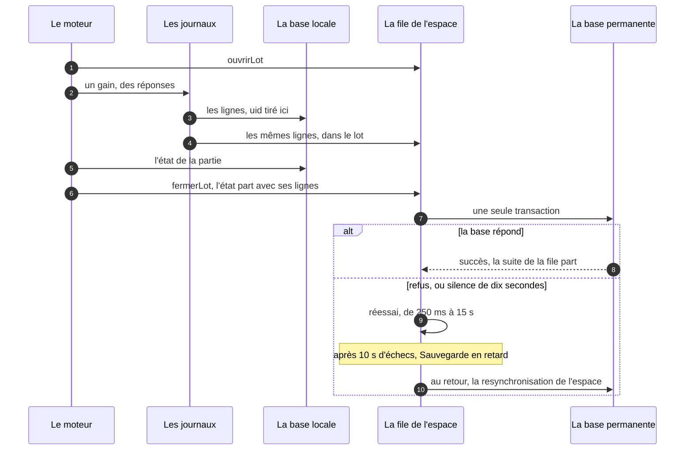
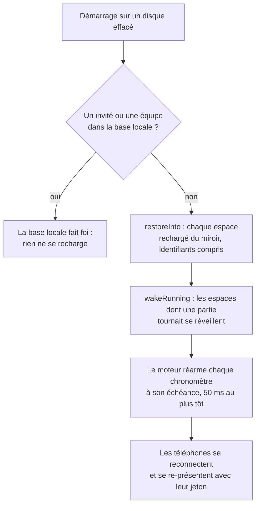

# Les données

> Où vit chaque donnée de FiestApp, et pourquoi : les deux bases, les
> journaux de la soirée, le miroir qui la protège d'un disque effacé, le nom
> de la soirée, les archives, les dérivations, le recalcul au démarrage, le
> Cabinet de curiosités, puis le démarrage et l'arrêt du serveur vus depuis
> les données. Pour un développeur.

**Dans cette page** : [Deux bases, deux rôles](#deux-bases-deux-rôles) ·
[Les journaux de la soirée](#les-journaux-de-la-soirée) ·
[Le miroir](#le-miroir) ·
[Le nom de la soirée](#le-nom-de-la-soirée) ·
[Les archives](#les-archives) ·
[Les dérivations](#les-dérivations) ·
[Le recalcul et les versions](#le-recalcul-et-les-versions) ·
[Le Cabinet de curiosités](#le-cabinet-de-curiosités) ·
[Le démarrage](#le-démarrage) ·
[L'arrêt](#larrêt) ·
[Ce qui ne vit qu'en mémoire](#ce-qui-ne-vit-quen-mémoire)

## Deux bases, deux rôles

L'offre gratuite de l'hébergeur endort le serveur sans trafic, et efface son
disque à chaque réveil : chaque réveil est un démarrage sur un disque vide.
D'où deux bases :

- **La base locale** (SQLite, `DB_PATH`) tient la soirée en cours de chaque
  espace, et rien d'autre. Elle est **jetable**. Le moteur y écrit de façon
  synchrone (better-sqlite3) : pas un aller-retour réseau au milieu d'une
  question, et la partie avance au rythme de la salle, pas à celui de la base
  distante.
- **La base permanente** (libSQL, `QUIZ_DB_URL` : Turso en ligne, un fichier
  `quizzes.db` chez soi) garde tout ce qui doit survivre — comptes, profils,
  quiz et photos, historique, quiz du jour, campagne, QG — et le **miroir** de
  la soirée : une copie des tables locales, d'où la soirée se recharge quand
  le disque est reparti vide.

La clôture d'une soirée, ou l'essai effacé, vide la base locale **de cet
espace**, après le miroir. « Nouvelle soirée », l'ancien nom de ce geste,
n'est plus un bouton : l'ancien message `host:resetParty` mène à la clôture.
Chaque table, et ce qui l'efface :
[La base de données](../reference/base-de-donnees.md).

**L'espace partitionne.** Un compte est un espace, et son identifiant
(`accounts.id`) sert de `space_id` à tout ce qui appartient à une soirée ou à
une bibliothèque — les sept tables locales, le miroir, les quiz, les photos,
les programmes, les partages, les salons, l'historique, les lignes de crédit
d'une soirée. Un identifiant qui n'est pas du sien vaut « introuvable »
(invariant 3). Ce qui appartient à une personne — son profil, son quiz du
jour, sa campagne — se range par `profile_id`, sans espace : un profil va
d'un espace à l'autre.

La plupart des magasins de la base permanente gardent en mémoire ce qu'ils
ont lu, écrivent d'abord en base et ensuite en mémoire, et passent ce qui
doit tenir ensemble en une transaction (`batch(…, 'write')`). Chacun ouvre
son client libSQL par `clientDistant`
(`server/src/core/distante.ts`), qui borne chaque aller-retour à dix secondes
(`DELAI_DISTANT_MS`) : sans ce délai, une base muette faisait attendre plus
de cinq minutes, suspendait le démarrage et gelait le miroir avec les vingt
requêtes qui l'attendaient. Vers une base distante, chaque appel est de plus
borné de bout en bout (`clientBorne`, cinq secondes de marge,
`MARGE_D_UN_APPEL_MS`) : le délai du `fetch` n'a pas empêché, en
production, une lecture de ne jamais revenir, sans une erreur, et de figer
tout ce qui l'attendait derrière un verrou ; elle échoue maintenant, et
l'appel suivant part d'un client neuf. Le même module mesure chaque
aller-retour, que `/healthz` et le QG relisent. Ses allers-retours passent
par le `fetch` de Node, ou, `QUIZ_DB_TRANSPORT=leger`, par le transport
léger (`server/src/core/transportLeger.ts`) : `http.request`, deux fois
moins de processeur par aller-retour au dixième de cœur de l'hébergeur, les
mêmes connexions gardées et comptées (`server/src/core/connexions.ts`).

## Les journaux de la soirée

La soirée s'écrit dans deux journaux et trois registres, réunis par espace
dans `SpaceRuntime` (`server/src/core/space.ts`) :

| Registre | Table locale | Ce qu'il garde |
|---|---|---|
| `Party` (`server/src/core/party.ts`) | `players` | les invités, leur jeton, leur profil, leur équipe |
| `Teams` (`server/src/core/teams.ts`) | `teams`, `team_bonus` | les équipes et les prix remis |
| `ScoreLedger` (`server/src/core/scores.ts`) | `score_entries` | le journal des gains |
| `AnswerLog` (`server/src/core/answers.ts`) | `answer_log` | le journal des réponses |
| `GameEngine` (`server/src/core/engine.ts`) | `sessions` | les parties, leur état et leurs chronomètres |

**Le journal des gains est en ajout seul.** On n'écrase jamais un total :
chaque gain est une ligne (joueur, points, raison, partie), une annulation
s'écrit en lignes de plus, et les totaux se recalculent en mémoire à partir
des lignes. Le classement de la soirée et son historique en viennent sans
rien tenir à côté.

**Le journal des réponses a une ligne par invité et par question posée**,
même sans réponse : c'est elle qui dit qu'un invité était là et n'a pas
répondu. Chaque ligne fige ce qui pourrait changer ensuite — l'équipe de
l'invité (`team_id`), le compagnon qu'il porte, la catégorie de la question —,
et ses points, écrits à la révélation, ne se recalculent jamais : une soirée
garde le barème de son soir. « Reposer » une question ou « Annuler les
points » efface ses lignes (`dropQuestion`) : une question mal posée ne pèse
pas sur les statistiques, une question reposée ne compte pas deux fois.

**L'identifiant d'une ligne (`uid`) se tire à l'écriture locale**, et le
miroir le reprend comme clé. Tiré au moment de l'envoi, il changeait à chaque
recopie rejouée — après une panne, un arrêt, une resynchronisation —, et un
gain comptait deux fois au réveil. Les lignes d'avant la colonne gardent un
`uid` vide, et rien ne les renvoie : l'ancien miroir les avait déjà copiées
sous un identifiant inconnu.

Chaque registre tient un compteur d'écritures (`revision`) : les pages
publiques — le souvenir et le bilan — se calculent une fois pour toute la
salle et se gardent tant qu'aucun compteur n'a bougé, une minute au plus
(`server/src/core/pages.ts`).

## Le miroir

`PartyBackup` (`server/src/core/backup.ts`) recopie chaque écriture de la
soirée dans les tables `party_*` de la base permanente. Il s'écrivait au fil
de l'eau, et abandonnait une écriture refusée après un avertissement : une
panne pendant l'arrivée de Bob laissait, au réveil, Alice à zéro et Bob
inconnu. Il tient désormais quatre promesses.

**Une file par espace, ordonnée, qui insiste.** Chaque écriture locale —
sauf le nom de la soirée, plus bas — rejoint la file (la « voie ») de son
espace, dans l'ordre, une seule requête en vol à la fois. Un refus ne se perd pas : la file réessaie — 250 ms, 500 ms,
1 s, 2 s, 4 s, 8 s, puis toutes les 15 s — jusqu'au succès, et le journal le
dit (« [sauvegarde] écriture distante refusée (…) : elle reste en file et
repartira — la soirée continue »). Dix secondes d'échecs sans interruption,
et l'espace passe « en retard » : l'écran commun — lui seul, jamais les
téléphones — affiche « Sauvegarde en retard — la soirée continue », et
`/healthz` le compte. Au rétablissement, une resynchronisation de l'espace
passe derrière.

**L'état d'une partie part avec ce qu'il a payé.** Chaque passage du moteur
ouvre un lot (`ouvrirLot`), et l'exclusion d'un invité aussi : gains,
réponses, effacements et état de la partie s'y accumulent, et partent à la
fermeture (`fermerLot`) en **une** transaction. Envoyés à part, un processus
tué entre les deux laissait au miroir les gains d'une révélation sans la
révélation : le réveil la rejouait, et la payait une seconde fois.

L'état d'une partie ne part pas à chaque réponse : tout de suite quand la
phase ou un chronomètre change, quand la partie se termine ou que le lot
porte des gains ; sinon au plus toutes les deux secondes
(`MIRROR_INTERVAL_MS`, `server/src/core/engine.ts`). Dans la file, deux envois
d'une même partie fusionnent (500 lignes au plus) et un état seul remplace
les états seuls qui attendaient ; ce qui attend derrière la tête de file part
avec elle, par paquets de 200 lignes. Au-delà de 4 Mio en attente pour un
espace, la file ne garde que les effacements et une resynchronisation.

**La resynchronisation n'efface jamais.** Elle relit l'espace dans la base
locale (`lireSoireeLocale`, `server/src/core/db.ts`), le compare au miroir par
identifiant et par empreinte, et n'envoie que ce qui manque ou a changé, par
lots de 200 lignes, chaque partie avec ses lignes, la partie en cours en
dernier. Elle n'efface rien au miroir : un PC de secours lancé sur de vieux
essais et pointé sur la base de production viderait sinon la vraie soirée.

**La remise à zéro efface le miroir avant la base locale.** Clore la soirée
ou effacer un essai passe par `remettreAZero` : la file
de l'espace se suspend, ce qui est en vol va au bout, puis les sept tables
`party_*` de l'espace s'effacent en une transaction. Si la base refuse,
l'erreur remonte et rien de local n'a bougé — l'écran commun lit « Rien n’a
été effacé : la sauvegarde en ligne ne répond pas — réessaie dans un
instant ». Sinon la file se vide, l'appelant vide la base locale, et la file
reprend. Dans l'autre ordre, un miroir qui refusait laissait l'écran dire
« Rien n'a été effacé » devant une salle vide, et l'ancienne soirée
ressuscitait au réveil.

**La restauration n'a lieu qu'au démarrage**, et seulement si la base locale
n'a ni invité ni équipe, **dans aucun espace** (`restoreInto`). Elle recharge
alors tous les espaces — noms de soirée, parties finies et en cours avec la
copie exacte de leur quiz, équipes, invités, gains, prix, réponses —, sous
leurs identifiants. Une base locale qui garde ne serait-ce qu'un invité fait
foi telle quelle : c'est d'elle que la resynchronisation relit chaque espace.

La partie reprend là où le miroir l'avait laissée : au pire, les réponses des
deux dernières secondes manquent. Si l'écran commun affichait « Sauvegarde en
retard », ce qui attendait dans la file est parti avec le disque.

La santé du miroir (`sante()`) — écritures en attente, échecs consécutifs,
depuis quand, dernier succès, espaces en retard — se lit dans le bloc
`miroir` de `/healthz` ([Exploiter](../exploitation/exploiter.md)).

## Le nom de la soirée

Une soirée se désigne par un nom tiré **une seule fois** (`soireeEnCours`,
`server/src/core/space.ts`), au premier besoin d'écrire sous lui : le premier
rangement après un quiz, ou la clôture. Il porte le jour de Paris, cinq
caractères tirés de l'heure et une empreinte de l'espace (`archiveIdOf`,
`server/src/core/archive.ts`), et se date à la **première question jouée**,
jamais à l'arrivée d'un invité : l'invitée revenue relire la veille datait
sinon la soirée suivante.

Il vit en mémoire, dans la table locale `soiree` et au miroir
(`party_soiree`). Toute écriture permanente sous ce nom passe d'abord par
`recopierSoiree`, et l'écriture au miroir part **hors de la file**
(`saveSoiree`) : son appelant l'attend pour écrire l'expérience ou l'archive,
et une file encombrée par une panne à peine levée le ferait patienter pour
rien. Refusée, elle le dit à l'appelant — rien ne s'écrit sous un nom qui
n'est pas à l'abri — et repasse par la file ; pendant une remise à zéro de
l'espace, elle attend l'issue, sinon elle ferait renaître la soirée qu'on
efface.

Seules la clôture et l'essai effacé oublient ce nom. Exclure le premier
arrivé, ou redémarrer, ne le change pas : recalculé, il comptait l'expérience
deux fois et dédoublait l'archive (invariant 11).

## Les archives

L'historique s'écrit tout seul : après chaque quiz — à son verdict, puis à la
fin de la partie si quelque chose a changé —, `apresQuiz` range la soirée
entière dans `soirees` (`ArchiveStore`, `server/src/core/archive.ts`), sous
son nom, et crédite l'expérience de chaque profil ; la clôture la range une
dernière fois. Le rangement ne fait rien quand rien n'a changé depuis le
dernier passage arrivé en base ; un passage qui échoue se refait au suivant.

Une archive (`buildArchive`) garde de quoi tout recalculer : les invités
(jamais leur jeton), les équipes, les prix remis, les deux journaux tels
quels, annulations comprises, et pour chaque partie **le quiz tel qu'il a
été posé** — la copie exacte que la partie a jouée, prise dans sa table
`sessions`. Un quiz retouché ou supprimé depuis ne change donc rien au bilan
d'une soirée passée. À côté, une fiche (`summary`) donne aux listes ce
qu'elles montrent sans relire l'archive entière. Une archive n'existe que si
une question a été jouée et qu'il reste un invité.

Les crédits d'une soirée vivent dans les tables des profils, sous son nom
(`profile_xp`, `profile_badges`, `profile_eclats`) : la ligne d'expérience
`(profil, soirée)` est remplacée à chaque crédit, jamais ajoutée, et ce qui ne
se juge qu'une fois tout joué attend la clôture (invariant 10). Un essai
effacé, ou une soirée retirée de l'historique, reprend tout ce qu'elle avait
crédité, en un seul lot, avant d'effacer son archive. Le détail :
[Après la soirée](../produit/apres-la-soiree.md) et
[Les récompenses](../produit/les-recompenses.md).

## Les dérivations

Le souvenir, le bilan, les chiffres, le palmarès, les relevés d'expérience et
les hauts faits ne sont stockés nulle part, sinon en crédits des profils
(plus haut) : ce sont des fonctions **pures** des journaux.

| Ce qu'on lit | La dérivation |
|---|---|
| Le souvenir | `buildRecap` (`server/src/core/recap.ts`) |
| Le bilan | `buildReview` (`server/src/core/review.ts`) |
| Les chiffres et le palmarès | `computeStats` (`server/src/core/stats.ts`) |
| Le journal rangé par question et par quiz, le coup d'œil | `server/src/core/journal.ts` |
| Les relevés et les gains d'expérience | `server/src/core/progress.ts` |
| Les hauts faits d'une soirée | `server/src/core/hautsfaits.ts` |

La soirée en cours et une archive passent **par le même chemin** :
`liveRecap` et `liveReview` (`server/src/core/space.ts`) lisent les journaux de
la base locale, `recapOfArchive` et `reviewOfArchive`
(`server/src/core/archive.ts`) ceux d'une archive, et les deux appellent les
mêmes fonctions. Une amélioration du bilan profite ainsi à toutes les soirées
passées (invariant 14). Les marques d'homonymie (« Camille (2) ») se
recalculent à chaque lecture et ne s'écrivent jamais ; l'avatar montré est
celui que le profil porte aujourd'hui.

## Le recalcul et les versions

Les récompenses sont, elles aussi, des dérivations des journaux. Quand une
règle change, le passé se relit au démarrage, une fois, sous une version ou
un drapeau :

| Quand change… | Ce qui le dit | Ce qui se relit |
|---|---|---|
| le barème de l'expérience, un haut fait ou un prix de soirée, un Divin, les saisons | `VERSION_BAREME` (`server/src/auth/profiles.ts`) | `recalculerHistorique` (`server/src/core/recalcul.ts`) relit chaque archive — sauf les soirées en cours —, réécrit les lignes d'expérience et remplace les récompenses de chaque soirée |
| un haut fait ou un palier du quiz du jour | `VERSION_DES_JOURS` (`server/src/core/jour.ts`), retenue dans `jour_meta` | `relireLesJours`, qui ajoute sans rien reprendre |
| un haut fait ou un palier de la campagne | `VERSION_DES_SERIES` (`server/src/core/campagne.ts`), retenue dans `campagne_meta` | `relireLesSeries`, qui ajoute sans rien reprendre |
| un haut fait d'une épreuve, une piste des sentiers | `VERSION_DES_EPREUVES` (`server/src/core/campagne.ts`), retenue dans `campagne_meta` | `relireLesEpreuves` : les hauts faits de chaque épreuve finie, puis les paliers de chaque joueur des sentiers — un passage par joueur, sans relire les séries ; il ajoute sans rien reprendre |
| le barème du solo | un drapeau dans `meta` | `appliquerLeBaremeDuSolo` (`server/src/core/baremeDuSolo.ts`), une fois |
| la règle d'un légendaire, la courbe des niveaux | une entrée de plus à `DURCISSEMENTS` ou `COURBES_D_AVANT`, avec son drapeau | chaque profil retient ce qu'il avait (`profile_legendaires`, `profile_niveaux`) : rien ne se reprend (invariant 22) |

Une version s'écrit en entier (`CAST(? AS INTEGER)`) : liée en flottant,
`{"v":6.0,…}` n'était jamais « du jour », et tout l'historique se relisait à
chaque réveil. Et une base qui hoquette pendant une relecture **fait échouer
le démarrage** — l'hébergeur le relance — au lieu de passer une archive pour
illisible et d'en remettre les lignes au barème sans les avoir relues. Ce qui
se dérive à chaque lecture (un légendaire, un niveau, un écusson, un solde de
confettis) n'a pas besoin de version : une règle changée vaut aussitôt, pour
tous. Chaque constante, et ce que la changer reprend ou non :
[Les barèmes](../reference/baremes.md).

## Le Cabinet de curiosités

Le Cabinet ([le produit](../produit/le-cabinet.md)) range tout par profil,
sans espace, dans la base permanente : rien de lui ne vit dans la base locale,
qui ne tient que la soirée. Le magasin et ses lots : [Le
serveur](./serveur.md#le-cabinet-de-curiosités) ; chaque table, colonne par
colonne : [La base de données](../reference/base-de-donnees.md#cabinet_gestes).

**Une partie est une série de la campagne d'un autre mode** — une ligne de
`campagne_series`, `mode = 'cabinet'` :

- **son départ figé**, dans la colonne `campagne_series.cabinet`
  (`DepartDUnePartie`, `shared/cabinet/partie.ts`, en JSON versionné) : le
  jeu, l'origine — une case de la visite, une chasse, une partie libre —,
  l'œuvre en jeu et son seuil, la carte-bonus, le chrono — chaque durée, le
  temps en plus, la grâce, la pause —, les trois manches et leurs rechanges,
  réponses comprises, et sa graine, que rien n'envoie à la page. Écrit au
  départ, jamais réécrit : tout se tire à cet instant, et recharger ne relance
  rien ;
- **ses gestes**, dans `cabinet_gestes`, un par rang, chacun écrit avant que
  sa réponse parte : ouvrir une manche, répondre, éclairer, changer, reculer,
  mettre en pause, quitter — et la clôture d'une partie d'un jour d'avant, que
  le serveur seul écrit. Aucune minuterie : l'état d'une partie est le pli de
  son départ et de ses gestes (`pliDeLaPartie`), chrono compris, et une manche
  expirée se juge au geste suivant ;
- **ses pièces jugées**, une par verdict — une par manche, deux au Pari
  parié —, ajoutées au bout de `campagne_series.questions` et de
  `campagne_reponses` par le lot du geste qui les tranche (`PieceDuCabinet`,
  `shared/cabinet/pieces.ts`). Le journal des réponses les compte sans rien
  savoir du Cabinet : l'expérience, les confettis, le compagnon, les missions,
  le carnet, ce que chacun a vu. Une pièce est juste dès deux étoiles
  naturelles ; la colonne `joker` porte le pouvoir qui l'a aidée
  (`pouvoir:eclairer`, `pouvoir:temps`), jamais la clé d'une carte-bonus ;
  `composee`, ce qu'il a fait (les affirmations de l'Éclair, le cadrage et le
  titre du Détail, la frise posée) ;
- **son bilan**, dans `campagne_series.bilan`, écrit par le lot qui la finit
  (`BilanDUnePartie`) : les étoiles avant et après les pouvoirs, l'issue —
  gagnée, gagnée et dorée, dorée, doublée, manquée, libre (`ISSUES`) —, la
  poussière d'or, l'œuvre. Un fait
  de la partie, jamais réécrit.

**Ce qui n'est pas une question de la base** porte un seul préfixe, `cab:`
— un lieu de l'Épingle, une fiche des Indices, une réplique, un tableau du
Détail, les cinq affirmations de l'Éclair, une frise — ; les questions de la
base que le Pari, le Mot mystère et le Filet posent gardent leur identifiant.
Le carnet et le signalement l'écartent par une seule liste
(`PREFIXES_HORS_DE_LA_BASE`, `shared/horsDeLaBase.ts`), en mémoire comme en
SQL ; la mesure des difficultés, elle, ne lit que les réponses nues, et écarte
toute autre pièce par sa forme — la clé de son jeu : seule la première
question du Pari, répondue dans les temps et sans aide, dans une manche que
« Changer » n'a pas touchée, mesure le savoir. Ce qu'une manche a montré de la
base compte vu pour toute la campagne, à son heure : le journal déplie les
cinq questions d'une manche de l'Éclair, les nouveaux venus d'une frise d'un
sujet, les questions qui nomment un tableau du Détail, ce que la pièce a
montré de plus qu'elle (`cabinet.montre` : les leurres du Détail, ce que
« Changer » a remplacé) — jamais dans ses premières réponses.

**Trois tables à lui**, créées dans le premier lot du réveil de la campagne
(`REVEIL_DU_CABINET`, `server/src/core/cabinet/tables.ts`) :

| Table | Ce qu'elle garde | Pourquoi |
|---|---|---|
| `cabinet_gestes` | les gestes de chaque partie, par `(serie_id, rang)`, avec l'`uid` du lot qui l'a écrit | le pli d'une partie, et la garde de chaque lot : une instruction ne s'écrit que si son geste est en base |
| `cabinet_profils` | une ligne par profil : la poussière gagnée, la série et son record, les visites figées des trois derniers jours, la partie en cours | ce qui se résume de ses parties, tenu à jour dans les lots qui le changent — jamais une somme relue à chaque page |
| `cabinet_oeuvres` | une ligne par œuvre entrée, 84 au plus : son origine, sa saison, la partie que son cartel garde, son prix et celui de sa dorure | ce qu'il possède ; un achat garde le prix payé, et le solde se relit de sa ligne de profil moins le prix de ses œuvres, dans l'instruction même qui dépense |

Et dans `campagne_meta`, **le secret du Cabinet** (`secret_du_cabinet`) :
tiré une fois, au premier réveil, relu à chaque réveil dans le même lot. La
graine de la visite du jour d'un profil en dérive
(`HMAC-SHA256(secret, profileId)`), au serveur seul : faite du profil et du
jour, la page l'aurait refaite et lu l'œuvre visée de chaque case ; tirée à
chaque réveil, la visite de qui n'a pas encore joué aurait changé d'un réveil
à l'autre, ou d'un serveur à l'autre pendant une mise en ligne.

**Ce qui se dérive, et ce qui s'écrit.**

| Ce qu'on lit | D'où |
|---|---|
| Le musée — ce qu'il possède, son solde, les gardiens dus, le prochain, la série montrée | `museeDe` (`shared/cabinet/musee.ts`), de ses lignes et de ses parties du jour |
| La visite du jour | dérivée de sa graine et du musée de minuit (`visiteDuJour`), la même à chaque page sans rien écrire ; **figée** dans `cabinet_profils.visites` au premier lot du jour qui écrit — un départ, un échange, la première dépense, la fin d'une partie d'un jour d'avant |
| Une partie, en cours ou finie, « Mes réponses », le cartel d'une œuvre | le pli de son départ et de ses gestes : la partie en cours et une partie finie passent par le même chemin (invariant 14) |
| Tes murs — les lieux épinglés, les dates rangées | le journal des réponses (ses seules pièces jugées, `jugeesDe`) et le contenu livré : rien ne s'écrit pour eux |
| Les gardiens réveillés | rangés sur l'étagère du profil (`profile_badges`, sous la clé fixe `#cabinet`), une fois dus : un légendaire ne se dérive pas à la lecture, et ne se reprend jamais (invariant 22) |
| La poussière d'or gagnée | écrite avec chaque bilan, et ajoutée au reflet du profil dans le même lot : un barème changé ne vaut que pour la suite |

**Les versions qui se relisent.** Le cartel et « Mes réponses » repassent
par le départ et les gestes d'une partie finie, aussi vieille soit-elle. Ce
qui pourrait changer se fige au départ — le seuil, le chrono — ou dans le
tirage ; ce que le pli juge au barème du code se garde sous une version :
`VERSIONS_DU_DEPART` et `VERSIONS_DU_BILAN_DU_CABINET` (`shared/cabinet/partie.ts`),
écrites en dur, dont aucune ne quitte la liste — chaque départ et chaque bilan
se relisent à la leur (`shared/cabinet/lecture.ts`), et une version inconnue se
refuse. Toutes deux valent 1 : aucune partie ne s'est jouée hors des bases
jetables avant la préproduction, et dès lors toute retouche du pli ou de la
lecture monte la version. Rien ne se relit au démarrage : une règle de gardien
changée vaut à la lecture froide suivante de chaque musée, qui réconcilie ses
gardiens sans rien reprendre — il n'y a pas de version du Cabinet à relire.
Le pourquoi : [les décisions](./decisions.md#le-cabinet-de-curiosités).

**Ce qui l'efface** : la suppression d'un profil seule, sous son verrou, avant
la campagne — ses gestes par les séries du profil (`cabinet_gestes` n'a pas de
`profile_id`), puis sa ligne et ses œuvres. Jamais un `UPDATE` ni un `DELETE`
de `campagne_reponses` : les déclencheurs des tranches du journal les
effaceraient toutes, et le réveil suivant relirait toute la base.

## Le démarrage

`server/src/index.ts` lit l'environnement, puis `createQuizServer`
(`server/src/server.ts`) démarre dans cet ordre :

1. **Les refus d'abord** : en ligne, pas de démarrage sans `QUIZ_DB_URL`
   ([La configuration](../reference/configuration.md)).
2. **Express et Socket.io**, puis la base locale (`initDb`) : le dossier, le
   mode WAL, les tables, les colonnes manquantes.
3. **Les comptes, seuls** (`AuthStore`) : tout le reste se range par espace,
   et ce qui date d'avant les espaces se rattache à celui de l'administrateur.
   Les sessions expirées s'effacent ; sur une base sans compte, le serveur
   crée l'administrateur — en ligne, jamais avec le mot de passe par défaut.
4. **Treize branches de front** (`deFront`) : le miroir et sa restauration,
   les profils, le quiz du jour, le rappel du soir, la bibliothèque et ses
   quiz d'amorce, les programmes, les partages, les salons, la campagne — les
   tables du Cabinet et son secret dans son premier lot —, le
   journal des gestes, la santé du serveur, la maintenance et l'historique. Un magasin qui a
   besoin d'un autre s'ouvre après lui, dans la même branche ; un échec ne
   remonte qu'une fois toutes les branches arrivées au bout. L'un après
   l'autre, soixante allers-retours faisaient trois secondes à chaque réveil,
   pendant lesquelles le premier invité qui scannait le QR regardait une page
   blanche.
5. **Les branchements** entre magasins (le quiz du jour et les profils, les
   lauriers, la campagne et les sentiers…), puis l'adoption des comptes
   d'animateur d'avant par un profil (`adopterLesComptes`), une fois.
6. **Les relectures**, chacune sous sa version ou son drapeau : le recalcul
   de l'historique, la reprise des portraits, les jours, les séries, le
   barème du solo.
7. **La salle** : le registre des espaces, puis `wakeRunning`, qui réveille
   les espaces dont une partie tournait — leur moteur réarme ses chronomètres.
8. **Les routes et la liaison temps réel**, puis l'écoute du port, et la
   ligne « [serveur] prêt en … ms ».
9. **Après seulement** : le démarrage s'écrit dans `qg_demarrages`, la base
   de la campagne se lit en fond vingt secondes plus tard, et le rappel du
   soir regarde l'heure chaque minute. Un réveil n'attend pas un aller-retour
   de plus.
10. `server/src/index.ts` pose enfin le filet — une exception échappée se
    consigne, le serveur continue — et écoute `SIGTERM`. Avant ce point,
    toute erreur arrête le processus avec un code d'échec, que l'hébergeur
    voit et redit.

## L'arrêt

Sur `SIGTERM` (l'hébergeur prévient avant de redémarrer) ou `SIGINT`, le
serveur s'éteint une fois, dans l'ordre inverse de ce qui en dépend
(`close`, `server/src/server.ts`) :

1. L'extinction propre s'écrit tout de suite dans `qg_demarrages` : sans
   elle, ce démarrage passerait pour arrêté net.
2. Le rappel du soir et la mesure de la charge s'arrêtent ; chaque moteur
   coupe ses chronomètres et pousse son dernier état au miroir
   (`registry.stopAll`).
3. La liaison temps réel se ferme.
4. La file du miroir se vide, **dix secondes au plus** (`delaiExtinctionMs`) :
   ce qui reste est abandonné et dit au journal (« [sauvegarde] extinction :
   N écriture(s) abandonnée(s) dans N espace(s) — … »).
5. Ensuite seulement, la base locale se ferme — la resynchronisation la
   relisait —, puis les magasins, les profils en dernier : un crédit parti
   avec le dernier quiz garde ainsi le plus long sursis.

Le processus sort de lui-même, et douze secondes après le signal quoi qu'il
arrive ; l'hébergeur, lui, coupe net trente secondes après avoir prévenu. Ce
signal n'arrive au serveur que s'il est lancé par `node` lui-même — d'où la
commande de démarrage de Render, `cd server && exec node … dist/index.mjs`
(ses drapeaux règlent le ramasse-miettes : [La mise en
ligne](../exploitation/mise-en-ligne.md)). Un
arrêt net (le processus tué, la mémoire épuisée) perd toute la file : « rien
ne se perd en route vers le miroir » vaut tant que le processus vit
(invariant 13).

## Ce qui ne vit qu'en mémoire

Un redémarrage oublie, sans dommage pour la soirée : la file du miroir une
fois vidée à l'arrêt, les instantanés et leur regroupement, les codes
« Rendre sa place », la réserve d'inscriptions, le pouls de la dernière
minute et le relevé de l'heure en
cours (réécrit dans la base permanente toutes les dix minutes), les pages
publiques gardées, les fins de la dernière clôture, la scène des écrans
d'animateur, les musées et les parties du Cabinet gardés en mémoire — chacun
se relit d'un lot à sa page suivante. Le navigateur, lui, garde ce qui est à lui — le jeton d'un
invité, sa dernière soirée — sous l'origine de la page : changer d'adresse le
perd.

## Pour aller plus loin

- [La base de données](../reference/base-de-donnees.md) — chaque table, qui l'écrit, qui la lit, ce qui l'efface
- [Exploiter](../exploitation/exploiter.md) — `/healthz`, la sauvegarde, la panne pendant une soirée
- [Le serveur](serveur.md) — les registres, le moteur, les magasins, les routes
- [Le temps réel](temps-reel.md) — l'instantané, les vues, les accusés
- [Les décisions](decisions.md) — les choix structurants et leur pourquoi
