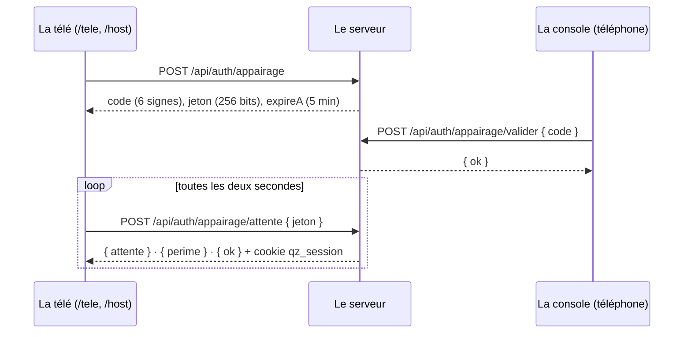

# La sécurité

> Pour un développeur : qui peut faire quoi, et comment le serveur le vérifie — les deux identités, les sessions, les mots de passe et le code de secours, les limites d'essais, les gardes de l'API, la télé branchée, le cloisonnement des espaces, ce qui ne quitte jamais le serveur, les en-têtes, les erreurs.

**Dans cette page** : [Les identités](#deux-identités--le-compte-et-le-profil) · [Les sessions](#les-sessions) · [Les mots de passe](#les-mots-de-passe-et-le-code-de-secours) · [Les limites d'essais](#les-limites-dessais) · [Les gardes de l'API](#les-gardes-de-lapi) · [La télé branchée](#la-télé-branchée) · [Le cloisonnement](#le-cloisonnement-des-espaces) · [Le temps réel](#le-temps-réel-et-les-inscriptions) · [Ce qui ne quitte jamais le serveur](#ce-qui-ne-quitte-jamais-le-serveur) · [Les en-têtes](#les-en-têtes-http) · [Les erreurs](#les-erreurs-neutres) · [Les textes et l'export](#les-textes-les-photos-et-lexport)

## Deux identités : le compte et le profil

L'invité anonyme n'a aucune identité au serveur : un prénom, un avatar, et le jeton de sa fiche de soirée sur son téléphone. Jouer ne passe par aucune route d'authentification, et rien de ce qui suit ne lui est demandé.

| | Le compte | Le profil |
|---|---|---|
| Ce qu'il est | un **espace** : ses quiz, sa soirée, son historique, ses réglages | une **personne** : son prénom, son avatar, sa progression |
| Table, magasin | `accounts`, `AuthStore` (`server/src/auth/store.ts`) | `profiles`, `ProfileStore` (`server/src/auth/profiles.ts`) |
| Cookie | `qz_session` — la console | `qz_joueur` |
| Ce qu'il ouvre | l'écran commun, la bibliothèque, les réglages, l'historique de l'espace | sa progression partout ; la console de l'espace qu'il tient |

L'`id` d'un compte est le `space_id` de tout ce qui appartient à l'espace. Le rôle `admin` n'appartient qu'au compte que le serveur crée à son premier démarrage, sur une base sans compte (`ensureDefaultSpace`) ; tout autre compte est `host`.

Un espace naît de deux façons :

- **Le salon d'un profil** : au premier `POST /api/joueur/espace` (ou `/api/joueur/salon`), sans rien demander (`creerEspaceDuProfil`). Identifiant `p-` et dix signes, adresse `s-` et six signes, tirés dans un alphabet sans lettres qu'on confond ; aucun mot de passe : son profil est sa porte (`estUnSalon`). Cinq créations d'un coup par adresse, puis une toutes les six minutes.
- **Le compte d'avant** : un identifiant, un mot de passe, une adresse choisie — celui de l'administrateur, et ceux créés avant les salons. Hors celui de l'administrateur, il reçoit son mot de passe par un lien d'activation (plus bas).

`accounts.profile_id` dit quel profil tient l'espace : un profil en tient au plus un, un espace n'a qu'un titulaire, vérifié en mémoire puis en base dans la même écriture (`linkProfile`). Se connecter à son profil ouvre alors la console de cet espace (`ouvrirConsole`). L'animateur rattache son profil depuis « Compte » (`POST /api/space/profil`) en prouvant les deux identités : sa console, et le mot de passe du profil — son identifiant aussi, sauf si ce profil est déjà ouvert dans ce navigateur. Remplacer ou détacher le profil d'un espace demande une preuve fraîche, le mot de passe du profil rattaché ou celui du compte (`prouver`, `server/src/auth/routes.ts`) : le téléphone prêté, console ouverte par le cookie du profil, rattachait sinon l'emprunteur, qui gardait la console. L'administrateur, seul, rattache sans preuve un espace sans titulaire (`POST /api/admin/espaces/:id/titulaire`, `server/src/profilsAdmin.ts`).

> [!IMPORTANT]
> **Invariant 16 — une personne, deux tables, et `accounts.id` ne bouge jamais.** Ne fusionne pas `accounts` et `profiles` : l'identifiant d'un compte est la clé de partition de vingt-trois tables (plus bas) et de toutes les archives.

« Compte » ne montre du profil rattaché que ce qu'il faut à la page — identifiant, prénom, avatar, finition, Éclats, légendaire, niveau (`ProfilDeLEspace`, `shared/profil.ts`) : toute session de l'espace le lit, la télé branchée chez un tiers comprise, et le profil complet portait le récit de ses Divins.

## Les sessions

| | La console | La télé branchée | Le profil |
|---|---|---|---|
| Cookie | `qz_session` | `qz_session` | `qz_joueur` |
| Durée du cookie | 30 jours, posée à l'ouverture | 30 jours, posée à l'ouverture | un an, posée à l'ouverture |
| Échéance en base | 30 jours, glisse à chaque usage (écrite au plus une fois l'heure) | 24 heures au plus : `fin_max` borne le glissement | un an, glisse (écrite au plus une fois par semaine) |
| Retient | le profil qui l'a ouverte, ou rien (le mot de passe du compte) | le profil de la console qui l'a validée | — |

- Les cookies sont `httpOnly`, `SameSite=Lax`, `Secure` en ligne, `Path=/` (`server/src/auth/http.ts`) ; seule une valeur de la forme `^[A-Za-z0-9_-]{20,128}$` atteint la base. Deux cookies distincts : un animateur pilote sa soirée et y joue dans le même navigateur.
- Un jeton fait 32 octets aléatoires ; la base n'en garde que l'empreinte SHA-256 (`auth_sessions.id`, `profile_sessions.id`) : une base qui fuit ne livre aucune session utilisable.
- Toutes les sessions vivent en mémoire, et `resolveSession` est synchrone — la poignée de main du temps réel la lit. Mais la base s'écrit d'abord, la mémoire suit : dans l'autre ordre, une écriture refusée laissait le changement valoir jusqu'au redémarrage, et une révocation refusée ressuscitait au réveil. Le démarrage efface les sessions expirées et les liens d'activation servis ou périmés.
- Une session d'un compte désactivé ne vaut plus rien.

Ce qui ferme des sessions :

| Geste | Ce qui tombe |
|---|---|
| Se déconnecter de la console (`POST /api/auth/logout`) | cette session |
| Se déconnecter de son profil | sa session de joueur, et la console de ce navigateur si **ce** profil l'a ouverte — jamais une console ouverte au mot de passe du compte, l'écran commun de la soirée |
| Mot de passe du compte changé, lien d'activation servi | toutes les sessions du compte ; une neuve s'ouvre pour qui a fait le geste |
| Mot de passe du profil changé, code de secours servi | ses sessions de joueur et toutes les consoles qu'il a ouvertes ; une neuve s'ouvre ici |
| Profil détaché ou remplacé | les consoles de l'ancien profil sur cet espace, sauf celle d'où vient le geste |
| Espace désactivé | toutes ses sessions |
| Profil suspendu ou supprimé | ses sessions de joueur et ses consoles |

Chaque session de console révoquée coupe les écrans qu'elle avait ouverts (`onRevoke`) : leur connexion temps réel tombe.

## Les mots de passe et le code de secours

- **Le hachage** : scrypt (natif à Node) — N = 32768, r = 8, p = 1, une clé de 64 octets, un sel de 16, la saisie normalisée NFKC (`server/src/auth/password.ts`). Le haché se décrit lui-même (`scrypt$N$r$p$sel$clé`) : durcir les paramètres ne casse aucun mot de passe existant. Le calcul part dans le pool de threads de Node, et une connexion ne fige jamais une partie. La vérification compare en temps constant ; un haché illisible vaut faux.
- **Un identifiant inconnu** se vérifie contre un haché factice (`dummyHash`) : il coûte le même temps qu'un mot de passe faux, et la connexion ne dit pas si un compte existe.
- **Un mot de passe choisi** fait de 8 à 200 caractères (`MIN_PASSWORD`, `MAX_PASSWORD`) — sauf celui d'amorçage de l'administrateur, `demo` en local, que le serveur refuse en ligne sur une base vide.
- **La session s'ouvre sur le haché vérifié** : un changement de mot de passe parti pendant le calcul de scrypt referme la session à peine ouverte (401).
- **Changer de mot de passe exige l'actuel** — ou, pour un profil, son code de secours : une session restée ouverte sur un téléphone prêté ne suffit pas.

**Le code de secours** est la seule porte de retour d'un profil : ni adresse e-mail, ni lien de réinitialisation, ni mot de passe provisoire. Seize signes en quatre groupes (`XXXX-XXXX-XXXX-XXXX`), dans un alphabet sans I, L, O ni U, comparés sans tirets ni casse, gardés hachés. Il n'existe en clair qu'au moment où on le donne : à l'inscription, à chaque usage — qui en rend un neuf, atomiquement, sinon deux onglets montraient deux codes neufs dont un mort —, et quand l'administrateur en tire un pour un joueur (`Cache-Control: no-store`, jamais au journal du QG). Il rouvre aussi la console de l'espace que le profil tient : sans autre porte de retour, un animateur qui l'a perdu la veille de sa fête ne doit pas réveiller l'administrateur.

**Le lien d'activation** donne son mot de passe à un compte d'avant : un jeton de 32 octets, porté dans le fragment de l'adresse (`/activer#t=…`, retiré de la barre dès qu'il est lu), gardé en empreinte ; sept jours (`ACTIVATION_MS`), une seule fois — consommé en une requête, deux navigateurs ne s'en servent pas deux fois —, et en tirer un neuf annule les précédents. Un lien servi ou périmé ne dit plus le compte qu'il ouvrait. Servi, il pose le mot de passe et ferme toutes les sessions du compte. Pas de lien pour un compte désactivé.

## Les limites d'essais

Toutes les portes qui ouvrent une console partagent **une seule réserve par serveur** (`LoginBudget`, obtenue par `loginBudgetOf(app)`, `server/src/auth/http.ts`) : avec une réserve par routeur, qui alternait les portes avait deux fois plus d'essais. Elle est rangée par application, parce que les tests font tourner plusieurs serveurs dans un même processus.

- **Par adresse** : 20 essais d'un coup, puis 20 par minute (un seau à jetons, `server/src/core/budget.ts`), sans exemption pour l'adresse locale.
- **Par secret visé** : 5 échecs (`ECHECS_AVANT_VERROU`) le ferment un quart d'heure, d'où que viennent les essais.
- **L'essai en vol** : un essai accepté compte comme un échec jusqu'à son jugement — `failed`, `succeeded`, ou `abandon` pour une saisie refusée avant le hachage —, 30 secondes au plus (`EN_VOL_MS`). Lu avant scrypt et compté après, le verrou laissait passer vingt essais partis ensemble.
- L'identifiant est normalisé (minuscules, 32 caractères) avant de former la clé : allongé d'une lettre, il ne rouvre pas cinq essais.
- Refus : 429, « Trop d'essais — réessaie dans un quart d'heure ». Tout vit en mémoire : un redémarrage oublie.

| Clé | Les portes qui la partagent |
|---|---|
| `compte:<identifiant>` | `POST /api/auth/login`, `POST /api/auth/password`, la preuve d'un changement de titulaire |
| `joueur:<identifiant>` | `POST /api/joueur/connexion`, `POST /api/space/profil`, `POST /api/joueur/mot-de-passe` par l'actuel, la preuve par le profil rattaché |
| `secours:<identifiant>` | `POST /api/joueur/secours`, `POST /api/joueur/mot-de-passe` par le code |
| `appairage:<session>` | `POST /api/auth/appairage/valider` — chaque console son verrou |
| l'adresse seule | `POST /api/auth/activation`, `POST /api/auth/activate`, `POST /api/auth/appairage` : un jeton de 256 bits ne se devine pas, et un verrou n'y ajouterait qu'une impasse |

Un verrou par secret : quand tout se comptait sous la clé du mot de passe, le code gagnait cinq essais en changeant de porte, et cinq codes faux fermaient la connexion à qui tapait le bon mot de passe. Au QG, la fiche d'un joueur dit jusqu'à quand sa connexion est fermée, et « Lever le verrou de connexion » rouvre ses deux clés (`rouvrir`) sans toucher la réserve de l'adresse.

D'autres réserves, par adresse :

| Réserve | Valeur | Où |
|---|---|---|
| Inscriptions de profils | 10 d'un coup, puis 5 par minute ; l'adresse locale exemptée | `server/src/auth/profileRoutes.ts` |
| Salons créés | 5 d'un coup, puis 1 toutes les 6 minutes ; l'adresse locale exemptée | `server/src/auth/profileRoutes.ts` |
| Inscriptions d'invités | 60 d'un coup puis 60 par minute par adresse **et par espace**, 300 puis 300 par minute par adresse ; l'adresse locale exemptée | `server/src/core/inscriptions.ts` |
| Télés en attente d'un code | 500 sur le serveur | `server/src/auth/appairage.ts` |
| Présentations d'écran refusées | 5 coupent la connexion temps réel | `server/src/sockets.ts` |

En ligne, l'adresse lue est la dernière de `x-forwarded-for`, celle qu'écrit le proxy de l'hébergeur (`trust proxy` à un saut).

## Les gardes de l'API

`mountApi` (`server/src/api.ts`) pose les gardes dans cet ordre :

1. `csrfGuard` sur tout `/api`.
2. Sur `/api/admin`, d'un bloc : `requireAccount`, `requireAdmin`, `refuserLesTeles` — puis `journaliser`, qui note au journal du QG chaque geste accepté.
3. Les routes publiques — connexion, activation, télé, profil, quiz du jour, campagne, porte de la réserve à jeton —, chacune avec son petit lecteur de JSON (de 1 à 8 Ko ; 256 Ko pour les dépôts de la réserve, 512 Ko pour ceux de la base de la campagne).
4. `requireAccount` sur tout le reste de `/api`, puis le lecteur de JSON de 4 Mo — les photos arrivent en dataURL : ces 4 Mo ne se lisent qu'une session vérifiée.
5. La bibliothèque, les partages, l'administration du quiz du jour et de la campagne, les profils, le QG.

| Garde | Refus |
|---|---|
| `csrfGuard` — toute écriture (hors `GET`, `HEAD`, `OPTIONS`) porte `X-Requested-With: quizz`, qu'un formulaire ou une page tierce ne peut pas poser sans une pré-vérification que le serveur ne répond jamais ; en ligne, une requête qui dit son `Origin` doit venir de l'origine publique (`PUBLIC_URL`, sinon `RENDER_EXTERNAL_URL`) | 403 « Requête refusée » |
| `requireAccount` — une session de console valide (cookie `qz_session`) ; pose `Cache-Control: no-store` | 401 « Connexion requise » |
| `requireAdmin` — le rôle `admin` | 403 « Réservé à l'administrateur » |
| `refuserLesTeles` — pas une session à `fin_max` : ni l'administration, ni rattacher ou détacher un profil, ni brancher une autre télé | 403 « Pas depuis une télé branchée : fais-le depuis ta console » |

Le client pose l'en-tête maison sur chaque requête (`client/src/api.ts`). Une route de compte lit l'espace dans la session (`accountOf(res).id`), jamais dans le corps ni dans l'adresse. Après une connexion, `?next=` ne ramène qu'à une page de l'application (`pageDeRetour`, `shared/securite.ts`) : l'adresse est résolue comme le navigateur la résoudra — une contre-oblique, une tabulation, un caractère de contrôle emmenaient ailleurs — et seule l'origine obtenue décide.

Deux tests lisent la liste des routes dans le routeur d'Express : `server/test/admin-seulement.test.ts` exige de toute route sous `/api/admin` (ou derrière `requireAdmin`) un 403 pour un animateur ordinaire et pour la télé branchée de l'administrateur ; `server/test/journal.test.ts` exige de chaque route qui écrit sa phrase au journal. Une route d'administration de plus y entre d'elle-même : la marche à suivre est dans [Les recettes](../contribuer/recettes.md).

## La télé branchée

Une télé s'ouvre sans rien taper à la télécommande : elle affiche un code court, le téléphone de l'animateur le valide (`server/src/auth/appairage.ts`).



- Le code : six signes sans 0, O, 1, I ni L, tapés sans espace ni casse, valables cinq minutes (`APPAIRAGE_MS`), à usage unique, validés seulement depuis une console ouverte — jamais depuis une télé. Le deviner ne rapporte que le droit de donner **sa** session à un inconnu.
- La session ne se récupère qu'avec le jeton de 256 bits que la télé seule connaît : le code montré à la salle n'y suffit pas. `/attente` n'a pas de réserve — la télé demande toutes les deux secondes, et compter ses demandes fermerait la porte de l'animateur sur le même wifi.
- « Périmé » se dit dans une réponse, jamais dans une erreur : la télé ne jette son code que sur `perime`, et garde son jeton sur toute panne du réseau. Périmé aussi si la console qui a validé s'est fermée entre-temps, ou si l'espace est désactivé.
- La session de la télé dure 24 heures au plus, sans glisser au-delà (`TELE_BRANCHEE_MS`, `fin_max`) : c'est souvent la télé de quelqu'un d'autre. Elle retient le profil de la console qui l'a validée, et tombe avec lui. Un écran de salle ne fait aucun geste qui relirait sa session : sa connexion tombe à l'heure dite, par un minuteur posé à `host:hello`.
- Les codes en attente vivent en mémoire, cinq cents au plus (429 « Trop de télés en attente — réessaie dans quelques minutes » : un 503 se lirait « le serveur redémarre »).

## Le cloisonnement des espaces

> [!IMPORTANT]
> **Invariant 3 — ce qui appartient à un espace est cloisonné par `space_id`.** Un identifiant qui n'est pas du sien vaut « introuvable », et le voisin n'en sait rien.

**Ce qui porte `space_id`** — vingt-trois tables :

- dans la base permanente : `quizzes`, `quiz_images`, `programmes`, `partages`, `catalogue`, `salons`, `soirees`, les sept tables du miroir (`party_players`, `party_teams`, `party_bonus`, `party_answers`, `party_scores`, `party_sessions`, `party_soiree`), `profile_xp` et `profile_badges` (rangées par soirée, donc par l'espace où elle s'est jouée) ;
- dans la base locale : `players`, `teams`, `team_bonus`, `answer_log`, `score_entries`, `sessions`, `soiree`.

L'espace lui-même est la ligne de `accounts` ; ses sessions (`auth_sessions`) et ses liens d'activation (`activations`) le désignent par `account_id`.

**Ce qui n'en a pas** : ce qui appartient à une personne et la suit d'un espace à l'autre — `profiles` et les autres tables `profile_*`, le quiz du jour et son rappel (`jour_*`), la campagne, les sentiers et les duels (`campagne_*`, `sentier_acquis`) — et ce qui appartient au serveur : `meta`, le journal et la santé du QG (`qg_gestes`, `qg_sante`, `qg_demarrages`). La liste complète : [La base de données](../reference/base-de-donnees.md).

Comment il tient :

- Une route de compte lit l'espace dans la session, jamais dans une charge utile ; une page publique, dans son adresse (`/<espace>/…`). Les magasins filtrent par `space_id` à la requête même.
- Une connexion temps réel s'attache à un espace une fois pour toutes (`bindSpace`, `server/src/sockets.ts`) : présentée à la soirée A, elle ne lira jamais la soirée B. L'écran d'un animateur se présente par la session de sa poignée de main, jamais par la page.
- Un espace désactivé ne se trouve plus : `party:watch` et `player:join` ne l'atteignent pas, son `entree.json` répond 404 ; ses pages publiques restent lisibles.

Les exceptions, voulues : le souvenir, le bilan et l'historique d'une soirée se lisent par leur lien, sans session ; une photo, par son adresse (`/media/image/<uuid>` : l'UUID est la permission). Et l'administrateur voit tous les espaces — les chiffres de leurs soirées, rien de leur contenu —, clôt une soirée laissée en plan, renomme, désactive ou supprime un espace, et en rattache un sans titulaire à un profil, ses quiz recopiés.

## Le temps réel et les inscriptions

- En ligne, le serveur temps réel refuse une page d'une autre origine que l'origine publique (`allowRequest`, `server/src/server.ts`) ; une connexion sans en-tête `Origin` — un script, un test — passe.
- `host:hello` présente l'écran par le cookie de la poignée de main ; cinq refus coupent la connexion (`HELLO_MAX_FAILURES`). Chaque geste d'écran relit la session (`requireHost`) : éteinte, la connexion tombe au premier geste.
- `player:join` : trois identités au plus par connexion (`JOINS_PER_SOCKET`) ; le prénom se vérifie avant de puiser dans la réserve d'inscriptions (« Il faut un prénom ! ») ; au-delà de la réserve, « Trop d'inscriptions d'un coup — réessaie dans une minute ». La réserve se compte par adresse **et par espace** : commune au serveur, la vague d'une salle fermait la porte à la salle voisine derrière la même box ; une seconde réserve, cinq fois plus large, borne une adresse sur tout le serveur. Sa mesure, remise à zéro à chaque clôture, ne garde des adresses qu'une empreinte salée.
- Le plafond d'une soirée est le plus petit de son réglage (2 à 500) et de `MAX_PLAYERS` : « La soirée est complète — préviens l'animateur, qui peut libérer des places ».
- Tout message d'un client passe par `ecouter()` : une charge absente ou malformée, un accusé manquant ne font jamais tomber le serveur (invariant 7). Le détail : [Le temps réel](./temps-reel.md).

## Ce qui ne quitte jamais le serveur

- **La partie** (invariant 1) : les clients reçoivent `playerView` et `hostView`, jamais l'état brut. La bonne réponse, l'anecdote, la photo de la révélation, les bonnes réponses de « plusieurs » et le bon ordre n'arrivent qu'à la révélation ; la note de l'animateur, l'extrait d'un blind test et le programme de la soirée ne partent jamais aux téléphones des invités.
- **Les Divins** (invariant 21) : leurs règles et leurs légendes vivent dans `server/src/core/divins.ts`, que ni `shared/` ni `client/` n'importent (`server/test/divins.test.ts`). Le serveur n'envoie que la liste des Divins descendus, et le récit à son seul porteur.
- **Les soirées des autres** : le QG n'en reçoit que des chiffres (`SoireeDuQg`, `shared/qg.ts`) — ni quiz, ni question, ni prénom d'invité, ni titre ; `server/test/qg.test.ts` et `server/test/qg-soirees.test.ts` relisent les réponses entières.
- **Les secrets** : des jetons de session et d'activation, la base ne garde que l'empreinte ; des mots de passe et des codes de secours, le haché ; un code tiré au QG ne va jamais au journal des gestes.

## Les en-têtes HTTP

Chaque réponse d'Express porte `X-Content-Type-Options: nosniff`, `Referrer-Policy: same-origin`, et une `Permissions-Policy` qui coupe caméra, micro, position et paiement ; Express ne s'annonce pas (`x-powered-by` désactivé). La politique de contenu se construit à chaque requête (`contentPolicy`, `server/src/server.ts`) :

```
default-src 'self'; script-src 'self'; style-src 'self' 'unsafe-inline';
img-src 'self' data: blob:; connect-src 'self' ws://<hôte> wss://<hôte>;
manifest-src 'self'; object-src 'none'; base-uri 'self'; form-action 'self';
frame-ancestors 'none'
```

Le temps réel ne parle qu'à l'hôte que la page a demandé, repris de l'en-tête `Host` — l'écran en `localhost`, les téléphones sur l'adresse du wifi, l'hébergeur en https : `ws: wss:` l'ouvrait à tous, et un script injecté aurait envoyé la soirée ailleurs. `Host` vient du client : il n'entre dans la politique que s'il a la forme d'un hôte, sinon `connect-src` se réduit à `'self'`. `frame-ancestors 'none'` interdit à toute page tierce d'encadrer l'application. L'analyseur des paramètres d'URL est celui de Node (`query parser` réglé à `simple`) : la bibliothèque `qs` n'est jamais appelée.

## Les erreurs neutres

Une panne ne se raconte qu'au journal du serveur (`server/src/core/http.ts`) :

- Une erreur faite pour être lue se lève avec un `Error` nu, sans `code` (`erreurMontrable`) : la route répond son message en **400** — un 404 ou un 409 se répond à la main.
- Toute autre — `LibsqlError`, `TypeError`, une erreur système à `code` — devient « Erreur serveur — réessaie dans un instant » : un 500 dans une route (`repondreErreur`, que `wrap` appelle pour toute promesse rejetée), un toast à l'écran commun (`messagePourEcran`). Son détail part au journal du serveur, et elle compte aux « Erreurs serveur » du QG.
- Une requête illisible reçoit du JSON (`erreurDeRequete`) : « Requête illisible — recharge la page et réessaie », « Envoi trop lourd — allège-le et réessaie » — jamais la page d'Express, pile d'appels et chemins du serveur compris.

## Les textes, les photos et l'export

- Prénoms, avatars et textes se nettoient et se bornent au serveur (`cleanName`, `cleanAvatar`, `shared/avatars.ts`) et se coupent avec `tronquer()`, entre deux caractères, jamais au milieu d'un emoji.
- Un identifiant suit `^[a-z0-9._-]{2,32}$` ; une adresse d'espace `^[a-z0-9-]{2,24}$`, ni un mot réservé (`RESERVED_SLUGS`), ni six chiffres, réservés aux codes de salon (`shared/space.ts`).
- Une photo arrive en dataURL, JPEG, PNG ou WebP, 2 Mo au plus, vérifiée par le serveur (`server/src/core/quizStore.ts`).
- Dans l'export CSV, une cellule qui commencerait comme une formule — `=`, `+`, `-`, `@`, une tabulation, un retour chariot — prend une apostrophe devant (`server/src/core/export.ts`).

## Les tests qui la gardent

| Fichier | Ce qu'il garantit |
|---|---|
| `server/test/securite.test.ts` | la page de retour et ses pièges ; l'activation sans verrou ; une seule réserve pour toutes les portes, codes de télé compris ; un verrou par secret ; les erreurs neutres et les requêtes illisibles ; la politique de contenu et un `Host` piégé |
| `server/test/admin-seulement.test.ts` | toute route d'administration refuse l'animateur ordinaire et la télé branchée de l'administrateur |
| `server/test/emprunts.test.ts` | le téléphone prêté et la télé ne prennent pas l'espace ; les preuves fraîches ; ce que « Compte » montre du profil |
| `server/test/appairage.test.ts` | le code, son usage unique, son verrou par console ; « périmé » en réponse ; 24 heures sans glisser, et la connexion qui tombe à l'heure dite |
| `server/test/espaces.test.ts` | la réserve d'inscriptions par adresse et par espace, et sa mesure |
| `server/test/journal.test.ts` | chaque route d'administration qui écrit se note avec sa phrase, et un refus jamais |
| `server/test/fiche-joueur.test.ts` · `server/test/profils-admin.test.ts` | les gestes du QG sur un profil, le code de secours jamais relu, la suppression qui n'oublie aucune table |
| `server/test/divins.test.ts` | les règles des Divins ne quittent pas le serveur |

## Pour aller plus loin

- [Administrer](../guides/administrer.md) — le QG, côté administrateur
- [Le temps réel](./temps-reel.md) — la liaison, l'instantané, les vues filtrées
- [Les données](./donnees.md) — les deux bases, le miroir, les archives
- [La configuration](../reference/configuration.md) — `PUBLIC_URL`, `ADMIN_PASSWORD`, `QUIZ_DB_URL`
- [L'API HTTP](../reference/api-http.md) — chaque route, et qui peut l'appeler
