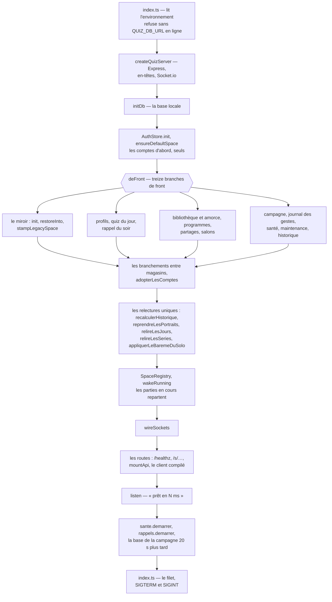
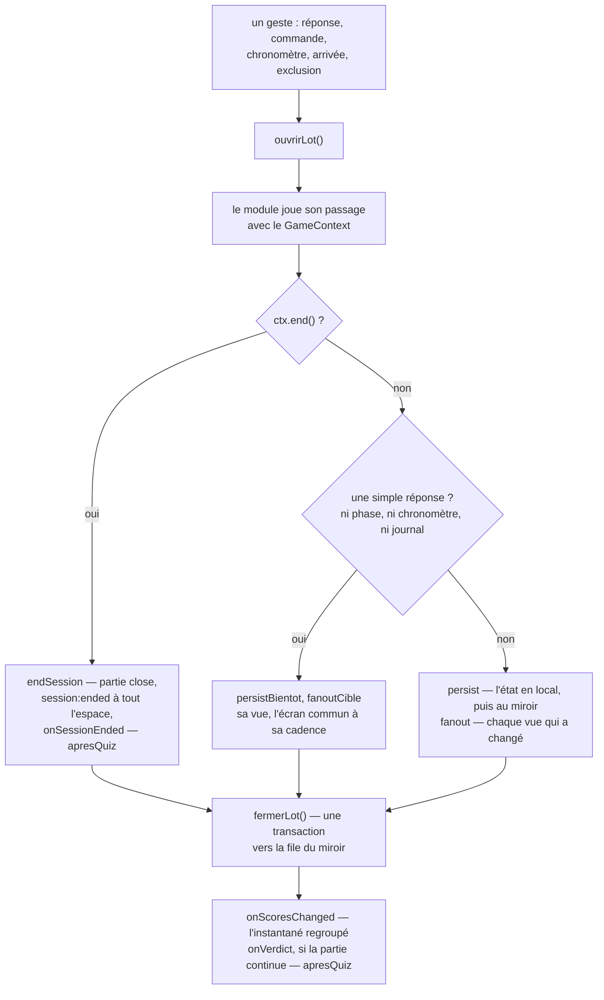

# Le serveur

> Le serveur de l'intérieur, pour qui va le modifier : démarrage et arrêt,
> registres et magasins, routes et erreurs, le moteur et son module de jeu, le
> Cabinet de curiosités et sa porte, les tâches de fond, le paquet.

**Dans cette page** : [Les fichiers d'entrée](#les-fichiers-dentrée) ·
[Le démarrage, pas à pas](#le-démarrage-pas-à-pas) ·
[L'arrêt](#larrêt) ·
[Les registres et les magasins](#les-registres-et-les-magasins) ·
[Les routes](#les-routes) ·
[Le moteur et le module de jeu](#le-moteur-et-le-module-de-jeu) ·
[Le Cabinet de curiosités](#le-cabinet-de-curiosités) ·
[Les tâches de fond](#les-tâches-de-fond) ·
[Le paquet](#le-paquet)

## Les fichiers d'entrée

| Fichier | Rôle |
|---|---|
| `server/src/index.ts` | Lit l'environnement, refuse les configurations dangereuses, lance `createQuizServer`, puis pose le filet et l'arrêt propre |
| `server/src/server.ts` | `createQuizServer` : Express, Socket.io, l'ordre du démarrage, `/healthz`, les pages publiques d'un espace, le client compilé, ce qui touche à tout (`removeAccount`, `supprimerProfil`) et l'arrêt (`close`) |
| `server/src/api.ts` | `mountApi` : l'ordre des gardes de `/api`, puis la bibliothèque |
| `server/src/sockets.ts` | `wireSockets` : le protocole temps réel, chaque message passé par `ecouter()` ; et `cloreLaSoiree`, que l'écran commun et le QG partagent |
| `server/src/racine.ts` | `SERVEUR`, le dossier `server/` d'où se compte tout chemin |

Express et Socket.io partagent un seul serveur HTTP, qui sert aussi le client
compilé : une seule chose à héberger.

## Le démarrage, pas à pas

1. **L'environnement** (`server/src/index.ts`). « En ligne » vaut `RENDER` non
   vide ou `NODE_ENV=production`. En ligne sans `QUIZ_DB_URL`, le serveur
   refuse de démarrer : sur un fichier local, comptes, quiz et archives
   disparaissaient au premier réveil. Chez soi, la base permanente est un
   fichier `quizzes.db` à côté de la base locale. Un `RESERVE_TOKEN` de moins
   de 32 caractères laisse fermée la porte de la routine
   ([la configuration](../reference/configuration.md)).
2. **Express et Socket.io.** Express perd `x-powered-by`, prend l'analyseur de
   requête simple (l'étendu repose sur `qs`, et ses failles de déni de
   service) et, en ligne, `trust proxy` à un saut ; puis viennent le minutage
   des routes, `compression()`, les en-têtes de sécurité. Socket.io bat toutes
   les 10 s et lâche après 8 — une liaison morte se voit en 18 s au lieu de
   45 — et refuse en ligne une origine autre que l'origine publique.
3. **La base locale** : `initDb` (`server/src/core/db.ts`) ouvre SQLite en WAL,
   crée les sept tables, ajoute les colonnes manquantes.
4. **Les comptes d'abord, seuls** : tout le reste est rangé par espace.
   `AuthStore.init()` crée ses tables, fait le ménage des sessions expirées et
   charge tout en mémoire ; `ensureDefaultSpace` crée l'administrateur ou
   relit l'espace par défaut. En ligne, sur une base sans compte, un
   `ADMIN_PASSWORD` absent ou laissé à `demo` arrête tout (`DemarrageRefuse`)
   — là seulement : exigé à chaque démarrage, il empêchait la production de se
   réveiller une fois la variable retirée.
5. **Les magasins se construisent**, chacun avec son client libSQL
   (`clientDistant`, `server/src/core/distante.ts`), qui abandonne une requête
   après 10 s : sans lui, on a mesuré 301 s d'attente, et tout gelait.
6. **Treize branches de front** (`deFront`) : le miroir (ses tables,
   `restoreInto` si la base locale est vide, `stampLegacySpace`), les profils,
   le quiz du jour et l'amorce de sa réserve, le rappel du soir, la
   bibliothèque et son amorce (`seedLibrary`), les programmes, les partages,
   les salons, la campagne — et, dans son premier lot, les trois tables du
   Cabinet de curiosités, sa colonne et son secret (`REVEIL_DU_CABINET`) : le
   Cabinet n'a pas d'`init` à lui —, le journal des gestes, la santé du serveur, la
   maintenance (le bandeau, les pages fermées du QG et leurs testeurs, `Maintenance`),
   l'historique. En série, chaque réveil attendait soixante allers-retours —
   trois secondes de page blanche ; et un échec ne remonte qu'une fois toutes
   les branches finies, pour que rien n'écrive plus après.
7. **Les branchements.** Le quiz du jour et la campagne reçoivent les profils
   à leur construction, le Cabinet la porte de la campagne
   (`campagne.porte()`) et les profils, et la campagne les crochets du
   Cabinet — ses paliers (`statsEnPlus`, là seulement où il s'ouvre),
   l'expédition qui part ou finit (`expeditionChange`) ; ce qui ne relie les magasins qu'à la lecture se
   branche une fois tous ouverts, par des fonctions —
   `profiles.statsDuJour = id => jour.statsDuJour(id)`, le laurier, les paliers
   des sentiers, les confettis de la campagne… Puis `adopterLesComptes` donne
   une fois son profil à chaque compte d'animateur d'avant.
8. **Les relectures uniques**, chacune sous sa version ou son drapeau :
   `recalculerHistorique` (sans les soirées en cours, lues dans la table locale
   `soiree`), `reprendreLesPortraits`, `jour.relireLesJours`,
   `campagne.relireLesSeries`, `appliquerLeBaremeDuSolo`. Une base qui hoquette
   ici fait échouer le démarrage, que l'hébergeur relance : le recalcul ne
   remet jamais au barème du jour les lignes d'une archive que la base n'a
   pas rendue.
9. **La salle** : le QR du wifi (`WIFI_SSID`, `WIFI_PASS`), `SpaceRegistry`,
   puis `wakeRunning()`, qui réveille chaque espace dont une partie était
   `running` dans `sessions` — son moteur réarme ses chronomètres. Les autres
   attendent leur première connexion ou leur première page.
10. **Le temps réel** (`ReserveDInscriptions`, `wireSockets`), puis **les
    routes**, dans l'ordre décrit plus bas.
11. **L'écoute** : le port s'ouvre, le journal dit
    `[serveur] prêt en N ms — au plus M invités par soirée`. Ensuite seulement
    — un réveil n'attend pas un aller-retour de plus — `sante.demarrer` écrit
    ce démarrage, la base de la campagne se lit en fond 20 s plus tard, et le
    rappel du soir regarde l'heure chaque minute.
12. **Le filet** (`server/src/index.ts`) : une promesse rejetée sans personne
    pour l'attendre ou une exception échappée partent au journal, et le serveur
    continue — tomber, c'était éteindre les soirées de tous les espaces pour un
    incident qui n'en touchait qu'une. Avant ce point, un démarrage raté
    s'arrête net (code 1), sur une ligne qui dit quoi faire.

## L'arrêt

`SIGTERM` ou `SIGINT` appelle `close()` une seule fois ; un minuteur force la
sortie 12 s après le signal. L'ordre :

1. le filet de l'instantané et le préchauffage de la campagne s'arrêtent ;
2. `sante.arreter()` écrit tout de suite l'extinction propre — l'hébergeur
   coupe net trente secondes après avoir prévenu ;
3. le rappel du soir et la mesure de charge s'arrêtent ;
4. `registry.stopAll()` : chaque moteur éteint ses chronomètres (leurs
   échéances restent écrites), écrit la réponse en attente et pousse son
   dernier état au miroir ;
5. `io.close()`, puis la file du miroir se vide — 10 s au plus, le reste est
   abandonné et dit au journal ;
6. la base locale se ferme, puis les magasins, les profils en dernier.

Un chronomètre qui sonnerait après la fermeture révélerait sur une base
fermée ; une resynchronisation en attente relit la base locale ; un crédit
d'expérience parti avec le dernier quiz garde le plus long sursis. En ligne, la
commande lance `node` lui-même (`exec node`) : par `npm start`, le signal se
perdait.

## Les registres et les magasins

Les **registres** tiennent la soirée en cours d'un espace : base locale,
recopiée au miroir. Les **magasins** tiennent ce qui doit survivre, dans la
base permanente. Ce qui ne vit qu'en mémoire part à chaque redémarrage.

| Nom | Fichier | Rôle | Base(s) |
|---|---|---|---|
| `SpaceRegistry` · `SpaceRuntime` | `server/src/core/space.ts` | Une soirée par espace, créée à la demande : registres, moteur, diffusions, scène, nom de la soirée, crédits, clôture | mémoire ; la table locale `soiree`, l'historique et les crédits |
| `Party` | `server/src/core/party.ts` | Les invités : jetons, profil, connexions, homonymes | locale (`players`), miroir |
| `Teams` | `server/src/core/teams.ts` | Les équipes et leurs prix | locale (`teams`, `team_bonus`), miroir |
| `ScoreLedger` | `server/src/core/scores.ts` | Le journal des gains, en ajout seul | locale (`score_entries`), miroir |
| `AnswerLog` | `server/src/core/answers.ts` | Une ligne par invité et par question posée | locale (`answer_log`), miroir |
| `GameEngine` | `server/src/core/engine.ts` | Une partie à la fois : route, persiste, rediffuse | locale (`sessions`), miroir |
| `PartyBackup` | `server/src/core/backup.ts` | Le miroir : files, lots, resynchronisation, restauration, santé | permanente (`party_*`) |
| `AuthStore` | `server/src/auth/store.ts` | Comptes (les espaces), sessions d'animateur, activations | permanente, tout en mémoire |
| `ProfileStore` | `server/src/auth/profiles.ts` | Profils, sessions, expérience, étagère, Éclats, achats | permanente (`profiles`, `profile_*`) |
| `QuizStore` | `server/src/core/quizStore.ts` | La bibliothèque et ses photos | permanente (`quizzes`, `quiz_images`, `meta`) |
| `ProgrammeStore` | `server/src/core/programmes.ts` | Le programme d'une soirée | permanente (`programmes`) |
| `PartageStore` | `server/src/core/partages.ts` | Les codes de partage, le catalogue | permanente (`partages`, `catalogue`) |
| `SalonStore` | `server/src/core/salons.ts` | Le code à six chiffres d'un salon | permanente (`salons`), mémoire |
| `ArchiveStore` | `server/src/core/archive.ts` | L'historique des soirées | permanente (`soirees`) |
| `JourStore` · `RappelStore` | `server/src/core/jour.ts`, `server/src/core/rappels.ts` | Le quiz du jour ; le rappel du soir | permanente (`jour_*`) |
| `CampagneStore` | `server/src/core/campagne.ts` | Campagne, défi, sentiers, parcours, duels, amis, expédition | permanente (`campagne_*`, `sentier_acquis`, `sentier_melanges`) ; ses questions dans `server/content/campagne/` |
| `CabinetStore` | `server/src/core/cabinet/magasin.ts` | Le Cabinet de curiosités : les musées et les parties en cours, par la porte de la campagne ([plus bas](#le-cabinet-de-curiosités)) | permanente (`cabinet_*`, ses parties dans `campagne_series`), mémoire ; son contenu neuf dans `server/content/cabinet/` |
| `JournalDesGestes` · `SanteDuServeur` | `server/src/core/journalDesGestes.ts`, `server/src/core/santeDuServeur.ts` | Le journal du QG ; la santé du serveur sur sept jours, et chaque erreur serveur en détail (`server/src/core/erreurs.ts`) | permanente (`qg_*`) |
| `PagesPubliques` | `server/src/core/pages.ts` | Souvenir et bilan calculés une fois, gardés compressés | mémoire |
| `PlacesRendues` · `ReserveDInscriptions` · `Appairages` | `server/src/core/places.ts`, `server/src/core/inscriptions.ts`, `server/src/auth/appairage.ts` | Codes « Rendre sa place », réserve d'inscriptions, branchement des télés | mémoire |

- **La base d'abord, la mémoire ensuite** (`AuthStore`, `ProfileStore`) :
  dans l'autre ordre, une écriture refusée valait jusqu'au redémarrage, et une
  révocation refusée ressuscitait.
- **Une colonne venue après coup** passe par `ajouterColonne` dans la base
  permanente, qui lit le schéma une fois par table au lieu de prendre tout
  refus pour « elle existe déjà » (`addColumn` dans la locale).
- **Un registre écrit en local, puis au miroir**, ses seules lignes ; un gain
  ou une réponse reçoit son `uid` à l'écriture locale. Le détail :
  [Les données](./donnees.md), [les tables](../reference/base-de-donnees.md).

## Les routes

### Qui déclare quoi

| Fichier | Les familles de routes | Monté par |
|---|---|---|
| `server/src/server.ts` | `/healthz` ; `/s/:slug/…`, les pages publiques d'un espace ; les anciennes adresses (302) ; `/media/quiz` ; `/robots.txt` ; le client compilé | `createQuizServer` |
| `server/src/auth/routes.ts` | `/api/auth/*`, `/api/space/*`, `/api/admin/accounts*` | `mountAuthApi` |
| `server/src/auth/appairage.ts` | `/api/auth/appairage*` | `mountAppairage` |
| `server/src/auth/profileRoutes.ts` | `/api/joueur/*` | `mountProfileApi` |
| `server/src/quizDuJour.ts` | `/api/jour/*`, dont la réserve de la routine ; `/api/admin/jour/*` | `mountJour`, `mountReserve`, `mountJourAdmin` |
| `server/src/campagne.ts` | `/api/campagne/*`, `/api/duels/*`, dont la base de la routine ; `/api/admin/campagne*` | `mountCampagne`, `mountBaseDeLaCampagne`, `mountCampagneAdmin` |
| `server/src/expedition.ts` | `/api/expedition*` | `mountExpedition` |
| `server/src/cabinet.ts` | `/api/cabinet*` | `mountCabinet` |
| `server/src/partages.ts` | `/api/partages/*`, `/api/catalogue*`, `/api/admin/catalogue*`, le partage d'un quiz | `mountPartages` |
| `server/src/profilsAdmin.ts` | `/api/admin/profils*`, `/api/admin/espaces*` | `mountProfilsAdmin` |
| `server/src/qg.ts` | `/api/admin/qg*`, `/api/admin/activite`, `/api/admin/soirees*`, `/api/admin/serveur`, `/api/admin/gestes` | `mountQg` |
| `server/src/api.ts` | `/api/quizzes*`, `/api/images`, `/media/image/:id`, `/api/modeles*`, `/api/programmes*`, `/api/quiz-tout-pret*`, `/api/soirees/:id` | `mountApi` |

Chaque route, sa méthode et son accès : [l'API HTTP](../reference/api-http.md).

### Les gardes, dans l'ordre

1. Le minutage des routes d'API, sous leur modèle, jamais leur adresse ;
   `compression()` ; `nosniff`, `Referrer-Policy`, `Permissions-Policy`, et
   une politique de contenu qui n'ouvre le temps réel qu'à l'hôte demandé.
2. `/healthz`, les pages publiques `/s/:slug/…` (un espace inconnu : 404
   « Soirée introuvable »), les anciennes adresses.
3. Sous `/api` :
   1. `csrfGuard` : toute écriture porte `X-Requested-With: quizz` et, en
      ligne, ne dit pas d'autre origine que la publique — sinon 403
      « Requête refusée » ;
   2. `/api/admin` gardé d'un bloc (`requireAccount`, `requireAdmin`,
      `refuserLesTeles`), puis `journaliser`, qui note au journal du QG chaque
      geste accepté — posé route par route, un garde retiré ne faisait rougir
      aucune épreuve ;
   3. les routes hors de la porte commune, derrière les pages fermées du QG
      (`fermerLesPortes` : une page en maintenance, ou bientôt disponible,
      ferme les routes qui y commencent quelque chose — `PORTES_DES_PAGES`,
      `server/src/maintenance.ts`) — comptes, appairage, profil du joueur,
      quiz du jour, campagne et duels, l'Expédition, le Cabinet de curiosités,
      missions et soins, dépôts de la routine (derrière `RESERVE_TOKEN`) —,
      chacune avec ses gardes et un petit lecteur JSON ;
   4. `requireAccount` sur tout le reste : 401 « Connexion requise », vérifié
      **avant** de lire le corps — sinon n'importe qui faisait analyser quatre
      mégaoctets de JSON ;
   5. le lecteur JSON de 4 Mo (les photos arrivent en dataURL) — jamais pour
      une lecture (`GET`, `HEAD`), qui n'a pas de corps —, puis les routes
      réservées aux animateurs et à l'administrateur.
4. `/media/quiz` ; puis toute adresse inconnue sous `/api`, `/media` ou `/s` :
   404 en JSON, jamais la page d'accueil.
5. `/robots.txt` et le client compilé : `/assets` déjà compressé, les dossiers
   d'images peintes, un fichier absent en 404 ; toute autre adresse passe par
   `servirPage`, qui pose statut, aperçus, préchargements et attente
   ([Le client](./client.md)).
6. `erreurDeRequete`, le dernier filet.

### Comment une erreur devient une réponse

Tout passe par `server/src/core/http.ts`. Une route asynchrone s'enveloppe dans
`wrap` (Express 4 n'attrape pas les rejets de promesse), et `repondreErreur`
tranche par `erreurMontrable` :

| L'erreur | La réponse | Le journal |
|---|---|---|
| un `Error` nu, sans `code` : `new Error('Cet identifiant est déjà pris')` | 400, son message | rien |
| toute autre : `LibsqlError`, `TypeError`, `ENOENT`… | 500, « Erreur serveur — réessaie dans un instant » | le détail, et une erreur au relevé de l'heure |
| un JSON cassé | 400, « Requête illisible — recharge la page et réessaie » | une ligne : sa sorte (`entity.parse.failed`…) et les en-têtes qui annonçaient le corps — jamais le corps |
| un corps trop lourd | 413, « Envoi trop lourd — allège-le et réessaie » | la même ligne |
| un fichier du paquet que le téléphone laisse en route — il change de page, perd le réseau : `ECONNABORTED`, que `servirPrecompresse` tait | aucune : plus personne pour la lire | rien, et rien au relevé de l'heure |

La règle tient à la classe : un message fait pour l'invité se lève par un
`new Error('…')` nu, en français, et dit quoi faire ; le reste parle de tables
et de colonnes — rien qui aide un invité, tout ce qui renseigne un curieux.
L'écran commun suit la même règle dans ses toasts (`messagePourEcran`), et la
page d'erreur d'Express, pile comprise, ne sort jamais.

## Le moteur et le module de jeu

Chaque `SpaceRuntime` construit son `GameEngine` (`server/src/core/engine.ts`)
avec `quizModule` (`server/src/games/quiz.ts`), le seul module branché.
**Le moteur ne connaît aucune règle** : il route réponses, commandes et
chronomètres vers le module, persiste et rediffuse. **Le module ne connaît ni
base ni réseau** : il reçoit l'état et un contexte, et rend des vues.

### Le contrat d'un module

`GameModule`, dans `server/src/core/types.ts` :

| Crochet | Quand | Ce qu'il rend |
|---|---|---|
| `createInitialState` | au lancement, qui termine la partie d'avant | l'état neuf |
| `onLaunch` | juste après | rien : il agit par le contexte |
| `onPlayerAction` | une réponse d'invité | un motif de refus (`ActionRefusal`), ou rien si elle est retenue |
| `onHostCommand`, `onTimer` | un geste d'animateur, un chronomètre | rien |
| `onPlayerJoin`, `onPlayerLeave` | un retardataire (`joinLate`), un exclu | rien |
| `reponseEnSuspens` | avant de rendre une place par code | vrai si une réponse attend son verdict |
| `playerView`, `hostView` | à chaque diffusion | la vue d'un invité, celle des écrans d'animateur |
| `vueDependDesAutres` | une promesse | `false` : une réponse ne change que la vue de son auteur et celle de l'écran commun |

Le **`GameContext`** est la seule façon d'agir : `award`, `logAnswers` (une
ligne par participant, réponse ou non), `dropAnswers`, `setTimer`,
`clearTimer`, `end`, `verdict` (le podium est à l'écran : l'expérience peut se
créditer), et de quoi lire. Le **`ViewContext`** des vues ne fait que lire ;
son `memo` calcule une fois par diffusion ce qui ne dépend pas du destinataire,
un classement, un podium — chaque vue retriait la salle, une demi-minute de
processeur par question à cinq cents invités.

### Un passage : `run()`

- **Un lot par passage** : gains, réponses et état partent ensemble, sans quoi
  un processus tué entre deux envois faisait révéler deux fois la même
  question au réveil.
- **L'état** (`sessions.state`, avec la copie exacte du quiz joué) s'écrit en
  local avec les échéances des chronomètres. Une simple réponse attend la fin
  du tour de boucle — deux cents réponses lues d'un coup réécrivaient deux
  cents fois l'état — et ne part au miroir qu'au plus toutes les 2 s
  (`MIRROR_INTERVAL_MS`) ; tout le reste part sur-le-champ.
- **Les vues** ne partent que si elles ont changé, et l'écran commun reçoit la
  sienne quatre fois par seconde au plus pendant une question
  (`HOST_INTERVAL_MS`).
- **Un chronomètre** sonne hors de toute requête : une exception s'arrête au
  journal sans emporter le processus.
- **Un verdict ou une fin de partie** lance `apresQuiz` : la soirée se range
  dans l'historique, l'expérience du quiz se crédite.

### Ce que fait `quizModule`

Ses phases (`pickPack`, `getReady`, `intertitre`, `observe`, `question`,
`cible`, `reveal`, `finished`) et ses chronomètres (`ready`, `intertitre`,
`observe`, `question`, `settle`, `autoNext`) s'écrivent avec la partie. Il garde trois
mémoires par espace, relues après chaque écriture : la bibliothèque jouable
(`setQuizLibrary`), le programme de ce soir (`setProgramme`), la dernière pose
de chaque question (`setQuestionsPosees`) ; deux relectures revenaient de
Turso dans le désordre, et seule la dernière demandée pose désormais ce
qu'elle a lu (`derniereRelecture`). Une partie joue sa propre copie du quiz,
tirée une fois. Son barème des QCM sert aussi le quiz du jour
(`server/src/core/jour.ts` importe `pointsDuChoix`, `GRACE_MS`…) : y toucher
change les deux. → [Les questions](../produit/les-questions.md),
[Le temps réel](./temps-reel.md)

## Le Cabinet de curiosités

Le Cabinet ([le produit](../produit/le-cabinet.md)) se joue seul, avec son
profil, sans temps réel : des routes HTTP, un magasin, et des règles pures,
toutes dans `shared/cabinet/` — un module par jeu, le pli d'une partie, le
musée, la vue. Le serveur ne juge rien lui-même : il relit, tire, écrit, et
choisit ce que la page voit. En construction, il répond partout sauf en
production (`cabinetOuvert`, `shared/cabinet/ouverture.ts`).

| Pièce | Fichier | Rôle |
|---|---|---|
| Les routes | `server/src/cabinet.ts` | `mountCabinet` : la page, commencer, un geste, « Mes réponses », un cadrage du Détail, le cartel d'une œuvre, tes murs, l'achat, la dorure, l'échange — pour un profil, par sa session ; fermé, 404, et la page servie le dit d'avance (`<meta name="cabinet" content="ferme">`, `fermerLeCabinet`, `server/src/core/page.ts`) |
| Le magasin | `server/src/core/cabinet/magasin.ts` | `CabinetStore` : les musées (`MUSEES_GARDES`, 500) et les parties en cours (`PARTIES_GARDEES`, 200) en mémoire, le plus anciennement servi oublié d'abord ; tout geste sous le verrou du profil, celui de la campagne ; la partie d'un jour d'avant close à la première page qui la trouve |
| Les tables, le lot froid | `server/src/core/cabinet/tables.ts` | le schéma (`REVEIL_DU_CABINET`), le musée d'un profil d'un seul lot (`lecturesDuMusee`), une partie par sa clé (`lecturesDeLaPartie`), les morceaux de SQL que les gardes partagent |
| Les écritures | `server/src/core/cabinet/ecriture.ts` | un lot par requête, gardé par la base : le départ, un geste et ce qu'il tranche, l'achat, la dorure, l'échange d'un jeu de la visite, l'oubli d'un profil |
| Les tireurs | `server/src/core/cabinet/tirages/` | un par jeu (`TIREURS`, `tirerLePlan`) : les trois manches et leurs rechanges, réponses comprises, tirées au départ ; ce que la base leur donne, préparé en fond (`preparerLesTas`) |
| Le contenu neuf | `server/src/core/cabinet/contenu.ts` | les lieux, les fiches, les répliques, les frises à thème de `server/content/cabinet/`, lus une fois par processus et jugés par ses juges (`trier`), une seule copie, que `server/scripts/cabinet-contenu.ts` importe pour juger un lot avant de le ranger |
| La vue | `server/src/core/cabinet/vue.ts` | ce que la page reçoit, champ par champ (invariant 1) : la page, une partie, le cartel, tes murs, le bouton de l'accueil |
| Les gardiens | `server/src/core/cabinet/gardiens.ts` | ce que le musée doit, comparé à l'étagère du profil : ce qui manque se range (`reconcilier`), sous une clé fixe |
| La porte | `server/src/core/porteDeLaCampagne.ts` | le seul passage vers `CampagneStore` |

**La porte de la campagne.** Le magasin de la campagne fait près de onze
mille lignes, et ses pièges se paient sans un bruit — une réponse écrite sans
prévenir l'expédition en route, sans se numéroter pour le journal, sans
créditer son expérience. Le Cabinet ne l'importe donc pas : il reçoit
`campagne.porte()` (`PorteDeLaCampagne`) — le client de la base, l'heure de
la campagne, le verrou du profil, les questions jouables et leur mesure, le
journal des réponses rattrapé au bout d'un lot (`lireAvecLeJournal`), le
secret du Cabinet, et le rituel d'une réponse en une fonction
(`ecrireDesReponses`) : l'expédition prévenue, le lot — à la fin d'une
partie qui a une juste, les lectures de l'expérience au bout, le journal
compris —, la réponse numérotée, puis, si le lot a écrit la fin de la partie
(`FinDUnePartie.ecrite`, lu sur la ligne de son geste), l'expérience
créditée une fois, les gardiens (`avantLesPaliers`), les paliers de la
campagne, le compagnon. Un geste qui ne tranche aucune pièce et ne finit
rien — ouvrir une manche, Éclairer, une pause, un essai sans verdict —
n'écrit aucune réponse : son lot part seul, par le client de la porte. La
campagne ne connaît du Cabinet que trois crochets, déclarés dans le même fichier : ce qu'il
ajoute à son réveil, à ses paliers (les traversées gagnées que L'Explorateur
compte, lues dans le lot de `statsDe`) et l'expédition qui part ou finit, en
mémoire ; et la porte lui offre de juger ces paliers hors d'une fin de partie,
au choix du légendaire qui gagne une traversée (`accorderLesPaliers`). `server/test/porte-de-la-campagne.test.ts` compte ce que chaque étape
coûte.

**Les lots gardés.** Deux onglets, ou deux serveurs pendant une mise en ligne,
chacun sa mémoire : la base seule dit qui a gagné. Un geste s'insère à son
rang, toujours en tête de son lot, avec un `uid` tiré pour ce lot (`INSERT …
ON CONFLICT DO NOTHING`) ; chaque autre instruction ne s'écrit que si ce
geste-là est en base (`gesteEcrit`). Le départ ne pose une partie que si le
profil n'en a aucune et a encore son droit du jour, recompté dans
l'instruction même ; une dépense relit le solde dans la sienne, et refuse
tant qu'une partie attend. Rien d'écrit — une garde qui n'a rien pris : le
musée et la partie s'oublient, la base se relit à froid, et le geste se
rejoue une fois sur l'état vrai — la vue d'à présent, ou le refus en mots.
Une erreur de la base : la mémoire s'oublie aussi, mais l'erreur remonte — un
500, « Erreur serveur — réessaie dans un instant » —, sans second essai au
serveur. La réponse partie d'elle-même à l'échéance, la page la renvoie
jusqu'à passer ; un geste touché, le joueur le refait : au même rang, il passe
une fois (`server/test/cabinet-charge.test.ts`). Jamais un `UPDATE` ni un
`DELETE` de `campagne_reponses` : les déclencheurs des tranches du journal
les effaceraient toutes, et le réveil suivant relirait toute la base.

**La mémoire et le lot froid.** Chaude, la page ne coûte rien ; froide, un
lot — cent cinquante lignes au pire, le journal des réponses rattrapé au
bout. Un geste coûte un aller-retour, son verdict compris ; la fin, son lot et
le rituel de la porte ; un achat, une dorure, un échange, un chacun. Les
parties du jour se lisent par l'index du profil et de la date (`partiesDuJour`,
`+mode = 'cabinet'`), et `server/test/cabinet-index.test.ts` lit le plan de
chaque instruction. Le gros bouton de l'accueil ne dit le musée que si le
serveur l'a en mémoire (`CabinetStore.accueil`) : pas un aller-retour de plus à
l'accueil.

**Le tirage.** Tout se tire au départ, par le tirage à la pièce de la campagne
(`server/src/core/tirageALaPiece.ts` : sept jours sans redite, la marche de
chaque jeu et celles que l'enjeu y ajoute) et le hasard du serveur, jamais
d'une graine que la page connaît. Ce que la base donne à chaque jeu — ses QCM,
ses mots, ses valeurs, ses tableaux, ses frises — se prépare une fois par liste
de questions jouables, une tranche par tour de boucle (`preparerLesTas`,
`rendreLaMain`), en fond derrière chaque page du Cabinet
(`CabinetStore.prechauffer`) ; un départ qui trouve une liste neuve l'attend
plutôt que de passer vingt-cinq mille questions au crible sur son chemin.

**L'heure.** Jamais `Date.now()` dans `shared/cabinet/` ni
`server/src/core/cabinet/` (`server/test/cabinet-chronos.test.ts`) : l'heure
est celle de la campagne, que le banc règle. Un départ en a deux : l'arrivée de
la requête dit le jour et la date de la partie ; l'ouverture de la première
manche se prend une fois le plan tiré, juste avant le lot — sans quoi la
question arrivait le chrono entamé. Seul le plafond des départs
(`DEPARTS_PAR_HEURE`) compte au temps de la machine : ce n'est pas une
échéance.

**Ce que `server/src/server.ts` branche** : son ouverture, calculée une fois
(l'option `cabinet` du serveur, que les tests posent) ; son préchauffage
derrière `/api/cabinet` ; son oubli d'un profil **avant** celui de la campagne
(`supprimerProfil` : ses gestes se trouvent par les séries du profil, que la
campagne efface) ; la balise du Cabinet fermé dans la page servie. Ses routes
passent derrière `fermerLesPortes` : le QG peut fermer le départ, l'achat, la
dorure et l'échange (`PORTES_DES_PAGES.cabinet`), et une partie commencée se
finit. Le détail des tables : [Les données](./donnees.md#le-cabinet-de-curiosités) ;
les pièges du code : `.claude/rules/cabinet.md`.

## Les tâches de fond

| Tâche | Où | Rythme | Ce qu'elle fait |
|---|---|---|---|
| Les chronomètres d'une partie | `GameEngine` | à l'échéance | échéances écrites avec la partie, réarmées au redémarrage |
| Les fenêtres d'une partie | `GameEngine` | 250 ms ; 2 s | la vue de l'écran commun pendant une question ; le va-et-vient recopié au miroir |
| L'instantané | `SpaceRuntime.broadcastSnapshot` | 120 ms (+ 2 ms par invité aux téléphones) | une diffusion par fenêtre, dédoublonnée |
| Le filet de l'instantané | `server/src/server.ts` | 5 min | renvoie tout, dédoublonnage ignoré : un client qui a manqué une diffusion se répare |
| La file du miroir | `PartyBackup` | en continu | réessais de 250 ms à 15 s ; « en retard » à l'écran après 10 s ; resynchronisation au rétablissement |
| La mesure de charge | `Charge` (`server/src/core/pouls.ts`) | 10 s | processeur, boucle (sonde à 100 ms), mémoire, invités connectés |
| La santé du serveur | `SanteDuServeur` | 10 min (`RELEVE_MS`) | le relevé de l'heure et un signe de vie, gardés huit jours |
| Le rappel du soir | `RappelStore` | chaque minute | la tournée part dès 18 h, jamais à partir de 22 h |
| La base de la campagne | `CampagneStore.prechauffer` | une fois : dès qu'un profil ouvre son accueil, l'expédition ou le Cabinet, sinon 20 s après l'ouverture | vérifiée au build et relue telle quelle par le paquet, par morceaux de 64 Ko (`lireLaBasePreparee`) — sous tsx, relue et vérifiée par tranches de 200 questions ; chaque tranche rend la main ; puis ses index, les sujets de chaque question, par tranches de mille, les familles de la mesure, la préparation des tirages (`preparerEnFond`) et le modèle du savoir, chaque étape à son tour de boucle (`rendreLaMain`, plus bas) : la première ouverture de la campagne et le premier tirage les trouvent faits |
| Les tas du Cabinet | `CabinetStore.prechauffer`, `preparerLesTas` | derrière chaque page du Cabinet, quand la liste des questions jouables a changé — la réserve du jour, un retrait, une base relue | ce que chaque jeu peut poser de la base — les QCM du Pari et de l'Éclair, les mots du Mot mystère, les valeurs du Filet —, une tranche de questions par tour de boucle, le verdict de chaque crible gardé par question : une liste neuve des mêmes questions ne coûte qu'un filtre ; puis l'Éclair à ses marches, une catégorie par tour ; puis ce que le disque donne — les tableaux du Détail, le contenu neuf —, chacun son tour |
| Le journal des réponses | `JournalDesReponses` (`server/src/core/journalDesReponses.ts`) | une fois au réveil, puis à chaque lecture qui en a besoin | toutes les réponses de campagne lues une fois, par tranches de deux mille, chacune à son tour de boucle — ses tranches gardées d'abord (`campagne_tranches`, une ligne chacune), puis la base pour ce qui les suit ; ensuite, seulement celles arrivées depuis le plus grand `rowid` lu, dans le lot de la requête qui en a besoin, et chaque fois qu'il a lu deux mille réponses de plus, une tranche de plus, écrite en fond par la base elle-même. Il tient ce que les requêtes d'avant relisaient de toute l'histoire à chaque page : la mesure, le modèle du savoir, l'expérience, ce que chacun a vu, ses premières réponses, ses écussons, ses missions, son carnet, ses compagnons, ses confettis, les épreuves des sentiers au QG |
| Le journal des duels | `JournalDesDuels` (`server/src/core/journalDesDuels.ts`) | une fois au réveil, puis à chaque lecture qui en a besoin ; tout, trois minutes après la première lecture (`DUELS_RELUS_APRES_LE_DEMARRAGE_MS`), puis chaque heure (`JOURNAL_DES_DUELS_RELU_MS`) | les duels classés de tous lus une fois ; ensuite, par leur clé, ce qu'une réponse vient de finir (dans son lot), les duels qui ferment et ce qui a peut-être bougé sans être rangé (`duelsARelire`), et par différence les séries écrites ailleurs, trente secondes plus tard au pire (`FRAICHEUR_DES_DUELS_MS`). Les cotes, les ligues, les bordures et le classement s'en dérivent |
| La mesure des difficultés | `CampagneStore.mesures` | dès ses deux dernières minutes (`MESURE_EN_AVANCE_MS`), au plus une tentative toutes les deux (`MESURE_RETENTEE_MS`) | la suivante relue en fond — du journal des réponses, rattrapé d'un aller-retour —, puis ses familles et la préparation des tirages (`relireLaMesureEnFond`), chacune à son tour de boucle ; qui la demande pendant ce temps reçoit celle qu'il y a, même périmée : seule la première, au réveil, s'attend |
| La réserve du jour pour `/healthz` | `server/src/server.ts` | 10 min au plus | relue en arrière-plan ; `/healthz` répond avec ce qu'il a |
| La fin d'une télé branchée | `server/src/sockets.ts` | à l'heure dite | sa connexion tombe, même sans un geste |

**Une étape de fond par tour de boucle** (`rendreLaMain`,
`server/src/core/tourniquet.ts`). Les calculs de fond de la campagne rendent
la main entre leurs étapes, mais plusieurs qui attendent la même chose — la
base au réveil, une mesure neuve — repartaient ensemble, dans la même phase
de la boucle : les index de la base, ses familles, la préparation des tirages
et la série de référence faisaient un seul bloc de 130 ms, 1,3 s de serveur
figé au dixième de cœur de l'hébergeur. Le tourniquet n'en laisse repartir
qu'une par tour, dans l'ordre où elles l'ont demandé : les requêtes arrivées
entre deux sont lues, et le plus long gel n'est plus que la plus longue étape
— vingt à trente millisecondes : les index de la base, ou la première
préparation d'un tirage (`travail-de-fond.test.ts`).

**Rien ne tourne la nuit** : l'hébergeur gratuit dort. La journée d'hier du
quiz du jour se clôt à la première demande d'aujourd'hui (`clorePasses`), les
semaines passées du défi à la première demande qui suit, une partie du
Cabinet laissée la veille à la première page qui la trouve, et le modèle du
savoir — qu'Automate lit pour les duels, et la page des sentiers pour dire
à chacun sa chance — se réajuste quand il a vieilli, à la demande de l'un ou
de l'autre (`MODELE_GARDE_MS`). Un service externe garde la production éveillée en
journée en appelant `/healthz`, qui répond toujours 200 : un échec ferait
redémarrer l'instance, disque et file du miroir perdus
([Exploiter](../exploitation/exploiter.md)).

## Le paquet

| | Commande | Ce qu'elle lance |
|---|---|---|
| Construire | `npm run build` | `vite build`, puis `server/scripts/empaqueter.ts` : esbuild, de `server/src/index.ts` à `server/dist/index.mjs`, ESM, Node 20, `shared/` compris |
| Démarrer en ligne | `cd server && exec node --single-threaded-gc --no-memory-reducer --max-old-space-size=320 dist/index.mjs` (`render.yaml`) | le paquet, sans tsx, le ramasse-miettes réglé pour le dixième de cœur |
| Démarrer chez soi | `npm start` | `tsx src/index.ts` : les sources, pas le paquet |

- **Pourquoi** : chaque réveil de l'offre gratuite est un démarrage, et tsx y
  traduisait tout le TypeScript — 0,8 à 1 s de processeur et 40 Mo de plus sur
  un dixième de cœur, quelques secondes de page blanche au premier invité.
- **Les dépendances restent dans `node_modules`** (`packages: 'external'`),
  binaires de better-sqlite3 et de libSQL compris.
- **`SERVEUR`** (`server/src/racine.ts`) est le dossier `server/`, d'où se
  comptent les quiz livrés (`server/content/quiz/`), la base de la campagne,
  la base locale par défaut et le client compilé (`client/dist/`). Le paquet
  vit un étage sous `server/`, comme `server/src/index.ts` : un chemin compté
  depuis l'`import.meta.url` d'un module y menait hors du dépôt — ni amorce,
  ni modèles, ni réserve du jour, et pas une erreur.
  `server/test/exploitation.test.ts` démarre un vrai paquet.

## Pour aller plus loin

- [La vue d'ensemble](./vue-d-ensemble.md) · [Le temps réel](./temps-reel.md) ·
  [Les données](./donnees.md) · [La sécurité](./securite.md)
- [L'API HTTP](../reference/api-http.md) ·
  [Les événements](../reference/evenements-temps-reel.md)
- [Exploiter](../exploitation/exploiter.md) — `/healthz`, le dépannage
- [Démarrer](../contribuer/demarrer.md) — `npm run dev`, une modification
