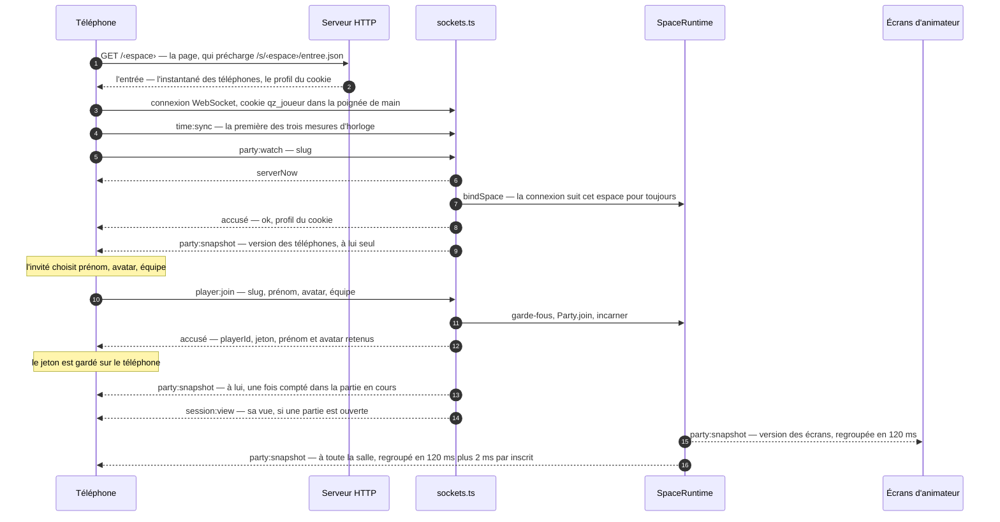
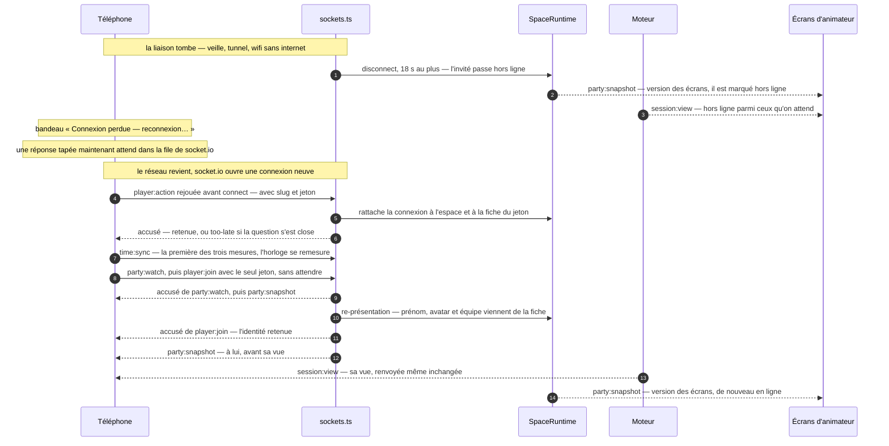
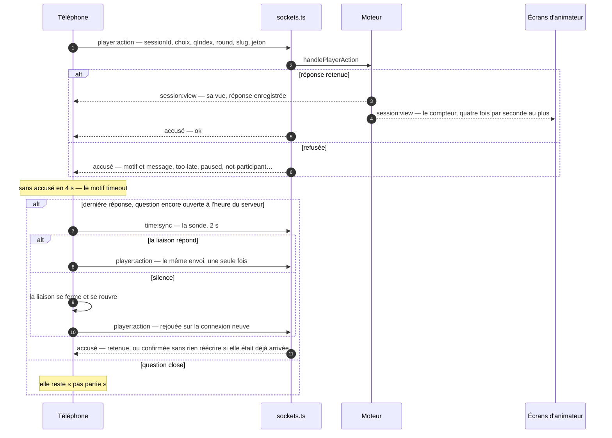

# Le temps réel

> La liaison Socket.io entre le serveur et les écrans d'une soirée — téléphones des invités, écran commun, télécommande, télé branchée, barre du chef : comment une connexion vit, comment chaque message est relu et accusé, ce que reçoivent les écrans (l'instantané, les vues), à quelle heure se lisent les chronomètres, et comment une identité traverse les coupures. Pour un développeur ; chaque message, un par un, est dans [la référence des événements](../reference/evenements-temps-reel.md).

**Dans cette page** : [Ce qui circule](#ce-qui-circule) · [La vie d'une connexion](#la-vie-dune-connexion) · [Les messages et leurs accusés](#les-messages-et-leurs-accusés) · [Répondre](#répondre) · [L'instantané](#linstantané) · [Les vues](#les-vues) · [Les gestes qui disent ce qu'ils visent](#les-gestes-qui-disent-ce-quils-visent) · [L'horloge](#lhorloge) · [L'identité d'un invité](#lidentité-dun-invité) · [La barre du chef](#la-barre-du-chef) · [La scène et la télécommande](#la-scène-et-la-télécommande) · [Les limites](#les-limites) · [Ce qui ne vit qu'en mémoire](#ce-qui-ne-vit-quen-mémoire)

## Ce qui circule

Seuls les téléphones des invités (`client/src/views/PlayerApp.tsx`) et les écrans d'animateur — l'écran commun et la télé branchée (`client/src/views/HostApp.tsx`), la télécommande, la barre du chef — ouvrent une liaison ; toutes les autres pages parlent en HTTP. Socket.io partage le serveur HTTP d'Express (`server/src/server.ts`). Le contrat, typé des deux côtés, est dans `shared/events.ts` ; ses gestionnaires dans `wireSockets` (`server/src/sockets.ts`).

Le serveur décide de tout. Les clients lui envoient des **gestes** — une inscription, une réponse, « Révéler » — et reçoivent deux sortes de choses :

| Ce qui part | Message | À qui | Quand |
|---|---|---|---|
| **L'instantané** : la salle — invités, équipes, prix, partie en cours, code du salon | `party:snapshot` | en deux versions, aux téléphones et aux écrans d'animateur | quand la salle change, regroupé |
| **Les vues** : la partie, calculée pour chacun | `session:view` | chaque participant, sa vue ; les écrans, la vue d'animateur | à chaque passage du moteur, si elle a changé |
| Les nouvelles d'une personne | `player:profil`, `player:gain`, `soiree:fin`, `toast` | un invité, ou la connexion qui a fait le geste | au crédit d'un quiz, à la clôture, en réponse à un geste |
| Les nouvelles de la soirée | `session:ended`, `soiree:progres`, `soiree:cloture`, `party:reset`, `player:removed` | l'espace, les écrans, les téléphones concernés | une partie qui finit, des niveaux gagnés, une clôture, une exclusion |

Tout passe par trois sortes de salles socket.io. Le serveur n'émet jamais à tout le monde : les espaces ne se voient pas (invariant 3).

| Salle | Qui y est | Ce qu'on y envoie |
|---|---|---|
| `space:<espace>` | toute connexion rattachée à l'espace : qui suit, qui joue, les écrans | l'instantané des téléphones (écrans exclus), `session:ended` |
| `hosts:<espace>` | les écrans d'animateur : console, télécommande, télé, liaison du chef | l'instantané des écrans, la vue d'animateur, l'annonce de clôture, les montées de niveau |
| `player:<invité>` | les connexions qui incarnent cet invité | sa vue, son profil, sa fin de soirée |

## La vie d'une connexion

### S'ouvrir

Chaque page tient **une** liaison (`client/src/socket.ts`), qu'elle ouvre elle-même (`autoConnect: false`). Elle tente le WebSocket d'abord, le long-polling en repli (`transports: ['websocket', 'polling']`) : la négociation par défaut ouvrait une liaison en long-polling puis la remplaçait, deux ou trois allers-retours de plus par téléphone au moment du scan. En ligne, le serveur n'accepte que les pages de son origine publique (`allowRequest`) ; chez soi, sans URL publique, tout passe — l'écran commun peut tourner en `localhost` pendant que les téléphones passent par l'adresse du wifi.

Le cookie de profil (`qz_joueur`) et la session d'animateur (`qz_session`) se lisent **dans la poignée de main**. Après une connexion à un profil, à la console ou le branchement d'une télé, la page referme donc sa liaison et la rouvre, pour que le serveur voie le nouveau cookie.

### Se présenter

Le serveur n'envoie rien à une connexion neuve : il ne sait pas encore quelle soirée elle suit. Elle le dit par son premier message qui nomme un espace (`party:watch`, `player:join`, `host:hello`…), et ne peut plus en changer : une connexion présentée à la soirée A ne lira jamais la soirée B (`bindSpace`).

- **Un téléphone**, à chaque `connect` : `party:watch` (l'espace, le profil du cookie, et l'instantané des téléphones à lui seul), puis, s'il porte un jeton, `player:join` avec ce seul jeton, **juste derrière et sans attendre la réponse** : la liaison garde l'ordre, et chaque réveil coûte un aller-retour de moins. Avant même la liaison, la page a préchargé son état de départ (`/s/<espace>/entree.json`, ce que `party:watch` dirait) : l'entrée paraît sans attendre la poignée de main du WebSocket ([Le client](client.md)).
- **Un écran d'animateur**, à chaque `connect` : `host:hello`. La session de sa poignée de main dit l'espace — jamais la page. En retour, l'annonce de clôture si elle est à l'écran, l'instantané des écrans, la vue d'animateur de la partie en cours ; puis le salon s'ouvre. La console redit aussitôt si elle se tient en télécommande : le serveur l'oublie avec la connexion précédente.

### Rester en vie : le battement de cœur et la sonde

Le serveur envoie un ping toutes les 10 secondes et attend la réponse 8 secondes (`pingInterval`, `pingTimeout`, `server/src/server.ts`) : une liaison morte se voit en 18 secondes au plus, des deux côtés. Les réglages par défaut, mesurés à 43,6 secondes, laissaient passer plus qu'une question entière, pendant laquelle un téléphone tombé du wifi ne voyait rien et l'écran commun le comptait encore.

Un téléphone qui sort de veille garde pourtant souvent une liaison morte que socket.io croit vivante — un wifi sans internet, le passage du wifi à la 4G. Le client la **sonde** (`verifierLiaison`, `client/src/socket.ts`) : il demande l'heure au serveur (`time:sync`) et, sans réponse en deux secondes, ferme la liaison et la rouvre. Il sonde au retour au premier plan, au retour du réseau, et chaque fois qu'un accusé tarde ; une sonde en cours sert à tous ceux qui l'attendent, au lieu de repartir dans la liaison qu'elle est en train de condamner.

### Tomber, revenir

Quand une connexion tombe, le serveur la retire de son invité (`Party.socketDisconnected`) ; l'invité passe **hors ligne** quand il ne lui en reste aucune — il peut en avoir plusieurs, onglets ou appareils. Seule la version des écrans de l'instantané change (`connected`), et la vue d'animateur se recalcule pour montrer qui, parmi ceux qu'on attend, est hors ligne. L'invité reste dans la partie, et attendu : seul l'animateur peut ne plus l'attendre.

Au retour, la connexion est neuve — un autre identifiant, sans espace ni identité. Le client remesure son horloge et se présente de nouveau ; le serveur lui renvoie sa vue, même inchangée, puisque son écran est peut-être vide (`resendViews`).

Ce que la page a émis pendant la coupure, socket.io le garde et le rejoue sur la connexion neuve **avant** l'événement `connect`, donc avant que la page se re-présente. Deux choses en découlent :

- une réponse porte l'espace et le jeton de l'invité (`slug`, `token`) : arrivée sur une connexion encore anonyme, elle s'y rattache seule ; sans eux, la réponse tapée pendant la coupure était jetée ;
- chaque geste d'animateur relit la session dans la poignée de main (`requireHost`) au lieu de compter sur un `host:hello` passé : un « Révéler » touché pendant un hoquet du wifi n'est plus perdu.

Une coupure décidée par le serveur — session révoquée, télé arrivée à la fin de sa session, présentations refusées — ne se reconnecte pas d'elle-même : la console revient à son formulaire (« Session fermée — reconnecte-toi »), la télé à son code.

## Les messages et leurs accusés

### Au serveur : `ecouter()`

Chaque message d'un client passe par `ecouter()` (`server/src/sockets.ts`, invariant 7). La charge devient toujours un objet, chaque champ se relit à son type, l'accusé est toujours une fonction — vide si le client n'en a pas donné —, et une exception, synchrone ou dans la promesse du gestionnaire, part au journal avec le nom de l'événement ; un client qui attend un accusé reçoit alors la réponse de panne prévue pour ce message. Socket.io appelle ses écouteurs hors de toute promesse, et le serveur n'a pas de filet global : un seul `player:action` sans charge, un `host:removeBonus` à `null` ou un `party:watch` sans fonction d'accusé (« ack is not a function ») arrêtaient le processus — et les soirées de tous les espaces avec.

Chaque geste `host:*` relit la session de la poignée de main (`requireHost`) : un téléphone, une connexion anonyme ou l'écran d'un autre espace ne font rien, et une session éteinte coupe l'écran à son premier geste. `server/test/garde-fous.test.ts` essaie chacun de ces gestes depuis un téléphone ; sa liste est imposée complète par le typecheck. Les refus sont écrits par le serveur et affichés tels quels : courts, en français, et ils disent quoi faire.

### Au client : qui attend quoi

| Fonction (`client/src/socket.ts`) | Messages | Attend | Sans accusé |
|---|---|---|---|
| `demander`, par `watchParty` et `helloHost` | `party:watch`, `host:hello` | une liaison et un réseau, puis émet une seule fois ; dix secondes en tout (`ACCUSE_TIMEOUT_MS`) | rejette, avec « Le serveur ne répond pas — vérifie ta connexion, puis réessaie » ou « Pas de réseau — vérifie ton Wi-Fi ou ta 4G, puis réessaie », et sonde la liaison |
| `demander`, par `joinAsPlayer`, `reprendrePlace`, `rendrePlace`, `setMyTeam` | `player:join`, `player:reprendre`, `host:rendrePlace`, `player:setTeam` | de même | résout un refus portant ce message |
| `horsLigneDuMemeNom` | `player:horsLigne` | de même | « personne » |
| `sendPlayerAction` | `player:action` | quatre secondes (`ACTION_TIMEOUT_MS`) | le motif `timeout` ; puis, si c'est la dernière réponse et que sa question est encore ouverte, une sonde et un renvoi |
| `envoyerCommande` | `host:command` | trois secondes (`COMMANDE_TIMEOUT_MS`) | une sonde, puis un renvoi |
| la barre du chef (`client/src/socketDuChef.ts`) | `host:command`, `host:launch`, `host:endSession`, `host:closeParty`, les équipes | n'attend pas | ne renvoie pas |

`demander` n'écrit que sur une liaison qui a une chance d'aboutir, et une seule fois : confié à une liaison coupée, le message partait au retour du réseau, après que l'invité avait réessayé, et l'inscrivait deux fois — « Camille » et « Camille (2) ». `watchParty` et `helloHost` rejettent au lieu de répondre `ok: false`, qui voudrait dire « cette adresse ne mène à rien » ou « pas de session » : un serveur muet n'a rien dit de tel.

Un renvoi est sans danger parce que chaque geste dit ce qu'il vise ([plus bas](#les-gestes-qui-disent-ce-quils-visent)) : arrivé deux fois, il ne joue qu'une. La barre du chef, elle, envoie ses gestes par sa seconde liaison sans attendre leur accusé ni les renvoyer : un geste parti dans une liaison morte ne repart pas, et la barre, qui lit la vue d'animateur, continue de montrer où en est la partie.

## Répondre

Une réponse porte la partie (`sessionId`), son contenu et la question qu'elle vise (`qIndex`, `round`), plus l'espace et le jeton de l'invité. Le moteur la confie au module de jeu, qui la juge (`GameEngine.handlePlayerAction`) ; sa vue repart, puis l'accusé — celle de l'écran commun, dans les 250 ms. Le chemin complet jusqu'aux journaux et au miroir est dans [la vue d'ensemble](vue-d-ensemble.md).

Sans accusé en quatre secondes, le téléphone ne conclut pas que la réponse est perdue, seulement qu'il n'en sait rien. Il dit « Ta réponse n'est pas encore partie — elle partira dès que le réseau revient » si socket.io se savait déconnecté (la réponse attend dans sa file), sinon « Ta réponse n'est pas partie — touche-la à nouveau ». Puis, si c'est sa dernière réponse et que la question est encore ouverte à l'heure du serveur, hors pause, il sonde la liaison et la renvoie une fois — seule la dernière a ce droit : renvoyer un premier choix après qu'on en a tapé un second écraserait le bon. Un accusé tardif qui contredit ce qu'on a affiché se dit après coup (« Ta réponse est bien arrivée »).

Le renvoi ne peut pas compter double : un envoi identique au précédent est confirmé sans rien réécrire, et une réponse qui vise une question passée reçoit `too-late` au lieu de s'inscrire sur la suivante.

## L'instantané

L'instantané (`PartySnapshot`, `shared/types.ts`) dit la salle : les invités et leur score de la soirée, les équipes et leurs points, les prix remis, la partie en cours et ses participants, l'adresse et le code pour entrer. Chaque champ est décrit dans [la référence](../reference/evenements-temps-reel.md#partysnapshot). Il est construit par `SpaceRuntime` (`server/src/core/space.ts`) et en part **deux versions** :

| Version | Salle | Ce qu'elle a de plus, ou de moins |
|---|---|---|
| Les téléphones (`pourLesTelephones`) | `space:<espace>`, écrans exclus | les invités **sans** `connected`, et pas de wifi |
| Les écrans d'animateur (`pourLesEcrans`) | `hosts:<espace>` | `connected` pour chaque invité, et ce que `enPlusPourLesEcrans` ajoute : le wifi, la santé du miroir, la scène, la télécommande, la fin en route |

Chaque veille d'écran basculait un `connected` et renvoyait la salle entière à chacun — à 300 invités, un gigaoctet pour une vague d'arrivées une par une. Aucun téléphone ne le lisait : l'entrée compte désormais les inscrits, et un invité hors ligne du même prénom se demande au serveur (`player:horsLigne`). Le mot de passe du wifi et la santé de la sauvegarde ne regardent que l'animateur.

**Dédoublonné.** Chaque version garde le dernier JSON qu'elle a envoyé et ne repart pas à l'identique (`lastSnapshot`, `lastEcrans`) : une veille de téléphone ne change que la version des écrans.

**Regroupé.** `broadcastSnapshot` attend avant d'envoyer, et ce qui change entre-temps part en un seul envoi : 120 ms pour les écrans, 120 ms plus 2 ms par inscrit pour les téléphones — une demi-seconde passé cent quatre-vingt-dix invités. Chaque envoi aux téléphones coûte à proportion de la salle, sa liste à chacun de ses téléphones, et une vague d'arrivées en faisait autant de diffusions ; les écrans restent à 120 ms parce que l'animateur y attend son quiz après « Lancer » — la console ne l'ouvre qu'avec la partie de l'instantané.

**Sur-le-champ, pour l'auteur du geste.** Celui qui se présente ou fait le geste n'attend pas le regroupement : `party:watch`, `player:join` et `player:reprendre` — une fois l'invité compté dans la partie en cours et avant sa première vue —, `player:setTeam` — avant l'accusé —, et `host:hello`, la version des écrans. À 500 invités, l'arrivant lisait sinon « tu entres à la prochaine question » une seconde durant, en pleine question.

**Sur-le-champ, pour tous.** `sendSnapshot()` envoie les deux versions sans attendre, et annule les envois regroupés qui attendaient : la scène, la télécommande, une fin de soirée en route, le code du salon qui change, la fin du programme d'un salon, l'annonce de clôture, la salle vidée à la fin d'une soirée. Quand le miroir passe en retard ou s'en remet, seule la version des écrans part.

**Le filet.** Toutes les cinq minutes, les deux versions de chaque espace en mémoire repartent, forcées, dédoublonnage ignoré (`server/src/server.ts`) : un client qui aurait manqué une diffusion se répare.

> [!IMPORTANT]
> N'y mets jamais un champ qui change à chaque tick : il partirait à toute la salle (invariant 4). Ce qui ne regarde que l'animateur va dans `enPlusPourLesEcrans` ; un champ rare y est absent quand il ne dit rien, pour que l'instantané dédoublonné n'en porte pas le poids. Et `sendSnapshot()` à chaque geste rendrait la salle bavarde : c'est `broadcastSnapshot()` qui regroupe.

## Les vues

Une partie ne part jamais telle qu'elle est (invariant 1). Le module de jeu (`server/src/games/quiz.ts`) calcule une vue par destinataire : `playerView` pour chaque participant, dans sa salle `player:<invité>`, et `hostView` pour les écrans d'animateur. La bonne réponse, l'anecdote, la photo de la révélation n'arrivent aux téléphones qu'à la révélation ; la note de l'animateur et le programme de la soirée ne leur arrivent jamais. Le moteur (`server/src/core/engine.ts`) les envoie par `session:view`.

- **Une vue ne repart que si elle a changé** pour son destinataire (`changed`) — sauf vers un téléphone qui revient, qui la reçoit toujours.
- **Une simple réponse ne recalcule que deux vues** : celle de son auteur et celle de l'écran commun ; et la vue d'animateur part au plus toutes les 250 ms pendant le va-et-vient des réponses (`HOST_INTERVAL_MS`), le dernier état partant toujours. Les connexions qui tombent et reviennent passent par la même fenêtre (`rafraichirAnimateur`) : une vague de reconnexions pendant une révélation ne recalcule pas la vue une fois par téléphone. Le détail du moteur : [Le serveur](serveur.md).
- **Les participants** d'une partie sont les invités connectés à son lancement, puis ceux qui arrivent (`joinLate`) — dont la connexion reçoit l'instantané qui les compte avant leur première vue.
- **Une partie qui se termine** l'annonce à tout l'espace (`session:ended`) : les téléphones reviennent à la salle d'attente.

## Les gestes qui disent ce qu'ils visent

Chaque geste qui fait avancer la partie dit ce que son auteur avait sous les yeux (invariant 12). Sans cela, un « Révéler » qui croisait la révélation automatique passait à la question suivante — la révélation sautait.

| Geste | Ce qu'il porte | Arrivé périmé |
|---|---|---|
| une réponse (`player:action`) | la question et le tour (`qIndex`, `round`) | refusée, `too-late` |
| `next`, `cancel`, `replay`, `cible` (`host:command`) | la phase, la question et le tour | ignoré en silence |
| `host:launch` | la partie qu'il remplace (`depuis`) | ignoré en silence |
| `host:scene` | l'écran que l'animateur quittait (`depuis`) | ignoré en silence |

`pause`, `resume`, `autoNext`, `selectPack` et `nePlusAttendre` ne se jugent pas sur leur visée. Un champ absent — une page d'avant — garde l'ancien comportement. À la console (`client/src/games/quiz/HostView.tsx`), la visée se fige au clic, même quand une boîte de confirmation fait attendre la commande : si la partie a avancé pendant que la boîte était ouverte, le serveur ne touche pas à la question suivante. Chaque geste de phase y est en plus ignoré dans la demi-seconde qui suit un changement de phase (`GARDE_APRES_PHASE_MS`, `shared/console.ts`) ; et un prix de la grille se remet avec l'identifiant de son geste (`client/src/remise.ts`) : un double clic ne le remet qu'une fois.

## L'horloge

Les échéances d'une partie sont des instants du serveur, et chaque écran les compare à l'heure du serveur, jamais à la sienne (invariant 6). L'horloge d'un téléphone dérive, certaines se règlent à la main : un appareil en retard de cinq secondes affichait du temps qui n'existait plus, et ses réponses arrivaient après la clôture de la question — toujours les mêmes personnes, à toutes les questions.

1. À chaque connexion, le client oublie sa mesure (`resetClock`, en gardant l'écart connu en attendant) et en prend trois, deux secondes au plus chacune (`syncClock`, `client/src/socket.ts`) : `time:sync` rend `Date.now()` du serveur.
2. Chaque mesure donne un écart : `serverTime + rtt/2 − receivedAt` (`clockOffset`, `shared/clock.ts`). L'erreur reste bornée par la moitié de l'aller-retour : on garde la mesure à l'aller-retour le plus court.
3. **Sauf saut** : deux mesures qui ne peuvent pas être vraies ensemble — leurs écarts diffèrent de plus que la demi-somme de leurs allers-retours, plus 500 ms (`JEU_D_HORLOGE_MS`) — disent que l'horloge du téléphone a sauté entre elles, recalée par le réseau ou à la main. La plus récente gagne, même plus lente (`bestSample`). Gardée pour sa vitesse, l'ancienne décalait tous les chronomètres du saut : au quiz du jour, un recalage de trente secondes fermait chaque question dès son affichage.
4. Tout chronomètre lit `serverNow()` (`client/src/clock.ts`) : la barre de temps, le décompte (`client/src/decompte.ts`), la régie, les codes de la télé et de « Rendre sa place », et le renvoi d'une réponse, qui ne part que si sa question est encore ouverte à cette heure-là.

Le quiz du jour, qui ne passe pas par la liaison, mesure la même horloge dans ses réponses HTTP (`mesureDeLaReponse`, `client/src/clock.ts`).

## L'identité d'un invité

Un invité est une **fiche** (`PlayerRec`, `server/src/core/party.ts`) : un identifiant, un prénom, un avatar, une équipe, un profil éventuel, et un **jeton** tiré à l'inscription, qui ne vaut que dans son espace. Le téléphone garde son identifiant et son jeton (`client/src/state.ts`) ; la base locale et le miroir gardent la fiche.

- **S'inscrire ou se re-présenter.** Un `player:join` sans jeton crée une fiche, après ses garde-fous — sauf pour un profil qui a déjà la sienne ce soir. Avec un jeton reconnu, c'est une **re-présentation** : prénom et avatar envoyés sont ignorés, la fiche du serveur fait foi (invariant 9) — sinon le surnom que l'animateur donnait à « GrosLourd » retombait au réveil du téléphone. Un profil reconnu ne rechoisit jamais son prénom ni son avatar : sans eux, `player:join` les prend dans le profil (invariant 8).
- **Qui est reconnu.** La fiche du profil présent ce soir l'emporte sur le jeton : un profil ne tient qu'une fiche par soirée (`findByProfile`) — une tablette connectée au profil de celle qui jouait déjà sur son téléphone lui faisait une seconde fiche, et l'expérience de l'une écrasait celle de l'autre. Le jeton d'une fiche rattachée à un autre profil que celui du téléphone ne vaut rien : il repart d'une fiche neuve.
- **Un jeton qui ne désigne plus personne** — exclu, essai effacé, soirée close — est refusé (`unknown-token`), **jamais recréé** : recréé en silence avec le prénom retenu par le téléphone, l'exclu revenait, et l'habitué atterrissait sans équipe sans jamais revoir l'écran d'équipe. Le téléphone repasse par l'entrée, pré-remplie. Celui d'une soirée qu'on vient de clore reçoit sa fin de soirée (`soiree-close`) ; après un redémarrage qui l'a oubliée, si l'espace n'a rien joué depuis, la dernière soirée close lui est proposée (`derniere`).
- **Rendre sa place.** Un téléphone mort emporte son jeton, et un nouveau téléphone ne reprend une fiche que par le code que l'animateur fait paraître (`host:rendrePlace`, `player:reprendre`, `server/src/core/places.ts`) — jamais sur un prénom retapé, que n'importe qui taperait. Le code donne un **jeton neuf** : l'ancien téléphone, rallumé, ne désigne plus personne, et deux téléphones ne jouent jamais la même place. Une fiche à profil ne se rend jamais par un code : le téléphone qui le taperait recevrait ensuite ce profil — son identifiant, son expérience, les récits de ses Divins ; se connecter au profil la rend, jeton compris. Un code faux est refusé, jamais puni d'une coupure : coupée par le serveur, une connexion ne se reconnecte plus.
- **Plusieurs connexions, une identité.** Un invité peut être incarné par plusieurs connexions — onglets, appareils —, et reste connecté tant qu'il en garde une ; une connexion n'incarne qu'un invité à la fois (`incarner`).
- **Deux Camille.** Deux fiches au même prénom (sans casse ni accents) **et** au même avatar qu'on voit — le dessin porté, sinon l'emoji (`visageDe`) — se distinguent à l'affichage : « Camille », « Camille (2) » (`nomsAffiches`, `shared/homonymes.ts`, invariant 17). La marque n'est jamais écrite en base ; `Party` la garde en mémoire et l'oublie à chaque arrivée, départ, renommage ou changement d'avatar, et quand une ligne ne montre plus ce qu'elle a comparé — un légendaire pris dans la loge en pleine soirée, un profil relu après un redémarrage (`revoirLesVisages`). Un prénom sort par trois portes — `publicPlayers` et `publicOne` (champ `nomAffiche` de l'instantané), et `Party.nomAffiche()`, que lit `ViewContext.playerName` dans les vues : c'est elle qui écrit sur le vidéoprojecteur.

## La barre du chef

Le chef d'un salon anime depuis son téléphone de joueur, avec une barre en bas de l'écran (`client/src/components/BarreDuChef.tsx`), chargée à la demande sur le seul téléphone qui a ouvert le salon (`chefIci`, `client/src/chef.ts`). Elle passe par une **seconde liaison**, celle de l'animateur (`client/src/socketDuChef.ts`) : une seule ne tient pas les deux rôles — les vues de partie arriveraient en double, sans dire à quel rôle elles s'adressent, et une session d'animateur qui tombe couperait aussi le joueur. Deux liaisons, deux poignées de main : le serveur n'a rien à apprendre de plus.

- Elle n'apparaît que si sa liaison s'est présentée (`host:hello`), et se déclare **télécommande** à chaque connexion : la télé branchée garde les coulisses pour elle, et ne propose pas de se piloter tant qu'elle est là.
- De la vue d'animateur, elle ne lit rien de la question — ni texte, ni réponses, ni note — : sa phase, son tour, le compte des réponses, le programme, l'enchaînement, la pause, et si le quiz est le dernier du programme (`server/test/barre-du-chef.test.ts`).
- Ses commandes portent d'office la visée de sa vue au moment de l'envoi. Une fois la partie lancée, elle choisit seule le prochain quiz du programme, à son multiplicateur, et pose le rythme choisi au salon, une fois par partie.
- Ses gestes partent sans attendre l'accusé ni se renvoyer (voir [les accusés](#au-client--qui-attend-quoi)).
- **« J'anime seulement »** : le téléphone du chef le redit à chaque `player:join` (`horsClassement`) ; le serveur ne l'écoute que du profil qui tient l'espace, le garde en mémoire, l'oublie à la fin de la soirée, et le fige au lancement de chaque partie. Le chef répond alors pour le plaisir : ni points, ni journal, ni attente, ni classement.

## La scène et la télécommande

**La scène** — l'écran de fin que montrent les écrans d'animateur : podium de la soirée, remise des prix, victoire, clôture — est tenue par le serveur pour tous les écrans de l'espace (`SpaceRuntime.poserScene`) et voyage dans l'instantané des écrans. Ouverte à la télécommande, la remise des prix passe donc à la télé. `host:scene` ne pose jamais la clôture, que seule la fin de soirée pose ; la clôture ne se quitte que vers la salle d'attente ; rien ne s'ouvre par-dessus une partie en cours. Elle vit en mémoire : un redémarrage ramène la salle d'attente.

**La télécommande** est un drapeau de connexion (`host:telecommande`). Tant qu'un écran de l'espace s'y tient, l'instantané des écrans le dit, et l'écran projeté laisse les coulisses — la liste des quiz, la grille des prix — à sa main. Un écran de 600 px de large au plus s'y tient d'office, sauf choix retenu sur l'appareil (`client/src/telecommande.ts`) ; ce qu'il montre, vu de l'animateur : [Animer une soirée](../guides/animer-une-soiree.md).

**La télé branchée** tient la session que lui a donnée son code d'appairage, 24 heures au plus. Un écran de salle ne fait aucun geste qui relirait sa session : le serveur coupe donc sa connexion à l'heure dite, même sans un geste, et la page revient à son code — allumée chez un ami, elle recevait encore ses soirées des jours plus tard.

## Les limites

| Limite | Valeur | Où |
|---|---|---|
| Invités par soirée | « Invités au plus » de l'espace, de 2 à 500, 150 d'office (`DEFAULT_MAX_PLAYERS`, `MAX_PLAYERS_CEILING`), borné par `MAX_PLAYERS` ; on compte les inscrits, connectés ou non | `shared/space.ts`, `server/src/core/space.ts` |
| Identités créées par une connexion | 3 (`JOINS_PER_SOCKET`) ; une re-présentation n'en crée pas | `server/src/sockets.ts` |
| Inscriptions par adresse | la réserve par adresse et par espace ([La sécurité](securite.md)) ; une demande sans prénom n'y puise pas | `server/src/core/inscriptions.ts` |
| Présentations d'écran refusées | 5, puis la connexion est coupée (`HELLO_MAX_FAILURES`) | `server/src/sockets.ts` |
| Codes « Rendre sa place » | 6 chiffres, 3 minutes (`VIE_DU_CODE_MS`), un seul usage ; 5 codes faux par connexion jusqu'au code suivant (`PLACE_MAX_FAILURES`), 5 par espace sur la dernière minute (`ESSAIS_MANQUES_MAX`, `FENETRE_ESSAIS_MS`) | `server/src/core/places.ts`, `server/src/sockets.ts` |
| Code du salon après la clôture | 30 minutes (`SURSIS_APRES_CLOTURE_MS`) ; un écran qui se présente pendant ce sursis le rouvre | `server/src/core/salons.ts` |
| Codes de salon manqués (`/<code>`) | 20 par adresse, puis 2 par minute | `server/src/server.ts` |
| Battement de cœur | un ping toutes les 10 s, 8 s pour répondre | `server/src/server.ts` |
| Regroupement de l'instantané | 120 ms (écrans), 120 ms plus 2 ms par inscrit (téléphones) ; filet forcé toutes les 5 minutes | `server/src/core/space.ts`, `server/src/server.ts` |
| Vue d'animateur pendant les réponses | toutes les 250 ms au plus (`HOST_INTERVAL_MS`) | `server/src/core/engine.ts` |
| Accusés côté client | 10 s (`ACCUSE_TIMEOUT_MS`), 4 s pour une réponse, 3 s pour un geste de console, sonde de 2 s ; trois mesures d'horloge de 2 s au plus | `client/src/socket.ts` |
| Jeu d'horloge toléré | 500 ms (`JEU_D_HORLOGE_MS`) | `shared/clock.ts` |
| Session d'une télé branchée | 24 heures | `server/src/auth/appairage.ts` |

Les constantes de produit ont leur ligne dans [Les barèmes](../reference/baremes.md).

## Ce qui ne vit qu'en mémoire

`SpaceRegistry` crée la soirée d'un espace à la première demande — une connexion qui se présente, mais aussi une page (`entree.json`) — et ne la décharge jamais, sauf à la suppression du compte. Au démarrage, les espaces dont une partie tournait sont réveillés, et leurs chronomètres réarmés à leur échéance (invariant 5).

La fiche des invités, les équipes, les prix, les journaux et l'état de la partie vivent dans la base locale et au miroir ([Les données](donnees.md)) ; le code du salon dans la base permanente (table `salons`), pour survivre à un redémarrage en pleine soirée. Le reste ne vit qu'en mémoire, et un redémarrage l'oublie :

- la scène des écrans d'animateur et l'annonce de clôture — retour à la salle d'attente ;
- les fins de soirée retenues par jeton — un téléphone qui dormait reçoit alors `unknown-token`, avec la dernière soirée close si rien n'a été joué depuis ;
- les codes « Rendre sa place » — l'animateur en fait paraître un neuf ;
- le chef qui anime seulement — son téléphone le redit à son `player:join` suivant ;
- les drapeaux de télécommande — chaque connexion le redit en se présentant ;
- les connexions elles-mêmes : chaque téléphone se reconnecte et se re-présente avec son jeton.

## Où vit le code

| Fichier | Ce qu'il tient |
|---|---|
| `shared/events.ts` | le contrat, typé des deux côtés |
| `server/src/sockets.ts` | tout le protocole : `ecouter()`, `bindSpace`, `incarner`, `requireHost`, chaque gestionnaire ; `cloreLaSoiree`, partagé avec le QG |
| `server/src/core/space.ts` | `SpaceRuntime`, la soirée d'un espace : registres, moteur, diffusions de l'instantané, scène, places, fin de soirée ; `SpaceRegistry` |
| `server/src/core/party.ts` | le registre des invités : jetons, connexions, rattachement au profil, marques d'homonymie |
| `server/src/core/engine.ts` | le moteur : participants, vues, `session:view`, `session:ended` |
| `server/src/core/salons.ts` · `server/src/core/places.ts` | le code du salon ; les codes « Rendre sa place » |
| `shared/clock.ts` · `shared/homonymes.ts` · `shared/types.ts` | l'heure du serveur ; « Camille (2) » ; l'instantané |
| `client/src/socket.ts` | la liaison de la page : écouteurs, horloge, sonde, accusés, renvois |
| `client/src/socketDuChef.ts` | la seconde liaison du chef |
| `client/src/clock.ts` | `serverNow()` |

Les tests qui gardent tout cela : `server/test/protocole.test.ts` (la visée, les pages d'avant), `server/test/temps-reel.test.ts` (messages malformés, re-présentation, un profil une fiche, homonymes), `server/test/garde-fous.test.ts`, `server/test/grande-salle.test.ts` et `server/test/au-geste.test.ts` (ce que coûtent les diffusions, l'instantané de l'auteur du geste), `server/test/liaison-morte.test.ts` (une réponse et un « Révéler » dans une liaison morte, le vrai module du client derrière un relais gelé), `server/test/telephone-perdu.test.ts`, `server/test/poignee-de-main.test.ts`.

## Pour aller plus loin

- [Les événements temps réel](../reference/evenements-temps-reel.md) — chaque message, sa charge, son accusé, ses refus
- [Vue d'ensemble de l'architecture](vue-d-ensemble.md) — le chemin d'une réponse jusqu'au miroir, et tous les invariants
- [Le serveur](serveur.md) — le démarrage, les registres, le moteur et ses chronomètres
- [Les données](donnees.md) — la base locale, le miroir, ce qui survit à un redémarrage
- [Le client](client.md) — l'entrée préchargée, l'état de la page, l'écran commun et la télécommande
- [La sécurité](securite.md) — les sessions, les réserves, le cloisonnement des espaces
- [Animer une soirée](../guides/animer-une-soiree.md) — ce que tout cela donne, vu de la console
