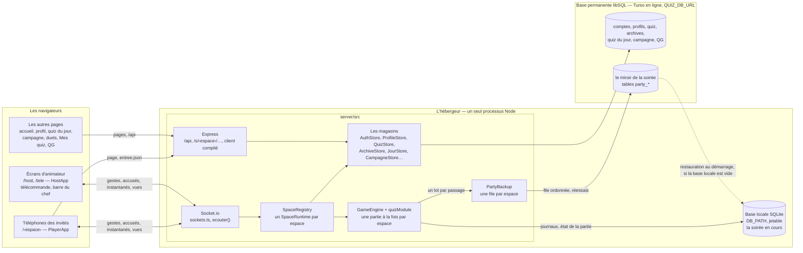
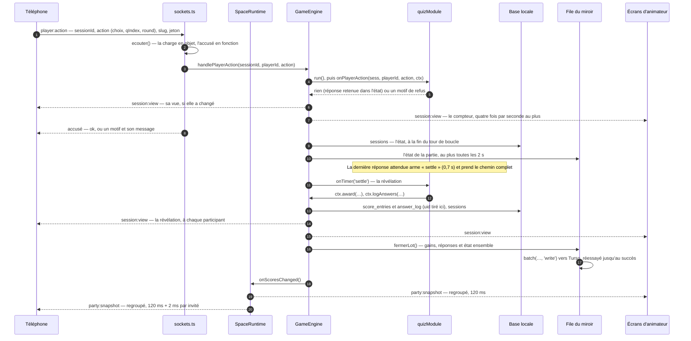

# Vue d'ensemble de l'architecture

> Le système d'un coup d'œil, pour un développeur qui arrive : ce qui tourne où,
> le chemin d'une réponse d'invité, les couches, les principes qui tiennent
> l'ensemble — et où vit chaque domaine.

**Dans cette page** : [Le dépôt](#le-dépôt) ·
[Le système](#le-système) ·
[Le chemin d'une réponse d'invité](#le-chemin-dune-réponse-dinvité) ·
[Les couches](#les-couches) ·
[Les principes](#les-principes) ·
[La carte des domaines](#la-carte-des-domaines)

FiestApp est un quiz de soirée auto-hébergé : les invités jouent depuis leur
téléphone, sans rien installer, un écran commun anime la salle, et plusieurs
animateurs partagent le serveur, chacun dans son **espace**. En ligne comme sur
le PC d'une soirée, un seul processus Node sert l'API HTTP, la liaison temps
réel et l'application React compilée (en développement, Vite sert les pages et
relaie le reste). Deux bases : une locale, jetable, pour la soirée en cours ;
une permanente pour tout ce qui doit survivre.

## Le dépôt

Un monorepo npm à deux espaces de travail, `client` et `server` (déclarés dans
`package.json`), et un troisième dossier lu des deux côtés, `shared/`.

| Dossier | Ce qu'il contient | Comment il se construit |
|---|---|---|
| `client/` | L'application React : une page par fichier (`client/src/views/`), les briques (`client/src/components/`), les vues du quiz (`client/src/games/quiz/`), la liaison (`client/src/socket.ts`), l'état (`client/src/state.ts`), l'API cliente (`client/src/api.ts`) | `vite build` vers `client/dist/`, ses scripts et ses styles compressés d'avance en brotli et gzip (`client/vite.config.ts`) |
| `server/` | `server/src/` (démarrage, routes, protocole), `server/src/core/` (registres, moteur, magasins, dérivations), `server/src/auth/` (comptes, profils, sessions), `server/src/games/` (les règles du quiz) ; les quiz livrés et la base de la campagne (`server/content/`), les scripts (`server/scripts/`), les tests (`server/test/`) | esbuild en fait un seul fichier, `server/dist/index.mjs` ([Le paquet](./serveur.md#le-paquet)) |
| `shared/` | Les types et les fonctions **pures** que client, serveur et tests partagent : le protocole (`shared/events.ts`), les adresses, le classement, les niveaux, la bibliothèque… | Rien : ce n'est pas un espace de travail. Les deux `tsconfig.json` l'incluent, le code l'importe par chemin relatif (`../../shared/…`), Vite et esbuild l'emportent dans leur paquet, tsx l'exécute tel quel |

`shared/` n'importe ni paquet npm, ni serveur, ni client : pas de réseau, pas
de disque, pas de base. Serveur et téléphone y appliquent **la même** règle —
un rang, une adresse, une durée —, et les tests la vérifient sans serveur.
Autour : `render.yaml` (la référence des services en ligne),
`.github/workflows/ci.yml` (la CI) et `.github/workflows/vitrine.yml` (la
vitrine, sur GitHub Pages), `.claude/` (les règles des agents,
[l'outillage Claude](../contribuer/outillage-claude.md)) et `retours/` (ce que
tablées et audits ont trouvé).

**Très peu de dépendances, et c'est voulu** : Express 4, Socket.io 4,
better-sqlite3, le client libSQL, `compression` et tsx côté serveur ; React 19,
`socket.io-client` et `qrcode.react` côté client, construit par Vite 6. Node 20
au moins, Node 22 en intégration continue et en ligne ; ni linter ni
formateur ([Les tests](../contribuer/tests.md)).

## Le système

- **Les navigateurs.** Seuls les téléphones des invités
  (`client/src/views/PlayerApp.tsx`) et les écrans d'animateur — écran commun
  et télé branchée (`client/src/views/HostApp.tsx`), télécommande, barre du
  chef sur sa seconde liaison (`client/src/socketDuChef.ts`) — ouvrent une
  liaison Socket.io ; toutes les autres pages, quiz du jour compris, parlent
  HTTP. La page d'un invité paraît avant sa liaison : le serveur lui précharge
  ce que `party:watch` dirait (`/s/<espace>/entree.json`). → [Le client](./client.md)
- **Le serveur.** Express et Socket.io partagent un serveur HTTP.
  `SpaceRegistry` (`server/src/core/space.ts`) crée à la demande un
  `SpaceRuntime` par espace : invités, équipes, journaux, moteur, diffusions.
  Les magasins tiennent la base permanente. → [Le serveur](./serveur.md)
- **Les deux bases.** La locale (SQLite, `DB_PATH`, `server/data/quizz.db` par
  défaut) ne garde que la soirée en cours de chaque espace, en sept tables. La
  permanente (libSQL, `QUIZ_DB_URL` : Turso en ligne, un fichier `quizzes.db`
  chez soi) garde le reste, et le **miroir** de la soirée, d'où un serveur qui
  redémarre sur un disque effacé recharge les soirées en cours.
  → [Les données](./donnees.md)
- **L'hébergeur.** Render, offre gratuite : la production et la préproduction,
  le même code, chacune sa base Turso — jamais la même. Le service s'endort
  après un quart d'heure sans trafic, et chaque réveil est un démarrage sur un
  disque effacé : d'où les deux bases, le miroir, le démarrage de front et le
  paquet. → [La mise en ligne](../exploitation/mise-en-ligne.md)

## Le chemin d'une réponse d'invité

Deux temps : **la réponse**, retenue dans l'état de la partie et accusée au
téléphone ; puis **la révélation**, qui juge, paie et écrit les journaux — en
un seul lot avec l'état de la partie.

- **`ecouter()`** (`server/src/sockets.ts`) rend toute charge objet et tout
  accusé fonction ; une exception part au journal, avec l'accusé de panne. La
  réponse porte l'espace et le jeton : après une coupure, elle arrive sur une
  connexion neuve, encore anonyme, et s'y rattache seule.
- **Le moteur** (`server/src/core/engine.ts`) ne connaît aucune règle : il
  ouvre un lot, confie le geste au module, persiste et rediffuse. Une simple
  réponse ne recalcule que la vue de son auteur et celle de l'écran commun.
- **Le module** (`server/src/games/quiz.ts`) juge : refus (`too-late`,
  `paused`, `invalid`…) ou réponse retenue. La révélation part du chronomètre
  « settle », de celui de la question, ou du clic « Révéler » (la commande
  `next`). → [Le temps réel](./temps-reel.md),
  [les événements](../reference/evenements-temps-reel.md)

## Les couches

| Couche | Où | Nature | Ce qu'on y trouve |
|---|---|---|---|
| Le contrat et les règles partagées | `shared/` | pur | Les types échangés (`shared/types.ts`, `shared/events.ts`) et les règles appliquées des deux côtés : classement (`shared/classement.ts`), équipes (`shared/teams.ts`), horloge (`shared/clock.ts`), niveaux (`shared/profil.ts`), bibliothèque (`shared/library.ts`), hasard d'une partie (`shared/hasard.ts`) |
| Les dérivations du serveur | une partie de `server/src/core/` | pur | Le souvenir (`server/src/core/recap.ts`), le bilan (`server/src/core/review.ts`), le palmarès (`server/src/core/stats.ts`), le journal rangé (`server/src/core/journal.ts`), les gains (`server/src/core/progress.ts`), les hauts faits (`server/src/core/hautsfaits.ts`) |
| Les règles du quiz | `server/src/games/quiz.ts` | ni base ni réseau | N'importe que des types et `shared/` ; agit par le contexte que le moteur lui prête |
| Les registres et le moteur | `server/src/core/` | écrit : base locale et miroir | `Party`, `Teams`, `ScoreLedger`, `AnswerLog`, `GameEngine`, réunis par `SpaceRuntime` |
| Les magasins | `server/src/core/`, `server/src/auth/` | écrit : base permanente | `AuthStore`, `ProfileStore`, `QuizStore`, `ArchiveStore`… ([la liste](./serveur.md#les-registres-et-les-magasins)) |
| Les portes | `server/src/server.ts`, `server/src/api.ts`, `server/src/sockets.ts`, les fichiers de routes | lit, vérifie, appelle | Routes HTTP, protocole temps réel, ordre des gardes |
| Le client | `client/src/` | navigateur | Pages, composants, liaison, état, stockage du navigateur |

Ce qui est pur se teste sans serveur, se relit sur une archive comme sur la
soirée en cours, et se recalcule quand une règle change.

## Les principes

`CLAUDE.md` les appelle les invariants : vingt-deux règles que le code ne casse
jamais, et que ses commentaires citent par leur numéro (« invariant 12 »).

### Le serveur décide

**1. La logique de jeu vit au serveur.** Les écrans ne reçoivent que des vues
calculées pour eux (`playerView`, `hostView`), jamais l'état : sinon la bonne
réponse serait dans le téléphone avant la révélation. Même règle pour ce qui la
trahit — anecdote, photo de la révélation, bonnes réponses de « plusieurs »,
bon ordre : à la révélation seulement ; note de l'animateur, extrait d'un blind
test, programme : jamais aux téléphones. → [Les questions](../produit/les-questions.md)

**12. Un geste dit ce qu'il visait.** Les commandes `next`, `cancel`, `replay`
et `cible` portent phase, question et tour, une réponse question et tour,
`host:scene` l'écran quitté, `host:launch` la partie remplacée ; périmé, le
geste est ignoré, la réponse reçoit `too-late`. Un « Révéler » arrivé 96 ms
après la révélation automatique passait à la question suivante.
→ [Le temps réel](./temps-reel.md)

**21. Les règles des Divins ne quittent jamais le serveur.** Règles et
légendes vivent dans `server/src/core/divins.ts`, que ni `shared/` ni `client/`
n'importent (`server/test/divins.test.ts` y veille) ; le serveur n'envoie que
la liste des Divins descendus, le récit à leur seul porteur, sans jauge ni
progression. Un récit lu dans le code de la page en dirait presque autant que
la règle. → [La sécurité](./securite.md)

### Les données

**2. Deux bases, deux rôles.** La locale tient la soirée en cours et reste
jetable : « Clore la soirée » et « C'était un essai » la vident. Ce qui doit
survivre va dans la permanente : le disque de l'hébergeur s'efface à chaque
réveil, et la soirée vit en local pour que le moteur reste synchrone.
→ [Les données](./donnees.md)

**3. Tout est cloisonné par `space_id`.** Une route d'animateur lit l'espace dans la
session, jamais dans la requête ; une connexion s'attache à un espace une fois
pour toutes. Un identifiant d'ailleurs vaut « introuvable », et le voisin n'en
sait rien : aucun animateur ne voit rien des autres. → [La sécurité](./securite.md)

**11. Le nom d'une soirée se tire une fois** (`soireeEnCours`), à sa première
question jouée, et ne se recalcule jamais : c'est la clé qui rend le crédit
idempotent. Recalculé sur le premier arrivé, il changeait quand on l'excluait —
l'expérience comptait deux fois, l'archive se dédoublait. Toute écriture
permanente sous ce nom passe d'abord par `recopierSoiree`.
→ [Après la soirée](../produit/apres-la-soiree.md)

**13. Rien ne se perd en route vers le miroir.** Une file par espace,
ordonnée, qui insiste ; un `uid` tiré à l'écriture locale, pour qu'un rejeu ne
compte pas deux fois ; l'état de la partie envoyé **avec** ses gains et ses
réponses, en une transaction (`ouvrirLot`, `fermerLot`) — sinon un arrêt
brutal faisait révéler deux fois la même question, et 177 points devenaient
354. La clôture efface le miroir **avant** la base locale, ou l'ancienne
soirée ressuscitait au réveil. → [Les données](./donnees.md)

**14. Les dérivations restent pures.** `liveRecap` et `recapOfArchive`
appellent toutes deux `buildRecap` (de même pour le bilan) : une amélioration
profite aux soirées passées. → [Les données](./donnees.md)

**18. L'historique s'écrit tout seul, et la soirée n'a qu'un geste de fin.**
Elle se range après chaque quiz (`apresQuiz`) ; « Clore la soirée » la termine
— le QG, par le même `cloreLaSoiree`, une soirée laissée en plan —, « C'était
un essai » l'efface avec ses crédits. Une seule fin à la fois (`finEnRoute`),
annoncée aux téléphones une fois la soirée effacée : « Sauvegarder » venait
parfois jamais, et deux clôtures croisées recréditaient.
→ [Après la soirée](../produit/apres-la-soiree.md)

### Le temps réel

**4. L'instantané est dédoublonné et regroupé.** Deux versions — les écrans
d'animateur (wifi, santé du miroir, scène, télécommande, fin en route en plus) et les
téléphones (sans `connected`) —, chacune envoyée seulement si elle change :
120 ms pour les écrans, 120 ms plus 2 ms par invité pour les téléphones, et
l'auteur d'un geste reçoit la sienne aussitôt. Chaque veille d'écran renvoyait
la salle à chacun : un gigaoctet pour trois cents arrivées.
→ [Le temps réel](./temps-reel.md)

**5. Les chronomètres sont persistés.** Leurs échéances s'écrivent avec la
partie ; au redémarrage, `wakeRunning()` réveille les espaces en jeu et
`GameEngine.restore()` les réarme : un réveil en pleine question la reprend où
elle en était. → [Le serveur](./serveur.md)

**6. Une échéance se lit à `serverNow()`, jamais à `Date.now()`**
(`client/src/clock.ts`) : l'horloge d'un téléphone dérive, et ses réponses
disparaissaient. Deux mesures qui ne peuvent pas être vraies ensemble disent
que l'horloge a sauté : la plus récente gagne, même plus lente (`bestSample`,
`shared/clock.ts`). → [Le temps réel](./temps-reel.md)

**7. Toute réponse reçoit un accusé, et tout message passe par `ecouter()`.**
Un `player:action` sans charge ou un `party:watch` sans accusé arrêtait le
processus — et les soirées de tous les espaces avec ; une réponse refusée
disparaissait sans un mot. → [Le temps réel](./temps-reel.md)

### Les identités

**8. Un profil ne donne aucun avantage de jeu face aux autres, et un invité
anonyme n'affiche rien** — ni « Niv. 0 », ni pastille grise : l'absence, pas
l'infériorité ; le chemin sans compte reste la valeur de l'application. Seule
l'Expédition, qu'on joue seul, fait servir ce qu'on a gagné, et ses jokers
n'en sortent jamais. Un profil reconnu ne rechoisit jamais prénom ni avatar.
→ [Le profil](../produit/le-profil.md) · [L'Expédition](../produit/l-expedition.md)

**9. La fiche du serveur fait foi.** Une re-présentation par jeton ignore le
prénom et l'avatar envoyés — sinon le renommage par l'animateur tombait au
réveil ; un jeton inconnu est refusé (`unknown-token`), jamais recréé ; une
place ne se reprend que par le code que l'animateur fait paraître, contre un
jeton neuf. → [Le temps réel](./temps-reel.md)

**16. Une personne, deux tables — et `accounts.id` ne bouge jamais.** Un compte
est un espace, un profil une personne ; `accounts.profile_id` dit qui tient
l'espace. Pas de fusion : l'identifiant d'un compte est la clé de partition de
la soirée, de la bibliothèque, du miroir et de toutes les archives.
→ [La sécurité](./securite.md)

**17. Les homonymes se règlent à l'affichage.** `nomsAffiches()` marque
« Camille (2) » quand prénom **et** avatar qu'on voit (`visageDe` : le dessin porté, sinon l'emoji) sont partagés, sans jamais l'écrire
en base. Un prénom sort par trois portes — `publicPlayers`, `publicOne`
(`server/src/core/party.ts`), `ViewContext.playerName` — et la troisième,
qu'on oublie, écrit sur le vidéoprojecteur. → [Le temps réel](./temps-reel.md)

### Les récompenses

**10. L'expérience d'un quiz se crédite dès son verdict**, puis à la fin de la
partie si quelque chose a changé, puis à la clôture : la ligne (profil,
soirée) est remplacée, jamais ajoutée. Podium de la soirée, prix, hauts faits
et paliers de carrière — à l'écran, les étapes des pistes — ne se décident
qu'à la clôture : prix et hauts faits en un lot
(`remplacerRecompensesDeSoiree`), les paliers en dernier (`accorderPaliers`).
Attendre l'archive ne donnait rien à qui
venait de gagner. → [Les récompenses](../produit/les-recompenses.md)

**19. L'expérience se mérite, et ne redescend jamais en cours de soirée.**
Rien pour la présence, rien seul : tout dès deux joueurs, des podiums à seuils
de questions (`SEUILS`, `shared/profil.ts`), une soirée jouée seul ne compte
pas (`soireeQuiCompte`), un prix ne rapporte jamais d'expérience. Cinquante
points par question jouée, c'était presque la moitié d'une soirée.
→ [Les barèmes](../reference/baremes.md)

**20. Les récompenses sont des dérivations des journaux.** Une règle change :
`VERSION_BAREME` monte, et `recalculerHistorique` relit l'historique au
démarrage. La version s'écrit en entier (`CAST(? AS INTEGER)`) — en flottant,
tout se relisait à chaque réveil —, et une base qui hoquette fait échouer le
démarrage plutôt que de remettre des lignes au barème sans les relire.
→ [Les données](./donnees.md)

**22. Durcir un légendaire, la courbe des niveaux ou le palier d'un portrait
ne reprend rien à personne.** Un légendaire durci ajoute une entrée à
`DURCISSEMENTS`, une courbe des niveaux à `COURBES_D_AVANT`, sous un drapeau
neuf, sans jamais en modifier une ; un palier validé ne se perd jamais, et
tout niveau passe par `niveauDuProfil`. Un portrait, un haut fait de soirée,
un prix ou un Divin n'ont pas de tel registre : durcis, ils reprendraient ce
qu'ils ont donné — on retient d'abord ce que chacun a.
Légendaires et niveaux se dérivent à chaque lecture : relever un seuil
reprenait le légendaire porté, durcir la courbe faisait redescendre de niveau.
→ [Les récompenses](../produit/les-recompenses.md)

### Les classements, les textes et les nombres

**15. Un classement passe par `shared/classement.ts`** : rang = 1 + le nombre
de concurrents strictement devant, tous les ex æquo en tête gagnent, et deux
estimations se comparent par `ecartEstimation`. Cinq règles de départage
donnaient trois vainqueurs à un même quiz, et la virgule flottante séparait
0,7 et 0,9 pour une cible de 0,8. → [Les questions](../produit/les-questions.md)

Trois conventions le prolongent : un texte se coupe avec `tronquer()`, un
nombre tapé se lit avec `lireNombre()`, une erreur faite pour être lue se lève
avec un `new Error('…')` nu ([Les routes](./serveur.md#les-routes),
[Les conventions](../contribuer/conventions.md)).

## La carte des domaines

| Domaine | Fichiers principaux | Produit | Technique |
|---|---|---|---|
| Le quiz en soirée | `server/src/games/quiz.ts`, `server/src/core/engine.ts`, `shared/classement.ts`, `shared/teams.ts`, `client/src/games/quiz/` | [La soirée](../produit/la-soiree.md), [Les questions](../produit/les-questions.md) | [Le serveur](./serveur.md) |
| La salle, les invités, les salons | `server/src/sockets.ts`, `server/src/core/space.ts`, `server/src/core/party.ts`, `shared/events.ts`, `client/src/views/PlayerApp.tsx` | [Animer une soirée](../guides/animer-une-soiree.md) | [Le temps réel](./temps-reel.md) |
| L'écran commun et la télé | `client/src/views/HostApp.tsx`, `client/src/games/quiz/HostView.tsx` | [Animer une soirée](../guides/animer-une-soiree.md) | [Le client](./client.md) |
| La fin de soirée, l'historique | `server/src/core/archive.ts`, `server/src/core/recap.ts`, `server/src/core/review.ts`, `shared/fin.ts` | [Après la soirée](../produit/apres-la-soiree.md) | [Les données](./donnees.md) |
| Les bases, les journaux, le miroir | `server/src/core/db.ts`, `server/src/core/backup.ts`, `server/src/core/distante.ts` | — | [Les données](./donnees.md), [Les tables](../reference/base-de-donnees.md) |
| Les récompenses | `shared/profil.ts`, `shared/hautsfaits.ts`, `shared/legendaires.ts`, `shared/pistes.ts`, `server/src/core/recalcul.ts` ; l'écran des gains de toutes les fins, `shared/gains.ts` et `client/src/components/Gains.tsx` ; l'album des trophées, `shared/trophees.ts` et `client/src/components/AlbumDesTrophees.tsx` | [Les récompenses](../produit/les-recompenses.md) | [Les barèmes](../reference/baremes.md) |
| Le profil et les avatars | `server/src/auth/profiles.ts`, `client/src/views/ProfilApp.tsx`, `client/src/components/Avatar.tsx` | [Le profil](../produit/le-profil.md) | [Le client](./client.md) |
| Les thèmes, la boutique | `shared/themes.ts`, `client/src/themes/`, `client/src/components/Boutique.tsx` | [La boutique](../produit/la-boutique.md) | [Le client](./client.md) |
| Ce que la page charge | `client/src/main.tsx`, `shared/adresses.ts`, `shared/depart.ts`, `server/src/core/apercus.ts` | [Jouer](../guides/jouer.md) | [Les adresses](../reference/adresses.md) |
| Le quiz du jour, le rappel | `server/src/core/jour.ts`, `server/src/quizDuJour.ts`, `server/src/core/rappels.ts`, `client/src/views/JourApp.tsx` | [Le quiz du jour](../produit/le-quiz-du-jour.md) | [Le serveur](./serveur.md#les-tâches-de-fond) |
| La campagne, le défi | `server/src/core/campagne.ts`, `server/src/campagne.ts`, `server/content/campagne/`, `client/src/views/CampagneApp.tsx` | [La campagne](../produit/la-campagne.md) | [Les données](./donnees.md) |
| Les sentiers du savoir | `shared/sentiers.ts`, `shared/branches.ts`, `client/src/views/Sentiers.tsx` | [Les sentiers](../produit/les-sentiers-du-savoir.md) | [Les barèmes](../reference/baremes.md) |
| Les duels | `shared/duels.ts`, `server/src/core/modeleDuSavoir.ts`, `client/src/views/Duels.tsx` | [Les duels](../produit/les-duels.md) | [Les barèmes](../reference/baremes.md) |
| La bibliothèque | `shared/library.ts`, `server/src/core/quizStore.ts`, `server/src/api.ts`, `client/src/views/EditorApp.tsx` | [Les quiz](../produit/les-quiz.md) | [L'API HTTP](../reference/api-http.md) |
| Comptes, sessions, télé | `server/src/auth/`, `server/src/core/inscriptions.ts` | [Administrer](../guides/administrer.md) | [La sécurité](./securite.md) |
| Le QG | `server/src/qg.ts`, `shared/qg.ts`, `server/src/profilsAdmin.ts`, `client/src/views/AdminApp.tsx` | [Administrer](../guides/administrer.md) | [La sécurité](./securite.md) |
| La mise en ligne | `render.yaml`, `server/scripts/empaqueter.ts`, `server/src/core/pouls.ts` | [La mise en ligne](../exploitation/mise-en-ligne.md) | [La configuration](../reference/configuration.md) |
| Les tests, la tablée | `server/test/banc.ts`, `server/scripts/smoke.ts`, `server/scripts/tablee/` | [Les tests](../contribuer/tests.md) | [L'outillage Claude](../contribuer/outillage-claude.md) |

## Pour aller plus loin

- [Le serveur](./serveur.md) — démarrage, magasins, routes, moteur, tâches de
  fond, paquet
- [Le temps réel](./temps-reel.md) — connexion, instantané, vues, horloge,
  accusés
- [Les données](./donnees.md) — les deux bases, le miroir, les archives, le
  recalcul
- [Le client](./client.md) · [La sécurité](./securite.md) ·
  [Les décisions](./decisions.md)
- [Démarrer](../contribuer/demarrer.md) — installer, lancer, modifier
