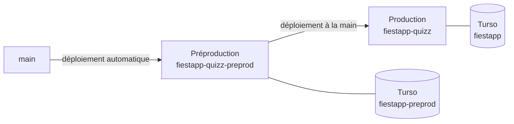

# La mise en ligne

> Mettre FiestApp en ligne, gratuitement, pas à pas : la base Turso, le
> service Render, la veille de 7 h à minuit, la préproduction, et la routine
> du matin qui remplit les réserves de questions — et la vitrine, sur GitHub
> Pages. Pour qui administre le serveur. Une fois en ligne, la suite est dans
> [Exploiter](exploiter.md).

**Dans cette page** : [Ce qu'il te faut](#ce-quil-te-faut) ·
[Les valeurs à garder sous la main](#les-valeurs-à-garder-sous-la-main) ·
[1. Pousser le code](#1-pousser-le-code-sur-github) ·
[2. La base Turso](#2-créer-la-base-turso) ·
[3. Le service Render](#3-créer-le-service-render) ·
[4. Le premier démarrage](#4-le-premier-démarrage) ·
[5. Tes quiz](#5-transférer-tes-quiz) ·
[6. La veille](#6-tenir-le-serveur-éveillé-de-7-h-à-minuit) ·
[7. Vérifier](#7-vérifier-pour-de-vrai) ·
[8. La préproduction](#8-la-préproduction) ·
[9. La routine du matin](#9-la-routine-du-matin) ·
[10. Un domaine à toi](#10-un-domaine-à-toi) ·
[11. La vitrine](#11-la-vitrine-sur-github-pages)

## Ce qu'il te faut

| Site | À quoi il sert | Carte bancaire |
|---|---|---|
| [github.com](https://github.com) | héberge le code — Render y lit le dépôt — et la vitrine (étape 11) | non |
| [turso.tech](https://turso.tech) | la base permanente : comptes, profils, quiz, historique, quiz du jour, campagne — tout ce qui doit survivre | non |
| [render.com](https://render.com) | le serveur qui fait tourner le jeu | non |
| [cron-job.org](https://cron-job.org) | appelle le serveur toutes les dix minutes, de 7 h à minuit, pour qu'il ne s'endorme pas | non |

La routine du matin (étape 9) tourne dans Claude Code, sur ton abonnement
Claude. Le reste ne coûte rien.

## Les valeurs à garder sous la main

Dans un gestionnaire de mots de passe, un fichier à toi — **jamais dans le
dépôt** :

| Quoi | Où tu l'obtiens | Exemple |
|---|---|---|
| L'adresse de la base Turso | la page de ta base | `libsql://fiestapp-xxx.turso.io` |
| Son jeton | le bouton de création de jeton, **affiché une seule fois** | `eyJhbGciOi…` |
| `ADMIN_LOGIN` | tu le choisis : 2 à 32 caractères, lettres, chiffres, point, tiret | `antoine` |
| `ADMIN_PASSWORD` | tu l'inventes ; il ne sert qu'au premier démarrage | `salsa2026!` |
| `ADMIN_SLUG` | le nom de ton espace dans l'adresse : 2 à 24 caractères, minuscules, chiffres, tirets — ni six chiffres, ni le nom d'une page de l'application | `chez-antoine` |
| `ADMIN_NAME` | ton prénom, tel que les invités le liront | `Antoine` |
| L'adresse publique | Render la donne après le déploiement | `https://fiestapp-xxxx.onrender.com` |
| `RESERVE_TOKEN` | le bouton « Generate » de Render (étape 9) | — |

> [!IMPORTANT]
> **Le mot de passe d'amorçage ne sert qu'une fois.** Au premier démarrage,
> sur une base qui n'a encore aucun compte, le serveur crée ton compte avec ;
> ensuite, plus rien ne le relit. Change-le depuis « Mon compte », puis retire
> `ADMIN_PASSWORD` des variables de Render : sur l'offre gratuite, chaque
> réveil est un démarrage, et il s'en passe très bien. Choisis autre chose
> que `demo` : en ligne, tant que la base n'a aucun compte, le serveur refuse
> de démarrer avec le mot de passe par défaut.

## Les étapes

### 1. Pousser le code sur GitHub

Render déploie depuis GitHub, pas depuis ton PC :

```bash
git push
```

### 2. Créer la base Turso

Sur [turso.tech](https://turso.tech), crée un compte, puis une base : nomme-la
`fiestapp`, emplacement en Europe, près du serveur. Sur sa page, relève son
adresse (`libsql://…`) et crée un jeton. En ligne de commande, si tu
préfères :

```bash
turso db create fiestapp
turso db show fiestapp --url
turso db tokens create fiestapp
```

### 3. Créer le service Render

Sur [render.com](https://render.com), crée un compte, puis **New → Web
Service**, et connecte le dépôt. Reprends les réglages de `render.yaml`, qui
les décrit sans les imposer — c'est le tableau de bord du service qui fait
foi :

| Réglage | Valeur |
|---|---|
| Region | Frankfurt |
| Instance Type | Free |
| Build Command | `npm ci && npm run build` |
| Start Command | `cd server && exec node --single-threaded-gc --no-memory-reducer --max-old-space-size=320 dist/index.mjs` |
| Health Check Path (*Settings*) | `/healthz` |

Ce que font ces deux commandes, et pourquoi :

- **`npm ci`**, et non `npm install` : les versions exactes de
  `package-lock.json`, celles que l'intégration continue a éprouvées, pas
  celles du jour du déploiement.
- **`npm run build`** construit le client (ses scripts et ses styles compressés d'avance
  en brotli et en gzip) **et** le serveur, en un seul fichier :
  `server/dist/index.mjs`. Chaque réveil de l'offre gratuite est un
  démarrage, et le serveur n'a plus à y traduire son TypeScript : 0,8 à 1 s
  de processeur et une quarantaine de mégaoctets en moins, sur un dixième de
  cœur — quelques secondes de page blanche en moins pour le premier invité qui
  scanne le QR. Il y vérifie aussi la base de la campagne, une fois pour
  toutes (`server/dist/index.campagne.ndjson`) : le serveur la relit telle
  quelle à chaque réveil — « base préparée relue » au journal —, au lieu de
  repasser ses vingt-quatre mille questions au juge, une seconde de
  processeur de plus. Si un fichier de la base change après le build, il
  l'écarte (« base préparée écartée ») et relit le dossier.
- **`exec node`**, jamais `npm start` : npm gardait pour lui le signal
  d'arrêt de Render, et l'arrêt propre — celui qui recopie les dernières
  réponses dans Turso avant de s'éteindre — ne s'exécutait jamais. `exec`
  remplace le shell par Node, qui reçoit le signal lui-même, et le service
  économise les 45 Mo de npm. `npm start`, d'ailleurs, lance `tsx` sur les
  sources, pas le paquet. L'ancienne commande,
  `cd server && exec node --import tsx src/index.ts`, marche toujours : c'est
  le repli si le paquet refusait de démarrer.
- **Les trois drapeaux de V8** règlent le ramasse-miettes, qui figeait le
  serveur jusqu'à deux secondes au dixième de cœur (le banc du 19 octobre
  2026) : V8 y ramasse comme sur toute la machine — ses fils d'aide se
  disputent le dixième sans finir plus tôt, et son réducteur de mémoire
  recompacte au repos un tas qu'il croit de huit gigaoctets, puisqu'il ne
  lit pas la limite du conteneur. `--single-threaded-gc` le garde sur un
  seul fil, `--no-memory-reducer` lui ôte ce compactage, et
  `--max-old-space-size=320` plafonne alors le tas sous les 512 Mo de
  l'offre gratuite. `NODE_OPTIONS` les refuse : ils ne vivent que dans la
  commande. Le journal de démarrage dit ce qui tourne (« ramasse-miettes sur
  un seul fil, sans réducteur de mémoire, tas jusqu'à 368 Mo »), `/healthz`
  aussi (`memoire.ramasseMiettes`, `memoire.tasMaxMo`) ; surveille `rssMo`
  les premiers jours. Une commande sans eux marche toujours : V8 reprend son
  réglage, et ses gels.

Puis ses variables (*Environment*) :

| Variable | Ce que tu mets |
|---|---|
| `ADMIN_LOGIN` | ton identifiant |
| `ADMIN_PASSWORD` | ton mot de passe d'amorçage |
| `ADMIN_SLUG` | le nom de ton espace (`chez-antoine`) |
| `ADMIN_NAME` | ton prénom ; sans elle, « Antoine » |
| `QUIZ_DB_URL` | l'adresse Turso de l'étape 2 — sans elle, le serveur refuse de démarrer : le disque de Render s'efface à chaque réveil, et tout ce qui y serait écrit disparaîtrait |
| `QUIZ_DB_TOKEN` | le jeton de l'étape 2 |
| `NODE_VERSION` | `22` |
| `MAX_PLAYERS` | `150` — le plafond d'invités d'une soirée, pour **chaque** espace. Sans elle, le code laisse monter jusqu'à 500, et une salle de 300 fait céder le dixième de processeur de l'offre gratuite |

Render pose de lui-même `RENDER=true`, qui met le serveur **en ligne**, et
`RENDER_EXTERNAL_URL`, l'adresse publique que portent les QR. Ne pose pas
`NODE_ENV=production` : Render n'en a pas besoin, et posée pendant la
construction, elle fait sauter les outils de construction à `npm ci`. Ce que
le mode en ligne change — cookies `Secure`, origine imposée, adresse lue
derrière le proxy — : [La configuration](../reference/configuration.md).

Enfin, dans *Settings*, coupe **Auto-Deploy** : la production ne se déploie
qu'à la main, une fois la préproduction vue tourner (étape 8).

> [!WARNING]
> Pas de **New → Blueprint**. Il lirait `render.yaml` et créerait d'un coup
> les deux services qu'il décrit — et le choix est sans retour : Render
> n'adopte jamais un service qu'un blueprint n'a pas créé lui-même, il en
> fabrique des copies, à de nouvelles adresses (étape 8).

### 4. Le premier démarrage

Deux à trois minutes de construction, et Render affiche l'adresse publique.
Le journal du service (*Logs*) raconte le démarrage :

- `[comptes] administrateur « antoine » créé, espace « chez-antoine »` — une
  fois, sur la base neuve ;
- `[quiz] 2 quiz importés depuis server/content/quiz/` — les deux quiz
  d'amorce, copiés une fois dans ton espace ;
- `[jour] réserve amorcée : 38 questions des quiz livrés` — la réserve du
  quiz du jour, une fois ;
- `[serveur] prêt en … ms — au plus 150 invités par soirée — version abc1234`
  — à chaque démarrage. S'il dit 500 et « MAX_PLAYERS non défini », la
  variable manque.

Le QR de l'écran commun portera de lui-même l'adresse publique suivie du code
à six chiffres de ton salon : rien à configurer de plus.

**Tout de suite ensuite** : ouvre `https://TON-ADRESSE.onrender.com/connexion`,
connecte-toi, ouvre « Mon compte », change ton mot de passe (la ligne « Mot de
passe »), puis retire `ADMIN_PASSWORD` des variables de Render. Dans « Mon
compte », « Mon profil joueur » rattache aussi ton profil à ton espace : se
connecter à ton profil ouvre alors ta console, et son code de secours te rend
l'accès si tu oublies tout ([Administrer](../guides/administrer.md)).

### 5. Transférer tes quiz

Une fois le serveur démarré en ligne — c'est lui qui crée ton compte, et les
quiz vont dans ton espace —, depuis le dépôt sur ton PC :

```bash
npm run migrate -- --to libsql://TON-ADRESSE.turso.io --token TON-JETON
```

La commande copie ta bibliothèque locale (`server/data/quizzes.db`) : les
photos d'abord, puis les quiz — terminés ou brouillons — de ton espace local,
vers le tien en ligne (`--slug` pour un autre). Elle se relance sans rien
dupliquer : un quiz déjà en ligne est mis à jour, un nouveau est ajouté, et
rien n'est jamais effacé à destination. Elle ne recopie pas les réglages d'un
quiz (le mélange des réponses, l'ordre, le tirage : une copie de modèle s'y
jouerait sa bonne réponse en premier), ni son archivage, ni les programmes,
les partages, l'historique ou les profils.

Autre chemin, sans ligne de commande : dans « Mes quiz », « Exporter tous mes
quiz » en local, puis « Importer un fichier » en ligne.

> [!TIP]
> Une fois en ligne, n'écris plus qu'en ligne : relancer `migrate` après coup
> réécrirait tes quiz en ligne avec leur version locale. Les deux quiz
> d'amorce se suppriment dans « Mes quiz » si tu n'en veux pas.

### 6. Tenir le serveur éveillé de 7 h à minuit

Sans trafic pendant quinze minutes, l'offre gratuite endort le serveur, et le
réveil prend près d'une minute : le premier invité qui scanne attendrait
devant une page blanche, et le premier joueur du quiz du jour aussi. Les
sondes de Render sur `/healthz` ne le tiennent pas éveillé. Et le rappel du
soir du quiz du jour part du serveur lui-même, à 18 h : endormi, il ne
partirait qu'à son réveil, et plus du tout après 22 h.

Sur [cron-job.org](https://cron-job.org), crée une tâche — pas une routine
Claude Code : elle ne passerait pas assez souvent, et chaque passage ouvrirait
une session sur ton abonnement.

| Réglage | Valeur |
|---|---|
| Adresse | `https://TON-ADRESSE.onrender.com/healthz` — la route la plus légère, qui répond toujours 200 et ne nomme personne |
| Horaire | personnalisé : aux minutes 0, 10, 20, 30, 40 et 50, de 7 h à 23 h, tous les jours |
| Fuseau horaire | `Europe/Paris`, pour que le changement d'heure se fasse tout seul |

Coupe aussi l'option qui désactive une tâche après plusieurs échecs.

**Le réveil du matin ne vient pas de cron-job.org.** La tâche abandonne un
appel au bout de trente secondes, et le réveil en prend près d'une minute : sa
requête coupée ne réveillait rien, et tous les appels de la journée
échouaient derrière celui de 7 h. C'est la routine du matin (étape 9) qui
lève le serveur, à 6 h 55 : sa première requête attend jusqu'à deux minutes
et insiste. Pas avant 6 h 45 : quinze minutes sans trafic avant le premier
appel de la tâche, et il se rendormirait. Après l'appel de 23 h 50, il
s'endort vers minuit cinq.

**Jamais 24 h/24, et jamais la préproduction.** Les 750 heures mensuelles de
l'offre gratuite sont communes aux deux services. De 7 h à minuit, la
production en prend environ 530 sur un mois de trente et un jours ; il en
reste 220 pour la préproduction et les soirées qui finissent après minuit.
Allumée en permanence, la production en prendrait 744 à elle seule : le quota
s'épuiserait avant la fin du mois, et Render suspend alors **tous** les
services gratuits jusqu'au 1er du mois suivant, production comprise.

La veille ne menace pas la soirée elle-même : tant qu'un écran commun ou un
téléphone est connecté, la liaison temps réel tient le serveur éveillé,
après minuit compris. Ni les quiz qu'on prépare : « Enregistrer » attend le
réveil (« Réveil du serveur… », deux minutes au plus), et le navigateur garde
ce qui n'est pas encore enregistré. Pour vérifier que la veille tient : en
soirée, `/healthz` dit un `uptime` de plusieurs heures (en secondes) ; un
serveur qui vient de se réveiller repart de zéro.

### 7. Vérifier pour de vrai

Ouvre l'écran commun, puis **scanne le QR avec ton téléphone en 4G, wifi
coupé** : c'est le seul essai qui prouve que les invités pourront jouer.
`/healthz` dit la version qui tourne (`version`) et le plafond en vigueur
(`maxPlayers`).

Pour mesurer la charge, vise la **préproduction** (étape 8) :

```bash
ADMIN_LOGIN=antoine ADMIN_PASSWORD=ton-mot-de-passe npm run load -- https://TA-PREPROD.onrender.com 20 --slug TON-ESPACE
```

Vingt invités simulés s'inscrivent, un quiz se joue de bout en bout, et le
script donne les temps mesurés.

> [!CAUTION]
> Jamais contre la production : ses invités s'inscrivent pour de vrai dans la
> soirée de ton espace, et le quiz se joue pour de vrai — classement, miroir,
> et l'archive qu'elle se fait après chaque quiz. Pour mesurer la production
> sans y inscrire personne, `--sonde` ne fait que connecter des téléphones.

### 8. La préproduction

Le développement local n'éprouve pas six choses, et ce sont celles qui
mordent : le miroir Turso avec sa vraie latence, le disque effacé au
redémarrage, le réveil après la veille, les cookies `Secure`, l'adresse du
client derrière le proxy, et la politique de contenu en conditions réelles.
Une soirée est un coup unique — on ne débogue pas devant la salle. D'où un
second service, identique au premier, sur **sa propre base**.



1. **Une seconde base Turso**, `fiestapp-preprod`, avec son jeton. Turso
   sait dupliquer une base existante, pour éprouver une migration sur de
   vraies données : la copie emporte aussi les comptes.
2. **Un second service Render**, avec les mêmes réglages qu'à l'étape 3 —
   mais **Auto-Deploy activé** : chaque fusion sur `main` le déploie.
3. **Ses variables** : `QUIZ_DB_URL` et `QUIZ_DB_TOKEN` de la base de
   préproduction, un `ADMIN_PASSWORD` **différent** de celui de la
   production, `APP_ENV=preprod`, et les autres comme à l'étape 3.
   `APP_ENV` pose une pastille « PREPROD » en bas de chaque page et
   `[preprod]` devant le titre de l'onglet : on ne projette pas la mauvaise
   instance un soir de fête.

> [!CAUTION]
> **Jamais la même base Turso pour les deux.** Un « C'était un essai », une
> soirée retirée de l'historique ou un espace supprimé en préproduction
> effacerait de vraies soirées : ce sont les gestes sans retour de
> l'application.

**Si un blueprint a déjà créé des copies** (`fiestapp-quizz-ljwa`, le même
suffixe sur les deux) : supprime les copies, et le blueprint qui les a créées,
sinon la synchronisation suivante les refait. Le service à garder est celui
qui répond à l'adresse déjà partagée : l'adresse `onrender.com` se fixe à la
création d'un service — le renommer ne la change pas, le recréer si — et
c'est elle que portent les QR imprimés. Regarde d'abord le `QUIZ_DB_URL` des
copies : si l'une pointe vers la base de production, elle a pu y écrire ;
sans `QUIZ_DB_URL`, elle n'a même pas démarré (« ❌ QUIZ_DB_URL manquant »). Le
service est jetable, la base ne l'est pas : la seule chose à ne jamais
supprimer, c'est la base Turso.

**Vérifier l'adresse des invités.** La réserve d'inscriptions de chaque
soirée se compte par adresse : soixante arrivées d'un coup par adresse, puis
soixante par minute. Le serveur lit la **dernière** entrée de
`x-forwarded-for`, en supposant un seul proxy devant lui. Après une vraie
soirée en préproduction, avec quelques téléphones en 4G sur des opérateurs
différents, cherche dans les *Logs* la ligne de chaque clôture :

```text
[inscriptions] soirée finie chez « chez-antoine » : 12 invités ; 12 inscriptions depuis la dernière clôture de l'espace, sous 7 adresses distinctes ; x-forwarded-for : 1 entrée
```

Des téléphones en 4G doivent donner **plusieurs** adresses (une salle
entière sur le wifi de la fête n'en donne qu'une, celle de la box). Et
« x-forwarded-for : 1 entrée » partout est ce qu'on attend d'un seul proxy ;
**toujours 2 entrées ou plus** voudrait dire que l'adresse lue est celle d'un
proxy, et que toute une salle partage une seule réserve — à corriger avant
une grande soirée.

**Promouvoir en production** : sur le tableau de bord de la production,
**Manual Deploy → Deploy latest commit**. On regarde la préproduction
tourner, puis on promeut — la veille d'une soirée, pas le soir même.

**Les minutes de construction.** L'offre gratuite en donne 500 par mois pour
tout l'espace de travail, et chaque fusion sur `main` construit la
préproduction. Épuisées, plus aucune construction jusqu'au mois suivant —
production comprise. Deux réglages : des **Build Filters** sur les deux
services (*Settings*, rubrique *Build*, **Ignored Paths** : `retours/**`,
`**/*.md`, `.claude/**`, `docs/**` — ni le serveur ni le client n'en lisent
une ligne) ; et, les semaines chargées, l'Auto-Deploy de la préproduction
coupé, quitte à la déployer à la main au moment de la regarder.
*Workspace → Billing* dit ce qui reste.

**La préproduction dort**, et aucun ping ne la réveille : les heures du mois
tiennent la production éveillée, pas deux services. On la réveille en
ouvrant son adresse, cinq minutes avant de s'en servir.

**À observer une fois : un déploiement pendant une partie.** Render peut
faire tourner l'ancienne et la nouvelle instance ensemble pendant une
bascule ; les deux écriraient alors au même miroir, et une question pourrait
se retrouver payée deux fois au réveil suivant — vu en local, jamais chez
Render. Ne pas déployer pendant une soirée suffit à s'en garder ; pour savoir
s'il faut aller plus loin, en préproduction : lance un quiz aux questions
longues, fais répondre deux téléphones, relève `/healthz` toutes les deux
secondes pendant un **Manual Deploy** —

```bash
while true; do echo "$(date +%T) $(curl -s https://TA-PREPROD.onrender.com/healthz | grep -oE '"(version|uptime)":[^,}]*' | tr '\n' ' ')"; sleep 2; done
```

— et regarde trois choses : des lignes qui **alternent** entre deux
`uptime`, l'un qui monte et l'autre de quelques secondes (les deux instances
répondaient ensemble) ; au journal, `[soirée] … rechargés après redémarrage`
de la nouvelle **avant** `[serveur] extinction demandée` de l'ancienne ; et le
classement de l'écran commun avant et après. Avec un chevauchement, il
faudra un bail entre les deux instances, qui n'existe pas encore.

### 9. La routine du matin

Le quiz du jour pose dix questions par jour, et sa réserve se vide ; la
campagne et ses sentiers consomment leur base. Une **routine Claude Code**
les remplit chaque matin, sur ton abonnement Claude — et réveille la
production au passage (étape 6). À faire le jour même de la mise en ligne :
la réserve n'a d'abord que les trente-huit questions des quiz livrés, de quoi
tenir quatre jours, et le journal du service dit dès qu'un jour en manque
(`[jour] réserve à sec`).

**Ce que le jeton ouvre — exactement.** Le serveur ne détient aucune clé
d'IA : il donne une consigne, puis reçoit des questions, derrière un jeton,
`RESERVE_TOKEN`, qui ouvre six routes et rien d'autre :

| Route | Ce qu'elle donne ou reçoit |
|---|---|
| `GET /api/jour/reserve` | combien de questions écrire pour tenir trois semaines d'avance, et la consigne — qui rappelle les intitulés déjà en réserve, ceux qui attendent d'être tirés d'abord |
| `POST /api/jour/reserve` | un lot de questions, au format de « Coller une liste », cent au plus |
| `GET /api/jour/reserve/etiquetage` | jusqu'à cinquante questions pas encore décrites — les prochaines à sortir d'abord — **avec leurs réponses et l'indice de la bonne** |
| `POST /api/jour/reserve/etiquetage` | leurs métadonnées |
| `GET /api/campagne/base` | la commande du jour par catégorie, la consigne commune et la part de chaque catégorie, avec des intitulés déjà écrits — aucune bonne réponse |
| `POST /api/campagne/base` | un lot de questions pour une catégorie, quarante au plus |

Il n'efface rien et n'ouvre aucune console. Mais **qui le tient lit les
questions des prochains jours, et leurs bonnes réponses** : garde-le comme
un mot de passe, chaque service le sien ; s'il a fuité, change-le aussitôt
des deux côtés (points 1 et 2), et retire au QG ce qu'il aurait déposé.

1. **Le jeton, dans Render.** Sur la préproduction d'abord, pour essayer,
   puis sur la production : *Environment → Add Environment Variable*, la clé
   `RESERVE_TOKEN`, et le bouton **Generate** pour la valeur. Enregistre : le
   service redémarre, et la page « Quiz du jour » du QG (`/admin#jour`) dit
   « Remplissage automatique ouvert ». Sous trente-deux caractères, la porte
   reste fermée, et le journal du démarrage le dit.
2. **Le même jeton, dans l'environnement Claude Code.** Sur claude.ai/code,
   le menu de l'environnement, puis **Edit** : ajoute `RESERVE_TOKEN` (la
   valeur recopiée de Render) et `FIESTAPP_URL` (l'adresse du service, sans
   `/` final) ; dans **Network access**, permets ce domaine. Le jeton ne
   s'écrit jamais dans le dépôt, ni dans une conversation. La préproduction
   essayée, remplace les deux par ceux de la production.
3. **La routine.** Demande-la à Claude dans une session de cet environnement
   (« crée la routine de la réserve du quiz du jour, tous les jours à
   6 h 55 »), ou crée-la toi-même : une nouvelle session à chaque passage,
   avec la consigne ci-dessous, et **Sonnet** pour modèle — il écrit ces
   questions aussi bien et pèse bien moins sur la limite d'usage de
   l'abonnement : sur Opus, la routine s'arrêtait sur cette limite avant
   d'avoir écrit une ligne. Elle passe tous les jours, même quand tout est
   plein (elle s'arrête alors en une ligne) : c'est elle qui réveille la
   production avant la tâche de cron-job.org.
4. **Vérifier.** Lance-la une fois à la main, depuis la liste des routines.
   Au QG, le journal des apports du quiz du jour dit « Écrite par l’IA », avec
   ce qu'elle a ajouté et écarté, et « Voir les prochains jours » montre ses
   questions — relis-en quelques-unes : c'est la première fois qu'un humain
   les lit. La page de la campagne (`/admin#campagne`) montre ce qu'elle a
   déposé dans sa base, et `/healthz` le dernier apport des deux.

La consigne de la routine :

```text
Tu remplis la réserve du quiz du jour de FiestApp, puis la base de sa
campagne, avec les variables de l'environnement FIESTAPP_URL et
RESERVE_TOKEN. N'écris rien dans le dépôt, n'ouvre aucune PR.

1. Lis ce qu'il faut écrire. Le serveur dort peut-être : il met jusqu'à
   deux minutes à se réveiller.
   curl -sS --retry 6 --retry-delay 20 --retry-all-errors --max-time 90 \
     -o reserve.json "$FIESTAPP_URL/api/jour/reserve" -H "Authorization: Bearer $RESERVE_TOKEN"
   jq '{aEcrire, parEnvoi, error}' reserve.json : si error n'est pas vide,
   dis-le en une ligne et arrête-toi ; si aEcrire vaut 0, dis-le en une
   ligne et passe au point 5. Sinon,
   jq -r .consigne reserve.json > consigne.txt, et lis-la en entier avec
   Read — la sortie d'une commande la couperait.
2. Écris aEcrire questions en suivant la consigne à la lettre, puis
   relis-les une à une comme elle le demande. Au moindre doute sur un
   fait, remplace la question.
3. Envoie-les par lots de parEnvoi questions au plus : chaque lot dans
   lot.txt, au format de la consigne, puis
   jq -Rs '{liste: .}' lot.txt > lot.json
   curl -sS --max-time 90 -X POST "$FIESTAPP_URL/api/jour/reserve" \
     -H "Authorization: Bearer $RESERVE_TOKEN" -H "X-Requested-With: quizz" \
     -H "Content-Type: application/json" --data @lot.json
4. Dis en une ligne combien de questions ajoutées, combien écartées, et
   pourquoi.
5. Décris les questions de la réserve qui ne le sont pas encore :
   curl -sS --max-time 90 "$FIESTAPP_URL/api/jour/reserve/etiquetage" \
     -H "Authorization: Bearer $RESERVE_TOKEN" > a-decrire.json
   La réponse donne consigne et questions (cinquante au plus). Si
   questions est vide, dis-le en une ligne et passe au point 6. Sinon,
   décris-les en suivant la consigne à la lettre, écris le tableau JSON
   qu'elle demande dans etiquetage.json, puis
   jq '{etiquetage: .}' etiquetage.json > envoi.json
   curl -sS --max-time 90 -X POST "$FIESTAPP_URL/api/jour/reserve/etiquetage" \
     -H "Authorization: Bearer $RESERVE_TOKEN" -H "X-Requested-With: quizz" \
     -H "Content-Type: application/json" --data @envoi.json
   Dis en une ligne combien décrites, combien refusées, et pourquoi.
6. Agrandis la base de la campagne :
   curl -sS --max-time 120 -o commande.json -w '%{http_code}\n' \
     "$FIESTAPP_URL/api/campagne/base" -H "Authorization: Bearer $RESERVE_TOKEN"
   Toute autre réponse que 200 : dis en une ligne le code et
   jq -r .error commande.json, et arrête-toi. Sinon,
   jq '{aEcrire, parEnvoi}' commande.json ; si aEcrire vaut 0, dis-le en
   une ligne et arrête-toi.
   a. Lis la consigne, une seule fois pour toutes les catégories : la
      commune, puis la part de chaque catégorie qui a encore des questions
      à écrire. Écris-la dans un fichier et lis-la en entier avec Read,
      par morceaux s'il le faut :
      jq -r '.consigneCommune // empty, (.categories[] | select(.aEcrire > 0) | .consigne)' commande.json > consigne-campagne.txt
   b. Écris toutes les questions de toutes les parts, d'un seul coup, dans
      lots.json : un seul tableau JSON au format de la consigne, chaque
      question avec la catégorie de sa part.
   c. Relis chaque question comme un correcteur exigeant : la bonne
      réponse est-elle certaine et la seule possible ? Chaque leurre
      est-il certainement faux ? L'anecdote est-elle exacte ? Au moindre
      doute, remplace la question.
   d. Envoie-les, une catégorie par envoi :
      jq -c 'group_by(.categorie)[] | {categorie: .[0].categorie, entrees: .}' lots.json > envois.jsonl
      while IFS= read -r envoi; do
        printf '%s\n' "$envoi" | jq -r .categorie
        printf '%s' "$envoi" | curl -sS --max-time 90 -X POST "$FIESTAPP_URL/api/campagne/base" \
          -H "Authorization: Bearer $RESERVE_TOKEN" -H "X-Requested-With: quizz" \
          -H "Content-Type: application/json" --data-binary @-
        echo
      done < envois.jsonl
      Chaque réponse, sous sa catégorie, donne ajoutees, et ecartees :
      chacune avec son texte et son motif.
   e. Corrige ou remplace chaque écartée — une question que la base a
      déjà, ou dont elle pose déjà le fait, se remplace par une autre :
      récris lots.json avec celles-là seulement, et renvoie-les par la
      même boucle, deux fois au plus.
   Termine par une ligne par catégorie : ajoutées, écartées, et pourquoi.
```

Pourquoi elle est écrite ainsi :

- **Chaque consigne passe par un fichier**, lu en entier : l'outil qui lance
  les commandes coupe ce qu'elles écrivent au-delà de 30 000 caractères, et
  celle du quiz du jour, avec ses centaines d'intitulés rappelés, y touche.
- **La base de la campagne s'écrit d'un coup**, la consigne commune lue une
  seule fois : recopiée dans chacune des douze catégories, elle faisait les
  trois quarts de ce que la routine lisait chaque matin, et chaque catégorie
  lui coûtait plusieurs tours de plus — elle s'arrêtait sur la limite
  d'usage.
- **Le point 5 est facultatif** : rien ne relit encore les métadonnées de la
  réserve. Il ne coûte rien les jours où tout est déjà décrit.
- **Le serveur relit tout à l'envoi.** La réserve écarte un doublon ou une
  question que la campagne pose déjà ; la base de la campagne relit chaque
  question avec son juge — une question peu sûre, une réponse dans
  l'intitulé, un leurre oublié —, écarte ce que la base, la réserve ou un
  quiz livré a déjà — le même intitulé, ou le même fait sous un autre
  (`server/src/core/memeFait.ts`) —, et ne prend pas plus de dix questions
  par catégorie et par jour (cinq sont commandées dans chacune des douze, soit
  soixante par jour). Ce qui passe se joue tout de suite, sans déploiement.

**Si elle s'arrête** — abonnement, jeton changé d'un seul côté, domaine plus
permis —, le QG le montre : plus d'apport, puis l'alerte sous sept jours
d'avance. En attendant, « Copier la consigne pour une IA », à la page du
quiz du jour du QG, donne la même consigne pour trente questions, à coller
dans le chatbot de ton choix ; sa réponse se recolle dans « Coller une
liste ». Si la routine lit « Le dépôt automatique n’est pas ouvert sur ce
serveur », `RESERVE_TOKEN` manque au service ou fait moins de trente-deux
caractères ; « Jeton de la réserve refusé », les deux côtés n'ont plus le
même jeton.

### 10. Un domaine à toi

Facultatif. Une fois le domaine branché au service sur Render, pose
`PUBLIC_URL` (`https://quiz.exemple.fr`, sans `/` final). Elle devient
l'adresse que portent les QR, la base des aperçus d'une page partagée, le
contact donné aux services de push du rappel du soir — et, en ligne, **la
seule origine admise** pour la liaison temps réel et les écritures. Sans
elle, l'origine admise reste l'adresse `onrender.com`, et les invités venus
par le domaine se font refuser leur connexion ; avec elle, c'est l'inverse :
une page ouverte par l'adresse `onrender.com` s'affiche, mais ne se connecte
plus. Un QR imprimé avec l'ancienne adresse est donc à réimprimer. La routine
du matin, qui n'envoie pas d'origine, marche avec l'une comme avec l'autre.

### 11. La vitrine sur GitHub Pages

Facultatif, et sans rapport avec le serveur. `docs/vitrine/` — la page qui
présente FiestApp, ses captures et ses peintures — se publie telle quelle sur
GitHub Pages, gratuit pour un dépôt public : <https://maxilyas.github.io/FiestApp/>,
ou `https://<ton-compte>.github.io/FiestApp/` depuis ta copie du dépôt. Sur
GitHub, ouvrir `docs/vitrine/index.html` ne montre que son code.

Une seule fois, sur GitHub : **Settings → Pages → Build and deployment →
Source : « GitHub Actions »**. Ensuite, chaque fusion sur `main` qui touche
`docs/vitrine/` la republie (`.github/workflows/vitrine.yml`, « Vitrine ») —
des captures refaites par `server/scripts/rendu-vitrine.ts` comprises. Seul ce
dossier part, sans build ni Jekyll : ni le reste de `docs/`, ni le code. Si
Pages n'était pas encore activé quand ce workflow a rejoint `main`, sa
première publication a échoué : relance-la depuis l'onglet **Actions →
Vitrine → Run workflow**, sur `main`.

La page y est servie sous `/FiestApp/` : ses liens restent relatifs
(`captures/…`, `peintures/…`) — un chemin qui commence par `/` sortirait du
site.

**L'aperçu d'un lien.** Partagée sur WhatsApp, Messenger, Signal ou
LinkedIn, l'adresse arrive avec une image, un titre et une phrase : les
balises `og:` de la page, et `docs/vitrine/apercu.jpg` (1200 × 630), que
compose `server/scripts/rendu-apercu-vitrine.ts` — à relancer après de
nouvelles captures. Ces balises sont les seules à porter l'adresse complète
de la vitrine, la seule que lisent ces applications : sur ta copie du
dépôt, mets-y la tienne. `server/test/vitrine.test.ts` vérifie que l'image
est publiée avec la page, à la taille dite, sous 300 Ko — au-delà, WhatsApp
la laisse de côté. WhatsApp garde aussi l'aperçu d'une adresse déjà
partagée : pour voir le nouveau, partage-la avec `?v=2` au bout.

## Pour aller plus loin

- [Exploiter](exploiter.md) — le jour de la soirée, `/healthz`, la sauvegarde, les pannes, le repli tout en local
- [La configuration](../reference/configuration.md) — chaque variable, son défaut, et le mode « en ligne »
- [Administrer](../guides/administrer.md) — le QG : les salons, les profils, les réserves de questions, la santé du serveur
- [Les commandes](../reference/commandes.md) — `migrate`, `load`, `export`, `sauvegarde` et leurs options
- [Le quiz du jour](../produit/le-quiz-du-jour.md) et [La campagne](../produit/la-campagne.md) — ce que remplissent la réserve et la base
