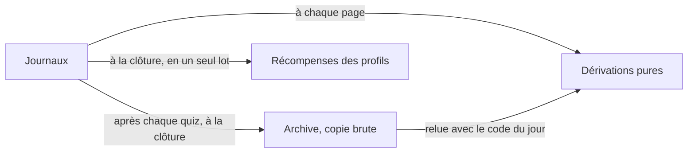

# Après la soirée

> La fin d'une soirée et ce qu'il en reste : la clore, ce que reçoivent les téléphones et l'écran commun, le souvenir, le bilan, l'historique, l'export et les prix. Pour l'animateur comme pour l'invité — tout se relit sans compte.

## Clore la soirée

L'historique s'écrit tout seul : dès le podium de chaque quiz, la soirée s'y range et l'expérience du quiz se crédite aux profils, sans un geste. Si elle s'arrêtait là, rien ne serait perdu ; l'historique la montre à part, « En cours ».

### « Clore la soirée », à l'écran commun

C'est le seul geste de fin de l'écran commun, dans la salle d'attente et sur l'écran de victoire dès qu'un invité est entré. La boîte propose un nom — celui que la soirée porte déjà dans l'historique, sinon le titre de ton espace, sinon « Soirée du *date* » —, que tu peux changer (80 caractères au plus). Confirmer :

1. termine le quiz en cours : ses questions révélées comptent, celle qui était ouverte non ;
2. range la soirée une dernière fois dans l'historique, sous ce nom ;
3. crédite ce qui ne se décide qu'une fois tout joué ([Ce qui se gagne, et quand](#ce-qui-se-gagne-et-quand)) ;
4. efface la soirée du serveur — la sauvegarde distante d'abord, la base locale ensuite ;
5. envoie à chaque téléphone sa fin de soirée, et à l'écran commun l'annonce de la soirée close.

Le code du salon survit une demi-heure à la clôture, pour un retardataire.

> [!IMPORTANT]
> Rien ne s'efface tant que rien ne s'est écrit au loin : si la base distante ne répond pas, la soirée reste entière, aucun téléphone ne reçoit de fin, et la console affiche « Rien n'a été effacé : … ». Il suffit de réessayer.

**Une seule fin à la fois** : pendant une clôture (« Clôture en cours… »), un second « Clore » attend le premier et en reçoit l'issue, et « C'était un essai » est refusé — l'inverse aussi. Deux fins croisées recréditaient les profils et réannonçaient la soirée devant un podium vide.

### « C'était un essai »

Dans la même boîte, « C'était un essai » efface tout, après une seconde confirmation : ce que la soirée avait crédité est repris aux profils — expérience, prix, hauts faits —, son archive disparaît, et les téléphones repassent par l'entrée. Une soirée close sans rien de joué s'efface de même (« Soirée vierge — rien n'avait été joué »).

### Depuis ton salon, sur ton téléphone

Quand tu animes depuis ton téléphone (« Créer un salon »), ta barre de chef clôt aussi :

- au verdict du dernier quiz du programme, elle propose « Terminer la soirée », et le podium reste à l'écran jusqu'à ce geste — rien ne se décompte ; ajouter un quiz au programme, ou en relancer un, défait cette fin ;
- hors d'un quiz, « ⋯ » propose aussi « Terminer la soirée » ;
- pendant le dernier quiz du programme, « Terminer le quiz » prévient (« Terminer ce quiz et la soirée ? ») : le quiz se termine et la soirée se clôt aussitôt.

La soirée garde le nom qu'elle porte dans l'historique. Sous ta fin de soirée, « Ton salon » propose « Encore un quiz, avec eux » et « C'était un essai », qui retire la soirée close de l'historique.

### Une soirée laissée en plan

Rien ne clôt une soirée tout seul : oubliée, elle reste la soirée en cours, et les quiz suivants, même un autre jour, s'y ajoutent sous le même nom. Sans un geste depuis six heures, elle passe « laissée en plan » au QG, où l'administrateur peut la clore comme son animateur l'aurait fait ([Administrer](../guides/administrer.md)).

## Ce que chacun reçoit à la clôture

### Sur chaque téléphone : la fin de soirée

Chaque invité reçoit la sienne, anonyme compris. C'est l'écran des gains de tous les modes — le même qu'à la fin d'une partie du quiz du jour ou d'une série —, de haut en bas :

- **le tableau de bord** : « Fin de la soirée », son nom, ton avatar et ton prénom tels que la salle les a vus, ta place « sur *N* » et tes points (ou « Tu n'as pas joué ce soir », « Tu animais la soirée ») ; avec un profil, tes records battus (« Record battu · … ») ;
- **« Ce que tu gagnes »**, avec un profil : l'expérience en un total — quand les deux comptent, « ta soirée », ce que « Mes soirées » lui compte, et « tes pistes », payées à part —, tes confettis, ton niveau (« Niveau *N* ! » s'il monte) et la finition qu'il ouvre ;
- **ce qui tombe en grand** : un Divin descendu sur toi, l'Éclat s'il a frappé, un avatar légendaire débloqué — le Divin et le légendaire avec « Le porter » ;
- **« Nouveaux trophées »** : trois au plus, les plus rares d'abord — les étapes de tes pistes (celles d'une même piste sur une ligne : « Le Bavard · Bronze → Argent »), tes exploits, tes prix du palmarès, puis tes coups du sort —, « Et 2 autres » pour le reste ; avec un profil, chacun mène à sa page de l'album des trophées, et « Il rejoint ta collection : *N* prix sur 20 » quand un prix y entre pour la première fois ;
- **« À porter »**, avec un profil : ce que tes étapes de piste viennent d'ouvrir — un fond, une gerbe, un thème — et l'emoji de collection d'un niveau gagné, chacun avec « Essayer », qui ouvre la loge l'essai déjà sur ta carte ;
- **deux boutons** : « Mon bilan », ouvert sur toi (« Revoir la soirée » si tu es arrivé après la dernière question), et « Accueil ».

Le reste se replie sous « Plus » : le souvenir, ton profil, la boutique, à quoi servent tes confettis, ce que tu approches, le quiz du jour. Un invité sans profil a sa soirée entière — son tableau de bord, ses trophées —, sans ce que rapporte un profil ; une ligne l'invite à en créer un, prénom et avatar du soir déjà remplis — « Il commence à la prochaine : celle-ci ne s'y ajoute pas. »

Même les soirs où rien ne tombe, la fin d'un profil dit qu'il avance : un **record battu**, dans le tableau de bord — sa plus longue série, ses bonnes réponses, sa précision sur vingt QCM au moins, contre toutes ses soirées d'avant —, et, sous « Plus », **« Tu t'en approches »** : deux objectifs au plus, qui ont avancé ce soir et dont il a passé la moitié (« 284 sur 300 bonnes réponses · +41 ce soir »). Les seuils sont dans [les barèmes](../reference/baremes.md).

### Revoir sa fin plus tard

La fin se garde sur le téléphone, et se rouvre quand tu **reviens** sur la page — rechargement, retour du navigateur — pendant douze heures. Une **arrivée** (un lien, le QR, « Jouer depuis cet appareil ») ouvre l'entrée de la soirée suivante : on vient pour jouer. Pendant sept jours, l'entrée de l'espace propose encore « La dernière soirée : le souvenir · mon bilan », et l'accueil la plus récente, sous son nom. Un téléphone qui dormait pendant la clôture retrouve sa fin s'il revient sur sa page ; si le serveur a redémarré entre-temps, il apprend au moins que la soirée est close.

### Sur l'écran commun : la soirée close

L'écran commun annonce à la salle « La soirée est close », son nom, le QR « Le souvenir de la soirée » (l'adresse de son archive), le podium de la soirée, les équipes qui l'emportent, puis ce qui est tombé : un Divin descendu (son nom seulement), les avatars légendaires débloqués et ceux qui ont éclaté, les montées de niveau et les hauts faits de chacun. La console propose « Le souvenir », « Copier le lien », « Le bilan », « Les fiches », « L'historique » et « La soirée suivante », qui rend la salle d'attente à tous les écrans.

## Ce qui se gagne, et quand

L'expérience d'un quiz se crédite dès qu'il rend son verdict, et ne redescend jamais en cours de soirée : au podium de chaque quiz, le téléphone d'un profil la fête un instant — « +45 XP », « Niveau 12 ! » s'il monte, la finition ou l'emoji de collection qu'il ouvre —, sans un trophée. Ce qui ne se juge qu'une fois tout joué attend la clôture : le podium de la soirée, l'assiduité, les prix du palmarès, les hauts faits de la soirée, les étapes des pistes et les avatars légendaires qu'ils ouvrent. Les hauts faits s'annoncent alors à l'écran commun, et chaque fin de soirée range ceux de son invité sous « Nouveaux trophées » ; leur catalogue, le barème et les Divins sont dans [Les récompenses](les-recompenses.md). Un prix ne rapporte jamais d'expérience.

Un invité exclu en cours de soirée rend ce qu'elle lui avait crédité.

## Le souvenir

Le souvenir est la page de la soirée, pour tout le monde, sans compte : `/<espace>/souvenir` pendant la soirée, puis l'adresse de son archive pour toujours. En tête, « Souvenir · *date* », le nom, « *N* joueurs · *N* quiz · *N* points distribués » et un bouton pour partager son lien — l'adresse d'archive, dès que la soirée s'est rangée une première fois.

Suivent « Le podium », « Les équipes au quiz », « Remis ce soir-là », « Le palmarès » (les prix que les chiffres désignent, remis ou non), les distinctions — « Le plus beau coup », « Le plus régulier », le vainqueur de chaque quiz, ex æquo compris —, [« Les chiffres »](#les-chiffres-de-la-soirée) et « Le reste du classement ». `/<espace>/stats` ouvre le souvenir sur ses chiffres : c'est le QR de la remise des prix.

Pendant la soirée, la page se rafraîchit seule toutes les vingt secondes, sauf dans un onglet caché ; une soirée archivée ne bouge plus. Un surnom donné ce soir-là à l'écran commun s'affiche partout et reste dans l'archive ; le profil garde son prénom.

## Le bilan, question par question

Le bilan (`/<espace>/bilan`) raconte à chacun sa soirée. On choisit son prénom dans « Qui es-tu ? » et l'on relit chaque question : l'intitulé, sa réponse, la bonne, son temps, ses points, et ce que son équipe et la salle ont répondu. Tout le monde peut lire le bilan de tout le monde : c'est un souvenir, pas un carnet de notes. Le téléphone qui jouait ouvre directement le sien ; sur un autre appareil, un profil connecté retrouve le sien dans une soirée archivée.

Celui d'un invité commence par ses tuiles — points, précision, coup d'œil, temps moyen — et « Tes moments forts » (ses prix, sa plus longue série, « La seule bonne réponse de toute la salle »…) ; l'onglet « La soirée » relit chaque question pour tout le monde, avec la répartition des réponses.

Les intitulés viennent de la copie exacte du quiz joué, gardée dans l'archive : retoucher la bibliothèque ensuite ne change pas le bilan. Une question « Qui dans la salle ? » n'y est pas : sans bonne réponse, elle n'entre pas au journal.

### Les pages à imprimer

`/<espace>/bilan/fiches` enchaîne le bilan de chaque invité qui a joué, une page chacun, en thème Ivoire : « Imprimer », puis « Enregistrer en PDF ». L'adresse est publique, mais son lien ne s'affiche qu'à l'animateur connecté — comme, sur une soirée close, « Tous les liens — un bilan par invité », à coller d'un coup dans le groupe.

## L'historique des soirées

L'historique de l'espace se lit à `/<espace>/soirees`, sans compte : la soirée en cours à part, puis chaque soirée close, avec son « Souvenir » et son « Bilan ». Connecté, l'animateur y **renomme** une soirée ou la **retire**, comme dans « Mon compte » (`/compte#historique`) : son souvenir et son bilan disparaissent, avec ce qu'elle avait rapporté aux profils — c'est définitif. La soirée en cours, elle, s'efface par « C'était un essai ».

| Page | Pendant la soirée | Pour toujours |
|---|---|---|
| Souvenir | `/<espace>/souvenir` | `/<espace>/soirees/<id>/souvenir` |
| Souvenir, sur ses chiffres | `/<espace>/stats` | `/<espace>/soirees/<id>/stats` |
| Bilan | `/<espace>/bilan` | `/<espace>/soirees/<id>/bilan` |
| Pages à imprimer | `/<espace>/bilan/fiches` | `/<espace>/soirees/<id>/bilan/fiches` |

**Entre deux soirées**, le souvenir et le bilan de l'espace montrent la dernière soirée close, son nom en tête, jusqu'à la première question jouée de la suivante — sans redirection : le QR scanné au podium mène encore à la soirée le lendemain. Toutes les adresses : [la référence des adresses](../reference/adresses.md).

### Le nom d'une soirée

Une soirée se date à sa première question jouée — l'heure de sa révélation —, jamais à l'arrivée d'un invité : l'invitée revenue relire la veille, ou le QR testé la veille, la dataient sinon du mauvais jour. Son identifiant (`2026-10-13-k7x2q-3fz81a`) dit ce jour, l'instant de cette première réponse et une empreinte de l'espace ; il se tire une seule fois, et ni une exclusion ni un redémarrage ne le changent — recalculé, il comptait l'expérience deux fois. Son nom affiché reste « Soirée du *date* » tant que tu ne lui en donnes pas un.

## L'export

`npm run export` écrit une soirée en fichiers, pour la garder à l'abri ou rédiger tes messages toi-même — `npm run export -- https://ton-serveur.example --slug demo --soiree <id>`, ou `--db` pour lire la base distante sans le serveur ([les commandes](../reference/commandes.md)).

Il écrit dans `export/<espace>/` un `bilan.json` complet et trois CSV faits pour Excel, au point-virgule : `invites.csv` (une colonne par question : « Canberra ✔ · 1,8 s · 200 pts »), `questions.csv` (la répartition des réponses, la réussite de chaque équipe) et `equipes.csv` (un quiz par colonne). Une cellule qui commencerait comme une formule (`=`, `+`, `-`, `@`) prend une apostrophe : un prénom piégé reste du texte. Sans `--soiree`, c'est la soirée en cours — vide entre deux soirées, où l'export refuse (« Aucune question au journal : rien à exporter. ») : la dernière close s'exporte par son identifiant, celui de ses adresses.

## Les prix de fin de soirée

Du journal des réponses — qui, à quelle question, en combien de temps, juste ou faux, et les questions laissées passer — sortent vingt prix individuels et deux prix d'équipe : **le palmarès**. Il se lit au souvenir et au bilan, et la remise des prix le propose à l'animateur. **Aucun point n'est attribué automatiquement.** Un seul lauréat par prix : à égalité parfaite, celui qui l'a tenu sur le plus de questions, puis l'ordre alphabétique — et la carte le dit (« Ex æquo avec Zoé — départagé par ordre alphabétique »). À la clôture, chaque prix individuel dont le lauréat a un profil rejoint sa collection, remis ou non ; les prix d'équipe ne se rangent nulle part.

### Le palmarès

Un prix ne se propose que s'il a de la matière : son seuil est dans la dernière colonne.

| Prix | Ce qui le décerne | Seuil pour être proposé |
|---|---|---|
| ⚡ L'Éclair | Le temps de réponse moyen le plus court, sur ses bonnes réponses | 3 bonnes réponses ; deux temps moyens différents parmi les prétendants |
| 🐢 Le Contemplatif | Le plus lent à répondre… mais juste quand même | les mêmes ; jamais la même personne que L'Éclair |
| 🔫 La Gâchette Facile | Vite et faux : ses erreurs rapportées à son temps de réponse moyen, sur tous ses QCM | 2 erreurs, moins de 50 % de précision |
| ⏰ Le Buzzer de Fin | Le plus souvent validé dans la dernière seconde | 1 réponse |
| 💯 Le Plus Précis | Le meilleur pourcentage de bonnes réponses | 3 QCM répondus, dont 1 juste |
| 🙃 Le Cancre Magnifique | Le plus de mauvaises réponses — un prix, pas une punition | 2 erreurs |
| 😴 L'Abstentionniste | A laissé passer le plus de questions sans rien envoyer | 2 questions |
| 🔥 L'Invincible | La plus longue série de bonnes réponses d'affilée | une série de 3 |
| 🌚 La Série Noire | La plus longue série de mauvaises réponses d'affilée | une série de 3 |
| 🔮 Le Compas dans l'Œil | Le plus juste sur les questions chiffrées, au [coup d'œil](#les-chiffres-de-la-soirée) | 2 estimations comparées |
| 🎈 L'Optimiste | Estime en moyenne au-dessus de la vérité | 2 estimations, plus de 5 % au-dessus |
| 🌧️ Le Pessimiste | Estime en moyenne en dessous de la vérité | 2 estimations, plus de 5 % en dessous |
| 🎯 Le Pile-Poil | Le plus d'estimations tombées exactement juste | 1 estimation exacte |
| 🦄 Le Franc-Tireur | Le plus souvent seul de toute la salle sur sa réponse | 2 fois |
| 🐑 Le Mouton | Le plus souvent sur la réponse la plus choisie de la salle, seule en tête | 3 fois |
| ✋ Le Doigt qui Tremble | A changé d'avis le plus souvent avant la révélation | 2 revirements |
| 🦸 Le Sauveur | Le plus souvent seul de son équipe à trouver, avec deux coéquipiers au moins à la question | 2 fois |
| 📈 La Remontada | A le plus progressé entre son premier quiz et son dernier (son rang dans chacun) | 2 quiz joués, 2 places gagnées |
| 📉 La Chute Libre | A le plus reculé entre son premier quiz et son dernier | 2 quiz joués, 2 places perdues |
| 👁️ L'Œil de Lynx | La meilleure mémoire sur les questions à photo qui disparaît | 2 de ces questions, la moitié justes |
| 🤝 Le Coup de Pouce *(équipe)* | L'équipe du joueur qui a le moins marqué, parmi ceux qui ont répondu | un joueur en équipe qui a répondu |
| ⚖️ La Plus Solidaire *(équipe)* | L'équipe dont les membres ont les points les plus proches | deux membres qui ont répondu ; à égalité, l'équipe du mieux classé |

Les règles et les seuils vivent dans `server/src/core/stats.ts`.

### Les prix remis à l'écran

La remise des prix, à l'écran commun — « Remise des prix » au podium d'un quiz quand la soirée a des équipes, puis au podium de la soirée et sur l'écran de victoire —, propose chaque prix du palmarès avec son lauréat, sa règle et le chiffre qui le justifie. **Un prix se remet pour le plaisir** : il s'annonce à la salle sans rien changer au classement, et vaut d'office zéro point (`POINTS_D_UN_PRIX`). Tu peux lui en donner, en plus ou en moins, jusqu'à 500 (`PRIX_MAX`, dans [les barèmes](../reference/baremes.md)) : ils vont à l'équipe du lauréat, et la remise dit avant le clic ce qu'ils changeraient au classement.

**Un prix libre** se remet à une équipe pour ce qui ne se calcule pas — un motif de 60 caractères (« ont chanté le plus fort »), des points si tu veux. Un prix mal donné se retire d'un toucher, dans « Prix déjà remis ». Le souvenir et le bilan montrent les prix remis dans « Remis ce soir-là », dans l'ordre : c'est le seul endroit où vit un prix libre.

## Les chiffres de la soirée

Le tableau « Les chiffres » du souvenir a une ligne par invité et dix-huit colonnes, triables d'un toucher sur l'en-tête ; leur légende se déplie dessous (« Que veulent dire ces colonnes ? »).

**La précision ne compte que les QCM** : une estimation n'est ni juste ni fausse. Elle dit toujours sur combien elle porte — « 3 justes sur 4 QCM » au bilan, « précision 75 % (3 sur 4 QCM) » dans « Mes soirées » : 50 % sur deux questions ne se lit pas comme sur deux cents.

**Une estimation se juge au coup d'œil** : la part de la salle qu'elle bat ou égale — 100 % quand personne n'a visé plus près, 0 % quand tout le monde l'a fait ; les ex æquo partagent leur rang. Le coup d'œil d'un joueur est la moyenne des siens. L'écart en pour cent mesurait la question plus que le joueur — trois ans sur 1994 font 0,15 %, trois sur 54 en font 6 % —, et une faute de frappe triplait la moyenne d'une soirée. Les deux ne se fondent jamais en un seul chiffre.

## Comment c'est construit

Le souvenir, le bilan, les chiffres et les prix se **dérivent** des journaux de la soirée — une ligne par invité et par question posée, réponse ou non —, par des fonctions pures : `buildRecap` (`server/src/core/recap.ts`), `buildReview` (`server/src/core/review.ts`), `computeStats` (`server/src/core/stats.ts`) ; l'expérience, par la même lecture (`server/src/core/journal.ts`).

**L'archive est une copie brute**, dans la base permanente : invités, équipes, prix remis, les deux journaux et les quiz tels qu'ils ont été posés. Rien n'y est précalculé : une soirée d'il y a deux ans se relit avec le code d'aujourd'hui (`recapOfArchive`, `reviewOfArchive`, `server/src/core/archive.ts`), et une amélioration du bilan profite aux soirées passées.

**La clôture décide en une fois** (`SpaceRuntime.closeParty`, `server/src/core/space.ts`) : l'expérience de la soirée entière, puis les prix, les hauts faits, les Divins et les légendaires de saison, remplacés **en un seul lot** (`remplacerRecompensesDeSoiree`, `server/src/auth/profiles.ts`), puis les étapes des pistes (`accorderPaliers` : le code les appelle des paliers). Chaque passage remplace le précédent : on recrédite sans jamais payer deux fois. Le détail est dans [Les données](../architecture/donnees.md).

## Pour aller plus loin

- [Une soirée de bout en bout](la-soiree.md) — ce qui précède la clôture
- [Les récompenses](les-recompenses.md) — l'expérience, les hauts faits, les Divins
- [Animer une soirée](../guides/animer-une-soiree.md) — la remise des prix et la clôture, pas à pas
- [Jouer](../guides/jouer.md) — la fin de soirée et le bilan, côté invité
- [Le profil](le-profil.md) — « Mes soirées », la collection de prix
- [Les barèmes](../reference/baremes.md) — les seuils et les points
- [L'API HTTP](../reference/api-http.md) — `recap.json`, `bilan.json`, `soirees.json`
