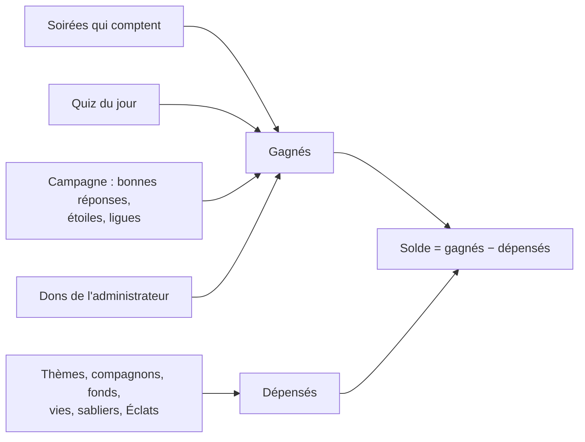
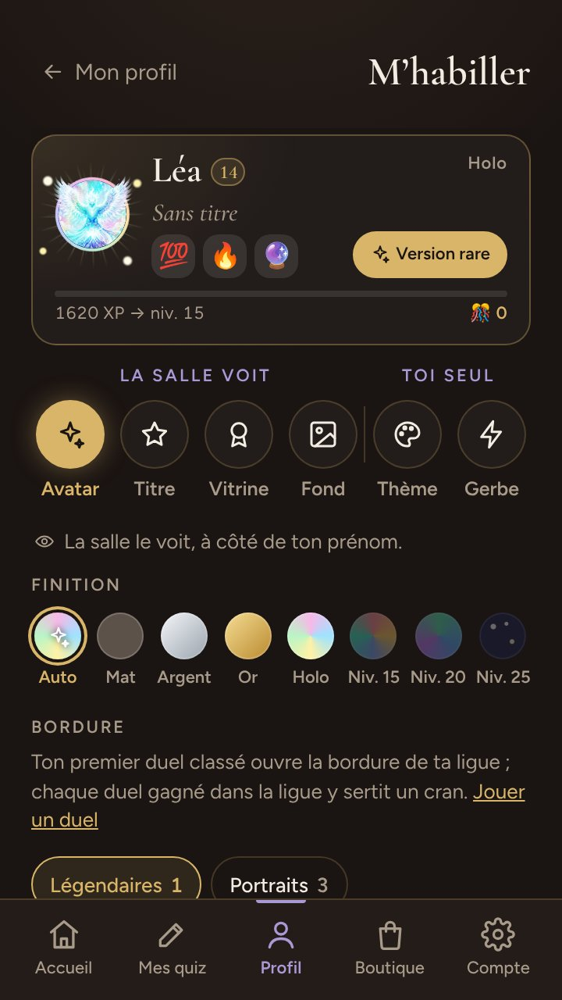

# La boutique

> Les confettis et ce qu'ils achètent, pour qui joue avec un profil : comment on les gagne et les dépense, le solde qui se relit, puis le catalogue — trente-cinq thèmes, vingt-cinq fonds de carte, vingt-quatre gerbes, cinq compagnons — et l'identité visuelle de FiestApp.

**Dans cette page** : [gagner des confettis](#gagner-des-confettis) · [les dépenser](#les-dépenser) · [un solde qui se relit](#un-solde-qui-se-relit) · [la boutique et ses rayons](#la-boutique-et-ses-rayons) · [essayer et porter](#essayer-et-porter) · [les thèmes](#les-thèmes) · [les fonds de carte](#les-fonds-de-carte) · [les gerbes](#les-gerbes) · [les compagnons](#les-compagnons) · [l'identité visuelle](#lidentité-visuelle) · [comment c'est construit](#comment-cest-construit)

Les confettis sont la monnaie des profils, et leur règle tient dans la phrase que l'application répète partout : « Une bonne réponse, un confetti ». Ils n'achètent que de l'habit — un thème pour tes pages, un compagnon pour ton avatar, un fond pour ta carte — et deux objets pour le jeu solo : rien de ce qui s'achète ou se gagne ici ne rapporte un point en soirée. L'invité sans profil joue en Velours, sans gerbe ni confettis, et rien ne lui montre ce qui lui manque : tout se joue sans compte. Chaque valeur citée a sa ligne dans [les barèmes](../reference/baremes.md).

## Gagner des confettis

Ton solde se lit au bout de ta ligne d'expérience (« 🎊 820 »), sur l'accueil, ton profil et la loge, et en tête de la boutique. Chaque fin qui en rapporte le dit sous « Ce que tu gagnes » — « 🎊 +7 confettis » au quiz du jour ; sur les sentiers, « 🎊 +14 confettis », puis « Dont 10 confettis pour tes étoiles. » —, et la fin de soirée ajoute, sous « Plus », à quoi ils servent : « Tu en as 820 : 1 thème à ta portée, et plus que 180 pour le thème Aurore boréale. »

| D'où | Ce qui paie | Combien |
|---|---|---|
| Une soirée qui compte | chaque QCM juste — « plusieurs » et « ordre » trouvés en entier — et chaque estimation dans le tiers le plus proche de la salle | un confetti chacun, sans bonus de rapidité ni multiplicateur |
| Le quiz du jour | chaque bonne réponse, partie en cours comprise | un confetti chacune |
| La campagne | chaque bonne réponse, dans tous ses modes : séries, épreuves des sentiers, parcours de thème, révisions du carnet, défi de la semaine, duels | un confetti chacune |
| Les étoiles des sentiers | la meilleure note de chaque palier des douze sentiers (pas celles des parcours de thème) | deux étoiles 10, trois étoiles 25 (`CONFETTIS_DES_ETOILES`) ; une meilleure note paie la différence |
| Les ligues des duels | chaque semaine close où tu as joué trois duels (`DUELS_POUR_LA_RECOMPENSE`) paie ta meilleure ligue de la semaine | bronze 10, argent 20, or 30, platine 40, diamant 50, maîtres 60 (`LIGUES`) ; la semaine en cours paie le lundi |
| L'administrateur | un don, depuis ta fiche au QG, avec un mot s'il le veut ; ou une annonce à tous — après une panne, pour une fête —, un don par profil | de 1 à 500 (`CONFETTIS_PAR_DON_MAX`), annoncé une fois sur ton accueil ; de 0 à 500 sous une annonce, à chacun des profils d'alors |
| Les missions du jour | chaque mission faite, et les trois le même jour ([les missions](les-missions.md)) | 15 chacune, 15 de plus pour les trois — 60 au plus par jour |
| Le coffre de la semaine | sa rareté commune, ou quand tu as déjà tout le reste | 60, 90, 120 ou 150 selon le coffre (`CONFETTIS_DU_COFFRE`) |

**Une soirée compte** dès que tu y as répondu à une question posée à deux joueurs au moins : seul devant ton propre quiz, tu connais les réponses. Ses confettis tombent dès le podium de chaque quiz, comme l'expérience.

> [!NOTE]
> **Des bonnes réponses, pas des points.** Une finale « ×3 » paie trois fois plus de points à ceux qui sont là ce soir-là, et un téléphone lent perd son bonus de rapidité : comptés en points, les confettis auraient hérité des deux.

## Les dépenser

| Ce qui s'achète | Prix | Où | Combien |
|---|---|---|---|
| Un thème | de 150 à 1 000 selon sa rareté (`PRIX_DES_THEMES`) | la boutique, rayon « Thèmes » | une fois chacun ; un thème de saison, pendant sa saison |
| Un compagnon | 1 000 (`PRIX_D_UN_COMPAGNON`) | rayon « Compagnons » | une fois chacun |
| Un fond des savoirs | 250 (`PRIX_D_UN_FOND`) | rayon « Fonds » | une fois chacun |
| Une vie des sentiers | 25 (`PRIX_D_UNE_VIE`) | rayon « Objets », ou « Plus de vies » sur les sentiers | de 1 à 10 par achat (`VIES_PAR_ACHAT_MAX`), dans une réserve qui ne périme pas |
| Un sablier | 50 (`PRIX_D_UN_SABLIER`) | rayon « Objets » ; le quiz du jour y mène | un ou deux à la fois, deux au plus en réserve (`SABLIERS_MAX`) |
| Un Éclat | 3 000 (`PRIX_D_UN_ECLAT`) | rayon « Objets » | un à la fois ; il attend en réserve dans la loge, qui le dépense sur l'avatar choisi |

Le serveur compte chaque achat contre ton solde relu à l'instant, **un seul à la fois par profil** — deux onglets ou un double toucher liraient le même solde —, et la page affiche le solde qu'il rend, jamais une soustraction faite dans le téléphone. Un refus se dit en clair, là où tu as touché : « Il te manque 150 confettis pour le thème Cahier d'écolier », « Le thème Halloween revient en boutique du 25 octobre au 1er novembre ». Les gerbes, les cinq thèmes qui se gagnent et les fonds qui se gagnent ou sortent du coffre ne s'achètent pas ; rien ne se rembourse, ne se revend ni ne se donne entre joueurs.

## Un solde qui se relit

Ton solde n'est écrit nulle part. À chaque lecture — l'accueil, ton profil, la boutique, un achat, la fin d'une soirée —, le serveur recompte tout ce que tu as gagné et retranche ce que tu as dépensé, chaque achat au prix écrit avec lui.

- **Tout est rétroactif.** Une soirée retirée de l'historique — ou un essai effacé — reprend ses confettis, et ton solde peut passer sous zéro ; la boutique dit alors « Une soirée retirée de l'historique a repris ses confettis. Tes thèmes, eux, te restent. » Un solde négatif bloque les achats, rien d'autre : ce que tu as acheté reste à toi, un thème porté reste porté.
- **Une règle qui change change le solde de tout le monde, d'un coup.** Ni version ni drapeau, contrairement à l'expérience : quand les étoiles des sentiers se sont mises à payer, elles ont payé toutes celles déjà gagnées. Toucher à `CONFETTIS_DES_ETOILES`, à `LIGUES` ou à la règle d'une soirée est un choix de produit qui déplace tous les soldes, passé compris.
- **Un prix qui change ne touche à aucun achat** : chacun garde le prix qu'il a payé. Changer `PRIX_DES_THEMES` ne rembourse personne et ne fait repayer personne. Un achat ne se reprend jamais, un don non plus.

## La boutique et ses rayons

La boutique (`/boutique`) est dans la barre du menu, entre « Profil » et « Compte » : en tête, « Boutique » et ton solde, puis quatre rayons sous une barre d'onglets fine, chacun à son adresse — « Thèmes » (`/boutique`), « Compagnons » (`/boutique#compagnons`), « Fonds » (`/boutique#fonds`), « Objets » (`/boutique#objets`). La fin d'une soirée y mène par « La boutique des thèmes », le quiz du jour par « Un sablier à la boutique · 50 confettis ». Sans profil, `/boutique` ouvre l'accueil et ses trois gros boutons, « Jouer sans compte » d'abord.

**Le rayon « Thèmes »** ne montre que ce que tu n'as pas et que la date permet — ni les offerts, ni ceux qui se gagnent, ni un thème hors de sa saison —, une rareté à la fois, choisie sur une rangée de gemmes (d'office la plus haute où un thème est à ta portée) : « Rare · 🎊 400 le thème · 3 en boutique ». Chaque thème y est une carte bordée de la couleur de sa rareté : son aperçu — l'écran d'une question photographié sous ce thème —, son nom, son prix ou « encore 50 », sa période s'il est de saison.

- **Toucher une carte ouvre sa fiche, jamais un achat** : l'aperçu en grand, son humeur, « Il coûte 250 confettis : il t'en restera 170. » et « L'acheter · 🎊 250 » — trop cher, « encore 580 », sans bouton.
- « L'acheter » ouvre un choix : **« Acheter et porter »**, **« L'acheter seulement »** ou « Plus tard ». Acheter sans porter, c'est prendre un thème de saison avant qu'il ne parte, ou compléter son album, sans quitter celui qu'on aime. La boutique dit ensuite où il est passé : « Océan habille tes pages. », ou « Océan est à toi : le porter quand tu veux. »
- Au pied du rayon, « 3 thèmes déjà à toi : les porter » mène à la loge.

**Le rayon « Compagnons »** est une vitrine qu'on fait défiler du doigt, une scène par compagnon, et un point par compagnon dessous : sa forme du moment en grand, qui flotte — touchée, elle bondit et des cœurs s'envolent —, son nom et sa rareté, puis ses quatre formes en couleur, chacune avec ce qu'elle demande (« Achat », 100, 300, 500) ; toucher une forme la montre en grand sur la scène. Dessous, son prix et « L'adopter » : adopté, il s'installe dans ta niche, et rien de plus — il ne devient pas ton avatar (le 19 octobre 2026 : « ça le met sur notre avatar et dans la niche. Ça serait mieux que dans la niche », le propriétaire). Si un autre y vit déjà, tu choisis : « L'adopter et l'installer » ou « L'adopter seulement » — celui qui y vit la garde, et continue de grandir. Trop cher, « Encore 180 confettis » et ce que tes missions du jour rapportent ; à toi, s'il est dans ta niche — sinon « L'installer dans ma niche » —, sa jauge — après sa forme ultime, celle du palier suivant de sa niche —, les formes atteintes cochées, « Le porter en avatar », qui ouvre la loge avec lui à l'essai, et « Gérer ma niche », qui ouvre son écran du profil ([les compagnons](#les-compagnons)). `/boutique#compagnon-tortue` ouvre la vitrine sur lui : « À la une » et la collection y mènent.

**Le rayon « Fonds »** vend les douze fonds des savoirs, deux par rangée : chacun est ta carte telle que la salle la verrait — ton avatar et ton prénom posés sur le fond, le savoir qu'il habille en pastille —, son nom et son prix, ou « Porté », « À toi ». Toucher une carte ouvre sa fiche (`/boutique#fond-jazz`) : ta carte en grand, « Il coûte 250 confettis : il t'en restera 170. » et « L'acheter · 🎊 250 », avec le même choix qu'un thème — trop cher, « encore 80 » et ce que tes missions du jour rapportent ; à toi, « L'essayer sur ma carte » ouvre la loge, l'essai en place. Au pied du rayon, « 1 sur 12 à toi : le porter » mène à la loge. Les fonds du trésor n'y paraissent pas : seul le coffre de la semaine les donne, et « Ma collection » le dit ([les fonds de carte](#les-fonds-de-carte)).

**Le rayon « Objets »** a une case par objet, avec son prix et ce que tu en as — « 0/2 » pour les sabliers, ta réserve pour les vies. Sa fiche (`/boutique#objet-vie`, `/boutique#objet-sablier`) dit ce qu'il fait, puis la quantité (− et +), le total, « Acheter » ou « Il te manque 30 confettis ». La vie sert après celles du jour ([les sentiers du savoir](les-sentiers-du-savoir.md)) ; le sablier garde ta série un jour manqué ([le quiz du jour](le-quiz-du-jour.md)). L'Éclat (`/boutique#objet-eclat`, depuis le 31 octobre 2026 : « pour ceux qui n'ont pas de chance », le propriétaire) s'achète un à un, 3 000 confettis : il attend en réserve, et la loge, pièce « Avatar », le dépense — « Choisir un avatar » montre chacun des tiens déjà éclaté, et le toucher l'ouvre en grand, aujourd'hui et éclaté côte à côte, avant « Faire éclater » : c'est pour toujours. Cher exprès : le tirage de chaque soirée et de chaque partie du jour reste la voie de tous.

## Essayer et porter

Ce que tu as se porte dans **la loge**, « M'habiller » sur ton profil ([le profil](le-profil.md)) : la pièce « Fond », sous « La salle voit », puis « Thème » et « Gerbe », sous « Toi seul ». Chaque pièce ne montre que ce que tu as, et compte dessous ce qui reste — « 13 fonds à gagner : où ? », vers « Ma collection » ; sous « Thème » et « Fond », « N autres à la boutique » aussi. **Un toucher essaie, rien ne s'enregistre** : un thème touché habille toute la page, un fond s'essaie derrière ta carte, une gerbe éclate. Une barre prend la place du menu — ce que tu essaies, « Annuler », « Porter » — et « Porter » enregistre tout l'essai d'un coup ; quitter la loge rend le thème que tu portais. Quand un toucher portait pour de bon, le doigt qui voulait seulement regarder un thème en habillait déjà toutes ses pages. La fin d'une partie qui vient de t'ouvrir un fond, une gerbe ou un thème le range sous « À porter » : « Essayer » ouvre la loge sur sa pièce, l'essai déjà en place — rien ne s'enregistre avant « Porter ».

**« Ma collection »** montre tout ce qui se gagne, en trois familles — les avatars, les trophées, puis le style. Dans le style, les thèmes en album, une page par rareté — en couleur ceux qui sont à toi, en gris les autres —, puis les fonds, les gerbes, les finitions et les bordures de ligue en petits albums : une case chacun, éteinte s'il reste à gagner, et sa fiche dit comment l'avoir et où tu en es — à toi et pas porté, « Essayer » ouvre la loge, l'essai déjà sur ta carte. Elle ne vend ni ne porte : la fiche d'un thème à gagner dit « Il ne se vend pas : il se gagne avec cinquante victoires au quiz du jour. » et mène au quiz du jour ; celle d'un fond des savoirs, son prix et ce que tu en as déjà (« 🎊 120 sur 250 »), et « Le voir en boutique » ouvre sa fiche dans le rayon ; celle d'un objet du trésor, sa rareté au coffre (« Fond de carte · Légendaire ») et tes missions du jour, qui le remplissent. Une gerbe y éclate au toucher, même à gagner. Et l'album des trophées dit, sous chaque étape d'une piste, le fond, la gerbe ou le thème qu'elle ouvre.

## Les thèmes

Un thème habille **toutes tes pages, sur tout appareil où ton profil est connecté** — l'accueil, ton profil, la boutique, tes quiz, ton compte, ton salon, la soirée sur ton téléphone, le quiz du jour, la campagne, les duels, le souvenir, le bilan, le QG —, jusqu'à la barre du navigateur, et ton téléphone retient le dernier porté : la page s'ouvre déjà habillée. Il n'habille jamais **l'écran commun ni la télé** : la salle les regarde, et l'animateur qui a acheté la Licorne anime en Velours, ou en Ivoire. L'aperçu de l'écran commun, dans « Mes quiz », prend de même l'habit de la salle, et les fiches imprimées du bilan sont en Ivoire.

### Le catalogue

Trente-cinq thèmes : deux offerts à tous les profils, vingt-huit à vendre — dont six de saison — et cinq qui se gagnent. La rareté ne se mesure pas, elle se décrète avec le prix : Commune 150, Peu commune 250, Rare 400, Épique 650, Légendaire 1 000 (`PRIX_DES_THEMES`). Dans la colonne du décor, « clair » dit un fond clair, que la page annonce au navigateur ; « animé », un décor qui bouge et s'arrête si ton téléphone demande moins de mouvement ; « peint », un tableau pour décor.

| Thème | Rareté | Prix ou condition | Saison | Décor |
|---|---|---|---|---|
| Velours | Offert | offert | — | sombre |
| Ivoire | Offert | offert | — | clair |
| Cahier d'écolier | Commune | 150 | — | clair |
| Carnet de voyage | Commune | 150 | — | clair |
| Guinguette | Commune | 150 | — | sombre, animé |
| Pyjama | Commune | 150 | — | sombre, animé |
| Stade | Commune | 150 | — | sombre |
| Jungle | Peu commune | 250 | — | sombre, animé |
| Océan | Peu commune | 250 | — | sombre, animé |
| Pâtisserie | Peu commune | 250 | — | clair |
| Game Boy | Peu commune | 250 | — | clair |
| Forêt rousse | Peu commune | 250 | — | clair, animé |
| Carnaval | Peu commune | 250 | en février | clair, animé |
| Plage | Peu commune | 250 | en juillet et en août | clair, animé |
| Licorne | Rare | 400 | — | clair, animé |
| Héros | Rare | 400 | — | clair |
| Grimoire | Rare | 400 | — | clair |
| Film noir | Rare | 400 | — | sombre, animé |
| Disco | Rare | 400 | — | sombre, animé |
| Halloween | Rare | 400 | du 25 octobre au 1er novembre | sombre, animé |
| Neige | Rare | 400 | du 20 au 26 décembre | sombre, animé |
| Cerisiers | Rare | 400 | en avril | clair, animé |
| Néon | Épique | 650 | — | sombre, animé |
| Olympe | Épique | 650 | — | clair |
| Braises | Épique | 650 | — | sombre, animé |
| Cosmos | Épique | 650 | — | sombre, animé |
| Feu d'artifice | Épique | 650 | du 30 décembre au 2 janvier | sombre, animé |
| Aurore boréale | Légendaire | 1 000 | — | sombre, animé |
| Kintsugi | Légendaire | 1 000 | — | sombre, animé |
| Grand théâtre | Légendaire | 1 000 | — | sombre |
| Babel | Légendaire | se gagne : les douze paliers de maître des sentiers du savoir | — | sombre, animé |
| L'Horloge astronomique | Légendaire | se gagne : cinquante victoires au quiz du jour | — | sombre, peint, animé |
| Le Ciel du jour | Légendaire | se gagne : trente jours d'affilée au quiz du jour (L'Infatigable · Argent) | — | sombre, peint, animé |
| Les Très Riches Heures | Légendaire | se gagne : les douze pages du calendrier du quiz du jour | — | clair, peint, animé |
| Le Sommet | Légendaire | se gagne : une série de vingt en campagne (L'Alpiniste · Or) | — | sombre, peint, animé |

Trois thèmes peints suivent l'heure de Paris, quelle que soit celle du téléphone : les aiguilles de l'Horloge, l'aube, le jour, le crépuscule et la nuit du Ciel du jour, la page du mois des Très Riches Heures.

**Les saisons.** Un thème de saison n'est en boutique que pendant sa période, bornes comprises, au jour de Paris — le Feu d'artifice enjambe le Nouvel An, et février compte son 29 —, et, acheté, il se garde toute l'année. Halloween, Neige et Feu d'artifice reprennent les dates des légendaires de saison ([les récompenses](les-recompenses.md)).

**Les cinq qui se gagnent** ne paraissent jamais en boutique : « Ma collection » les montre et mène où les gagner. Ils se relisent à chaque lecture de ton profil, et ce qui les ouvre ne se perd pas — un palier de maître, une victoire, l'étape d'une piste, une page du calendrier : gagné, un thème reste à toi.

## Les fonds de carte

Un fond se voit **derrière ta carte** quand quelqu'un l'ouvre en touchant ton nom, et sur la carte en tête de ta loge ; rien d'autre ne change, ni l'écran commun ni les classements. Sans fond choisi, ta carte reste en Velours. Vingt-cinq fonds, de trois façons :

- **Sept se gagnent**, et se relisent à chaque affichage — celui que tu ne mérites plus (une soirée retirée qui te fait redescendre sous le niveau 20) cesse de se voir sans que rien ne soit réécrit, et revient avec ce qui l'avait ouvert.
- **Douze s'achètent**, les fonds des savoirs : un par catégorie de questions, tous peints, tous au même prix — 250 confettis (`PRIX_D_UN_FOND`), celui d'un thème peu commun : un fond se voit moins qu'un thème, qui habille toutes tes pages. Acheté, il est à toi pour de bon. Ils ne sortent pas du coffre de la semaine, dont les chances restent au trésor.
- **Six sortent du coffre de la semaine**, le trésor, à sa rareté — et de nulle part ailleurs : ils ne se vendent pas ([les missions](les-missions.md)).

| Fond | Il s'obtient avec | Décor |
|---|---|---|
| Nuit étoilée | 30 jours joués au quiz du jour | dessiné |
| Aurore boréale | le niveau 20 | dessiné |
| Kintsugi | 10 victoires au quiz du jour | dessiné |
| Grand théâtre | 25 soirées (L'Habitué · Or) | dessiné |
| Cabinet de curiosités | 3 paliers de maître des sentiers (`MAITRES_DU_CABINET`) — sans lien avec le [Cabinet de curiosités](le-cabinet.md), le mode venu après lui : il garde son nom et sa clé, rien ne se reprend | dessiné |
| Le Triomphe | un titre de champion du mois au quiz du jour | peint |
| Le Cadran solaire | 50 jours dans le premier quart du quiz du jour (L'Élite · Argent) | peint |
| Le Musée de nuit | 250 confettis en boutique — Culture générale | peint, des savoirs |
| Le Temple d'Égypte | 250 confettis en boutique — Histoire | peint, des savoirs |
| La Carte des navigateurs | 250 confettis en boutique — Géographie | peint, des savoirs |
| Le Laboratoire de la foudre | 250 confettis en boutique — Sciences | peint, des savoirs |
| La Savane au crépuscule | 250 confettis en boutique — Nature | peint, des savoirs |
| La Salle obscure | 250 confettis en boutique — Cinéma & séries | peint, des savoirs |
| Le Club de jazz | 250 confettis en boutique — Musique | peint, des savoirs |
| Le Vitrail | 250 confettis en boutique — Arts & lettres | peint, des savoirs |
| La Terre battue | 250 confettis en boutique — Sport | peint, des savoirs |
| Le Marché aux épices | 250 confettis en boutique — Cuisine | peint, des savoirs |
| La Table de jeux | 250 confettis en boutique — Jeux & pop culture | peint, des savoirs |
| Les Années folles | 250 confettis en boutique — Autour de la fête | peint, des savoirs |
| La Voie lactée | le coffre de la semaine — rare | peint, du trésor |
| Le Jardin des lanternes | le coffre de la semaine — rare | peint, du trésor |
| Les Abysses | le coffre de la semaine — épique | peint, du trésor |
| La Bibliothèque enchantée | le coffre de la semaine — épique | peint, du trésor |
| Le Dragon d'or | le coffre de la semaine — légendaire | peint, du trésor |
| La Cité céleste | le coffre de la semaine — légendaire | peint, du trésor |

Les six du trésor ne se trouvent nulle part ailleurs : seul le coffre de la semaine les donne, à sa rareté ([les missions](les-missions.md)), et ce qu'il a donné reste à toi. La boutique ne les montre pas, pas même en vitrine : « Ma collection » dit d'où ils viennent.

Sous tous les thèmes — le tien comme celui de qui regarde —, une carte à fond garde les couleurs du Velours : le décor d'un fond est nocturne, et le thème Héros, qui la repeignait en blanc, y laissait une encre claire illisible.

## Les gerbes

Une gerbe éclate **sur ton téléphone, à chaque bonne réponse**, et sur le tien seulement : ni la salle ni l'écran commun n'en savent rien. En soirée : un QCM juste, « plusieurs » ou « ordre » trouvés en entier, une estimation pile-poil — pas une estimation seulement proche, qui paie pourtant son confetti. Puis au quiz du jour, en campagne — série, défi, duel —, aux épreuves des sentiers et aux parcours de thème. Elle se tait si ton téléphone demande moins de mouvement.

Sans choix, ce sont les confettis ; « Aucune », dans la loge, les éteint. Neuf autres s'ouvrent par un haut fait ou l'étape d'une piste ([les récompenses](les-recompenses.md)) : une étape plus haute garde la gerbe de l'étape d'en dessous, et une gerbe choisie que tu ne mérites plus redevient les confettis. Huit, une par fête, s'ouvrent avec le légendaire de sa saison — depuis le 1er novembre 2026, [les saisons](les-recompenses.md#les-saisons) — ; ni l'étagère ni les pistes ne les disent, la fin de la partie qui l'ouvre les propose à essayer. Les six du trésor, seul le coffre de la semaine les donne ([les missions](les-missions.md)). Chacune a son allure — un ballon flotte, une étincelle file.

| Gerbe | Elle se gagne avec | Ses particules | Mouvement |
|---|---|---|---|
| Les confettis | un profil | 🎊 🎉 | jaillit |
| La pluie d'étoiles | Le Sans-Faute, au quiz du jour | ⭐ 🌟 ✨ | tombe |
| Les étincelles | l'Éclair du jour | ⚡ ✨ | jaillit |
| Les ballons | une victoire au quiz du jour | 🎈 | monte |
| Les pétales | sept jours de série (L'Infatigable) | 🌸 💮 | tombe |
| Les feuilles d'automne | dix bonnes réponses dans une série (L'Alpiniste) | 🍂 🍁 | tombe |
| Les pixels | 250 bonnes réponses en campagne (Le Marathonien) | 👾 🟨 🟦 🟥 | jaillit |
| Les colombes | le Funambule, en campagne | 🕊️ | monte |
| Les flammes | trente jours de série (L'Infatigable · Argent) | 🔥 | monte |
| Les trophées | le défi de la semaine, gagné | 🏆 🥇 | jaillit |
| Les fusées | le Nouvel An, au quiz du jour ou en soirée | 🎆 🎇 ✨ | monte |
| Les roses | la Saint-Valentin, au quiz du jour ou en soirée | 🌹 💌 💕 | tombe |
| Le printemps | Pâques, au quiz du jour ou en soirée | 🐣 🌷 🥚 🐰 | jaillit |
| Les notes | la Fête de la musique, au quiz du jour ou en soirée | 🎵 🎶 🎸 | monte |
| Les vacances | l'été, au quiz du jour ou en soirée | 🌞 🍉 🌊 🐚 | jaillit |
| L'école | la rentrée, au quiz du jour ou en soirée | ✏️ 📚 🍎 | jaillit |
| Les citrouilles | Halloween, au quiz du jour ou en soirée | 🎃 🦇 👻 | monte |
| Les cadeaux | Noël, au quiz du jour ou en soirée | 🎁 🎄 ⛄ | tombe |
| Les flocons | le coffre de la semaine — peu commune | ❄️ | tombe |
| Les cœurs | le coffre de la semaine — peu commune | 💖 💗 💕 | monte |
| Les papillons | le coffre de la semaine — rare | 🦋 | monte |
| Les étoiles filantes | le coffre de la semaine — rare | 🌠 ✨ | tombe |
| Les diamants | le coffre de la semaine — épique | 💎 ✨ | jaillit |
| Le trésor | le coffre de la semaine — légendaire | 👑 💎 💰 ✨ | jaillit |

## Les compagnons

Cinq compagnons, des animaux peints, s'achètent **1 000 confettis** à leur première forme (`PRIX_D_UN_COMPAGNON`). Adopté, il s'installe dans **ta niche**, la petite fenêtre en haut à droite de chaque page de ton téléphone ([le profil](le-profil.md)), et grandit avec les bonnes réponses que tu donnes **avec lui** — celui de ta niche, que tu le portes ou non ; jusqu'au 18 octobre 2026, celui que tu portais —, comptées depuis l'achat : celles qui rapportent un confetti, en soirée, au quiz du jour et en campagne — les étoiles et les ligues, qui paient sans être des réponses, n'y comptent pas. Une deuxième forme à 100, une troisième à 300, la forme ultime à 500 (`JUSTES_DES_FORMES`), de rareté montante : commune, rare, épique, légendaire. **Une forme atteinte ne se perd jamais**, même si une soirée retirée fait redescendre tes bonnes réponses. Après sa forme ultime, sa niche s'embellit : un ornement à 1 500, 4 000, 10 000 et 25 000 bonnes réponses avec lui (`PALIERS_DE_LA_NICHE`), gardé lui aussi pour toujours ([le profil](le-profil.md)).

| Compagnon | À l'achat | À 100 | À 300 | À 500, la forme ultime |
|---|---|---|---|---|
| Le Loup 🐺 | Le louveteau | Le jeune loup | Le loup adulte | Le loup des étoiles |
| Le Chat des lanternes 🐱 | Le chaton | Le jeune chat | Le chat des lanternes | L'esprit des lanternes |
| La Tortue-île 🐢 | La petite tortue | La jeune tortue | La tortue-bosquet | La tortue-île |
| Le Panda roux 🐼 | Le bébé panda roux | Le jeune panda roux | Le panda roux adulte | Le panda des érables |
| La Luciole ✨ | La petite luciole | La jeune luciole | La luciole des sentiers | La luciole-constellation |

**La luciole** s'achète comme eux depuis le 31 octobre 2026 (le choix du propriétaire, l'[Expédition](l-expedition.md) effacée) : elle rejoignait qui menait une expédition au bout — la Première traversée —, et ne se montrait ni au rayon, ni au coffre, ni « À la une ». Qui l'a la garde, et le [Cabinet de curiosités](le-cabinet.md) l'offre toujours à qui complète sa première salle — offerte, une fois, dans ta niche si elle est vide ; sinon elle attend son tour dans « Tes compagnons ». Elle grandit comme les autres — la petite luciole, la jeune luciole, la luciole des sentiers, la luciole-constellation —, et l'Éclat lui ouvre à sa forme ultime sa métamorphose, la luciole-aurore.

Chacune de ses formes atteintes se porte aussi comme un légendaire, si tu le choisis, dans la loge, pièce « Avatar » ; porté, il remplace ton avatar dans la salle où tu joues — porter un médaillon ne fait grandir personne : c'est la niche qui compte. À sa forme ultime, l'Éclat lui ouvre une forme de plus, **sa métamorphose de lumière** — le loup-tempête, le chat-soleil, l'île en fleurs, la luciole-aurore, le panda des cerisiers —, qui ne remplace rien : elle se porte et se montre dans sa niche en la choisissant. Dans sa niche, il réagit à la révélation — ravi, dépité avec toi, des cœurs quand peu l'ont trouvée — et sort au podium, sans jamais te donner d'avantage. Toucher ta niche ouvre sa fiche, une bulle : le caresser, où il en est, ses envies du jour ; « Mon compagnon », au profil, est chez lui : lui donner un nom, que ta carte montre, choisir la forme qu'il y montre et les ornements de sa niche, y installer un autre des tiens. Sa jauge, ses réactions, sa gestion, ses formes dans la collection et son Éclat : [le profil](le-profil.md).

## L'identité visuelle

**Velours** est l'habit de FiestApp : « un noir chaud, du champagne, une serif : la soirée habillée, pas décorée », pensé pour l'écran commun, vu de loin, dans le noir — le contraste et la taille d'abord, sans lueur, flou ni dégradé décoratif. L'invité sans profil reste en Velours : le noir ménage les yeux, dans le noir.

**Ivoire**, le Velours passé sur papier, sert le vidéoprojecteur qui délave les noirs : dans une salle éclairée, le Velours devient un rectangle gris. Le bouton « Fond clair » de la console y fait passer l'écran commun, sans toucher aux téléphones des invités ; ce sont aussi les teintes des fiches imprimées du bilan.

**Deux polices**, livrées avec l'application et jamais demandées à un tiers — le repli sur le wifi local marche hors ligne : Cormorant Garamond, la serif des titres et des nombres qu'on lit seuls, et Figtree pour le texte. Les thèmes apportent les leurs, téléchargées seulement par qui porte le thème.

**Les formes des réponses** — ▲ rose, ◆ champagne, ● lavande, ■ sauge — portent la couleur, le texte reste à l'encre : pour qui distingue mal les couleurs, la forme suffit.

**Les emojis** sont tous antérieurs à Unicode 13 : l'écran commun tourne sous Windows 10, qui dessine les plus récents en carré vide, devant toute la salle. L'éditeur et la liste collée signalent un emoji trop récent sans le refuser ; un avatar trop récent devient l'avatar par défaut.

**Un thème change**, sur tes écrans seulement, les couleurs — les teintes des formes comprises —, les polices, le décor et la barre du navigateur. **Il ne change pas** l'écran commun, les téléphones des autres, une carte à fond, les règles du jeu, ni les conventions : le compteur des gros boutons reste blanc sur rouge.

Les jetons du CSS, les couches d'un décor et ce que les tests en gardent : [les conventions](../contribuer/conventions.md) et [le client](../architecture/client.md).

## Comment c'est construit

- **Les catalogues sont purs** : `shared/themes.ts` — les thèmes, leurs prix et leurs saisons, ceux qui se gagnent, les confettis d'une soirée (`THEMES`, `PRIX_DES_THEMES`, `enBoutique`, `themeGagne`, `confettisDeSoiree`) —, `shared/fonds.ts`, `shared/gerbes.ts`, `shared/compagnons.ts` ; les albums des fonds et des gerbes dans « Ma collection », `shared/style.ts`.
- **Chaque thème a sa feuille** dans `client/src/themes/` — Velours et Ivoire vivent dans `client/src/styles.css` —, chargée seulement quand on le porte ou l'essaie, avec ses polices (`client/public/fonts/themes/`). Ses aperçus (`client/src/themes/apercus/`) sont l'application photographiée par `server/scripts/apercus-themes.ts`, jamais une maquette. Le thème d'un profil se pose par `client/src/themeJoueur.ts`, celui de l'écran commun par `client/src/theme.ts`.
- **Les achats vivent dans la base permanente**, une ligne par achat avec le prix payé, que rien ne modifie — sauf la forme atteinte d'un compagnon, qui ne fait que monter : `profile_achats`, `profile_compagnons`, `profile_fonds`, `profile_vies`, `profile_sabliers`, `profile_eclats_achetes`, et les dons dans `profile_dons`. La base locale jetable n'en sait rien.
- **Le solde se dérive** : `ProfileStore.boutiqueEtDons` (`server/src/auth/profiles.ts`) lit d'un seul aller-retour tes achats et tes dons, et en même temps tes soirées, ton quiz du jour (`JourStore.justesDe`) et ta campagne (`CampagneStore.duProfil` : bonnes réponses, étoiles, ligues — et, de la même lecture, tes paliers et ta cote, que ta page partage). Chaque achat passe par `unAchatALaFois` ; les routes sont dans [la référence](../reference/api-http.md).

Les deux bases et les journaux d'où se relisent les gains : [les données](../architecture/donnees.md).

## Pour aller plus loin

- [Le profil](le-profil.md) — la loge, la collection, la carte, la croissance des compagnons
- [Les récompenses](les-recompenses.md) — les hauts faits et les pistes qui ouvrent gerbes, fonds et thèmes
- [Le quiz du jour](le-quiz-du-jour.md) — le sablier, l'Horloge, le Ciel du jour, les Très Riches Heures
- [Les sentiers du savoir](les-sentiers-du-savoir.md) — les vies, les étoiles, Babel et le Cabinet de curiosités
- [Les duels](les-duels.md) — les ligues et leurs confettis du lundi
- [Les barèmes](../reference/baremes.md) — chaque prix, chaque seuil, et ce que les changer implique
- [Les recettes](../contribuer/recettes.md) — ajouter un thème, une gerbe, un achat
