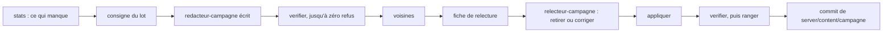

# La campagne

> La campagne solo telle que tu la joues sur ton téléphone : la série à trois vies, le carnet de révision, le défi de la semaine, avec leurs règles et ce qu'ils rapportent. Puis la base de questions qui la nourrit et comment elle grandit ; ces deux dernières parties s'adressent surtout à ceux qui maintiennent l'application.

**Dans cette page** : [En bref](#en-bref) · [Une partie](#une-partie) · [La série à trois vies](#la-série-à-trois-vies) · [Ce que la campagne rapporte](#ce-que-la-campagne-rapporte) · [Le carnet de révision](#le-carnet-de-révision) · [Le défi de la semaine](#le-défi-de-la-semaine) · [Les hauts faits et les pistes](#les-hauts-faits-et-les-pistes) · [Signaler une erreur](#signaler-une-erreur) · [La base de questions](#la-base-de-questions) · [Comment c'est construit](#comment-cest-construit)

## En bref

La campagne se joue seul, à ton rythme, sans chronomètre ni animateur. Elle vit à `/campagne`, en quatre onglets :

| Onglet | Adresse | Ce que tu y fais |
|---|---|---|
| « La série » | `/campagne` | Une série à trois vies qui monte de marche en marche |
| « Les sentiers » | `/campagne#sentiers` | Les sentiers du savoir ([leur page](les-sentiers-du-savoir.md)) |
| « Le défi » | `/campagne#defi` | La même série pour tous, une tentative par semaine |
| « Apprendre » | `/campagne#carnet` | Le carnet de révision, puis les parcours de thème |

Les sentiers font monter une catégorie en douze paliers, puis un palier de maître, et ouvrent les portraits des avatars du savoir. Les parcours de thème font monter un sujet en six étapes. Les duels, contre Automate ou contre quelqu'un, ont leur page, `/duels` (voir [les duels](les-duels.md)). Tous ces modes puisent dans la même base de questions, rapportent la même chose par bonne réponse et remplissent le même carnet.

> [!NOTE]
> La campagne demande un profil : c'est lui qui garde tes records, ton carnet et tes confettis. Sans profil, `/campagne` l'explique et propose « Me connecter » ou « Créer mon profil ». Une soirée, elle, se joue de bout en bout sans compte.

Chaque valeur citée ici a sa ligne dans [les barèmes](../reference/baremes.md), avec sa constante et ce que la changer implique.

## Une partie

**À l'accueil**, le gros bouton de la campagne te mène d'abord à une épreuve de sentier laissée en route, puis à ton défi de la semaine (si tu l'as commencé, si c'est lundi ou si tu en as déjà relevé un), puis aux questions de ton carnet à revoir aujourd'hui, puis au défi, et enfin au sentier que tu avances. Le défi n'y paraît qu'après ta première partie de campagne, et disparaît une fois ta tentative finie.

**L'onglet « La série »** montre ton record. Sous « Commencer une série », une ligne dit sur quoi tu joues (« Sur Toutes les catégories », « Histoire et Sport », un sujet). « Changer › » ouvre la feuille « Sur quoi ? » : toutes les catégories, une ou plusieurs des douze, ou un sujet. Ton choix est retenu sur ce téléphone.

**Une question** affiche sa marche et son numéro (« Moyen · question 10 »), tes bonnes réponses (« 7 bonnes réponses ») et tes vies, puis l'intitulé et quatre réponses, ou « Vrai » et « Faux ». Après ta réponse, tu lis « Bien joué ! +10 XP » et ta gerbe éclate, ou bien « Raté… plus que 2 vies ». Viennent ensuite la bonne réponse et l'anecdote, que le serveur ne t'envoie qu'après ta réponse. « ← Partir » te ramène à l'onglet sans rien perdre. « Recommencer », en bas, arrête la série : elle finit comme si tu l'avais perdue, et ton record et tes hauts faits comptent ce qu'elle a joué.

**La fin** affiche tes bonnes réponses, la marche atteinte et ton record (« Record battu : 23 · l'ancien était de 18 », ou « Ton record : 18 »), et rappelle que tes erreurs reviendront demain dans ton carnet. Puis l'écran des gains, le même à la fin de chaque mode — une série, une révision, un défi, une épreuve des sentiers, l'étape d'un parcours, comme au quiz du jour et en soirée :

- **« Ce que tu gagnes »** : l'expérience en un total, et ce qui la fait quand elle vient de plusieurs côtés (« ta série +60 · tes trophées +100 ») ; tes confettis ; ton niveau, relu après la partie, et « Niveau 12 ! » s'il monte ;
- en grand, l'Éclat du défi et les légendaires ;
- **« Nouveaux trophées »** : trois au plus, les plus rares d'abord — les étapes d'une même piste sur une ligne, « L'Alpiniste · Bronze → Or » —, chacun menant à sa page de l'album des trophées ;
- **« À porter »** : ce que leurs étapes de piste viennent d'ouvrir — un fond, une gerbe, un thème — et l'emoji de collection d'un niveau gagné ; « Essayer » ouvre la loge, l'essai déjà sur ta carte.

Viennent enfin « Rejouer » (« Rejouer · Histoire et Sport »), « Changer de catégorie » (« Changer de sujet » après un sujet), « Mes réponses » (la correction, avec la bonne réponse centrée et la tienne barrée dessous) et « Accueil ».

## La série à trois vies

| Règle | Valeur |
|---|---|
| Vies | 3 (`VIES`) : la troisième erreur finit la série |
| Longueur | 60 questions au plus (`QUESTIONS_PAR_SERIE`) |
| Montée | 5 faciles, 5 moyennes, 5 difficiles, 5 expertes (`QUESTIONS_PAR_MARCHE`), puis le reste au plus dur |
| Pour jouer | 10 questions jouables au moins sur ton choix (`QUESTIONS_POUR_JOUER`) |
| Une à la fois | « Une nouvelle série » referme celle laissée en route et lui décerne ce qu'elle a joué. Une révision ou un défi en cours restent ouverts |
| Record | Ta meilleure série finie, sujets compris. Le défi, les duels et les révisions n'y comptent pas |

Les **catégories** sont douze : Culture générale, Histoire, Géographie, Sciences, Nature, Cinéma & séries, Musique, Arts & lettres, Sport, Cuisine, Jeux & pop culture, Autour de la fête. Un **sujet** est un choix qui traverse les catégories (`shared/sujets.ts`). Il y en a vingt-sept, en trois familles :

| Famille | Sujets | Ce qui range une question dans le sujet |
|---|---|---|
| Un thème | Les animaux, Les inventions, Mythes et légendes, La Terre et l'espace, Les grands rendez-vous du sport, Le petit écran, La danse, Les métiers de la santé, L'informatique, L'astronomie, Les jeux vidéo, La BD et le manga, Monuments et architecture, La langue française, L'anglais, L'espagnol | Ses sous-thèmes, parfois une étiquette |
| Une époque | Avant 1800, Le XIXe siècle, 1900 à 1949, les années 50 à 2000 (une par décennie), Depuis 2010 | Sa date. Une date connue seulement « au siècle près » ne compte pour aucune époque |
| Un fil rouge | La France, Pionnières, Les pièges, Les premières fois, Les records, Les surnoms, L'origine des mots, L'insolite, Souvenirs d'enfance | Ses étiquettes, ou sa portée |

La feuille ne propose un sujet que s'il a au moins dix questions jouables. Une série sur un sujet compte pour ton record, mais pas pour tes records par catégorie ni pour la Grande Série.

**Les marches.** Une question est facile si au moins 70 % des joueurs la trouvent, moyenne à partir de 40 %, difficile à partir de 20 %, et experte en dessous. Avant toute réponse, la difficulté estimée à l'écriture, de 1 à 5, fixe une part de réussite attendue : 90, 80, 55, 30 ou 10 % (`TAUX_A_PRIORI`). Cette estimation pèse autant que vingt réponses (`REPONSES_FICTIVES`), et les vraies réponses de campagne la remplacent peu à peu. Les révisions ne comptent pas dans cette mesure.

**Les familles.** De la difficulté 1 à la 3 (`DIFFICULTES_EN_FAMILLE`), ces vingt réponses fictives ne partent pas de l'estimation seule, mais de la part mesurée sur la famille de la question : les questions de sa catégorie et de sa difficulté, ou, quand sa réponse est une année, un autre nombre ou un vrai ou faux, toutes celles de cette forme et de cette difficulté, toutes catégories ensemble. Une question n'a que quelques réponses, sa famille des centaines : une question jamais jouée dont la famille est ratée part déjà difficile. Ses propres réponses ne comptent pas pour sa famille, et aucune question n'y pèse plus de vingt réponses, pour qu'une question piège n'emporte pas les autres. Mesuré le 15 octobre 2026, avant les familles : une 3 qui se répond par une année se trouvait à 33 %, une 2 du sport à 66 %, une 2 des sciences à 82 % ; et sur 5 801 questions jouées, aucune moyenne n'était jamais devenue difficile. Les 4 et les 5 gardent leur estimation : seuls les joueurs les plus forts les atteignent, et leur part mesurée dirait qui les a jouées plus que ce qu'elles valent.

**Le tirage.** Chaque marche te pose d'abord ce que tu n'as jamais vu, puis ce que tu as vu il y a le plus longtemps. Une question vue ces dernières vingt-quatre heures ne revient qu'en dernier recours (`VUE_RECENTE_MS`). À fraîcheur égale, les catégories et les sous-thèmes passent à tour de rôle. Le tirage évite aussi deux questions **jumelles**, c'est-à-dire de même forme d'intitulé ou avec deux réponses en commun (`server/src/core/jumelles.ts`).

## Ce que la campagne rapporte

| Quoi | Combien |
|---|---|
| Expérience | 5 XP par bonne réponse (`XP_PAR_JUSTE`), 10 pour les 20 premières de la journée, à l'heure de Paris (`JUSTES_DOUBLEES_PAR_JOUR`). Sans plafond, dans tous les modes |
| Confettis | 1 par bonne réponse, dans tous les modes |
| Hauts faits et étapes des pistes | À la fin d'une partie (voir [plus bas](#les-hauts-faits-et-les-pistes)) |
| Éclat | 1 chance sur 20 (`CHANCE_ECLAT_DU_DEFI`), au défi de la semaine seulement |

Revenir chaque jour rapporte donc plus qu'enchaîner les séries d'un coup, et c'est voulu. L'onglet affiche ce que la journée t'a déjà rapporté (« Aujourd'hui : +60 XP · encore 14 bonnes réponses au double »). Une bonne réponse compte aussi pour l'écusson de sa catégorie, sauf en révision. Tu dépenses tes confettis à [la boutique](la-boutique.md), et ton expérience fait monter ton niveau (voir [les récompenses](les-recompenses.md)).

## Le carnet de révision

Dans l'onglet « Apprendre », le carnet transforme chaque erreur en rendez-vous.

- **Ce qui y entre** : toute question ratée en campagne, que ce soit en série, sur un sentier, dans un parcours, en révision ou en duel contre Automate. Une question ratée au défi de la semaine, ou dans un duel encore ouvert, n'y entre qu'à la clôture : plus tôt, le carnet soufflerait la réponse à ceux qui jouent encore.
- **Les rendez-vous** : le lendemain, trois jours après, puis une semaine après (`INTERVALLES_DE_REVISION`), comptés en jours de Paris. Une question retrouvée aux trois rendez-vous est **apprise**. Ratée à nouveau, elle repart au premier rendez-vous, même si elle était apprise. Une bonne réponse ne compte qu'à la date du rendez-vous ou après.
- **Une révision** pose au plus dix questions (`QUESTIONS_PAR_REVISION`), les plus en retard d'abord, sans vies. Après chaque réponse, elle dit où en est la question (« Encore 2 rendez-vous : elle revient dans 3 jours. »). Une révision laissée en route se reprend, et « Recommencer une révision » en tire une neuve.
- **Quand rien n'est à revoir**, « Tout revoir » repasse le carnet dix questions à la fois : celles qui attendent leur rendez-vous, puis les apprises. Une question retrouvée en avance garde son rendez-vous.
- **Viser une catégorie ou un thème** : sous le gros bouton, une ligne dit ce que la révision vise — « Tout le carnet » d'office — et, dessous, ce qui est à revoir dans chaque catégorie, la plus chargée d'abord (« Histoire 3 · Nature 3 · Géographie 1 »). « Changer › » ouvre la feuille « Sur quoi ? » de la série, chaque case disant ce qui y attend : « 3 à revoir », ou « 5 au carnet » quand rien n'y est dû aujourd'hui ; l'onglet « Thèmes » fait de même pour les thèmes, les époques et les fils rouges. Une catégorie choisie, la révision ne pose que ses questions dues ; sans question due, « Tout revoir » la reprend en avance. Recommencée, une révision vise ce que visait l'autre, et sa fin propose d'en revoir encore sur le même choix, tant qu'il y reste à revoir.
- **Ce que la révision rapporte** : un confetti et l'expérience par bonne réponse, et elle compte pour Le Marathonien. Elle ne compte pas pour le record, les hauts faits de série, L'Érudit, les écussons ni la mesure des difficultés, puisqu'elle repose des questions dont tu as lu la réponse la veille.
- **« Ce que j'ai appris »** affiche tes cent derniers faits appris, et jamais ce qui reste à revoir.

## Le défi de la semaine

Un même défi pour tout le serveur, du lundi au dimanche minuit, heure de Paris : une série à trois vies, sans chronomètre, et **une seule tentative**. Laissée en route, la tentative se reprend, mais elle ne s'abandonne pas.

| Règle | Ce qu'il en est |
|---|---|
| Ses questions | Tirées pour le premier joueur qui le relève (« Relever le défi »), pas à l'ouverture de la page. Le tirage se fait comme pour une série sur toutes les catégories, sans privilégier les questions jamais vues, puis il reste figé pour la semaine |
| Le classement | Selon les bonnes réponses, les ex æquo au même rang. Y figure qui a répondu au moins une fois, avec « · en cours » tant qu'il joue. Il montre cinquante lignes, puis la tienne. Toucher un nom ouvre la carte du joueur |
| La clôture | Rien ne se déclenche le lundi à minuit : la première demande de la semaine suivante clôt la précédente, et une tentative laissée en route s'arrête là |
| La correction | Disponible à la clôture seulement : plus tôt, elle soufflerait les réponses |
| Ce qu'il compte | Ton expérience, tes confettis, tes hauts faits de série et tes pistes, mais pas ton record |

**Le Vainqueur du défi.** À la clôture, le premier reçoit le haut fait « Le Vainqueur du défi » ; en cas d'égalité, tous les premiers le reçoivent. Il porte aussi **le laurier d'argent** à côté de son prénom pendant toute la semaine suivante, y compris en soirée ; si le joueur a aussi le laurier du quiz du jour, c'est celui-ci qui s'affiche. Pour qu'il y ait un vainqueur, il faut au moins deux joueurs (`JOUEURS_POUR_LE_DEFI` : seul, on n'a battu personne) et au moins une bonne réponse. Un profil que l'administrateur a masqué des classements n'y apparaît que pour lui-même, et ne peut pas gagner. La semaine suivante, l'onglet le dit sous « La semaine dernière » : les vainqueurs et leur laurier, ta place, ce que la clôture t'a décerné — en lignes de trophées, comme à la fin d'une partie, chacune menant à l'album — et « La correction du défi ».

**L'Éclat.** Une tentative finie par sa dernière réponse tire l'Éclat, avec une chance sur vingt (`CHANCE_ECLAT_DU_DEFI`). Une tentative arrêtée par la clôture n'en tire pas. La série, la révision et les sentiers n'en tirent jamais, parce qu'on peut les rejouer à volonté ; au défi, c'est le calendrier qui sert de garde-fou. Ce qu'est l'Éclat est expliqué dans [les récompenses](les-recompenses.md).

## Les hauts faits et les pistes

| Haut fait | Ce qu'il demande | XP |
|---|---|---|
| 🎪 Le Funambule | Neuf bonnes réponses d'affilée sur ta dernière vie (`FUNAMBULE`) | 100 |
| 💠 Sans une égratignure | Atteindre les questions expertes d'une série sans perdre une vie | 100 |
| 🏔️ La Grande Série | Trente bonnes réponses dans une série de toutes les catégories, sans sujet (`GRANDE_SERIE`) | 150 |
| 🌍 Le Tour du monde | Un record d'au moins dix (`RECORD_DU_TOUR_DU_MONDE`) dans une série d'une seule catégorie, pour chacune des douze. Il ne tombe qu'une fois | 250 |
| ⚔️ Le Vainqueur du défi | Finir en tête du défi de la semaine, à deux joueurs au moins | 150 |

Les quatre premiers tombent à la fin d'une série (même arrêtée), d'un défi ou d'un duel, au plus une fois chacun par partie. Le Vainqueur du défi tombe à la clôture du défi.

Trois pistes avancent elles aussi, et leurs étapes tombent à la fin de chaque partie : bronze, argent, or, qui rapportent 50, 100 puis 200 XP, une fois chacune (`XP_PALIER`) :

| Piste | Bronze · Argent · Or | Ce qu'elle compte |
|---|---|---|
| 🧗 L'Alpiniste | 10 · 15 · 20 | Ton record de série |
| 🎓 L'Érudit | 25 · 100 · 300 | Les questions expertes trouvées, sauf en révision |
| 👟 Le Marathonien | 250 · 1 000 · 2 000 | Toutes tes bonnes réponses de campagne, y compris en révision |

Ils ouvrent quatre légendaires : la Salamandre (le Funambule), le Serpent à plumes (la Grande Série), l'Éléphant (Le Marathonien · Or) et la Chimère (L'Alpiniste · Or, avec L'Habitué du Podium et Le Champion du jour). Ils ouvrent aussi le thème Le Sommet (L'Alpiniste · Or) et quatre gerbes. Dans « Ma collection », la page « Campagne » de l'album des trophées montre ces pistes en échelle, chaque étape disant ce qu'elle ouvre, puis les exploits, chacun compté autant de fois qu'il est tombé. Ce qui est commun à toutes les récompenses est dans [les récompenses](les-recompenses.md).

Les épreuves des sentiers ont leurs propres trophées — Le Randonneur, La Constellation, Le Cartographe, L'Impeccable et Contre toute attente —, rangés sur la page « Sentiers » de l'album : voir [les sentiers du savoir](les-sentiers-du-savoir.md#les-trophées-des-sentiers).

## Signaler une erreur

Après ta réponse, le lien « Signaler une erreur dans cette question » te laisse écrire une phrase de 280 caractères au plus (`SIGNALEMENT_MAX`). Tu as droit à un signalement par question : si tu en renvoies un, il remplace le précédent. Toutes les parties de campagne se signalent de cette façon, y compris les épreuves des sentiers et les parcours.

L'administrateur relit chaque signalement à `/admin#signalements`, avec ceux du quiz du jour, ce que le joueur a répondu et ce que disent toutes les réponses à la question. Il a ensuite quatre gestes :
- « Garder » laisse la question en jeu et referme ses signalements.
- « Corriger » reprend l'intitulé, les réponses, la bonne réponse et l'anecdote. Si la bonne réponse reste la même, la question garde son identifiant et ses mesures. Si elle change, la question corrigée devient une question neuve, avec un identifiant neuf, et l'ancienne est retirée.
- « Reclasser » change sa catégorie, son sous-thème et sa difficulté estimée : elle rejoint les séries, les sentiers et le défi de sa nouvelle catégorie dès le prochain tirage. Les réponses déjà données gardent la leur, et tes écussons ne bougent pas.
- « Retirer de la campagne » la retire pour tous et pour toujours.

Les parties déjà tirées, y compris le défi de la semaine, gardent la version qu'elles ont lue. Quand ta remarque a servi — la question corrigée, reclassée ou retirée —, ton accueil te remercie, une fois ; « Garder » ne dit rien. Pour le détail côté administration, voir [administrer](../guides/administrer.md#les-signalements).

## La base de questions

Tout ce que pose la campagne, et aussi le quiz tout prêt des soirées, vient d'une base qui lui est propre : des QCM écrits et étiquetés à l'avance, rangés dans `server/content/campagne/`, avec un fichier par catégorie et une question par ligne. Cette base ne partage aucune question avec la réserve du quiz du jour ; sinon, la campagne reposerait des questions vues le matin même.

- **Sa taille** : 25 529 questions au 17 octobre 2026, de 1 692 à 3 208 par catégorie, et au moins 200 par sous-thème — sauf les langues et écritures du monde (55), que le français, l'anglais et l'espagnol ont quittées ce jour-là. Pour le compte du jour, lance `npx tsx scripts/base-campagne.ts stats` depuis `server/`. Chaque question a une difficulté estimée de 1 à 5, avec une répartition visée de 8, 17, 27, 28 et 20 % (`CIBLE_DES_DIFFICULTES`).
- **L'identifiant** : huit caractères, qui ne changent jamais. Les réponses, les signalements et le retrait d'une question s'y rattachent.
- **Le juge** : toute question passe par le même contrôle (`lireQuestionDeLaBase`, `server/src/core/baseCampagne.ts`), qu'elle vienne du dépôt, d'un lot ou de la routine. Il la refuse au premier défaut : intitulé négatif, bonne réponse écrite dans l'intitulé (ou nom de famille de la personne qui répond), emoji, réponse en double, fait incertain… Une réponse que l'intitulé laisse deviner par sa racine (« Qui a peint *Les Deux Fridas* ? ») est acceptée, mais la commande `racines` la liste, et le quiz tout prêt ne la pose qu'en dernier recours.
- **Pas de doublon** : le rangement d'un lot et le dépôt de la routine refusent le même intitulé, mais aussi **le même fait** sous un autre intitulé (`server/src/core/memeFait.ts`). C'est le cas quand deux questions ont la même bonne réponse et une entité ou l'essentiel de leurs mots en commun, ou quand chacune répond à l'autre (Charlot et Charlie Chaplin). Le refus cite la question qui pose déjà le fait.

### Comment elle grandit

| Chemin | Comment |
|---|---|
| La routine du matin | La routine Claude Code de la réserve du quiz du jour utilise le même jeton (`RESERVE_TOKEN`). Elle demande ce qui manque (`GET /api/campagne/base` : cinq questions par catégorie et par jour), puis dépose ses questions (`POST`). Chaque refus revient avec son motif. Les questions acceptées se jouent aussitôt, sans déploiement |
| Un lot à la main | La skill `base-campagne` : l'agent `redacteur-campagne` écrit le lot, `relecteur-campagne` le relit, puis le lot est rangé dans le dépôt (voir le schéma ci-dessous) |
| En nombre | `server/scripts/generer-campagne.ts` : des lots de trente questions au plus, écrits par vagues où deux lots ne partagent jamais un sous-thème, avec les mêmes agents |
| Par l'inventaire d'un thème | La danse, les métiers de la santé, la langue française, l'anglais et l'espagnol ont un inventaire (`server/src/core/inventaires.ts`) : tout ce que leurs sous-thèmes doivent couvrir, famille par famille — la salsa, les orishas, la rééducation, les urgences, l'accord du participe, le verlan, les verbes irréguliers, les faux amis… La consigne le donne à qui écrit pour eux, la routine comprise ; `generer-campagne.ts preparer --inventaire=<clé>` commande famille par famille, deux familles s'écrivant en même temps, et `base-campagne.ts couverture <clé>` dit les sujets restés sans question |
| Pour étoffer un thème | `generer-campagne.ts preparer --sujet=<clé> --questions=<n>` : n questions de plus pour un thème, une époque ou un fil rouge, là où il vit déjà — les surnoms au cyclisme et chez les rois — et aux difficultés qui lui manquent ; hors de ses sous-thèmes, chaque ligne de la consigne dit son étiquette ou ses années |
| Depuis Wikidata | `server/scripts/faits-wikidata.ts` : des faits sûrs pour quinze familles (tableaux, films, prix Goncourt…). Le rédacteur n'écrit que les phrases, ce qui coûte deux fois moins cher, et chaque lot est relu |

Le chemin d'un lot, de la consigne au commit :

Les lots en cours vivent dans `.lots-campagne/`, un dossier que git ignore ; seul `server/content/campagne/` est commité. Le détail est dans la skill (`.claude/skills/base-campagne/SKILL.md`) et dans [les commandes](../reference/commandes.md). Tout passe par l'abonnement Claude et ses agents : le dépôt n'a ni clé ni SDK de l'API d'Anthropic, qui se paie à part. La routine du matin utilise le même abonnement : une génération en nombre ne doit donc pas se lancer dans l'heure qui la précède.

**La relecture.** Le correcteur vérifie la bonne réponse (exacte, unique, et qui le restera), chaque nom, chiffre et date, et la difficulté. Au moindre doute, il retire la question (« la base est grande »). Il ne corrige jamais une réponse : une réponse fausse fait retirer la question.

**Corriger après coup.** Une coquille se corrige dans son fichier, sous le même identifiant ; si la bonne réponse change, il faut ranger une question neuve. À l'administration, « Corriger » et « Retirer » écrivent dans la base permanente, sans toucher aux fichiers du dépôt, comme les dépôts de la routine. La production et la préproduction ayant chacune leur base permanente, leurs bases de campagne ne sont donc pas tout à fait les mêmes.

> [!WARNING]
> Une correction ne repasse pas par le contrôle du même fait, ni à la relecture d'un lot, ni à l'administration : un intitulé réécrit peut poser le même fait qu'une autre question. Après une correction faite hors d'un lot, lance la commande `voisines`.

## Comment c'est construit

**La logique est au serveur.** `server/src/core/campagne.ts` (`CampagneStore`) tire les questions, compte les vies, juge les réponses, crédite l'expérience et décerne les récompenses. `server/src/campagne.ts` ouvre les routes ; celles des joueurs exigent une session de profil. Les règles pures sont dans `shared/campagne.ts`, `shared/revision.ts` et `shared/sujets.ts`. Le téléphone (`client/src/views/CampagneApp.tsx`, `client/src/views/Defi.tsx`, `client/src/views/Carnet.tsx`) ne reçoit la bonne réponse qu'après avoir répondu ; chaque fin passe par l'écran des gains de tous les modes (`GainsDeCampagne`, sur `client/src/components/Gains.tsx` et `shared/gains.ts`). La campagne n'utilise pas le temps réel, seulement des requêtes HTTP (voir [l'API](../reference/api-http.md)).

**Les données.** Le serveur lit la base de questions du dépôt une fois par processus : en arrière-plan, vingt secondes après le démarrage, par tranches, pour ne pas bloquer les soirées. Il y ajoute les dépôts de la routine et les corrections. Tout le reste vit dans la base permanente (Turso), et rien dans la base locale :
- chaque partie, quel que soit son mode, est une ligne de `campagne_series` ;
- chaque réponse est une ligne de `campagne_reponses`, le journal dont tout se recalcule ;
- le défi figé de chaque semaine est une ligne de `campagne_defis`.

Le détail est dans [la base de données](../reference/base-de-donnees.md).

| Ce qui se recalcule | À partir de quoi | Quand |
|---|---|---|
| Le carnet | Les réponses de campagne | À chaque lecture : une règle changée vaut aussitôt pour tout le passé |
| La marche d'une question | Ses réponses et celles de sa famille, révisions exclues | Toutes les dix minutes au plus, et dès que la base change |
| Les confettis de campagne | Les bonnes réponses, les étoiles des sentiers, les ligues des duels | À chaque lecture du solde |
| L'expérience de campagne | Les bonnes réponses jour par jour, les paliers de sentier | Réécrite en entier (ligne `#campagne`) à chaque bonne réponse |
| Les hauts faits et les étapes des pistes | Les parties finies | À chaque fin de partie, puis au démarrage, une fois par version (`VERSION_DES_SERIES`) |

> [!IMPORTANT]
> Au démarrage, les hauts faits ne sont recalculés que sur les séries à trois vies (mode `serie`), les étapes des pistes sur toutes les parties, et rien n'est jamais enlevé : un haut fait gagné au défi ou en duel n'est pas recalculé, et durcir un seuil ne reprend rien à personne. Si le barème du solo change (`XP_PAR_JUSTE`, `JUSTES_DOUBLEES_PAR_JOUR`), un joueur n'en voit l'effet qu'à sa bonne réponse suivante. Pour l'appliquer à tous d'un coup, il faut un drapeau neuf, comme `bareme-du-solo-2026-10-06` (`server/src/core/baremeDuSolo.ts`), qui recompte tout une fois au démarrage.

Les raisons de ces choix sont dans [les décisions](../architecture/decisions.md), et le fonctionnement des journaux dans [les données](../architecture/donnees.md).

## Pour aller plus loin

- [Les sentiers du savoir](les-sentiers-du-savoir.md) et [les duels](les-duels.md) : les autres modes de la campagne
- [Les récompenses](les-recompenses.md) : l'expérience, les niveaux, l'Éclat, les légendaires
- [Le quiz du jour](le-quiz-du-jour.md) : l'autre jeu solo, et son laurier
- [Administrer](../guides/administrer.md) : relire les signalements
- [Les barèmes](../reference/baremes.md), [l'API HTTP](../reference/api-http.md), [la base de données](../reference/base-de-donnees.md), [les commandes](../reference/commandes.md)
- [L'outillage de Claude](../contribuer/outillage-claude.md) : la skill `base-campagne` et ses deux agents
- [La mise en ligne](../exploitation/mise-en-ligne.md) : brancher la routine du matin
