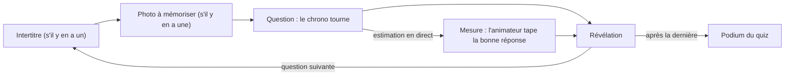

# La soirée

> Une soirée FiestApp de bout en bout, vue de la salle et des téléphones : le salon et son code, la salle d'attente, chaque quiz et chaque question, les équipes, les podiums, la clôture. Pour les invités, les animateurs, et quiconque découvre l'application.

**Dans cette page** : [le salon](#le-salon-et-son-code) · [entrer](#entrer-dans-la-soirée) · [la salle d'attente](#la-salle-dattente) · [lancer un quiz](#lancer-un-quiz) · [le cycle d'une question](#le-cycle-dune-question) · [sa place](#sa-place-dans-la-course) · [arriver en retard](#arriver-en-retard-partir-sendormir) · [le podium du quiz](#le-podium-du-quiz) · [le programme](#le-programme-et-lenchaînement) · [les équipes](#les-équipes-et-leurs-points) · [le podium de la soirée](#le-podium-de-la-soirée-et-lécran-de-victoire) · [la clôture](#la-clôture)

## Ce qu'il faut pour jouer

Des invités, chacun avec son téléphone — sans compte et sans rien installer —, et quelqu'un qui anime. Les questions et les réponses s'affichent sur chaque téléphone ; un écran que toute la salle voit (une télé, un vidéoprojecteur) n'est pas obligatoire, mais c'est lui qui fait le spectacle : l'**écran commun**, ouvert par l'animateur sur `/host`, ou une télé branchée par un code sur `/tele`.

Chaque animateur a son espace : ses quiz, ses soirées, son code de salon. Un espace ne voit rien des autres.

## Le salon et son code

Il y a deux façons d'ouvrir une soirée.

- **Depuis son profil**, sur son téléphone : « Créer un salon » ouvre « Nouveau salon ». On y choisit « Les quiz » de ce soir, « Où voit-on les questions ? » (« Sur nos téléphones », ou « Sur une télé », branchée par le code qu'elle affiche), « Et toi ? » (« Je joue aussi » ou « J'anime seulement »), « Les équipes » (« Chacun pour soi » ou « En équipes »), et, repliés dans « Réglages », le rythme des questions et les points de chaque quiz. « Ouvrir le salon » tire le code et mène le chef à sa soirée, avec une barre de gestes en bas de son téléphone.
- **À l'écran commun** (`/host`), depuis un ordinateur branché à la télé : le salon s'ouvre dès que l'écran se présente.

Le **code du salon** a six chiffres (« 482 157 »). On entre en scannant le QR de l'écran, en ouvrant l'adresse du serveur suivie du code, ou en tapant le code dans « Rejoindre une soirée ».

Le chef qui choisit « J'anime seulement » suit la partie sur son téléphone comme les autres, et peut répondre pour le plaisir : rien de lui ne compte — ni points, ni classement, ni attente. Son téléphone lit « Tu animes · hors classement ».

## Entrer dans la soirée

La page de la soirée s'ouvre sur trois gros boutons : « Jouer sans compte », « Me connecter », « Créer un profil ».

- **Sans compte**, un prénom (24 caractères au plus) et un avatar parmi vingt-quatre emojis suffisent. C'est le chemin principal : un invité anonyme joue exactement la même partie qu'un profil.
- **Avec un profil**, on est reconnu et l'on entre sans rien rechoisir (« Entrer dans la soirée »). Un profil retient le niveau et les prix d'une soirée à l'autre ; il ne change rien aux points de ce soir.
- **S'il y a des équipes**, un second écran propose de gros boutons — l'emoji, le nom, les avatars de ceux qui y sont déjà. Pendant un quiz, « Entrer sans équipe » laisse entrer tout de suite : on la choisira à la fin.

Deux invités au même prénom et au même avatar — celui qu'on voit : le dessin porté, sinon l'emoji — se distinguent à l'affichage (« Camille (2) ») : personne n'est refusé, personne n'est renommé.

## La salle d'attente

- **Au téléphone** : son avatar, son prénom, son score et son rang de la soirée, son équipe (« Changer » ou « Choisir mon équipe », hors quiz), puis le « Classement de la soirée » — « Touche un nom pour voir sa carte. » — et « En attente du prochain quiz… ».
- **À l'écran commun** : « Pour rejoindre le quiz », le code en grand, l'adresse, le QR (et celui du wifi s'il est réglé), et la liste des invités, rangés par équipe.

## Lancer un quiz

1. **Lancer.** « Lancer un quiz » à l'écran commun — le bouton dit « En attente des invités… » tant qu'aucun téléphone n'est connecté — ou « Lancer le quiz » dans la barre du chef. Les invités connectés à cet instant forment la partie ; les autres y entrent en arrivant ([plus bas](#arriver-en-retard-partir-sendormir)).
2. **Choisir.** Avec un [programme](#le-programme-et-lenchaînement), l'écran propose le prochain quiz, déjà réglé : « C'est parti ! », « Ensuite : … », ou « Un autre quiz… ». Sinon, « Choisis un quiz » montre une carte par quiz prêt — nombre de questions, catégories, estimations, durée estimée, « Joué ce soir », « Au programme · 2 » — et « Ce quiz vaut » : « points normaux », « ×2 points » ou « ×3 points ». Dans un salon, la barre du chef choisit seule le prochain quiz du programme. Les téléphones affichent « Le quiz va commencer… ».
3. **Le compte à rebours.** Trois secondes : « Préparez vos téléphones… » à l'écran, « Prépare-toi… » au téléphone, puis 3, 2, 1, « Top ! ».

## Le cycle d'une question

Chaque sorte de question, ce qu'elle montre et ce qu'elle rapporte : [Les questions](les-questions.md).

### Avant la question

- **L'intertitre** est une diapo sans réponse (« Manche 2 : le cinéma ») ; les téléphones écrivent « La question arrive… ». Il dure jusqu'au clic de l'animateur, ou le temps de l'enchaînement réglé.
- **La photo à mémoriser** passe seule, quelques secondes ; les téléphones écrivent « Mémorise ». Ni l'intitulé ni les réponses n'arrivent avant qu'elle disparaisse.

### Pendant la question

- **La barre de temps** se vide — 5 à 120 secondes, 20 d'office. Elle se lit à l'heure du serveur : un téléphone dont l'horloge dérive voit le même temps que la salle. Dans les cinq dernières secondes, elle passe au rouge, s'épaissit — sauf sous un thème qui la borde, déjà épaisse (Héros, GameBoy, Plage) —, et un sablier paraît devant les secondes — l'urgence se voit sans la couleur, et sans le mouvement que coupe « réduire les animations » —, et l'écran commun fait tic-tac.
- **Répondre**, c'est un toucher ; la réponse part au lever du doigt. Ensuite : « Réponse enregistrée · tu peux encore changer, au prix du bonus de rapidité ». On peut se raviser jusqu'à la révélation, mais c'est le dernier envoi qui compte, heure comprise.
- **Le temps de lire est offert** : au QCM, le bonus de rapidité ne commence à fondre qu'une fois le temps de lire la question et ses réponses écoulé. Le détail : [Les questions](les-questions.md#comment-il-se-note).
- **Chaque réponse reçoit un accusé** : le téléphone dit quand elle n'est pas passée (« Trop tard — la question était finie », « Ta réponse n’est pas partie — touche-la à nouveau »).
- **Passé l'échéance**, les réponses se grisent sous « Réponses closes » ; le serveur garde la question ouverte 1,5 seconde de plus (`GRACE_MS`), pour la réponse partie juste avant.
- **En pause**, le chrono se fige et plus personne ne répond : « En pause », « Le chrono reprendra où il s'est arrêté ». À la reprise, le téléphone vibre.

La révélation part à la fin de cette marge, au clic « Révéler » de l'animateur, ou **0,7 seconde après la dernière réponse attendue** — un changement d'avis relance ce souffle. Un téléphone en veille reste attendu : on ne révèle pas dans le dos d'un réseau qui hoquette. Si un téléphone est mort, l'animateur peut choisir de ne plus l'attendre.

### La révélation

- **À l'écran commun** : la bonne réponse — pour un QCM, combien ont choisi chaque réponse et le plus rapide à avoir trouvé ; pour une estimation, la bonne valeur et les huit propositions les plus proches —, l'anecdote (« Le saviez-vous ? »), puis **les équipes d'abord**, et « En tête du quiz », les cinq premiers.
- **Au téléphone**, dans l'ordre : son résultat (« +173 pts » et « Bien joué ! », « Raté… tu avais dit … », ou « Pas de réponse à cette question. »), sa [place dans la course](#sa-place-dans-la-course), les équipes, l'anecdote, puis la carte **« Cette question »**.
- **« Cette question »** montre ceux qui ont répondu — ceux qui ont trouvé d'abord, du plus rapide au plus lent, puis les autres —, six lignes au plus (le haut, puis soi entre ses deux voisins), chacune avec son temps, ses points et l'emoji de son équipe, et une phrase : « La réponse juste la plus rapide » (« 0,7 s devant Hugo »), « 3 sur 12 ont trouvé », « 2 autres ont dit comme toi ». Elle accompagne les QCM et leurs variantes « plusieurs » et « ordre », et les estimations — rangées de la plus proche à la plus loin, chacune avec son nombre à la place du temps (« 3ᵉ plus proche sur 8 ») ; ni « Qui dans la salle ? », ni une question dont les points sont annulés ou qu'on n'a pas mesurée.

Les points tombent à la révélation, jamais avant : **le classement de la soirée bouge à chaque révélation**, pas seulement au podium.

## Sa place dans la course

Avec cinquante invités, trois mènent dès le premier quiz et les autres regardent une course perdue d'avance. Chaque téléphone dit donc, à chaque révélation, trois lignes courtes :

- **l'étiquette** : « Ce quiz ×2 · encore 6 questions » ;
- **sa place** : « 5ᵉ place sur 12 · 450 pts », avec ↑ 2 s'il a gagné deux places depuis la question d'avant ;
- **une cible nommée** : « À 40 pts d’Hugo », le plus proche strictement devant (« et 2 autres » s'ils sont ex æquo). En tête : « Tu prends la tête ! » la question où l'on passe devant, puis « Tu mènes » et « Hugo te suit à 40 pts ».

Elle ne dit que les bonnes nouvelles : la flèche ne descend jamais, « sur 12 » ne s'écrit que dans la moitié haute du classement, jamais « dernier », et pas de rang à zéro point (« Pas encore de points », ou « Personne n'a encore marqué »). Le lecteur d'écran entend une seule phrase : « Ce quiz : rang 5 sur 12, 450 points, 2 places gagnées. À 40 points d’Hugo. Encore 6 questions. »

À égalité de points, deux invités ont le même rang : [Les questions](les-questions.md#les-ex-æquo-et-le-départage) dit la règle.

## Arriver en retard, partir, s'endormir

- **Arriver pendant un quiz**, c'est entrer tout de suite dans la partie. On joue la question en cours si elle est encore ouverte ; sinon on joue à partir de la suivante — quand la question est révélée, en cours de mesure, quand le quiz est fini, quand toute la salle a déjà répondu, ou quand il reste moins de temps qu'il n'en faut pour la lire. Le téléphone dit alors « Bienvenue ! Tu joues à partir de la prochaine question. » plutôt qu'un échec. On ne récupère rien des questions passées ; si l'animateur repose la question, le retardataire la joue aussi.
- **Un téléphone qui s'endort** reste dans la partie et retrouve sa vue en se rallumant ; il reste attendu à chaque question. Un téléphone mort, l'animateur peut ne plus l'attendre, ou rendre sa place à son propriétaire sur un autre téléphone par un code à six chiffres.
- **Un invité exclu** part avec ses points et ses réponses, et la salle ne l'attend plus.

## Le podium du quiz

Après la dernière révélation, « Voir le podium ».

- **À l'écran commun** : « Podium du quiz », trois marches — le rang partagé s'y lit : deux premiers ex æquo montent sur deux marches de premier —, « Les équipes après ce quiz » et « La suite du classement » à partir du quatrième.
- **Au téléphone** : « Quiz terminé » et sa place (« 3ᵉ place sur 12 · 450 pts », ou « Pas de points cette fois ») ; dès qu'un autre quiz s'est joué plus tôt ce soir, sa place à la soirée (« Soirée : 4ᵉ place », « Soirée : tu mènes ») ; le podium des équipes et celui des joueurs, en marches ; puis **« Le classement »** : tous les joueurs du quiz — soixante au plus, sa propre ligne ajoutée au-delà —, avec leur rang, l'emoji de leur équipe et leurs points, et « Tu étais à 20 pts du podium » quand on talonnait la troisième marche.

L'expérience du quiz se crédite aux profils dès ce podium ([Les récompenses](les-recompenses.md)) : le téléphone d'un profil la fête un instant — « +45 XP », « Niveau 12 ! » s'il monte —, et ses trophées attendent la clôture ([Après la soirée](apres-la-soiree.md)). Ensuite : « Quiz suivant », « Remise des prix » (s'il y a des équipes) ou « Terminer le quiz ». Le podium reste à l'écran tant que personne ne le referme.

## Le programme et l'enchaînement

**Le programme de la soirée**, ce sont les quiz de ce soir dans l'ordre, chacun avec son multiplicateur — la finale en ×2, réglée d'avance. Il se compose en créant le salon ([Les quiz](les-quiz.md)). L'écran commun propose ensuite le prochain quiz, et la barre du chef le lance seule. Un quiz lancé ce soir, même interrompu, compte comme joué et ne se repropose plus ; un quiz lancé hors programme ne fait rien sauter. Dans un salon, une fois le dernier quiz du programme joué, la barre du chef propose « Terminer la soirée », et le podium reste à l'écran jusque-là. Seuls les écrans d'animateur connaissent le programme : la salle ne lit pas le menu.

**Le multiplicateur** (×2, ×3) s'annonce à l'écran et sur chaque téléphone : un dernier quiz en points doubles rend un écart de 400 points rattrapable jusqu'à la dernière question.

**L'enchaînement des questions** se règle en « Suivante : au clic · 5 s · 10 s · 20 s » : la question suivante part seule après la révélation, avec un décompte (« Question suivante dans 5 s »). Il s'arrête de lui-même quand une question se ferme sans une seule réponse — « Personne n'a répondu — la suite attend l'animateur » ; à la dernière question, c'est le podium qui attend. Il reprend dès qu'une question reçoit une réponse. Le réglage passe d'un quiz au suivant de la soirée ; dans un salon, c'est le rythme choisi à l'ouverture (5 secondes d'office). Quand l'animateur annule les points d'une question, sa révélation attend le clic.

## Les équipes et leurs points

Chacun joue pour soi, et ses points font aussi ceux de son équipe : il n'y a ni score collectif à saisir, ni double comptabilité.

- **Les créer** : l'animateur en crée deux à six d'un coup (« Les créer d'un coup », une équipe proposée pour quatre invités) ou une à une, dix au plus ; le chef d'un salon les prépare avant d'ouvrir. Chacun choisit la sienne en entrant. Pendant un quiz, on ne change pas de camp (« Pas pendant un quiz — on verra à la fin ! ») ; l'animateur, lui, peut déplacer quelqu'un à tout moment.
- **La règle exacte.** Chaque réponse est écrite au journal avec l'équipe de son joueur à cet instant. Pour chaque question de la soirée, on fait la moyenne des points des membres de l'équipe qui l'ont eue sous les yeux, qu'ils aient répondu ou non ; la moyenne de l'équipe est la somme de ces moyennes, arrondie à la fin. **Les points d'équipe** sont cette moyenne, plus les prix à points. Le plus de points d'équipe l'emporte ; deux équipes à égalité partagent le même rang.
- **Un exemple.** Chez les Randonneurs, Sofia et Hugo jouent la question 1 et marquent 200 et 164 : 182 pour l'équipe. Karim arrive à la question 2, que les trois jouent à 100 chacun : 100 de plus, soit **282** — Karim ne pèse pas sur la question 1, qu'il n'a jamais vue. Inès, qui rejoint l'équipe après le quiz, n'y change rien tant qu'elle n'a pas joué une question ; Malik, qui passe dans une autre équipe, laisse ses points à celle pour laquelle il a joué.
- **Les prix** se remettent pour le plaisir, à 0 point d'office : ils s'annoncent sans rien changer au classement, sauf si l'animateur leur donne des points (de −500 à +500).
- **Le total** des points des membres s'affiche en petit au mur, pour qu'on le commente ; il ne classe pas.

Un seul tableau montre les équipes, le même partout : entre deux questions, au podium, au téléphone, au souvenir. La formule complète : [Les questions](les-questions.md#le-barème-des-équipes).

## Le podium de la soirée et l'écran de victoire

Ces écrans se commandent de la console de l'animateur, et tous les écrans d'animateur de l'espace les montrent ensemble — la télé suit la télécommande.

- **« Podium »** (dès qu'un point est marqué) : le classement de toute la soirée, en deux onglets, « Les équipes » et « Les joueurs » — les équipes d'abord s'il y en a —, avec le QR « Le souvenir de la soirée ». Côté joueurs, la suite du classement et des distinctions : le plus beau coup, le plus régulier, le vainqueur de chaque quiz.
- **« Remise des prix »** : les prix de la soirée, remis aux équipes devant la salle ([Après la soirée](apres-la-soiree.md)).
- **L'écran de victoire** : « L'équipe qui remporte le quiz » — ou « Les équipes qui remportent le quiz », ex æquo —, ses points d'équipe, puis le tableau des équipes et celui des joueurs. Sans quiz joué ni prix remis : « Aucun quiz joué, aucun prix remis : rien à couronner pour l'instant. »

## La clôture

« Clore la soirée » range la soirée dans l'historique, crédite ce qui ne se décide qu'à la fin, et envoie à chaque téléphone sa fin de soirée ; « C'était un essai » l'efface sans rien garder. Tout ce qui suit est raconté dans [Après la soirée](apres-la-soiree.md).

## Qui pilote

L'animateur garde la main à chaque instant — révéler, mettre en pause, reposer une question, annuler ses points, régler l'enchaînement, ne plus attendre un téléphone mort, rendre une place —, depuis l'écran commun, une télécommande ou la barre du chef ; les deux derniers gestes, à la console et à la télécommande seulement. Le pas à pas : [Animer une soirée](../guides/animer-une-soiree.md).

## Pour aller plus loin

- [Les questions](les-questions.md) — chaque sorte, ce qu'elle rapporte, formules et exemples
- [Les quiz](les-quiz.md) — écrire ses quiz, composer le programme de la soirée
- [Animer une soirée](../guides/animer-une-soiree.md) — la console, les gestes, les imprévus
- [Jouer](../guides/jouer.md) — rejoindre, répondre, retrouver sa place
- [Après la soirée](apres-la-soiree.md) — la clôture, la fin de soirée, le souvenir, le bilan
- [Les récompenses](les-recompenses.md) — ce qu'une soirée rapporte à un profil
- [Le temps réel](../architecture/temps-reel.md) — comment les téléphones et l'écran restent d'accord
