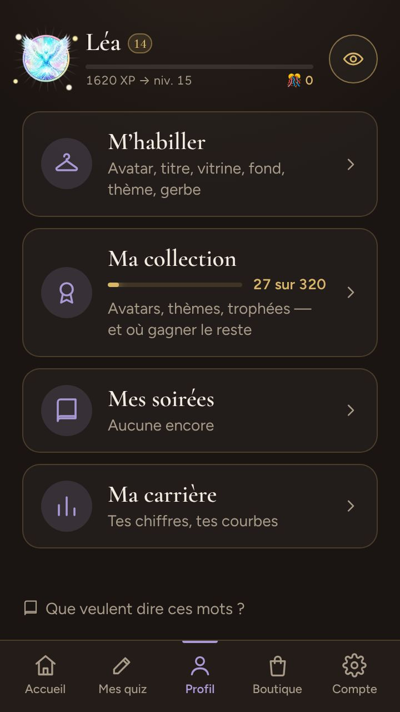

# Le profil

> Ce qu'un profil garde, comment il naît et se retrouve, et ce qu'on y voit — l'accueil, la loge, « Ma collection », la carte d'un joueur, les avatars —, puis comment il anime son salon. Pour les joueurs et les animateurs ; la dernière section, pour qui touche au code.

**Dans cette page** : [Naître et revenir](#naître-et-revenir) · [L'accueil](#laccueil) · [La page du profil](#la-page-du-profil) · [La loge](#la-loge) · [Ma collection](#ma-collection) · [La carte d'un joueur](#la-carte-dun-joueur) · [Les avatars](#les-avatars) · [Animer avec son profil](#animer-avec-son-profil) · [Le code](#comment-cest-construit)

## Ce qu'est un profil

Un profil, c'est toi d'une soirée à l'autre et d'un animateur à l'autre : un prénom, un avatar, ton expérience, ce que tu gagnes et ce que tu portes. Il t'ouvre aussi ce qui se joue seul ou entre amis — [le quiz du jour](le-quiz-du-jour.md), [la campagne](la-campagne.md), [les sentiers du savoir](les-sentiers-du-savoir.md), [les duels](les-duels.md) —, [la boutique](la-boutique.md), et ton salon pour animer.

> [!IMPORTANT]
> **Tout se joue sans profil.** À l'entrée d'une soirée comme à l'accueil, « Jouer sans compte » est le premier des trois boutons : un prénom et un avatar suffisent, et un invité anonyme n'affiche rien de ce qu'il n'a pas — ni « Niv. 0 », ni pastille grise. **Un profil ne donne aucun avantage de jeu face aux autres** : mêmes questions, mêmes points, même chronomètre. Ce que tu gagnes se voit ; rien ne se joue — sauf dans [l'Expédition](l-expedition.md) et [le Cabinet de curiosités](le-cabinet.md), qu'on joue seul : tes légendaires y deviennent des jokers, tes œuvres et tes gardiens des cartes-bonus, et rien n'en sort.

## Naître et revenir

### Créer son profil

Un profil naît d'un prénom et d'un mot de passe ; l'identifiant s'en déduit.

| D'où | Ce que tu remplis |
|---|---|
| L'accueil (`/`), « Créer un profil » | un écran : « Ton prénom » (24 caractères au plus, dit quand on en approche : « Encore 3 caractères »), « Ton avatar » (un emoji tiré au sort ; « changer » ouvre les 24), « Ton mot de passe » (« 8 caractères au moins », dit d'avance à côté du champ), puis « Créer mon profil » |
| L'entrée d'une soirée, « Créer un profil » | deux écrans : « Créer ton profil · 1/2 », le prénom et l'avatar ; « 2/2 », « Garder ma progression », le mot de passe (« Au moins 8 caractères. ») — ou « Plus tard — je joue » |
| La soirée, entre deux quiz ou à sa fin | le même formulaire, le prénom et l'avatar du soir déjà remplis |

- **Un refus se dit sous le champ qu'il vise.** Un mot de passe trop court (« Au moins 8 caractères ») se dit sous le mot de passe, et sa règle se tait — une seule fois, à l'œil comme au lecteur d'écran ; elle garde sa place, rien ne bouge — ; il s'efface dès qu'on le retape ; l'identifiant reste sur sa ligne. Seul un refus de l'identifiant — pris, ou mal formé — en ouvre le champ, le message dessous.
- **Au lecteur d'écran**, chaque écran a son titre de premier niveau : à l'entrée d'une soirée et dans sa salle d'attente, le nom de la soirée — caché quand l'écran ne le montre pas (« Me connecter », « Garder ma progression », le code de secours, « Retrouver mon profil », « Reprendre ma place », le formulaire ouvert entre deux quiz) ; l'onglet garde ce nom. L'accueil : plus bas.
- **L'identifiant** s'écrit sur une ligne qu'on peut modifier (« Pour te reconnecter : camille ») : 2 à 32 caractères, minuscules sans accent, chiffres, point, tiret ou tiret bas. Déjà pris, le serveur en propose un libre (« camille2 ») : déduit, la page le prend d'elle-même ; tapé à la main, il est refusé (« « camille » est déjà pris »), et l'entrée d'une soirée propose « Essaie « camille2 » — le prendre ».
- **Le code de secours** — seize signes, `XXXX-XXXX-XXXX-XXXX` — s'affiche une seule fois, juste après (« Ton profil est prêt » à l'accueil, « Note ce code de secours » à l'entrée). Il n'y a pas d'adresse e-mail : c'est la seule façon de retrouver un profil dont on a oublié le mot de passe.
- **Créé pendant une soirée**, il s'y rattache et la soirée compte ; après la clôture, il commence à la suivante, et la fin de soirée le dit.

### Revenir, et le mot de passe oublié

- **Ton téléphone reste connecté un an** après la connexion. L'entrée d'une soirée te reconnaît : « Te revoilà, », ton prénom, ton niveau, « Entrer dans la soirée » ; dessous, « Jouer sous un autre prénom ce soir » — ton profil n'en sait rien — et « Ce n'est pas moi ». Tu ne rechoisis jamais ton prénom ni ton avatar : la soirée les prend dans ton profil.
- **« Me connecter »** : « Ton identifiant », « Ton mot de passe ». Cinq échecs sur un même identifiant le ferment un quart d'heure (« Trop d'essais — réessaie dans un quart d'heure ») ; un profil suspendu l'apprend au bon mot de passe (« Ton profil est suspendu : demande à l'administrateur de le réactiver »).
- **« J'ai oublié mon mot de passe »** ouvre « Retrouver mon profil » : ton identifiant, ton code de secours, un nouveau mot de passe. Le code ne sert qu'une fois, un neuf s'affiche aussitôt (« Note ton nouveau code »). Sans lui, « Le profil ne se retrouve pas — tu peux jouer sans compte, ou en créer un neuf » ; seul l'administrateur peut t'en tirer un neuf ([administrer](../guides/administrer.md)).
- **Dans « Compte »** : « Mot de passe », à changer avec l'actuel ou le code de secours (« Mot de passe changé. Tes autres appareils devront se reconnecter. »), et « Me déconnecter », sur cet appareil seulement.

Les sessions, les essais et les codes en détail : [la sécurité](../architecture/securite.md).

## L'accueil

Connecté, `/` est ton accueil. De haut en bas : **ta ligne** — ton avatar, ton prénom, ton niveau, la barre « N XP → niv. N+1 », tes confettis 🎊 ; un toucher ouvre **ta carte**, telle que la salle la voit — ton profil est au menu —, et « Amis », à côté, ouvre la feuille de tes amis — ; **ce que l'administrateur a fait pour toi** ces trente derniers jours (des confettis offerts et leur mot, ton prénom changé), dit une fois sur ce téléphone, avec « Merci » ; **l'affiche d'une nouveauté**, quand l'administrateur en met une à l'affiche — le Cabinet de curiosités qui ouvre, ses trois gardiens peints, « Visiter le Cabinet » et ce que ta première visite te rapporte, ou « Plus tard » ; nocturne et dorée sous tous les thèmes, elle prend la place de « À la une » jusqu'à ce que tu ailles sur sa page ou la ranges, et « Nouveau » brille sur le gros bouton de sa page jusqu'à ta visite ; **« À la une »**, un compagnon, un thème et un fond de la boutique que tu n'as pas, qui se glissent du doigt, et **la ligne de tes missions du jour**, ses trois anneaux et ce qui reste à gagner — elle s'allume d'or quand ton coffre de la semaine t'attend ([les missions](les-missions.md)) ; **la soirée où tu joues déjà**, « Revenir chez Hugo » — « Ta soirée continue », tant qu'elle a vécu ces douze dernières heures ; puis deux sections de gros boutons :

| Section | Bouton | Ce qu'il dit, et sa pastille |
|---|---|---|
| « Seul » | [La campagne](la-campagne.md) | ton carnet (« À revoir »), ton épreuve laissée en route, sinon le sentier que tu avances et tes vies |
| | [Le quiz du jour](le-quiz-du-jour.md) et [le défi de la semaine](la-campagne.md#le-défi-de-la-semaine) | une tuile, deux onglets, le quiz du jour ouvert d'office. « Quiz du jour » : « Dix questions, les mêmes pour tous », ou « Joué aujourd'hui », et ta série ; « À jouer » tant que celui du jour t'attend. « Défi de la semaine » : combien l'ont relevé (« À relever »), tes bonnes réponses s'il t'attend (« À finir »), ta place une fois relevé. Un point d'or sur l'onglet de ce qui attend |
| | [Les duels](les-duels.md) | un résultat à voir (la tuile s'allume, « Résultat »), qui te défie, ton duel en route, sinon ta ligue, ta cote et ta semaine ; un chiffre blanc sur rouge compte ce qui t'attend |
| « Entre amis » | « Créer un salon » | « Tu lances les quiz : tu joues, ou tu animes » |
| | « Rejoindre une soirée » | « Avec son code, ou le QR de l'hôte » |

Dessous, la dernière soirée gardée sur ce téléphone, l'installation de l'application et son rappel du soir, puis la barre du menu : **Accueil · Mes quiz · Profil · Boutique · Compte**. Pas de carte « J'anime » pour un profil : « Créer un salon » et le menu en tiennent lieu. Seule une console d'animateur ouverte sur ce navigateur sans profil la garde, au-dessus des trois boutons de l'accueil anonyme.

Au lecteur d'écran, la page a son titre de premier niveau, que l'œil ne voit pas : « Accueil » connecté, « FiestApp · le quiz de soirée » sans profil, sur chacun de ses écrans. L'onglet suit l'écran du formulaire : « Me connecter · FiestApp », « Créer un profil · FiestApp », « Retrouver mon profil · FiestApp », « Ton profil est prêt · FiestApp », et « Note ton nouveau code · FiestApp » après un secours.

## La page du profil

`/profil` met ta ligne en tête : touchée, l'œil au bout, elle ouvre **ta carte**, telle que la salle la voit. Ton laurier, si tu as gagné hier (« Vainqueur du quiz du jour d'hier », « Vainqueur du défi de la semaine dernière »). Puis quatre boutons, et « Que veulent dire ces mots ? », le glossaire des mots maison :

| Bouton | Sous son titre | Ouvre |
|---|---|---|
| « M'habiller » | « Avatar, titre, vitrine, fond, thème, gerbe » ; un compteur rouge quand la loge a du neuf | `/profil#avatar`, ou la première pièce qui a du neuf |
| « Ma collection » | sa jauge et « N sur M » ; « Avatars, thèmes, trophées — et où gagner le reste » | `/profil#collection` |
| « Mes soirées » | « Aucune encore », ou « 12 soirées, jouées ou animées » | `/profil#soirees` |
| « Ma carrière » | « Précision 64 % · tes courbes » | `/profil#carriere` |

Chaque écran a son adresse et « ← », qui ramène d'où tu viens ; les adresses d'avant (`#avatars`, `#style-…`, `#carte-…`, `#trophees`) mènent à l'écran qui les a reprises. L'identifiant, le mot de passe et « Me déconnecter » vivent dans « Compte ».

## La loge

« M'habiller » ouvre la loge : tout ce que tu portes, au même endroit. En tête, **ta carte**, collée en haut pendant que tu choisis — ton fond, ton avatar, ton titre (« Sans titre » sinon), ta vitrine, ta finition —, puis ta barre d'expérience et tes confettis. Dessous, six pièces sur une rangée, et qui voit celle qui est ouverte :

| Pièce | Sous la rangée | Ce qu'on y choisit |
|---|---|---|
| Avatar (`#avatar`) | « La salle le voit, à côté de ton prénom. » | ta finition, ta bordure de ligue, puis ton avatar |
| Titre (`#titre`) | « Sous ton prénom, sur ta carte. » | « Aucun », ou un titre gagné |
| Vitrine (`#vitrine`) | « Trois trophées, sur ta carte. » | « Les plus durs, d'office », ou un à trois trophées |
| Fond (`#fond`) | « Derrière ta carte : rien d'autre ne change. » | « Velours », ou un fond gagné, acheté ou sorti du coffre |
| Thème (`#theme`) | « Toi seul le vois : il habille tes pages. » | un de tes thèmes |
| Gerbe (`#gerbe`) | « Toi seul la vois, à tes bonnes réponses. » | « Aucune », ou une gerbe gagnée |

**Un toucher essaie, rien ne s'enregistre.** Ta carte montre l'essai (« Aperçu »), un thème habille toute la page, une gerbe éclate. Une barre prend la place du menu — ce que tu essaies, « Annuler », « Porter » — et « Porter » envoie tout l'essai d'un coup : le serveur vérifie chaque pièce avant d'écrire, tout passe ou rien, et un refus s'écrit dans la barre. Quitter la loge rend le thème que tu portais. Quand chaque toucher enregistrait, on portait ce qu'on voulait seulement regarder.

**Ta carte se touche** : elle s'ouvre en grand, ta carte entière telle que la salle l'ouvre en touchant ton prénom — l'essai par-dessus : « Aperçu de ta carte », et au pied « Rien n'est encore porté : la salle voit ta tenue d'avant. » et « Porter ». Seul ce que tu essaies change (l'avatar, sa finition, son Éclat et sa bordure, le titre, la vitrine, le fond) ; tes chiffres et tes écussons restent les tiens (`carteAvecLEssai`, `shared/loge.ts`). Son avatar s'y touche encore, pour le voir en grand.

**Partir sans porter se demande.** Un essai en cours, quitter la loge — « ← Mon profil », un lien vers « Ma collection » ou le menu, le retour du téléphone — ouvre « Porter avant de partir ? », qui dit ce que tu essaies : « Porter » l'enregistre puis part (un refus te laisse dans la loge, dit dans la barre), « Partir sans » le laisse, « Rester » le garde à l'essai. Recharger la page ou fermer l'onglet, le navigateur le demande à sa façon. Passer d'une pièce à l'autre ne quitte pas la loge : l'essai suit.

**Chaque pièce ne montre que ce que tu as**, finitions et bordures comprises. Ce qui reste se compte sans se montrer, et mène à sa ligne de « Ma collection », qui dit où et comment le gagner : un seul lien sous la pièce, « N à gagner : où ? » (`AGagner` : « 13 fonds à gagner : où ? », « 2 titres à gagner : où ? »), et pour les thèmes et les fonds, en plus, « N autres à la boutique ».

- **Avatar** : « Finition » — « Auto », la plus belle, d'office ; puis les tiennes ; ce qui reste, compté au bout de la rangée (« +3 à gagner »), mène à sa ligne de la collection. « Bordure » — « Auto », « Sans », tes ligues, et les autres comptées de même ; sans duel classé, comment ouvrir la première ([les duels](les-duels.md)). Puis tes avatars, rangés comme l'album de la collection : ses gemmes (`Gemmes`) — « Offerts », les 24 emojis de l'inscription, puis chaque rareté où tu as quelque chose, chacune son compte —, ouvertes sur celle de l'avatar que tu portes ; la grille de ce que tu as sur la page ; et dessous, ce qui reste sur la même page de l'album (« 13 avatars communs à gagner : où ? »), qui y mène — rien sous les Divins. Ni familles, ni cadenas. Un avatar éclaté s'essaie en « Version rare » ou d'origine, sur la carte même.
  **Un Éclat en réserve** (depuis le 20 octobre 2026) : tombé sur un avatar qui avait déjà éclaté, il s'annonce en tête de la pièce — « Un Éclat en réserve », « Choisir un avatar ». La grille s'allume sur ceux qui peuvent éclater (un Divin, ou un avatar déjà éclaté, non) ; un toucher demande confirmation, et l'Éclat est dépensé pour toujours — ce n'est pas un essai, rien à « Porter » ([les récompenses](les-recompenses.md#léclat)).
- **Titre et Vitrine** : « Mes titres » — « Aucun », puis tes titres de maître des sentiers, de champion du mois, tes trophées ; « Mes trophées » — « Les plus durs, d'office », ou « Touches-en jusqu'à 3, dans l'ordre où ta carte les montrera. » Sans aucun haut fait, les deux disent le plus proche à gagner, sinon le plus simple pour commencer, L'Alpiniste. Leurs règles : [les récompenses](les-recompenses.md).
- **Fond, Thème, Gerbe** : leurs catalogues sont dans [la boutique](la-boutique.md).

**« Nouveau »** : ce que tu as gagné à porter depuis ton dernier passage dans la loge se compte en rouge, comme les défis reçus des duels — sur « Profil », dans la barre du menu de chaque page, sur « M'habiller », qui ouvre la loge sur la première pièce qui a du neuf, puis d'un point rouge jusqu'à la chose même : sur la pièce, puis, dans « Avatar », sur la rareté qui le range — tant que tu n'y es pas — et sur sa case ; un Éclat neuf, sur l'avatar où il est tombé ; une finition, une bordure atteinte ou sertie, sur sa pastille. Le point d'une pièce s'éteint dès que tu l'as regardée, **sur tous tes appareils** : le serveur retient ce que tu as vu ; ceux de ses cases restent le temps de ta visite. Ta première visite compte tout comme déjà vu. **La fin d'une partie** range sous « À porter » ce qu'elle vient d'ouvrir — un fond, une gerbe, un thème, un emoji de collection — : « Essayer » ouvre la loge, l'essai déjà sur ta carte (`/profil?essayer=nuit#fond`), seulement s'il est à toi — de même « Essayer », dans une fiche de « Ma collection ».

## Ma collection

« Ma collection » (`/profil#collection`) montre tout ce qui se gagne : ce que tu as, ce qui reste, et où le gagner. On n'y porte rien — « ce qui est à toi se porte depuis « M'habiller » ». En tête, ton total « N sur M » ; puis trois familles, chacune son compte :

- **Les avatars** : l'album, ci-dessous — sans les 24 emojis de l'inscription, qui sont à tout le monde.
- **Les trophées** : l'album des trophées, « Ce que tu as réussi, mode par mode », une page par mode — Soirée, Quiz du jour, Campagne, Duels, Sentiers, Partout — avec ses pistes — ce qui se cumule, en trois étapes, Bronze · Argent · Or, et ce que chaque étape ouvre —, les exploits, les coups du sort, le palmarès, le calendrier, les ligues, les maîtres, les écussons ; « Les plus proches » en tête, la rareté d'un trophée à la couleur de sa case. Leurs règles : [les récompenses](les-recompenses.md). Sous lui, depuis le 1er novembre 2026, **le carnet des fêtes** (`#collection-timbres`) : un timbre par fête et par an, une page par année — gagné et tamponné, la fête en cours et jusqu'à quand, celles à venir et leurs dates, « Manqué » pour une fête passée sans lui ([le carnet des fêtes](les-recompenses.md#le-carnet-des-fêtes)).
- **Le style** : les thèmes en album par rareté (en couleur ce qui est à toi, en gris le reste) ; puis, en petits albums faits comme celui des trophées (`AlbumDuStyle`, `shared/style.ts`), les fonds de carte, les gerbes — qui éclatent au toucher, même à gagner —, les finitions et les bordures de ligue, une par ligue de duel, comptées même avant ton premier duel classé (zéro sur six). Une case chacun, en couleur s'il est à toi, éteinte sinon, ce qu'il faut sous sa case (« niv. 20 », « 30 jours », « 🎊 250 », « coffre ») — une bordure y dit ses crans (« 3/12 », « sertie »). Touchée, sa fiche dit ce qu'il habille, comment l'avoir et où tu en es, et le chemin de l'écran qui le donne, s'il en a un — un fond des savoirs, « Le voir en boutique », sa fiche dépliée dans le rayon ; un objet du trésor, sa rareté au coffre ; à toi et pas porté, « Essayer » : la loge s'ouvre, l'objet sur ta carte (`?essayer=finition:or#avatar`, que la loge lit en s'ouvrant : `essaiDemande`).

**L'album des avatars** range les 157 avatars qui se gagnent — 32 légendaires, 72 portraits, 20 formes de compagnon et 5 métamorphoses, 22 emojis de collection, 6 Divins — en six pages, une par rareté (`RARETES_D_AVATAR`, `shared/album.ts`). Avec la galerie des compagnons, c'est le seul endroit où l'on voit la luciole avant de l'avoir : sa voie, « En expédition : la Première traversée ». Le Cabinet de curiosités ouvert en production, il dira « Au Cabinet : compléter une salle » d'abord, et chaque gardien sa voie du Cabinet (« Au Cabinet : compléter la salle du Rempart ») ; d'ici là, l'album s'en tait, même en préproduction.

| Page | Ce qu'elle range |
|---|---|
| Commune | le premier portrait de chaque sentier, chaque compagnon à sa première forme, les emojis de collection des niveaux 2 à 9 |
| Peu commune | le deuxième portrait de chaque sentier, les emojis de collection des niveaux 11 à 29 |
| Rare | les troisième et quatrième portraits, la deuxième forme de chaque compagnon |
| Épique | le cinquième portrait, la troisième forme de chaque compagnon |
| Légendaire | les 32 légendaires, la forme ultime de chaque sentier et de chaque compagnon |
| Divin | les 6 Divins |

Ce que tu as d'abord, en couleur ; le reste en silhouette dorée, une pastille disant où il se gagne. L'album s'ouvre sur la page de ce que tu portes, sinon sur la première où il te reste à gagner. Une case touchée ouvre sa fiche : l'avatar en grand, sa rareté, ce qu'il raconte, « Comment l'obtenir » — ses voies, chacune avec son lieu, sa règle et où tu en es — et un bouton vers l'écran où le gagner (« Jouer le quiz du jour », « Aller à la campagne », « Aller au sentier », « Aller à la boutique ») ; à toi et pas porté, « Essayer », comme dans le style. Un Divin n'a ni voie, ni lieu, ni jauge : « Un Divin, inconnu », « Personne ne sait ce qui le fait descendre. Ceux qui l'ont vu ne le cherchaient pas. » Chaque page d'un album a son adresse (`#collection-avatars-rare`, `#collection-trophees-jour`) : la loge ouvre celle de la gemme qu'elle montre, la fin d'une partie celle des trophées qu'elle vient de faire tomber.

## Mes soirées et Ma carrière

**« Mes soirées »** : une carte par soirée, la plus récente d'abord — sa date, le nom que l'animateur lui a donné, « chez … » (« chez moi », « un espace fermé »), tes réponses, ta place si tu étais sur le podium, « Mon bilan » — le tien, sans « Qui es-tu ? » — et l'expérience gagnée ; son nom ouvre son souvenir ([après la soirée](apres-la-soiree.md)). À qui a un salon : « Toutes », « Chez moi », « Ailleurs ». En pied, une phrase rappelle que ce que rapportent les pistes, le quiz du jour et la campagne s'ajoute à part.

**« Ma carrière »** : trois jauges jamais fondues — la précision (« N sur M QCM », tous les modes de jeu), le coup d'œil et le flair (en soirée) —, neuf chiffres de tes soirées (soirées, quiz gagnés, podiums, réflexe moyen, record de vitesse, meilleure série, réponses, estimations exactes, hôtes différents), puis quatre vues : tes soirées en courbes, tes catégories (tous les modes ensemble, comme tes écussons), ta campagne et son record, ton quiz du jour.

## La carte d'un joueur

**Où elle s'ouvre** : en soirée, dans la salle d'attente, en touchant un nom du « Classement de la soirée » (« Touche un nom pour voir sa carte. ») ; hors d'une soirée, au classement du quiz du jour ou du défi, dans les duels, parmi tes amis — seulement pour qui est connecté à son profil, et jamais pour un profil masqué par l'administrateur ; la tienne, en touchant ta ligne, sur l'accueil ou ton profil. Elle ne dépasse pas les trois quarts de l'écran.

**Une carte à collectionner** (le choix du 20 octobre 2026, sur [la maquette](../../retours/2026-10-20/carte-du-joueur/README.md)) : son cadre est celui de **sa ligue actuelle aux duels** — bronze, argent, or, platine, diamant, l'or et l'émail noir des maîtres —, et sans duel classé, celui de tous, aux couleurs du thème. Elle s'incline sous le doigt et accroche la lumière ; le diamant y fait glisser un arc-en-ciel. Au recto, qui il est et ce qu'il fait ce soir ; **« Retourner la carte »**, sous elle avec la croix, montre la face suivante : son dos — ses chiffres, ses écussons, sa collection —, puis, depuis le 31 octobre 2026 ([la maquette](../../retours/2026-10-31/carte-radar/README.md)), **son savoir** et **ses sentiers**. Le doigt qui glisse de côté la retourne aussi, dans son sens — vers la gauche la face suivante, vers la droite la précédente —, et des gemmes serties au pied du cadre disent sur quelle face on est.

**Son savoir**, en radar : un rayon par catégorie, sa part de bonnes réponses aux QCM vers le bord — soirées, quiz du jour et campagne ensemble, comme ses écussons —, une catégorie dès dix QCM. Toutes connues, une forme, comme la fiche d'un joueur ; sinon des pétales, et l'arc en pointillé de ce qui reste à découvrir. La pierre au bout de chaque rayon est la couleur de son écusson. **La moyenne des joueurs** s'y pose en pointillé bleu — le joueur moyen, parmi ceux qui ont leurs dix QCM dans la catégorie, dès dix joueurs : on voit d'un coup où il passe au-dessus, où en dessous. Une catégorie touchée dit sa part et sur combien de QCM, son écusson, la part des joueurs et l'écart (« Les joueurs : 63 % +23 »), où il en est de son sentier ; dessous, **ses forces** (trois) et ce qui lui reste **à conquérir** (deux, dès cinq catégories connues) — tout le monde les voit. **Ses sentiers** : ceux qu'il a commencés, chacun un anneau de douze crans à la couleur de sa branche autour du dernier avatar qu'il y a gagné, ses maîtres couronnés ; ses paliers (sur 144), ses avatars du savoir (sur 72) et ses maîtres en cadrans ; un sentier touché dit où il en est et le prochain avatar. Chaque face existe s'il a de quoi la remplir : ni radar vide, ni douze sentiers à zéro.

| Pour tout le monde | Pour un profil, en plus |
|---|---|
| son avatar en grand, son nom | son niveau en gemme, son titre, son laurier, « Champion de … au quiz du jour » ; « « Max » ce soir — Maxime sur son profil » quand l'animateur l'a surnommé ; son fond de carte, qui tapisse chacune de ses faces, dans leur cadre de métal ; le blason de sa ligue au coin |
| en soirée : sa place, ses points (« Pas encore de points ce soir »), ses réponses par type (« précision 50 % (1 sur 2 QCM) · 8 estimations, coup d'œil 100 % ») | son compagnon, perché au coin de l'illustration, sa plaque dessous — son nom, le titre de votre amitié ; « Ses plus beaux hauts faits », comme les pouvoirs d'une carte, avec ce qu'il a fallu faire |
| | au dos, un seul tableau : soirées, quiz gagnés, hauts faits, précision, coup d'œil, réflexe — sans aucune soirée, ceux du solo : hauts faits, précision, record en série, paliers de sentier, bonnes réponses de campagne —, puis ses prix (« 14 sur 20 »), son quiz du jour (« 41 j », « 3 victoires »), ses duels (sa cote, sa ligue) et son record de campagne, chacun s'il a quelque chose à dire |
| | au dos encore : ses trois écussons les plus hauts, puis sa collection, tout au bout — ses Divins, ses légendaires |
| | son savoir : le radar de ses douze catégories, la catégorie touchée, ses forces et ce qui lui reste à conquérir — dès une catégorie à dix QCM |
| | ses sentiers : ceux qu'il a commencés, leurs paliers, leurs avatars, ses maîtres — dès un palier validé |

Ta propre carte n'a pas de « ce soir » : son illustration grandit d'autant. Celle d'un anonyme n'a ni dos ni rien qui dise ce qui lui manque. Hors d'une soirée, ses gestes viennent sous elle — « Défier », ou le duel déjà ouvert entre vous et de quoi le rouvrir ; ajouter à ses amis ([les duels](les-duels.md)). **Son avatar touché s'ouvre en grand**, à la place de ce que la carte raconte : la peinture entière d'un légendaire, son reflet qui suit le doigt, la lumière de sa finition, son Éclat, son nom dessous — rien pour un anonyme. **Son compagnon aussi** : sa niche en grand, ses ornements, ce qu'il est et sa forme, son nom, votre amitié. Un nouveau toucher, ou Échap, rend la carte. Qui demande moins de mouvement à son téléphone la voit droite, et retournée d'un coup.

## Les amis et les objectifs les plus proches

**Tes amis** : « Amis », sur l'accueil, ouvre leur feuille — chercher un prénom, ceux qui t'ont ajouté, tes amis, les joueurs croisés —, chaque ligne ouvrant une carte. Ajouter est à sens unique, et un ami ne donne aucun droit de plus : [les duels](les-duels.md).

**Les plus proches** (`lesPlusProches`, `shared/proches.ts`), en tête des trophées : les trois objectifs que tu as le plus avancés — un légendaire pas encore à toi, ou l'étape suivante d'une piste —, seulement ceux que tu as commencés ; à égalité, le légendaire d'abord. La Légende, que ta barre de niveau dit déjà, et les Éclats, qui se tirent, n'y paraissent pas.

## Les avatars

Ton avatar se voit partout où l'on te voit : la salle d'attente, les classements, l'écran commun, ta carte. Le souvenir et le bilan d'une soirée n'en gardent que l'avatar — ni niveau, ni laurier, qui mentiraient sur une soirée d'il y a un mois.

### Les emojis

Les **24 de l'inscription** sont à tout le monde : 🦊 🐸 🦄 🐙 🐼 🐯 🦁 🐨 🐷 🐶 🐱 🐵 🦉 🦖 🍕 🌮 🍩 🎸 🚀 ⚽ 🎲 👑 🌵 🍉 (`AVATARS`, `shared/avatars.ts`) — tous antérieurs à Unicode 13, parce que l'écran commun tourne sous Windows 10 ; un emoji trop récent devient 🎉. Les **22 emojis de collection** sont réservés aux profils, un par niveau qui n'ouvre pas de finition, jusqu'au 29 (`COLLECTION`) :

| Niveau | 2 | 4 | 5 | 7 | 8 | 9 | 11 | 12 | 13 | 14 | 16 |
|---|---|---|---|---|---|---|---|---|---|---|---|
| Emoji | 🦚 | 🐢 | 🦈 | 🦔 | 🐝 | 🦩 | 🦥 | 🐳 | 🦜 | 🦦 | 🐲 |

| Niveau | 17 | 18 | 19 | 21 | 22 | 23 | 24 | 26 | 27 | 28 | 29 |
|---|---|---|---|---|---|---|---|---|---|---|---|
| Emoji | 🪐 | 🦝 | 🦑 | 🦓 | 🦒 | 🦘 | 🦢 | 🦕 | 🧜 | 🧚 | 🌋 |

Ceux du 18 au 29 sont arrivés le 1er novembre 2026 : les plus assidus approchaient du niveau 30 et montaient depuis le 17 sans rien recevoir — qui avait déjà passé un de ces niveaux a eu son emoji d'un coup. Au-delà du 29, ils attendent les finitions de prestige, dont les niveaux ne sont pas encore choisis.

Le serveur n'en laisse porter un qu'au niveau qui l'ouvre, jamais à un anonyme. Un profil qui redescend en dessous — une soirée retirée — montre 🎉 à sa place, sans que rien ne soit réécrit, jusque dans la soirée en cours. Leur anneau est vert jusqu'au niveau 9, bleu dès le niveau 10 (`COLLECTION_HAUTE`).

### Les avatars peints

| Famille | Combien | Comment ils se gagnent | Leurs règles |
|---|---|---|---|
| Les légendaires | 26, du Phénix à Janus | une de leurs voies : des hauts faits en soirée, au quiz du jour, en campagne, ou une saison — et, pour vingt-trois d'entre eux, l'Expédition et le Cabinet de curiosités, dont ils sont les gardiens | [les récompenses](les-recompenses.md) |
| Les Divins | 6 : Hélios, Le Séraphin, Le Lotus Sacré, L'Arbre-Monde, L'Ange Déchu, Chronos | personne ne le sait : leurs règles vivent au serveur seul, dans `server/src/core/divins.ts` | [les récompenses](les-recompenses.md) |
| Les portraits du savoir | 72, six par branche, chacune son style peint | un palier pair de leur sentier, révélé à la fin de l'épreuve avec « Le porter » | [les sentiers du savoir](les-sentiers-du-savoir.md) |
| Les compagnons | 5, quatre formes chacun | adoptés en boutique — la luciole aussi depuis le 31 octobre 2026, qu'offre encore la première salle complète du Cabinet de curiosités —, puis grandis dans sa niche | [la boutique](la-boutique.md), et ci-dessous |

- **Un seul à la fois**, à la place de ton emoji, qui reste dessous : choisir un emoji l'ôte.
- **Le serveur vérifie** qu'il est à toi quand tu le prends, et refuse en clair (« Ce Divin n'est pas encore descendu sur toi », « Ce portrait se gagne au palier 8 du sentier de la forêt », « Le Loup s'achète d'abord, à la boutique »). Ensuite, un légendaire et un Divin se relisent à chaque affichage — une soirée retirée peut les reprendre — ; un portrait et une forme de compagnon atteinte ne se perdent jamais.
- **Un Divin** s'annonce quand il descend — à toute la salle, pour ceux d'une soirée — ; ta carte montre ceux que tu as, et seul ton téléphone reçoit leur récit.

### Les compagnons

Le prix, les formes et ce qui les fait grandir sont dans [la boutique](la-boutique.md). Ce qui se voit du profil :

- **Sa niche** (depuis le 18 octobre 2026) : une petite fenêtre en arche, toujours au même coin — en haut à droite de chaque page du téléphone, l'accueil, le profil, la boutique, la soirée, le quiz du jour, la campagne, les duels, l'expédition, le Cabinet de curiosités, le salon. Son compagnon y vit en buste, devant le décor peint de sa forme, celui de son avatar — la pleine lune du loup adulte ; un ciel de nuit à la première forme. La première ligne de chaque page s'arrête avant elle ; quand la page défile, elle se fait petite au coin — elle s'efface sous une tête collée, la carte de la loge ou la tête d'un sentier. Sans compagnon — l'invité anonyme, un profil qui n'en a pas —, pas de niche : la ligne va jusqu'au bord.
- **La toucher ouvre sa fiche**, une bulle douce qui sort d'elle, la page sous un voile léger (depuis le 20 octobre 2026, le propriétaire : « un truc plus soft avec les actions pour le caresser et rediriger vers l'onglet compagnon […] uniquement pouvoir interagir avec lui ? Et de savoir où il en est ») : lui en grand, qu'on caresse en le touchant ou par « Le caresser » — il saute, des cœurs s'envolent, et une caresse sur deux, l'un des tours que votre complicité lui a appris : rien de plus — ; son nom, sa forme et le titre de votre amitié ; **où il en est** — la jauge de sa forme suivante, puis celle du palier suivant de sa niche — ; **ses envies du jour** — combien sont comblées, ou « Un cadeau t'attend chez lui ! » quand les trois le sont ; jamais un reproche — ; et « Chez lui », sa page, en or quand son cadeau l'y attend. Repliée, la niche se déplie pour elle ; la toucher encore, toucher à côté ou la croix la referment. **Rien ne s'y règle** : son nom, sa forme, ses ornements et tes compagnons se règlent chez lui. Elle ouvrait « Ma niche », sa gestion, du 19 au 20 octobre 2026 (« il n'y a pas d'interface de gestion de compagnon quand on clique dessus ? Pouvoir choisir son compagnon, le customiser », le propriétaire) : un second endroit pour ce que sa page règle. Son nom — seize caractères au plus — se lit sur ta carte, à qui l'ouvre (depuis le 19 octobre 2026 : « Le compagnon sur la carte doit avoir son nom », le propriétaire), et rien d'autre dans la salle ; il se porte en avatar depuis la loge, plus d'ici (« Tu peux enlever le lien vers mon avatar », le propriétaire, le 20 octobre 2026). **« Mon compagnon »**, au profil (depuis le 19 octobre 2026, le propriétaire : « où est-ce que cela se fait ? Il manque des fonctionnalités simples et pratiques pour accéder à cela ») : un cinquième gros bouton, juste après « M'habiller », pour qui a un compagnon — sa niche en petit, son nom et sa forme, la jauge de son prochain but —, qui ouvre sa page, chez lui (`/profil#compagnon`, [plus bas](#ses-soins-et-son-jardin)) ; la boutique y mène aussi (« Gérer ma niche », sous chacun des tiens). Et les premières fois, sur l'accueil, le profil et la boutique, une bulle « Touche-moi ! » sort de la niche, trois fois au plus — plus jamais une fois qu'on l'a touchée.
- **Sur la durée, sa niche s'embellit** (depuis le 19 octobre 2026) : après sa forme ultime, ce n'est plus lui qui change, c'est sa niche — chaque palier de bonnes réponses données avec lui lui ajoute un ornement, gardé pour toujours, même si une soirée retirée fait redescendre tes bonnes réponses : **1 500**, Amis pour la vie, une guirlande de petites lampes ; **4 000**, Complices, du lierre et des fleurs au rebord ; **10 000**, Inséparables, l'arche dorée et son étoile ; **25 000**, Légende, un halo, et son ciel qui scintille (`PALIERS_DE_LA_NICHE`, recalés sur le rythme mesuré en production : la guirlande en six semaines pour un joueur assidu, la légende en deux ans). Les paliers sont **à chaque compagnon** : c'est celui de la niche qui avance — une raison de lui rester fidèle. Chaque ornement se montre d'office, **peint** (depuis le 20 octobre 2026, dans le style Féerique, choisi parmi quatre essais) : des lampes de verre, un lierre touffu qui pousse autour du bas de la niche, une arche ciselée d'or et son étoile au petit cœur, un halo de lumière. Dans « Décorer », chez lui, « Sa niche s'embellit » les montre un par un, chacun avec ses trois choix et leur aperçu — **Féerique**, peint ; **Dessin**, comme sur la maquette, plus léger ; **Caché** — ; ceux qui viennent s'y annoncent, avec leur palier. Dans sa fiche, sa niche peinte se pose au-dessus de son nom, avec la place de ce qui la déborde. Le titre de leur amitié — celui du dernier palier atteint — se lit sous son nom. Les lampes scintillent, le halo respire, à peine — et plus du tout si le téléphone demande moins de mouvement.
- **Sur ta carte**, celle que la salle ouvre en touchant ton nom et celle de tes amis : le compagnon de ta niche, perché au coin de l'illustration — la forme qu'elle montre, ses ornements —, sa plaque dessous, son nom et le titre de votre amitié ; touché, il s'ouvre en grand, sa forme dite dessous. Il avait sa ligne sous l'avatar jusqu'au 20 octobre 2026 : « ça fait tout descendre » (le propriétaire).
- **C'est celui de la niche qui grandit**, qu'on le porte en avatar ou non : adopté, il s'y installe — ou attend son tour, si tu le veux, quand un autre y vit déjà — ; un autre s'y installe d'un toucher, dans « Tes compagnons », chez lui, ou sous sa scène de la boutique (« L'installer dans ma niche »). **La niche est sa maison, l'avatar une autre affaire** : l'adopter ne le fait plus porter, et changer d'avatar ne déplace plus personne. Qui n'avait jamais choisi a gardé, figé une fois, celui que sa niche montrait — celui qu'il portait, c'était le seul qui grandissait avant elle, sinon le plus grand des siens.
- **Il réagit à la révélation** (depuis le 19 octobre 2026), en soirée, au quiz du jour, en campagne — séries, défi, duels, révisions —, sur les sentiers, en parcours, en expédition et au Cabinet — où une manche juste le nourrit, et chaque essai du Mot mystère ou nom des Indices lui fait retenir son souffle —, et à rien d'autre : pendant la question, il ne bouge pas. Tu touches une réponse : il **retient son souffle**, penché vers la page, son ciel assombri — le téléphone ne sait pas encore si elle est juste. Une **bonne réponse le nourrit** : des étincelles volent de tes points jusqu'à lui, « +1 » paraît, sa jauge s'allume sur le rebord le temps du repas, et il sautille, ravi ; seul dans la salle, une soirée ne compte pas : ravi, sans « +1 ». Une **ratée**, il est dépité avec toi, jamais déçu de toi : il pleut chez lui, rien ne sort vers la page. Une bonne réponse **que peu ont trouvée** — le quart au plus de ceux qui ont répondu, à quatre au moins ; au quiz du jour, des joueurs du jour ; en campagne, une experte —, une bulle de cœurs en plus. Une estimation n'est jamais fausse : parmi les plus proches, elle le nourrit ; pile-poil, des cœurs ; sinon, rien. Sans réponse, rien non plus. **Au podium d'un quiz, ou à une forme atteinte**, il sort de sa niche — une fois par quiz au plus, après l'expérience —, vole jusqu'en bas de l'écran, près du pouce, et s'y pose, triomphant : on peut le caresser, puis il rentre ; la niche garde son décor pendant qu'il est dehors. Si le téléphone demande moins de mouvement, ses humeurs changent encore, mais rien ne bouge : il triomphe dans sa niche, sans en sortir.
- **La vitrine de la boutique** les met en scène, un par un : sa forme du moment en grand, qui bondit quand on la touche, et ses quatre formes en couleur — chacune se montre en grand au toucher, pour voir ce qu'il deviendra. L'album des avatars et « À la une » y mènent, la vitrine tournée vers lui (`/boutique#compagnon-loup`).
- **La luciole** (depuis le 20 octobre 2026) se gagnait au bout d'une expédition, la Première traversée ; depuis le 31 octobre 2026, l'Expédition effacée, elle **s'achète en boutique comme les autres** (le choix du propriétaire), et qui l'a la garde. Le Cabinet de curiosités l'offre toujours à ta première salle complète, que le bilan de la partie, ou la page de l'achat, annonce : ta niche vide l'accueille ; sinon elle attend son tour dans « Tes compagnons », d'où un toucher l'installe. Sa métamorphose, la luciole-aurore, s'ouvre comme celle des autres : à sa forme ultime, quand l'Éclat brille sur elle.
- **La jauge** de la forme suivante, à la boutique, dans la fiche de la niche, sur le bouton « Mon compagnon » — sur sa page, l'or de son chemin — et sur leur fiche de l'album : « N sur 300 bonnes réponses avec lui » — « avec elle », pour la tortue —, puis, après sa forme ultime, celle du palier suivant de sa niche : « 4 600 sur 10 000 bonnes réponses avec lui : l'arche dorée et son étoile ». Elle ne s'arrête qu'à la légende. Et sur le rebord de la niche, le temps d'un repas.
- **La croissance se lit** à la fin d'un quiz — la salle voit la nouvelle forme, s'il la porte —, d'une partie du quiz du jour, d'une série ou d'une épreuve, et à chaque visite de la boutique ; jamais pendant une question. Qui portait sa plus haute forme porte la nouvelle.
- **L'Éclat** tombe sur la forme portée et brille sur toutes les formes du même compagnon : des paillettes les annoncent. À sa forme ultime, il lui ouvre **sa métamorphose de lumière** (depuis le 19 octobre 2026) — le loup-tempête, le chat-soleil, l'île en fleurs, et depuis le 20 la luciole-aurore et le panda des cerisiers : un autre animal, plus féroce, dans son propre décor, qui sort tout entier du cercle, l'aura et l'anneau à sa couleur. **C'est une forme de plus, qui ne remplace rien** (le propriétaire : « je veux que ce soit un choix ») : sa forme ultime reste telle quelle tant que tu ne choisis pas, et la métamorphose se choisit à deux endroits, séparément — en avatar, une case de plus dans la loge ; dans sa niche, une petite niche de plus dans « Décorer », chez lui, où ses humeurs réagissent comme les autres. Tant que tu ne l'as pas vue, la loge et « Décorer » la marquent d'un point rouge ; l'Éclat tombé sur sa forme ultime la montre aussi, à la fin de la partie, avec « Le porter ». L'album l'a sur sa page légendaire, après sa forme ultime. Peinte le 13 octobre, elle ne partait pas : un loup éclaté ne gagnait que ses quatre paillettes, et l'on croyait que l'Éclat n'avait rien fait. Si l'Éclat s'en va — la soirée qui l'a tiré retirée —, elle se referme : ni portée, ni dans sa niche. La loge ne propose pas « Version rare » sous un compagnon. L'ombre — cent mauvaises réponses données en le portant — est peinte, et attend sa règle.
- **À la forme ultime, son monde prend vie** : les rubans d'étoiles du loup, les feux d'artifice et les lanternes du chat, la brume et les oiseaux de la tortue, l'essaim de la luciole, les feuilles d'érable du panda sortent du cercle, le chat, la tortue, la luciole et le panda tout entiers. Dans une liste, tout reste dans le disque.

### Ses soins et son jardin

La page « Mon compagnon » (`/profil#compagnon`) est **chez lui** (la maquette validée par le propriétaire le 20 octobre 2026 : « trop de texte et pas assez visuel » ; « réfléchir pour faire comme un mini jeu de s'occuper de son compagnon. Que ce soit fun et qu'à la fin on puisse avoir des choses supplémentaires ») : sa niche en grand au milieu de son jardin, son nom sur sa plaque, et tout ce qui se fait d'un toucher. Rien ne s'y gagne en confettis ni en expérience, rien n'y donne d'avantage de jeu, et ce qu'on y gagne ne se voit que chez lui.

- **Ses envies du jour** : un goûter (sa friandise s'envole jusqu'à lui), un câlin (on le caresse du doigt jusqu'à ce qu'il ronronne), une partie de cueillette. Au premier passage du jour, il dort, volets fermés : on le réveille en touchant sa niche. Un jour sans venir ne retire rien — il ne boude jamais, et le lendemain ses envies sont neuves.
- **La cueillette**, son jeu : trente secondes pour attraper ses friandises au vol en le guidant du doigt — une étoile vaut trois, un nuage le mouille et le ralentit. Trois étoiles à 10, 20 et 30 points, son record avec chaque compagnon. La première partie du jour comble son envie ; les suivantes, pour le plaisir et le record.
- **Son cadeau** : ses trois envies comblées, il te rapporte une trouvaille pour son jardin, et votre complicité gagne un jour. Tous les sept jours de complicité, **le grand cadeau** : une rare ou une épique. Il apprend aussi des tours — la pirouette à 3 jours, le salut à 10, la danse à 20, le grand saut à 40 —, qu'il fait quand on le caresse.
- **Ses trouvailles** : trente objets pour son jardin, en cinq raretés — dix communes, huit peu communes, six rares, quatre épiques, deux légendaires. Le cadeau du jour donne surtout des communes, parfois une peu commune, rarement une rare ; le grand cadeau, une rare ou une épique ; chaque légendaire, un exploit — la fontaine aux étoiles, cent jours de complicité ; l'étoile filante apprivoisée, trois étoiles à la cueillette, dix fois. Les doubles existent : deux lanternes, ce sont deux lanternes à poser. Elles sont à toi, pour tous tes compagnons.
- **Son jardin grandit avec votre complicité** : le petit coin (trois places), la cour (cinq, à sept jours), le jardin (sept, à vingt-cinq jours), le domaine (dix, à soixante jours) — quand il dépasse l'écran, deux flèches le font défiler. Chaque place a sa sorte : un grand objet sur une grande place, un petit partout au sol, ce qui vole dans son ciel. Un « + » marque une place libre ; le toucher ouvre **« Décorer »** sur elle — son jardin et ses trouvailles, rangées par rareté, celles qui manquent en silhouette avec la façon de les avoir —, et l'onglet « Sa niche » y garde la forme qu'elle montre et ses ornements. Chaque compagnon a son jardin, et sa complicité.
- **Son chemin** remplace la jauge et ses paragraphes : ses formes, sa métamorphose, puis les ornements de sa niche, sur un seul fil ; toucher une étape la montre dans sa niche le temps d'un regard.
- **Tes compagnons** : ceux qui sont à toi, à installer d'un toucher pour s'occuper d'eux, et **« Tous les voir »** ouvre la galerie des cinq — sans passer par la boutique : chacun sa scène, ses formes, et comment l'avoir ; on l'adopte sur place, et la luciole y paraît à son prix, comme les autres, depuis le 31 octobre 2026.

### Ce qui entoure l'avatar

La finition et sa lumière, l'Éclat, la bordure de ligue se gagnent ailleurs — [les récompenses](les-recompenses.md), [les duels](les-duels.md) — et se règlent dans la loge, pièce « Avatar ». Une finition épinglée le reste tant que ton niveau la permet ; sinon tu portes la plus belle encore ouverte, sans que rien ne soit réécrit. Sur un avatar peint, la finition devient son cercle — sauf Mat sur un portrait ou un compagnon, qui gardent l'anneau de leur palier ou de leur forme. Un Divin ne prend ni finition, ni lumière, ni Éclat, ni bordure.

## Animer avec son profil

**Une personne, deux tables.** Un compte est un **espace** — son salon, ses quiz, ses soirées —, un profil une **personne**. L'identifiant d'un compte cloisonne tout ce que contient l'espace, archives comprises, et ne bouge jamais : les deux tables restent séparées, reliées par une colonne, `accounts.profile_id`, qui dit qui tient l'espace. Un profil tient un espace au plus, un espace un profil au plus.

- **« Créer un salon »** (`/salon`) crée ton espace la première fois — une adresse neutre, `s-…`, rattachée à ton profil, sans mot de passe à part — et t'ouvre la console. « Mes quiz » et « Compte » s'ouvrent de même par ton profil ; se connecter à ton profil rouvre la console de l'espace que tu tiens, sauf s'il est en pause (« Ton salon est en pause — demande à l'administrateur »). Ton niveau te suit à ta propre soirée comme chez les autres.
- **Se déconnecter** de ton profil referme la console qu'il avait ouverte sur ce navigateur, et elle seule ; changer ton mot de passe ou servir ton code de secours referme aussi celles qu'il avait ouvertes ailleurs.
- **Les comptes d'avant**, à identifiant et mot de passe, ont chacun reçu un profil au même identifiant et au même mot de passe, rattaché à leur espace. Celui dont l'identifiant était déjà pris garde sa porte (« Un ancien compte d'animateur ? Connecte-toi ici », sous un refus de connexion) ; dans son « Compte », « Mon profil joueur » rattache un profil — son mot de passe pour confirmer —, « Détacher ce profil » demande le mot de passe du profil ou celui du compte, et l'administrateur peut rattacher depuis le QG.

Animer, pas à pas : [animer une soirée](../guides/animer-une-soiree.md) ; les sessions et les preuves : [la sécurité](../architecture/securite.md).

## Ce que le profil ne fait pas

- **Pas d'adresse e-mail**, donc pas de lien de réinitialisation : le code de secours est la seule porte de retour.
- **Pas de prénom changé par soi-même** : seul l'administrateur le renomme, et ton accueil te le dit. Pour un soir, « Jouer sous un autre prénom ce soir ».
- **Rien ne se porte depuis « Ma collection »**, ni un compagnon depuis la boutique — hors « Acheter et porter » à l'achat, et « Le porter » quand une partie révèle un légendaire ou un portrait : le reste passe par la loge.
- **Aucun avantage de jeu**, d'aucune finition, d'aucun avatar, d'aucun niveau.

## Comment c'est construit

- **`ProfileStore`** (`server/src/auth/profiles.ts`) tient les profils dans la base permanente ; en mémoire, toutes les sessions, et chaque profil lu, rangé à sa première lecture avec ses Éclats, ses récompenses et ses compagnons, chargés d'un aller-retour par paquets de deux cents (`byIds`). Ses routes : `server/src/auth/profileRoutes.ts` ([l'API](../reference/api-http.md)).
- **Trois lectures** de `GET /api/joueur/moi` : `?leger`, le profil léger (`PublicProfile`) des pages de jeu ; `?accueil`, l'en-tête de l'accueil (`ProfilDAccueil`) ; sans paramètre, le détail de sa page et de la boutique (`PublicProfileDetail`) — qui coûtait quatre ou cinq allers-retours à la base pour une ligne d'accueil.
- **Une écriture, tout ou rien** : `PUT /api/joueur/moi` passe par `ProfileStore.update`, qui valide chaque champ avant d'écrire ; la route rediffuse la salle de chaque soirée où le profil joue (`profilChange`, `server/src/server.ts`), et rend le profil léger — la page recopie dans son détail ce qui n'y est pas, comme le fond de carte.
- **Ce qu'on porte se relit, il ne se fige pas** : l'avatar par `avatarPorte`, jamais dans la colonne ; la fiche d'une soirée à chaque diffusion (`Party.relireAvatars`, `server/src/core/party.ts`) ; ce que la salle voit d'un profil — niveau, finition, Éclat, avatar peint, laurier, bordure — par une seule règle, `badgeDe`, lue en mémoire à chaque instantané et par les pages d'une soirée archivée.
- **Un seul avatar, partout** : celui qu'on porte — un légendaire, un portrait, une forme de compagnon, sinon l'emoji — se dit par un seul chemin (`sonAvatar`, `shared/sonAvatar.ts`), dans la salle, la loge, « Ma collection », les classements, le souvenir, le bilan et les listes du QG — celles qui cherchent un profil gardent son emoji enregistré ; le 14 octobre 2026, une trentaine d'endroits montraient encore l'emoji sous un légendaire porté (`server/test/un-seul-avatar.test.ts`).
- **La carte** : `carteDuProfil` (`server/src/core/carte.ts`) calcule la moitié profil de ses trois portes, `vitrineDeLaCarte` (`shared/carte.ts`) la vitrine ; aucune ne rend d'identifiant de connexion. Le téléphone la dessine (`client/src/components/CarteJoueur.tsx`) : son cadre (`cadreDeLaCarte`), le tableau de son dos (`cadransDuDos`), son avatar et son compagnon en grand (`AvatarEnGrand`, `CompagnonEnGrand`).
- **Les règles pures**, dans `shared/` : l'essai et le « Nouveau » de la loge (`shared/loge.ts`), la collection, l'album et le style (`shared/collection.ts`, `shared/album.ts`, `shared/style.ts`), les avatars (`shared/avatars.ts`, `shared/branches.ts`, `shared/compagnons.ts`, `shared/divins.ts` — leurs noms seulement).
- **Le client** : `client/src/views/ProfilApp.tsx` sert l'accueil, le profil et la boutique ; ses écrans viennent à la demande (`client/src/components/PanneauxDuProfil.tsx`), jamais sur l'accueil anonyme. Les dessins aussi, sorte par sorte (`client/src/components/medaillons.ts`) : un invité anonyme n'en télécharge un que si quelqu'un, dans la salle, le porte.
- **La chaîne de peinture** (`server/scripts/anime/`) : chaque image se paie au modèle d'images de Gemini — en lot à moitié prix, en direct pour un compagnon —, se juge sur une planche, puis se livre sous son empreinte dans `client/public/portraits`, `client/public/medaillons` ou `client/public/compagnons`, servie un an sans revalider, la livraison réécrivant le module qui la cite. Rien ne se peint à la main : la skill `peindre` (`.claude/skills/peindre/SKILL.md`) ; les tests refusent un fichier que plus personne ne cite.
- **Les tests** : `server/test/loge.test.ts`, `server/test/grille-avatars.test.ts`, `server/test/profil-atlas.test.ts`, `server/test/ma-collection.test.ts`, `server/test/album-des-avatars.test.ts`, `server/test/style.test.ts`, `server/test/trophees.test.ts`, `server/test/carte.test.ts`, `server/test/carte-a-collectionner.test.ts`, `server/test/avatar-en-grand.test.ts`, `server/test/compagnons.test.ts`, `server/test/medaillons.test.ts` ; les écrans en 360 × 640 : `server/scripts/rendu-profil.ts`, et la carte d'un joueur dans tous ses états : `server/scripts/rendu-carte.ts`.

Les tables et ce qui se relit de chaque journal : [les données](../architecture/donnees.md).

## Pour aller plus loin

- [Les récompenses](les-recompenses.md) — l'expérience, les niveaux, les finitions, l'Éclat, les hauts faits, les légendaires, les Divins
- [La boutique](la-boutique.md) — les confettis, les thèmes, les fonds, les gerbes, les compagnons
- [Les sentiers du savoir](les-sentiers-du-savoir.md) — les portraits et les titres de maître
- [Les duels](les-duels.md) — les amis, la cote, les ligues et leurs bordures
- [Jouer](../guides/jouer.md) — l'entrée d'une soirée, avec ou sans profil
- [Les barèmes](../reference/baremes.md) — chaque constante et sa valeur
- [Les recettes](../contribuer/recettes.md) — ajouter un avatar peint, une pièce à la loge
- `.claude/rules/profil.md` et `.claude/rules/medaillons.md` — les fichiers et les pièges du domaine, pour qui modifie le code
