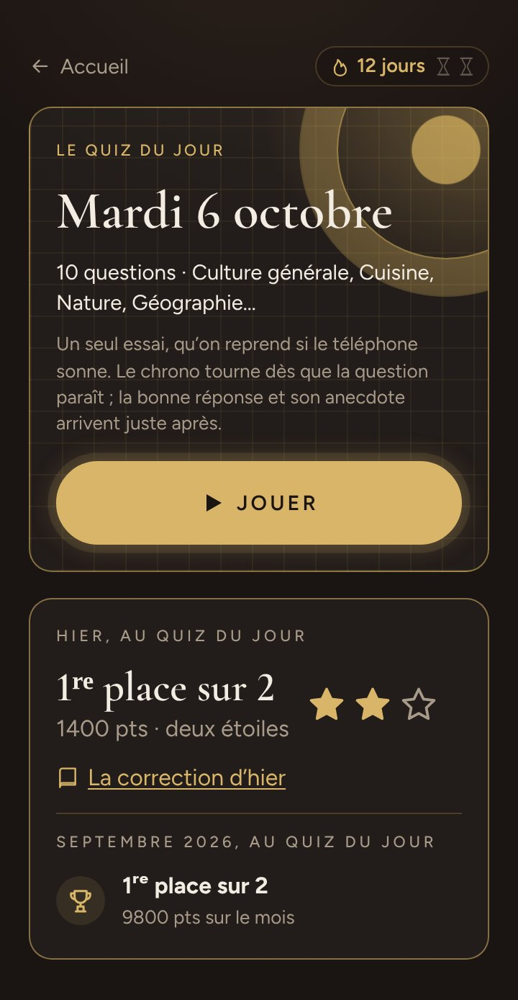

# Le quiz du jour

> Dix questions par jour, les mêmes pour tous les profils du serveur, à jouer seul sur son téléphone : ce que vit le joueur, les règles, la réserve, le rappel du soir et l'installation.

**Dans cette page** : [une journée de quiz](#une-journée-de-quiz) · [les règles chiffrées](#les-règles-chiffrées) · [la réserve de questions](#la-réserve-de-questions) · [le rappel du soir](#le-rappel-du-soir) · [l'installation](#lapplication-sur-lécran-daccueil) · [comment c'est construit](#comment-cest-construit)

Le quiz du jour est **réservé aux profils** : sans profil, `/jour` montre une invitation — « Créer mon profil et jouer », « J'ai déjà un profil » — et rien d'autre. L'invité anonyme ne voit nulle part ce qui lui manque, et les soirées restent ouvertes à tous, sans compte. Chaque valeur citée a sa ligne dans [les barèmes](../reference/baremes.md).

## Une journée de quiz

### Depuis l'accueil

Sur l'accueil d'un profil, dans la section « Seul », le gros bouton **« Le quiz du jour »** dit « Dix questions, les mêmes pour tous » (ou « Joué aujourd'hui »), ta série quand elle dépasse un jour, et porte la pastille « À jouer » tant que ta partie du jour n'est pas commencée.

En haut de `/jour` : « ← Accueil », la pastille de ta **série** (une flamme, tes jours, tes sabliers) et, dans l'application installée, la petite **cloche** du rappel du soir. La carte du jour donne la date, les questions et leurs catégories, et le bouton « Jouer » (« Reprendre · 450 pts » pour une partie commencée) ; dessous, « Déjà 12 joueurs aujourd'hui » (qui ouvre le classement) et qui a gagné hier.

### La partie, question par question

- Chaque question s'affiche comme en soirée. Le **chrono est celui du serveur** : recharger, changer de téléphone ou laisser sonner le sien ne rend pas une seconde. Une question montrée garde son échéance ; passée, elle compte « sans réponse ».
- Ta réponse part une fois. Arrivée après l'échéance et sa marge : « Trop tard ! Ta réponse est arrivée après la fin. »
- Puis la **révélation** : « +162 pts », « Bien joué ! » et ta gerbe, ou « Raté… », « Temps écoulé. », « Question annulée » ; la bonne réponse — jamais avant la tienne ; « Trouvée par 64 % des joueurs du jour » ; l'anecdote, « Le saviez-vous ? ».
- « Question suivante » (« Voir mon résultat » après la dernière), et « Signaler une erreur dans cette question » : une phrase pour l'administrateur, qui peut annuler la question pour tous.
- Une partie laissée en route se reprend où elle en était, sur n'importe quel téléphone du profil.

### La fin, puis le jour joué

**La fin de la partie** ne se voit qu'une fois. En tête, ton résultat : tes points, tes bonnes réponses, tes **étoiles** — la note de la partie, comme aux sentiers : « Deux étoiles · la troisième au sans-faute » —, ta place pour l'instant (« Pour l'instant : 3ᵉ place sur 12 · à 70 pts de Lucas »), la part des points possibles et ta série. Puis l'écran des gains, le même à la fin de chaque mode :

- **« Ce que tu gagnes »** : l'expérience en un total, et ce qui la fait quand elle vient de plusieurs côtés (« ta partie +124 · ta série de 7 jours +70 · tes trophées +175 ») ; tes confettis, un par bonne réponse ; ton niveau, sa barre, « Niveau 12 ! » s'il monte et la finition qu'il ouvre ;
- en grand, ce qui est rare : Chronos s'il descend, l'Éclat, une page du calendrier, un légendaire ;
- **« Nouveaux trophées »** : trois au plus, les plus rares d'abord, chacun menant à sa page de l'album des trophées ; « Et 2 autres » déplie le reste ;
- **« À porter »** : ce que leurs étapes de piste viennent d'ouvrir — un fond, une gerbe, un thème — et l'emoji de collection d'un niveau gagné ; « Essayer » ouvre la loge, l'essai déjà sur ta carte.

Puis « Le classement se fige à minuit. », et « Voir le classement », « Revoir mes réponses », « Continuer en solo : la campagne », « Retour à l'accueil ».

Revenu plus tard, tu trouves **le jour joué** : ton résultat en une carte — tes points, tes étoiles, ta place, l'expérience gagnée —, le classement du jour incrusté, et « Dix nouvelles questions dans 7 h 05 », compté jusqu'au minuit de Paris.

### La correction

« Revoir mes réponses » s'ouvre dès ta partie finie ; celle d'un jour clos, à tous (« La correction d'hier »). Pour chaque question : sa marque (juste, faux, sans réponse, annulée), ce qu'elle a rapporté, **la bonne réponse au centre**, la tienne **barrée dessous** si elle était fausse, « Répondu en 4,2 s sur 20 », le « Bonus de rapidité », la part de la salle, l'anecdote. Sans réponse, elle dit pourquoi : le temps écoulé, ta réponse arrivée après la fin, ou la partie arrêtée avant.

### Le classement du jour et du mois

Un seul classement pour tout le serveur, aux règles des soirées : rang partagé, tous les ex æquo en tête vainqueurs, « Camille (2) » pour deux homonymes. Trois onglets, chacun à son adresse — « Aujourd'hui » (`/jour#classement`), « Hier » (`#classement-hier`), le mois (`#classement-mois`, le total de ses jours) ; cinquante lignes, la tienne à part si tu es plus bas, « · en cours » pour une partie pas finie. Toucher un nom ouvre la carte du joueur. Un profil masqué par l'administrateur n'y paraît plus pour les autres, ni aux classements du défi et des duels — lui se voit toujours, sans en être averti.

### La nuit, et le lendemain

**Rien ne tourne à minuit.** La première demande d'un jour neuf — la page du jour, l'accueil d'un profil, ou une soirée qui affiche les lauriers — clôt la veille, une fois pour toutes : le classement se fige, le podium est payé, les hauts faits de la nuit tombent, le laurier change de tête. Au premier jour d'un mois, le mois d'avant se clôt de même.

Le lendemain, **« Hier, au quiz du jour »** raconte ta place, tes points, l'expérience du podium et tes étoiles ; ce que la nuit t'a décerné, en lignes de trophées comme à la fin d'une partie — Le Laurier et l'étape du Champion du jour qu'une même victoire fait tomber sur une seule ligne —, et ce qu'ils ouvrent à porter ; ton laurier ; puis « La correction d'hier ». Les sept premiers jours d'un mois, le mois d'avant suit : ta place au classement du mois, et ce que sa clôture t'a donné — ton titre de champion (« Ton titre : … », à porter depuis « Mon titre ») et le fond du Triomphe à essayer, le Mois complet en ligne de trophée.

### La série et ses sabliers

**La série** compte les jours d'affilée où tu as joué — une partie commencée, ou une soirée : la fête ne casse jamais une série. Tant que tu n'as pas joué aujourd'hui, elle court jusqu'à hier ; minuit seul la casse.

**Un sablier** la garde : il couvre un jour manqué au milieu d'une série, qui tient, sans compter ce jour-là. Il s'achète à la boutique, rayon « Objets » — 50 confettis, deux au plus en réserve, un ou deux d'un coup ; acheté le jour même du jour manqué, il le couvre encore. La feuille « Ta série », sous sa pastille, mène à [la boutique](la-boutique.md).

### Le laurier et le champion du mois

Le vainqueur d'hier — tous les ex æquo en tête — porte **le laurier** toute la journée, juste après son prénom : au classement du jour, sur sa carte (« Vainqueur du quiz du jour d'hier »), sur sa page et dans les soirées où il joue. Il grandit avec ses victoires : vert à la première, d'or à cinq, serti à vingt, étoilé à cinquante (`SEUILS_DU_LAURIER`). Qui porte aussi l'argent du défi de la semaine montre celui d'hier.

**Le champion du mois** — le premier du classement du mois, ex æquo compris, à deux joueurs au moins — reçoit un titre daté, « Champion d'octobre 2026 », à porter sous son prénom. Sa carte le dit tout le mois suivant, et l'écran commun le salue quand il entre dans une soirée.

### Le calendrier des Heures

Douze enluminures, une par mois. **Vingt jours joués** dans un mois (`JOURS_POUR_UNE_PAGE`, une partie commencée compte) ouvrent sa page ; le champion du mois la reçoit dorée ; les douze ouvrent le thème « Les Très Riches Heures ». Le calendrier se regarde dans « Ma collection », sur la page « Quiz du jour » de l'album des trophées, avec tes titres de champion du mois.

## Les règles chiffrées

| Ce qui compte | La règle | Constante |
|---|---|---|
| Questions | 10 par jour, moins si la réserve est à sec | `QUESTIONS_PAR_JOUR` |
| Points d'une bonne réponse | Comme en soirée : 100, plus jusqu'à 100 de rapidité — entière pendant le temps de lecture offert, nulle à l'échéance | `CHOICE_POINTS`, `SPEED_BONUS` |
| Marge après l'échéance | 1,5 s | `GRACE_MS` |
| Expérience de la partie | ⌊200 × points ÷ points possibles⌋ — 1 240 sur 2 000 font 124 | `XP_MAX_DU_JOUR` |
| Bonus de série | 10 par jour d'affilée, 100 au plus, versé dès la partie commencée | `XP_PAR_JOUR_DE_SERIE`, `XP_DE_SERIE_MAX` |
| Podium du jour | 75, 45, 30 ; rang partagé, une marche de moins que de joueurs, points > 0 | `XP_PODIUM_DU_JOUR` |
| Étoiles, la note de la partie | Trois au sans-faute ; deux à 8 sur 10 ; une à 6 sur 10 — sur les questions qui comptent encore | `medailleDe`, `ETOILES_DE_LA_MEDAILLE` |
| « Trouvée par » | Dite à partir de 3 joueurs sur la question, temps écoulé compris | — |
| Éclat | Une chance sur 40 à chaque partie finie | `CHANCE_ECLAT_DU_JOUR` |

Le serveur compte encore la note en médailles (`medailleDe` : l'or, l'argent, le bronze), et l'écran la montre en étoiles (`NOM_DE_LA_NOTE`, `phraseDesEtoiles`) : bronze, argent et or nomment les étapes des pistes, et la « médaille d'or » d'un jour se lisait comme un trophée.

Ce qui est commun à tous les modes — niveaux, Éclat, légendaires, Divins — est dans [les récompenses](les-recompenses.md).

### Les pistes du quiz du jour

Cinq pistes, chacune en trois étapes — bronze, argent, or —, qui rapportent 50, 100 puis 200 points d'expérience, une fois chacune (`XP_PALIER`). Dans « Ma collection », la page « Quiz du jour » de l'album des trophées les montre en échelle, chaque étape disant ce qu'elle ouvre ; la piste du Champion du jour y compte aussi Le Laurier, qui n'a plus de case à lui.

| Piste | Ce qu'elle compte | Bronze · Argent · Or | Quand une étape tombe |
|---|---|---|---|
| L'Assidu | parties commencées | 7 · 30 · 100 | au « Jouer » |
| Le Champion du jour | victoires | 1 · 5 · 20 | à la nuit |
| Le Sans-Faute | parties finies sans une faute | 1 · 3 · 10 | à la fin de la partie |
| L'Élite | jours dans le premier quart d'une salle de 8 joueurs au moins | 10 · 50 · 150 | à la nuit |
| L'Infatigable | la plus longue série, soirées et sabliers compris | 7 · 30 · 100 | au « Jouer » |

La Légende, qui suit le niveau, se juge aussi au quiz du jour.

### Les hauts faits du jour

Ils se regagnent et rapportent leur expérience à chaque fois ; l'album les range en exploits — Le Laurier, lui, se compte dans la piste du Champion du jour — et en coups du sort pour La Lanterne du jour, Le Courant d'air et Le Dernier Métro. Ceux qui se mesurent aux autres, hors Le Laurier et Le Triomphe, ne se jugent que dans une salle de **8 joueurs au moins** (`SALLE_DU_JOUR`) ; un profil masqué n'y compte ni n'y gagne.

| Haut fait | Ce qu'il faut | XP | Quand |
|---|---|---|---|
| Le Laurier | gagner le quiz du jour | 50 | à la nuit |
| Le Triomphe | le gagner trois jours d'affilée | 150 | à la nuit |
| Le Phénix du jour | le gagner au lendemain d'un jour fini dans la moitié basse (salle de 8, les deux jours) | 100 | à la nuit |
| Seul au monde | seul juste sur une question où 8 au moins ont répondu | 75 | à la nuit |
| L'Éclair du jour | la bonne réponse la plus rapide sur trois questions (salle de 8) | 50 | à la nuit |
| La Lanterne du jour | dernier en ayant répondu à tout (salle de 8) | 15 | à la nuit |
| Le Courant d'air | laisser sa partie avant sa dernière question | 5 | à la nuit |
| Le Lève-tôt | finir sa partie avant 8 h (Paris) | 25 | à la fin de la partie |
| Le Dernier Métro | la commencer à 23 h 30 passées (Paris) | 10 | au « Jouer » |
| Le Mois complet | jouer chaque jour de quiz d'un mois qui en a eu 28 au moins | 250 | à la clôture du mois |

Le quiz du jour ouvre aussi des légendaires — le Sphinx (L'Assidu ou Le Sans-Faute à l'or), l'Aigle, l'Ouroboros, le Scarabée, le Coq, la Chauve-souris, et des voies vers d'autres —, ceux des saisons (Halloween, Noël, le Nouvel An : quelques jours joués), des titres, des gerbes, des fonds et trois thèmes. **Chronos**, l'un des six Divins, peut descendre sur une partie : la fin de la partie te le révèle, à toi seul, avec son récit ; ses règles sont secrètes.

## La réserve de questions

### D'où viennent les questions

Elles attendent dans une **réserve**, chacune une seule fois — reconnue à son intitulé, sans casse, accents ni ponctuation. Elle n'accepte que des questions à choix, sans support : une photo, un extrait, une estimation ou une variante sont écartés, et le journal des apports dit pourquoi ; un doublon aussi, ou une question que la base de la campagne pose déjà.

- **L'amorce** : au tout premier démarrage, les questions des quiz livrés qui se jouent seuls — trente-huit avec les quiz livrés d'aujourd'hui, de quoi tenir quatre jours. Une soirée peut jouer ces quiz : leurs questions ne sortent qu'en dernier recours.
- **La routine du matin** : une routine Claude Code, sur l'abonnement de l'administrateur, écrit ce qui manque pour **trois semaines d'avance** — cent questions au plus par passage — puis les dépose. Le serveur ne détient aucune clé d'IA. Sa mise en place : [la mise en ligne](../exploitation/mise-en-ligne.md).
- **À la main**, à `/admin#jour` : « Coller une liste » (le format de l'éditeur), ou « Copier la consigne pour une IA » — la même que celle de la routine, pour trente questions. La même page suit le jour ([administrer](../guides/administrer.md)) : les jours d'avance (alerte sous sept) ; le tirage d'aujourd'hui, question par question, ce que chaque réponse a recueilli — d'où annuler une question pour tous ou la retirer, sans attendre un signalement ; les signalements ; le classement du mois et son « Masquer » ; les séries qui tiennent ; le rappel du soir.

La consigne dit ce qui fait une bonne question, demande un quart de faciles et un quart de difficiles, privilégie les quatre catégories les moins fournies, rappelle jusqu'à trois cents intitulés déjà là — les questions prêtes d'abord, puis les dernières posées — et, dès qu'il y en a assez, ce que les réponses des joueurs disent de la difficulté des dernières questions posées.

### Le tirage, et la réserve à sec

Le premier qui ouvre le quiz du jour en déclenche le tirage, pour tous, et il se fige : la même copie, réponses mélangées de la même façon ; une question corrigée ensuite ne change rien à ce jour-là. La réserve choisit, dans l'ordre :

1. les questions neuves, hors quiz livrés, **deux au plus par catégorie** d'abord ;
2. à sec, les plus anciennes posées **il y a plus de trente jours** ;
3. puis les questions des quiz livrés, neuves puis anciennes.

S'il en manque, le jour se joue avec moins de dix questions, et reste ainsi. Sans aucune, pas de quiz : « Pas de quiz aujourd'hui », et « Il revient demain » seulement si la réserve tient demain ; le tirage se retente à chaque demande, si bien qu'une réserve remplie dans la matinée donne encore le quiz du jour. Le journal du serveur le dit (`[jour] réserve à sec`).

### Le jeton de la réserve, et ce qu'il ouvre

La routine s'annonce par le jeton `RESERVE_TOKEN`, posé sur le serveur (trente-deux caractères au moins, sinon la porte reste fermée) et envoyé en en-tête `Authorization: Bearer`, vérifié avant toute lecture du corps ; sans jeton posé, ses routes répondent 404. Il ouvre exactement :

- **la consigne et le dépôt** (`/api/jour/reserve`) — la consigne rappelle les intitulés des questions prêtes, celles des prochains jours ;
- **l'étiquetage** (`/api/jour/reserve/etiquetage`) : jusqu'à cinquante questions pas encore décrites — **les prochaines à sortir d'abord, avec leurs réponses et l'index de la bonne** —, puis l'écriture de leur description (sous-thème, étiquettes, difficulté estimée, âge, portée, leurres, source) ;
- **la base de la campagne** (`/api/campagne/base`, voir [la campagne](la-campagne.md)).

Il n'efface rien et ne lit aucun profil.

> [!WARNING]
> Qui tient le jeton peut lire les questions des prochains jours **et leur bonne réponse**. Garde-le comme un mot de passe ; s'il a fuité, change-le des deux côtés — sur le serveur et dans l'environnement de la routine —, et retire à `/admin#jour` ce qu'il aurait déposé.

Chaque description est relue au catalogue : une clé inconnue refuse l'entrée entière, qui reviendra au passage suivant. Rien ne lit encore ces descriptions : une question décrite « hors de la base » (un prénom à remplacer, une photo à regarder) reste tirable.

## Le rappel du soir

C'est **la seule notification** de FiestApp : ni un défi, ni un duel ne font sonner un téléphone.

- **Où** : dans l'application installée seulement (sur iPhone, depuis iOS 16.4), une petite cloche en haut de la page du jour. Un toucher l'active — le téléphone demande alors sa permission —, un second la coupe. Pleine, elle est allumée ; barrée, les notifications sont bloquées, et seuls les réglages du téléphone les rouvrent.
- **Quand** : vers 18 h à Paris (`HEURE_DU_RAPPEL`), une notification, une seule par téléphone et par jour, à qui n'a pas fini sa partie. Rien pour qui l'a finie, rien un jour sans quiz, rien à partir de 22 h (`FIN_DU_RAPPEL`) : un serveur qui redémarre tard ne réveille personne. Abonné après 18 h, le premier rappel est pour le lendemain.
- **Quoi** : « Le quiz du jour t'attend » — avec « Ta série de 6 jours tient jusqu'à minuit » quand elle est en jeu — ou « Ta partie du jour n'est pas finie » et les questions qui restent. Jamais de prénom : une notification se lit sur l'écran verrouillé. La toucher ouvre `/jour`.
- **À qui** : le rappel suit la session du profil sur ce téléphone — une déconnexion l'éteint —, cinq téléphones au plus par profil. Chaque message part chiffré pour ce seul téléphone, par le service de notifications de son navigateur (Google, Apple, Mozilla, Microsoft).

Rien à configurer : le serveur tire ses clés de notification au premier démarrage et les garde en base ; chaque envoi y est réservé d'abord, si bien qu'un redémarrage ne renvoie rien. `/healthz` dit la dernière tournée ; le QG garde le bilan de chaque soir.

## L'application sur l'écran d'accueil

FiestApp n'est dans aucun store : c'est la page qui s'installe, d'après son manifeste (`client/public/manifest.webmanifest`). Au pied de l'accueil d'un téléphone, la ligne « Installer l'application » se déroule d'un toucher : ce qu'elle apporte (avec un profil, le rappel du soir), puis les gestes de l'iPhone (dans Safari, « Partager », puis « Sur l'écran d'accueil ») et ceux d'Android (dans Chrome, le menu ⋮, puis « Installer l'application »), chacun à son onglet, celui du téléphone d'abord. Sur Android, quand Chrome l'offre, « Installer maintenant » suffit. « Ne plus afficher » la masque sur ce téléphone. Rien sur un ordinateur, rien dans l'application déjà installée, qui s'ouvre en plein écran.

## Comment c'est construit

- **Les fichiers** : `shared/jour.ts` (les règles pures), `server/src/core/jour.ts` (la réserve, le tirage, la partie, la nuit, le mois), `server/src/quizDuJour.ts` (les routes), `server/src/core/consigne.ts` et `server/src/core/etiquetage.ts`, `server/src/core/rappels.ts` et `server/src/core/pousser.ts` (le rappel, en Web Push sans bibliothèque), `client/src/views/JourApp.tsx` — sa fin passe par l'écran des gains de tous les modes (`client/src/components/Gains.tsx`, `shared/gains.ts`) — et `client/public/sw.js` ; au QG, `shared/qgDuJour.ts`.
- **Tout vit dans la base permanente**, jamais dans la base locale jetable : un profil commence sur un téléphone et reprend sur un autre ([les tables](../reference/base-de-donnees.md)).
- **Pas de liaison temps réel** : la page parle en HTTP ([les routes](../reference/api-http.md)), et chaque partie que le serveur renvoie porte son heure, sur laquelle le téléphone recale son chrono. Pas de chronomètre au serveur non plus : une question dont l'échéance est passée se compte « sans réponse » à la lecture suivante, que la page demande d'elle-même juste après l'échéance.
- **Ce qui fige** : chaque partie garde l'expérience de ses points et son bonus de série, chaque podium la sienne. Changer le barème du jour ne touche que l'avenir ; recompter le passé se fait une fois, sous un drapeau neuf (`server/src/core/baremeDuSolo.ts`). La ligne d'expérience du quiz du jour compte dans le niveau, pas dans l'historique des soirées, et leur recalcul ne la relit pas.
- **Ce qui se relit** : les récompenses du jour dérivent des journaux. Quand une règle change, `VERSION_DES_JOURS` monte, et le démarrage suivant rejoue la nuit de chaque jour clos, le début et la fin de chaque partie et les étapes des pistes — sans rien doubler. **Ce qui ne se relit pas** : un mois déjà clos (son champion, son Mois complet), le podium payé, l'Éclat tiré — une règle de mois ou de podium qui change demande sa propre relecture. La série et les sabliers se recalculent à chaque lecture : rien ne s'en écrit.

Les deux bases, les journaux et le recalcul : [les données](../architecture/donnees.md).

## Pour aller plus loin

- [Les récompenses](les-recompenses.md) — l'expérience, les niveaux, les légendaires, l'Éclat, communs à tous les modes
- [La boutique](la-boutique.md) — les confettis, le sablier, les thèmes
- [La campagne](la-campagne.md) — l'autre jeu solo, et le défi de la semaine
- [Administrer](../guides/administrer.md) — la réserve, le suivi du jour au QG, les signalements, les profils masqués
- [La mise en ligne](../exploitation/mise-en-ligne.md) — poser le jeton et lancer la routine du matin
- [Les barèmes](../reference/baremes.md) — chaque valeur, et ce que la changer implique
