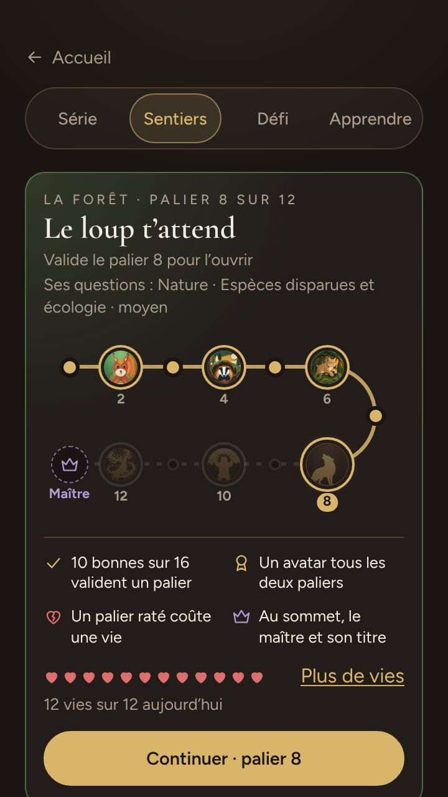

# Les sentiers du savoir

> Le deuxième onglet de la campagne : douze sentiers, un par catégorie de questions, qu'on gravit palier par palier pour gagner les avatars du savoir — et, dans l'onglet « Apprendre », les parcours de thème, où l'on n'a rien à perdre. Comment on les joue, leurs règles chiffrées, puis comment c'est construit.

**Dans cette page** : [La carte](#la-carte-des-sentiers) · [Ta chance](#ta-chance-sentier-par-sentier) · [Une épreuve](#une-épreuve-question-par-question) · [Les trophées](#les-trophées-des-sentiers) · [Quitter une épreuve](#quitter-une-épreuve) · [Les vies](#les-vies) · [Les parcours de thème](#les-parcours-de-thème) · [Les règles chiffrées](#les-règles-chiffrées) · [Comment c'est construit](#comment-cest-construit)

## En bref

- **Douze sentiers**, un par catégorie : la forêt pose des questions de nature, le stade de sport.
- **Douze paliers** par sentier, puis un **palier de maître** facultatif ; à chacun son épreuve de seize questions, que **dix bonnes réponses valident** (neuf au maître). Ce sont les questions qui durcissent, pas la règle.
- **Un portrait tous les deux paliers** : six par sentier, soixante-douze en tout. C'est le seul endroit où se gagnent les avatars du savoir.
- **Douze vies par jour** pour tous les sentiers : seul un palier raté en coûte une, et rejouer un palier validé ne coûte rien.
- **Des étoiles** sur chaque palier validé ; la deuxième et la troisième paient des confettis.
- **Des trophées** : trois pistes — tes paliers, tes étoiles, tes sentiers menés au palier 8 — et deux exploits, L'Impeccable et Contre toute attente.

Les sentiers, comme toute la campagne, se jouent avec un profil : ce que tu y gagnes y reste. Sans profil, la campagne propose de se connecter ou d'en créer un — une soirée, elle, se joue toujours sans compte.

## Où les trouver

- Dans la campagne, le deuxième onglet, « Les sentiers » (« Sentiers » au téléphone) : `/campagne#sentiers`. Chaque sentier a son adresse : `/campagne#sentier-foret`, `/campagne#sentier-stade`…
- Sur l'accueil, le bouton de la campagne dit le sentier que tu avances et tes vies (« Vers le palier 8 de la forêt · 11 vies ») et ouvre les sentiers ; le défi de la semaine et ton carnet à revoir passent devant, jamais devant une épreuve laissée en route (voir [la campagne](la-campagne.md)).

## La carte des sentiers

Le haut de la carte est un seul bloc, qui montre **un sentier** : celui dont tu as touché la tuile, sinon celui que tu avances — l'épreuve laissée en route d'abord, sinon ton sentier le plus haut qui n'est pas au sommet. Il dit ce qui t'attend (« Le loup t’attend ») et d'où viennent ses questions : la catégorie, le thème du chapitre, la difficulté en un mot. Puis le panorama de ses treize étapes, un portrait sur chaque palier pair (en silhouette tant qu'il n'est pas gagné), les règles en quatre lignes, repliées sous « Comment ça marche ? » une fois trois paliers validés en jouant, et tes vies en cœurs. Son bouton ouvre le sentier (« Continuer · palier 8 ») ou reprend l'épreuve laissée (« Reprendre l’épreuve ») ; une épreuve laissée sur un autre sentier s'y rappelle (« … : une seule à la fois. »).

Dessous, une tuile par sentier : son dernier portrait gagné, son nom et **sa catégorie dessous** — le nom d'un sentier est une image : « Le tour du monde » pose de la culture générale —, son état (« À commencer », « Palier 4 », « Maître à tenter », « Maître »), ses étoiles et la difficulté du palier à jouer. Dans son coin, **la couleur de piste** de ce palier pour toi (voir plus bas). Toucher une tuile fait monter son sentier dans le bloc ; la toucher encore y entre.

## Ta chance, sentier par sentier

La difficulté d'un palier dit ce qu'il pose (« moyen à difficile »), pas ce qu'il est pour toi : un cinéphile passe l'écran les doigts dans le nez et bute sur le stade. Une fois **vingt premières réponses** données en campagne, la page dit ta chance de valider du premier coup le palier qui t'attend, sentier par sentier, lue sur tes réponses — rien n'est adouci, les questions restent celles du palier :

- **La couleur de piste**, comme au ski, dans le coin de chaque tuile : **verte** à 70 % de chances et plus, **bleue** à 45 %, **rouge** à 20 %, **noire** en deçà. Chacune a sa forme — rond, carré, triangle, losange — pour qui ne distingue pas les couleurs.
- **Le bloc du haut** le dit en clair : « Pour toi : piste rouge, 33 % de chances du premier coup ». Pas sur une épreuve déjà entamée : elle a ses bonnes réponses.
- **La fiche du palier** qui t'attend aussi, sous sa difficulté : « piste rouge : 33 % de chances de le valider du premier coup ».
- **Ta progression** : quand tu as répondu dans la catégorie avant la semaine et depuis — dix premières réponses de chaque côté —, ce que ta chance valait il y a une semaine, aux mêmes questions : « (14 % il y a une semaine) ». À la baisse aussi : elle dit ce qui est.

Ta chance se lit sur ta **première réponse** à chaque question, comme le modèle du savoir qui la calcule (voir [comment c'est construit](#comment-cest-construit)) : revoir une question corrigée ne dit plus ce que tu savais. Elle se dit à 1 % près, jamais 0 ni 100 : aucune épreuve n'est perdue ou gagnée d'avance.

## Un sentier

Le sentier (« ← Les sentiers » pour revenir) se lit de bas en haut, du « Départ » à la couronne : une pastille par palier — une coche s'il est validé, un portrait sur les paliers pairs —, et « Jouer » à côté du palier à jouer. Son en-tête, collé, dit ton palier ; un refus s'y écrit. Une épreuve laissée sur ce sentier s'y reprend : « Reprendre le palier 3 · 2 sur 3 ».

### Les chapitres

Les huit premiers paliers vont **par deux**, et chaque paire est un chapitre qui a son thème, fait d'un à quatre sous-thèmes de la catégorie : la forêt commence par « Mammifères et oiseaux », le stade par « Football et rugby ». Un chapitre change ce que tu lis, jamais la difficulté : ses questions passent devant le reste de la catégorie, à la même marche, et chaque sous-thème sert dans un seul chapitre. Du palier 9 au maître, plus de chapitre : **toute la catégorie**, chaque sous-thème à son tour — on ne gravit pas le stade sur le seul football.

### La fiche d'un palier

Toucher un palier ouvre sa fiche (« Palier 3 sur 12 ») : son thème (« Le français et les langues · chapitre 2 sur 4 »), sa difficulté — et, pour celui qui t'attend, ta chance de le valider —, ses questions (« 12 faciles et 4 moyennes »), son seuil, ce que paient ses étoiles (« ★★ à 13 : 10 confettis · ★★★ sans faute : 25 ») et le portrait qu'il ouvre. Puis le geste : « Jouer le palier 3 », « Rejouer · sans risquer de vie » pour un palier validé, « Reprendre le palier 3 » pour l'épreuve laissée sur ce palier (« rien n’est perdu, tu reprends où tu en étais »), « Plus de vies : racheter » sans vie. Si une épreuve en jeu t'attend ailleurs, ni « Jouer » ni « Rejouer » : « Une seule épreuve à la fois : finis-la, ou quitte-la — un palier quitté compte comme raté. »

## Une épreuve, question par question

En haut, « ← Partir », « Palier 2 · question 4/16 » et tes vies du jour (« Rejeu » pour un palier validé). Puis l'enjeu, « 10 bonnes réponses sur 16 pour l’écureuil. Une vie en jeu. », et une barre de seize cases : les bonnes réponses montent de la gauche, les fautes de la droite, une ligne d'or marque le seuil (« 2 fautes · 4 permises »). La question dit sa difficulté, sa catégorie et son sous-thème ; pas de chronomètre. Après ta réponse : « 🎊 +1 » et l'expérience gagnée, ou « Raté… », la bonne réponse et son anecdote, et « Signaler une erreur dans cette question ». Le téléphone ne reçoit la bonne réponse qu'avec la tienne.

- **Validé en route** : à la dixième bonne réponse (la neuvième au maître), le palier est acquis — « Palier validé. Plus rien en jeu : les questions qui restent comptent pour les étoiles. » L'épreuve continue jusqu'à la seizième question, à moins que tu ne t'arrêtes là.
- **Raté** : à la faute de trop — la septième, la huitième au maître —, l'épreuve s'arrête : « Raté… la ligne d’or est franchie ».

### La fin d'une épreuve

Chaque fin passe par l'écran des gains, le même à la fin de chaque mode : **« Ce que tu gagnes »** — l'expérience en un total, et ce qui la fait (« tes bonnes réponses +70 · le palier +100 · tes trophées +100 »), tes confettis (« 🎊 +24 confettis », puis « Dont 10 confettis pour tes étoiles. »), ton niveau, relu après l'épreuve —, les légendaires en grand, **« Nouveaux trophées »** — les étapes des pistes qu'elle a fait tomber, celles des sentiers (voir plus bas) comme Le Marathonien ou L'Érudit, et ses exploits, chacun menant à sa page de l'album — et **« À porter »** : ce qu'elles ouvrent, le Cabinet de curiosités ou Babel quand ce maître est ton troisième ou ton douzième, l'emoji de collection d'un niveau gagné, chacun avec « Essayer ». Elle propose aussi « Mes réponses », la correction.

- **Un portrait** (un palier pair validé la première fois) se révèle en grand : « L’écureuil est à toi », « Le porter », « Continuer le sentier ». **Le maître**, de même : la couronne, « Maître de la forêt », « Le porter ».
- **Un autre palier** : « Palier validé » (ou « Rejoué »), « Jouer le palier 4 », et « Rejouer pour ★★ · sans risquer de vie » s'il manque des étoiles.
- **Raté** : « Raté de peu » ou « Pas cette fois », « 7 bonnes réponses : il en fallait 10. La septième faute a franchi la ligne. », une vie de moins (aucune en rejeu), puis « Réessayer » et « Retour au sentier ».

**Le palier de maître**, après le sommet, est facultatif : « des questions que moins d’un joueur sur cinq trouve. En réussir plus de la moitié fait de toi le maître ». Seize expertes de toute la catégorie, neuf pour valider. Son titre — « Maître de la forêt », « Maître du stade » — se porte sous ton prénom, comme le nom d'un haut fait : « la salle le lit en touchant ton nom ». Trois maîtres ouvrent un fond de carte, le Cabinet de curiosités ; douze, un thème qu'aucune boutique ne vend, Babel (voir [la boutique](la-boutique.md)). Dans « Ma collection », la page « Sentiers » de l'album des trophées montre tes maîtres, sentier par sentier, et ce que leur nombre ouvre.

## Les trophées des sentiers

Un portrait tous les deux paliers ne suffisait pas à y revenir (le 15 octobre 2026) : les sentiers ont leurs trophées, sur leur page de l'album des trophées, avant les maîtres. Ils comptent ce qui se valide **en épreuve** : un palier repris d'un ancien portrait, sans étoiles, n'y compte qu'une fois rejoué et validé — comme son expérience.

| Trophée | Ce qu'il compte | Bronze · argent · or |
|---|---|---|
| 🥾 Le Randonneur | les paliers validés en épreuve, chacun une fois, le maître compris | 12 · 48 · 120 |
| 🌟 La Constellation | tes étoiles : la meilleure note de chaque palier, additionnées | 25 · 100 · 250 |
| 🗺️ Le Cartographe | les sentiers validés jusqu'au palier 8 — le dernier des chapitres — ou plus haut | 3 · 6 · 12 |

Comme toute piste, chaque étape tombe une fois et rapporte 50, 100 puis 200 XP (`XP_PALIER`), à la fin d'une épreuve ou d'une série — la campagne les compte avec Le Marathonien. Deux exploits se regagnent, une épreuve en jeu au plus chacun ; jamais un rejeu, qui se rejoue sans rien risquer :

| Exploit | La règle | XP |
|---|---|---|
| 💎 L'Impeccable | seize bonnes réponses sur seize, dès le cinquième palier — avant, le vrai ou faux y aidait | 150 |
| ⛷️ Contre toute attente | valider du premier coup un palier que ta chance annonçait en piste noire | 100 |

**Contre toute attente** se juge à la chance que la page te disait **au départ** de l'épreuve : elle se garde avec elle, et ce que tu réponds ensuite n'y change rien. Sans chance annoncée — moins de vingt premières réponses, le modèle pas encore ajusté —, il n'y a rien à démentir. Raté une fois, le palier n'est plus du premier coup. Sur la production, un premier essai annoncé en piste noire sur huit a été validé.

## Quitter une épreuve

| Geste | Ce qu'il fait | Ce qu'il coûte |
|---|---|---|
| « ← Partir », en haut | Tu reviens au sentier ; l'épreuve t'attend telle quelle, et son palier la reprend. | Rien |
| « Abandonner l’épreuve », en bas | Après confirmation, l'épreuve s'arrête et compte comme ratée ; un rejeu abandonné se referme, simplement. | Une vie, si le palier était en jeu |
| « Arrêter là · voir mon palier » | Le même bouton, une fois le palier validé : l'épreuve s'arrête et mène à sa fin, comme à la seizième question — étoiles, portrait, titre. | Rien |

> [!NOTE]
> Abandonner coûte une vie parce que, sans elle, on quitterait juste avant la faute de trop pour ne jamais rien perdre. Partir ne perd rien : l'épreuve reste en jeu, et on la reprend où on l'avait laissée.

**Une épreuve à la fois.** Tant qu'une épreuve en jeu t'attend, le serveur refuse d'en commencer une autre, même un rejeu : « Une épreuve t’attend : le palier 10 du sentier de la forêt. Finis-la, ou abandonne-la. » Un rejeu laissé en route, ou une épreuve déjà validée qui continuait pour ses étoiles, ne bloque rien : commencer une autre épreuve les referme d'eux-mêmes. L'épreuve validée se referme alors **sans écran de fin** : le palier reste validé, son portrait est à toi et ses étoiles comptent, mais sa révélation ne s'affiche pas, et les étapes de piste qu'elle aurait fait tomber — Le Marathonien, L'Érudit — attendent ta prochaine partie de campagne finie.

Un administrateur peut aussi libérer une épreuve qui t'attend, sans te coûter de vie (voir [Comment c'est construit](#comment-cest-construit)).

## Les vies

- **Douze par jour** (`VIES_PAR_JOUR`, une par sentier), pour tous les sentiers, rendues à **minuit, heure de Paris**, sans s'additionner d'un jour à l'autre.
- **Seul un palier en jeu raté en coûte une**, à la faute de trop ou abandonné. Ni « ← Partir », ni un rejeu, ni les parcours de thème.
- **Sans vie**, un nouveau palier attend minuit ou un rachat ; tu peux toujours rejouer un palier validé, ou jouer une série.
- **Racheter des vies** : 25 confettis la vie (`PRIX_D_UNE_VIE`), de une à dix par achat (`VIES_PAR_ACHAT_MAX`), sur l'écran « Plus de vies » (le lien à côté des cœurs, ou « Racheter des vies » à la fin d'une épreuve quand il n'en reste plus) ou dans la boutique, rayon « Objets ». Elles vont dans une **réserve qui ne périme pas** et servent après celles du jour.

La réserve, c'est ce que tu as acheté, moins les échecs qui ont dépassé douze un même jour : rien n'est compté à part.

## Les parcours de thème

Dans l'onglet « Apprendre » (`/campagne#carnet`), sous le carnet de révision : « 6 étapes de 10 questions, 7 bonnes réponses pour passer, sans vies : on y apprend, on n’y perd rien. »

- **Un parcours par sujet** de la campagne — un thème (les animaux, le petit écran…), une époque ou un fil rouge (la France, les pièges…) — qui a au moins soixante questions jouables : chacun des vingt-cinq sujets en a un.
- **Six étapes de dix questions**, des faciles aux difficiles, jamais d'experte, sans vrai ou faux dès la troisième, les sous-thèmes du sujet à tour de rôle ; **sept bonnes réponses** pour passer.
- **Rien à perdre** : ratée à la quatrième faute, l'étape se rejoue tout de suite, sur d'autres questions ; laissée par « ← Partir », elle t'attend ; en ouvrir une autre la referme. Pas d'abandon.
- **Ce qu'elles rapportent** : chaque bonne réponse paie comme en série, une étape finie peut faire tomber Le Marathonien, et tes erreurs vont au carnet. Ni portrait, ni titre, ni expérience d'étape ; les étoiles (à sept, neuf et dix bonnes réponses) ne paient pas de confettis. Sa fin passe par le même écran des gains qu'une épreuve.
- **La liste** : l'étape laissée d'abord, tes parcours en cours, puis une famille à la fois (« Thèmes », « Époques », « Fils rouges »).

> [!NOTE]
> Sous les douze sentiers, on prenait les parcours pour eux, alors qu'ils n'en ont ni les vies ni les avatars : ils sont passés dans « Apprendre ». Le code, les tables et l'API gardent leurs noms d'avant, des « sentiers à thème » montés en paliers (`shared/sentiersDeSujets.ts`, `mode = 'sujet'`).

## Les règles chiffrées

Chaque valeur a sa ligne, avec ce que la changer implique, dans [les barèmes](../reference/baremes.md).

### Les paliers

Seize questions par épreuve (`QUESTIONS_PAR_EPREUVE`), dix pour valider (`SEUIL_DES_PALIERS`), neuf au maître (`SEUIL_DU_MAITRE`), les mélanges dans `PALIERS` (`shared/sentiers.ts`) — F, M, D : faciles, moyennes, difficiles. Les paliers 1 à 8 posent le thème de leur chapitre, les suivants toute la catégorie ; du vrai ou faux jusqu'au palier 4, plus ensuite.

| Palier | Mélange | Il ouvre | Difficulté affichée |
|---|---|---|---|
| 1 | 16 F | — | facile |
| 2 | 14 F · 2 M | le 1er portrait | facile |
| 3 | 12 F · 4 M | — | facile à moyen |
| 4 | 10 F · 6 M | le 2e portrait | facile à moyen |
| 5 | 7 F · 9 M | — | facile à moyen |
| 6 | 4 F · 12 M | le 3e portrait | moyen |
| 7 | 16 M | — | moyen |
| 8 | 13 M · 3 D | le 4e portrait | moyen |
| 9 | 10 M · 6 D | — | moyen à difficile |
| 10 | 7 M · 9 D | le 5e portrait | moyen à difficile |
| 11 | 5 M · 11 D | — | moyen à difficile |
| 12 | 3 M · 13 D | le 6e portrait | difficile |
| Maître | 16 expertes | le titre | expert |

Ce sont les mélanges du code. L'administrateur peut régler celui d'un palier depuis le QG (`/admin#campagne`), pour les douze sentiers ensemble : seize questions, jamais d'experte, le seuil intouché, et rien au maître. La difficulté affichée suit alors le mélange réglé (voir [administrer](../guides/administrer.md#la-campagne-et-les-sentiers)).

- **Aucune experte avant le maître** : moins d'un joueur sur cinq en trouve une, et un portrait qui en dépendrait se gagnerait à l'usure. **Pas de vrai ou faux** dès le cinquième palier : une chance sur deux au hasard.
- La **difficulté affichée** est la marche moyenne des seize questions (`difficulteDuMelange`) ; le niveau d'une question est celui de toute la campagne (voir [la campagne](la-campagne.md)).
- **Les étoiles** d'une épreuve validée : une au seuil, deux à treize bonnes réponses, trois sans faute ; seule la meilleure note de chaque palier compte.

### Ce qui rapporte

| Quoi | Combien | Quand |
|---|---|---|
| Une bonne réponse | un confetti, et l'expérience d'une bonne réponse de campagne | à chaque fois, comme en série |
| Un palier validé | 50 XP, 100 s'il ouvre un portrait, 250 au maître (`XP_D_UN_PALIER`, `XP_D_UN_PALIER_A_PORTRAIT`, `XP_DU_MAITRE`) | une fois par palier, à la bonne réponse qui le valide |
| Deux, trois étoiles | 10, 25 confettis (`CONFETTIS_DES_ETOILES`) | la meilleure note de chaque palier ; un progrès paie la différence |
| Un palier pair, le maître | son portrait, le titre de maître | à leur première validation |
| Trois, douze maîtres | le Cabinet de curiosités, le thème Babel | dès qu'ils sont atteints |
| Une épreuve finie, validée ou non | les étapes des pistes qu'elle fait tomber — Le Randonneur, La Constellation, Le Cartographe, Le Marathonien, L'Érudit — et ses exploits, L'Impeccable et Contre toute attente | à la fin |

Chaque bonne réponse compte aussi pour l'écusson de sa catégorie (voir [les récompenses](les-recompenses.md)) et fait grandir le compagnon que tu portes.

### Les portraits et le titre

Chaque sentier ouvre six portraits, aux paliers 2, 4, 6, 8, 10 et 12 (`PALIER_DU_PORTRAIT`, `shared/branches.ts`) ; ils se portent comme un légendaire, et « Ma collection » les range par rareté (voir [le profil](le-profil.md)).

| Sentier | Catégorie | Ses six portraits, du palier 2 au palier 12 |
|---|---|---|
| Le tour du monde | Culture générale | kangourou, lama, fennec, axolotl, pangolin, panda roux |
| Les mythologies | Histoire | Minotaure, Gorgone, Thor, Anubis, Poséidon, Athéna |
| Les océans | Géographie | hippocampe, tortue de mer, méduse lumineuse, raie manta, baleine à bosse, narval |
| L'espace | Sciences | robot, extraterrestre, chat de Schrödinger, astronome, savante, astronaute |
| La forêt | Nature | écureuil, blaireau, lynx, loup, ours, cerf |
| Le grand écran | Cinéma & séries | cow-boy, vampire, détective, pirate, super-héroïne, star |
| La scène | Musique | DJ, rockeuse, jazzman, violoniste, cantatrice, chef d'orchestre |
| Les contes | Arts & lettres | lutin, troll, yéti, fée, sirène, griffon |
| Le stade | Sport | nageuse, cycliste, surfeur, skieuse, boxeur, danseuse étoile |
| La brigade | Cuisine | croissant, macaron, boulanger, pâtissière, sommelier, chef |
| L'arcade | Jeux & pop culture | slime, squelette, coffre vivant, archère, mage, chevalier |
| Le carnaval | Autour de la fête | piñata, fêtard, arlequin, magicien, reine du disco, masque de Venise |

- **Un palier validé ne se perd jamais**, ni ce qu'il ouvre ; le serveur vérifie le palier quand tu prends un portrait ou un titre, puis te croit.
- **Les portraits gagnés avant les sentiers** (ils s'ouvraient alors aux bonnes réponses d'une catégorie, en soirée et au quiz du jour) ont été gardés, à deux paliers validés par portrait, sans étoiles : ces paliers se rejouent comme des rejeux, et paient leur expérience la première fois qu'ils sont validés ainsi.

### Le tirage d'une épreuve

Les seize questions se tirent au départ, dans la catégorie du sentier (sans les questions retirées ni celles du quiz du jour), selon le mélange du palier ; pour chaque place :

1. Une question **vue ces dernières vingt-quatre heures** ne revient qu'en dernier recours (`VUE_RECENTE_MS`) : on ne revoit pas le soir même ce qu'on vient de rater.
2. **Paliers 1 à 8** : le thème du chapitre passe devant le reste de la catégorie, même par une question déjà vue.
3. **Paliers 9 à 13** : chaque sous-thème passe d'abord, même par une question déjà vue.
4. Ensuite, les questions **jamais vues** d'abord, et **pas deux jumelles** quand la marche en a d'aussi fraîches : la même forme d'intitulé (« Qui a réalisé le film… ») ou deux réponses proposées en commun (`server/src/core/jumelles.ts`).
5. Une marche à court de jamais vues **reste sa marche** et reprend ses déjà vues, la plus anciennement vue d'abord : emprunter changerait la difficulté du palier. Elle n'emprunte que vide, d'abord à la marche plus dure.

Les seize sont ensuite mélangées, et les réponses de chacune (sauf « Vrai » et « Faux »). Les parcours de thème suivent la même règle sur leur sujet.

### Quand une règle change

- **Une épreuve garde son seuil et ses questions** : un seuil ou un mélange changé — dans le code, ou réglé au QG — ne vaut que pour les épreuves qui commencent, et une issue écrite ne se relit pas — une épreuve validée le reste.
- **Les étoiles paient à chaque lecture du solde** : changer `CONFETTIS_DES_ETOILES` — ou `PRIX_D_UNE_VIE`, que vaut la troisième étoile — change d'un coup le solde de tout le monde, rétroactivement.
- **Les portraits ouverts ne sont retenus nulle part** : ils se relisent des paliers. Repousser le palier d'un portrait le reprendrait à qui n'a pas le nouveau.
- **Les trophées des sentiers se relisent une fois par version** (`VERSION_DES_EPREUVES`) : au démarrage qui l'apporte, chaque épreuve finie redonne ses exploits, et chacun reçoit les étapes de ses pistes, sans rien perdre. C'est ainsi qu'ils sont tombés, le 15 octobre 2026, à qui les tenait déjà. Contre toute attente ne se relit que sur les épreuves qui ont gardé leur chance.

## Comment c'est construit

**Où vit la logique.** Les règles sont pures et partagées : `shared/sentiers.ts` (paliers, seuils, étoiles, vies, expérience, titres), `shared/branches.ts` (les portraits), `shared/chapitres.ts`, `shared/sentiersDeSujets.ts` (les parcours). Le serveur les applique dans `CampagneStore` (`server/src/core/campagne.ts`) : il tire une épreuve (`tirerUneEpreuve`), juge chaque réponse et ne donne jamais la bonne avant la tienne. Les routes : `server/src/campagne.ts` (voir [l'API HTTP](../reference/api-http.md)) ; les pages : `client/src/views/Sentiers.tsx`, `client/src/views/Parcours.tsx`.

**Rien ne se compte à côté.** Une épreuve est une série de la campagne d'un autre mode, dans la base permanente : ses réponses, son seuil, son issue. Paliers, étoiles et vies se relisent de ce journal à chaque lecture, avec les paliers repris des anciens portraits (`sentier_acquis`) et les vies achetées (`profile_vies`) : aucun compteur qu'un hoquet de la base pourrait fausser. Le détail : [les données](../architecture/donnees.md).

**Le calibrage.** Mélanges et seuils ont été calculés avant d'être fixés (`server/scripts/calibrage-sentiers.ts`), une question étant trouvée par 85, 55, 30 ou 10 % des joueurs selon sa marche. À dix sur seize, un joueur moyen passe du premier coup le cinquième palier 79 fois sur cent, le huitième 23 ; un bon joueur, le douzième 46. À douze, le seuil d'avant, le joueur moyen ne passait plus le cinquième que 38 fois sur cent, le huitième 4 : les vraies épreuves butaient là. Le QG (`/admin#campagne`, « Les sentiers ») mesure chaque palier sur les épreuves de trois mois, et signale celui qui passe mieux que le précédent : son mélange est à revoir, et s'y règle (`sentier_melanges`).

**Ta chance.** Le modèle du savoir (`server/src/core/modeleDuSavoir.ts`) ajuste ensemble une force par joueur et par catégorie et une difficulté par question, sur la première réponse de chacun ; il apprend aussi ce que vaut chaque difficulté estimée à l'écriture, en bloc (`ECART_DES_ESTIMATIONS`). La page des sentiers relit ta force de tes premières réponses, puis ta chance sur chaque marche du palier, et la loi de leur somme — ta forme du jour intégrée (`chanceDeLEpreuve`, `FORME_D_UNE_EPREUVE`). Mesurée avant d'être montrée, sur les épreuves de la production du 8 au 15 octobre 2026, le modèle ajusté avant le 8 : chaque tranche annoncée tient à quelques points près (16 % annoncés, 9 % validées ; 32 et 36 ; 56 et 51 ; 86 et 87). Le modèle d'avant annonçait 7 % à des épreuves qui se validaient une fois sur trois. Il se refait en fond, au plus toutes les demi-heures ; avant son premier ajustement, la page ne dit pas de chance. Au départ d'une épreuve en jeu, la chance de ce palier se calcule par le même chemin et se garde avec elle (`campagne_series.chance`) : Contre toute attente la relit à la fin — et ces chances, confrontées aux issues, mesureront le modèle sans le refaire.

**Libérer une épreuve.** Depuis la fiche d'un joueur, au QG, l'administrateur peut libérer l'épreuve qui l'attend (« Libérer l’épreuve ») : elle se referme telle quelle, sans coûter de vie ni compter comme un échec (voir [administrer](../guides/administrer.md)).

## Pour aller plus loin

- [La campagne](la-campagne.md) — la série, le carnet de révision, le défi de la semaine, et ce que paie une bonne réponse
- [Le profil](le-profil.md) — « Ma collection » et la loge, où se portent les portraits et les titres
- [Les récompenses](les-recompenses.md) — l'expérience, les niveaux, les écussons
- [La boutique](la-boutique.md) — les confettis, la vie en objet, le Cabinet de curiosités et Babel
- [Les barèmes](../reference/baremes.md) — chaque valeur de cette page, constante par constante
- [Les données](../architecture/donnees.md) — les tables et les dérivations derrière les sentiers
