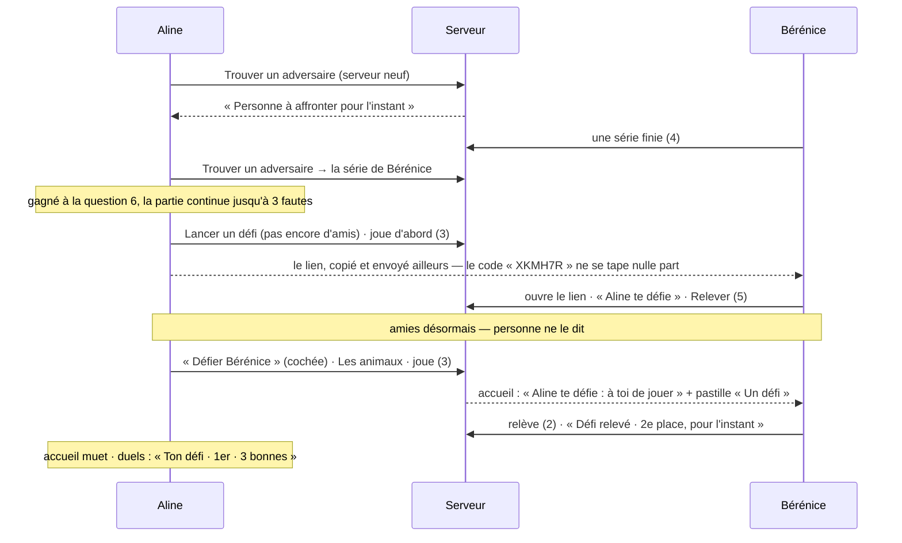

# Les vœux du 11 octobre, joués — rapport de l'experte UX du jeu solo (mobile, cinq minutes par jour)

## En bref

Sur les sept vœux du 11 octobre, quatre sont tenus : les sentiers disent leur thème et leur difficulté, le carnet se recommence et se quitte, le profil se change en touchant sa carte, et le classement du défi s'ouvre sur la carte de chacun. Trois ne le sont qu'à moitié : les duels, le défi entre amis et la vitesse. Ce qui manque n'est presque jamais une fonction. C'est un **bout de chemin** : un duel classé déjà gagné ne finit pas, et la cote n'est créditée qu'à la troisième erreur ; « Trouver un adversaire » tombe sur « Personne à affronter » dès qu'un serveur est petit ; le code d'un défi entre amis ne se tape nulle part ; abandonner une épreuve déjà validée saute l'écran qui révèle le portrait. Les trois améliorations les plus rentables, toutes de quelques lignes :
1. **finir un duel classé dès qu'il est gagné** ;
2. **un champ « J'ai un code »** sur la page des duels, et un message « personne à affronter » qui propose quoi faire ;
3. **une pastille « À revoir » sur la tuile de la campagne**, quand le carnet attend : c'est le rendez-vous du lendemain, et l'accueil n'en dit rien.

## Méthode

- **Appareils** : `aline-tel1` (Aline) et `aline-tel2` (Bérénice), tous deux en `petit-telephone` (360 × 640, Chromium de l'atelier, pilote `TABLEE=…/atelier.json`). Les deux profils ont été créés depuis `/`, comme le ferait quelqu'un qui découvre l'application. Il y a eu environ deux cents gestes, de 16 h 27 à 17 h 05 UTC, le dimanche 11 octobre, cinq heures avant la clôture de la semaine.
- **Chemins déroulés** : les sept de la fiche, tous en entier.
  - Deux épreuves de sentier : la première quittée à mi-chemin puis reprise et validée, la seconde validée puis abandonnée.
  - Une épreuve de sentier à thème, commencée puis laissée.
  - Une série ratée exprès, le carnet revu, « Recommencer » puis « ← Partir ».
  - Le profil changé : avatar, titre, vitrine, fond, thème.
  - Un duel classé joué jusqu'au bout.
  - Deux défis entre amis, l'un par lien, l'autre envoyé directement à l'amie.
  - Le défi de la semaine joué par les deux profils, et un nom touché dans son classement.
- **Outils**, tous dans `export/evaluations/nouveautes-solo/` :
  - `rep.mjs` répond à une question de campagne d'un seul appel au pilote ;
  - `vitesse.mjs` ouvre chaque page à froid puis en cache (4G lente, processeur ×4), trois fois, et compte requêtes, octets, décalages et textes successifs ;
  - `pellicule.mjs` filme une ouverture image par image (`Page.startScreencast`).
- **Code** : chaque constat a été relu dans le code, `fichier:ligne` à l'appui. Les numéros de ligne renvoient au commit `d38ced7` (HEAD), dont le code applicatif est celui de `6bc9233`, le client servi (construit à 16 h 22 UTC) ; les deux commits suivants ne touchent que les fiches d'experts.
- **Preuves** : 50 captures dans `export/evaluations/nouveautes-solo/captures/` (notées `[cNN]` plus bas), les pellicules complètes dans `pellicule/`, les mesures dans `vitesse-a.json` et `vitesse-b.json` (médianes de trois passages) et dans `vitesse-essai.json` (un passage).
- **Non couvert** :
  - le lendemain : le carnet dû, les vies rendues à minuit, la paie du lundi — l'horloge de l'atelier n'avance pas ;
  - les notifications (la cloche des défis), l'application installée ;
  - un serveur peuplé : il n'y avait que deux profils ;
  - les lecteurs d'écran.

## Les sept vœux

| # | Le vœu | Verdict | Preuve | Pour qu'il le soit tout à fait |
|---|---|---|---|---|
| 1 | Sentiers : savoir direct contre quoi on joue, et la difficulté | **Tenu** | La tuile donne la catégorie et la difficulté (« Culture générale · facile » [c04], « Nature · palier 3 · facile à moyen » [c50]). Le bloc du haut dit « Ses questions : Nature · Mammifères et oiseaux · facile » [c05]. La fiche du palier donne thème, difficulté, questions, seuil et étoiles [c06]. Chaque question porte son étiquette « Facile · Nature · Mammifères » [c07]. Les sentiers à thème montrent le mélange de chaque palier [c13]. | Moins de chemin : il faut quatre touchers de l'accueil à la première question (six pour un profil neuf). « Reprendre » plutôt que « Jouer » sur un palier qui attend (constat 8). |
| 2 | Recommencer un carnet ; un bouton pour partir | **Tenu** | « Recommencer » sous chaque question de révision, confirmé [c16]. « ← Partir » ramène au carnet, où « Reprendre · 1 sur 4 » attend ; rien n'est perdu, la réponse donnée reste au carnet [c17]. | Que « 1 sur 4 » veuille dire la même chose qu'au sentier, où « 5 sur 6 » compte les bonnes réponses (les mots). |
| 3 | Un profil visuel, où l'on touche ce qu'on change, sans la collection | **Tenu** | Le vestiaire est une carte qu'on touche, un crayon par pièce [c19]. Chaque pièce a sa page, la carte collée en tête [c20–c23]. « Ma collection » est rangée à part, sous « Me retrouver ». | Que les pages vides d'un débutant (titre « Aucun », vitrine) disent comment avoir son premier (constat 11). Que la collection cesse de renvoyer à « Ma carte », qui n'existe plus (les mots). |
| 4 | Défi entre amis, avec liste d'amis : comment ça marche ? | **À moitié** | La règle est écrite trois fois [c24][c29]. La liste d'amis fonctionne [c31]. Un défi envoyé arrive sur l'accueil de l'amie, avec sa pastille [c36]. | Le **code** affiché « pour le dire à voix haute » ne se tape nulle part [c30][c39]. Devenir amies ne se dit pas, la fin d'un défi ne nomme pas l'adversaire [c35], et l'auteur n'apprend pas qu'on a relevé son défi (constats 3 et 6). |
| 5 | Classement du défi de la semaine : toucher un joueur ouvre sa carte | **Tenu** | Toucher « Aline » ouvre sa carte : portrait, niveau, écusson, ligue et cote [c38]. Même geste dans le classement d'un défi entre amis [c32]. | Une carte qui parle du solo : pour qui ne joue qu'en solo, elle affiche « Soirées 0 · Quiz gagnés 0 · Hauts faits 0 · Coup d'œil — · Réflexe — » (constat 9). |
| 6 | Défier un joueur : une tuile sous le quiz du jour, un classement ELO, des récompenses par semaine avec des ligues, très clair | **À moitié** | La tuile est sous le quiz du jour [c02], la page claire, la cote, les ligues et la semaine expliquées [c24]. La fin d'un duel est exemplaire [c28]. | Un duel déjà gagné continue jusqu'à 60 questions et menace encore de « −36 si tu perds » [c27] (constat 1). Sur un petit serveur, il n'y a personne à affronter dès le premier duel, et la récompense de la semaine (trois duels) devient impossible [c25] (constat 2). |
| 7 | Que les pages chargent le plus vite possible | **À moitié** | Jamais d'écran blanc au-delà de 0,25 s : « Chargement… » est écrit par le serveur. En cache, la page est stable en 0,7 à 1,1 s. Pas de décalage de mise en page, sauf sur les duels. | Ce qui paraît d'abord n'est pas toujours la bonne chose : la série avant le défi ou le carnet [c42][c43], le sentier vu d'en haut avant le palier [c46][c47], la chouette avant l'écureuil [c40][c41], et un saut de 118 px sur les duels (CLS 0,107) [c44][c45] (constat 7). |

## Constats

Du plus rentable au moins rentable : d'abord ce qui abîme un vœu et se corrige en quelques lignes.

### 1. Un duel classé déjà gagné ne finit pas, et sa cote attend la troisième erreur
- **Où** : une partie contre un adversaire (`/duels`, « Trouver un adversaire »).
  - `server/src/core/campagne.ts:1032` : `const finie = vies <= 0 || position >= s.questions.length` ;
  - `server/src/core/campagne.ts:2327` : la rencontre recopie toutes les questions de la série d'en face (`questions: sienne.questions`), soit 60 (`shared/campagne.ts:26`, `QUESTIONS_PAR_SERIE`) ;
  - `client/src/views/CampagneApp.tsx:1338-1342` : l'enjeu est affiché tant que la partie n'est pas finie.
- **Constat** :
  - Bérénice avait 4 ; à la question 6, Aline en avait 5, la partie était gagnée. Elle a continué : question 8, « Toi 7 – Bérénice 4 », toujours sous « En jeu : +12 si tu gagnes, −36 si tu perds » [c27].
  - La partie ne finit qu'à la troisième erreur, ou à la 60e question. Il a fallu rater exprès trois fois pour lire « Gagné ! » et voir sa cote passer de 1000 à 1012 [c28].
  - Qui part, content d'avoir gagné, laisse un duel « en route » : sa cote ne bouge pas, et le duel ne compte pas pour les trois de la semaine. Seules les rencontres finies se relisent (`lectureDesDuels`, `mode = 'rencontre' AND finie_le IS NOT NULL`).
- **Preuve** : [c26] l'enjeu à la question 1, [c27] la victoire acquise qui continue, [c28] la fin ; les étapes : `rep.mjs` sur la rencontre d'Aline contre la série de Bérénice.
- **Qui ça touche** : tout joueur de duels qui bat un score faible. C'est le cas courant, puisqu'on lui cherche un adversaire de son niveau et qu'on le bat une fois sur deux. Pour cinq minutes par jour, c'est la partie la plus longue de l'application, et le vœu « très clair niveau utilisation » est manqué là.
- **Statut** : bug confirmé (la victoire acquise n'est pas reconnue), friction.
- **Piste** (A, la plus simple) : finir la rencontre dès que son score dépasse celui d'en face. La cote ne lit que gagné, perdu ou égal, rien ne change pour elle.
  ```ts
  // core/campagne.ts, repondre() — une rencontre gagnée n'a plus rien à jouer.
  const gagnee = s.mode === 'rencontre' && !!s.adversaire && justes > sesJustesEnTout(s.adversaire)
  const finie = vies <= 0 || position >= s.questions.length || gagnee
  ```
  - Le test, dans `campagne-rencontre.test.ts` : « une rencontre s'arrête à la bonne réponse qui dépasse le score d'en face, et sa fin dit gagnée ».
  - Variante (B), si l'on veut laisser jouer : une fois le score dépassé, l'enjeu devient « Gagné : +12 à ta cote », et un bouton « Arrêter là » finit la rencontre.
- **Priorité · effort** : P2 · S.

### 2. « Personne à affronter » : une impasse dès le premier duel, sur un serveur de quelques amis
- **Où** : `server/src/core/campagne.ts:2299`, « Personne à affronter pour l'instant : d'autres joueurs doivent d'abord finir des séries ».
- **Constat** :
  - Un profil neuf qui touche « Trouver un adversaire » lit ce refus en rouge [c25].
  - Après son premier duel, Aline ne trouvait plus personne non plus : une série ne s'affronte qu'une fois, et Bérénice n'en avait fini qu'une.
  - La page affiche pourtant « Encore 2 duels cette semaine pour les 10 confettis de ta ligue de bronze, lundi » : une récompense qu'aucun geste ne permet d'atteindre.
  - Le message ne dit pas quoi faire, contre la convention du dépôt (« ils disent quoi faire »).
- **Preuve** : [c25] ; étapes : un serveur à deux profils, une série finie chacun, un duel joué, puis « Un autre adversaire ».
- **Qui ça touche** : FiestApp est auto-hébergé, pour un cercle d'amis. Le vivier d'adversaires est le nombre de séries finies par les autres, jamais affrontées. Au lancement des duels sur un serveur, tout le monde bute là, et un débutant découvre les duels par un refus.
- **Statut** : friction ; tension avec un parti pris (le choix du 10 octobre : « jamais deux fois la même », « une série allée au bout de ses vies »).
- **Piste** :
  - **S** : le texte et deux gestes. « Personne de libre à affronter pour l'instant. En attendant, défie un ami, ou joue une série : elle servira d'adversaire aux autres. » Sous lui, « Défier un ami » et « Jouer une série ». Sur la tuile de l'accueil, ne pas promettre « Un joueur de ton niveau » quand il n'y a personne (le serveur le sait déjà au moment de lire `DuelsDAccueil`).
  - **M**, un vivier plus large :
    - les tentatives finies du défi de la semaine des autres, quand on ne l'a pas joué : ce sont des séries d'un autre mode, aux mêmes règles ;
    - une série déjà affrontée qui redevient possible au bout de trente jours ;
    - à mesurer, puisqu'il touche un choix de produit.
- **Priorité · effort** : P2 · S (message) / M (vivier).

### 3. Le code d'un défi entre amis ne se tape nulle part
- **Où** :
  - la fin d'un défi lancé (`FinDuDuel`) affiche « son code : XKMH7R » [c30] ;
  - le commentaire de `client/src/views/Duel.tsx:37-41` en fait « de quoi le dire à voix haute » ;
  - `client/src/views/Duels.tsx` n'a aucun champ pour le saisir ; le code ne s'ouvre que par l'adresse (`/duels#duel-<code>`, `CampagneApp.tsx:244`).
- **Constat** :
  - Deux amies côte à côte (le cas typique d'une première amitié, puisqu'on ne devient amis qu'en relevant un défi) n'ont que le lien à s'envoyer par une autre application.
  - Bérénice a cherché où taper le code. Le seul champ de code de l'accueil, « Rejoindre une soirée », n'accepte que des chiffres : de « XKMH7R » il a gardé « 7 » [c39].
- **Preuve** : [c30], [c39] ; recherche dans `client/src/views/` : aucun `input` de code hors du salon.
- **Qui ça touche** : quiconque veut se faire un premier ami. C'est le cœur du vœu 4, « comment cela fonctionne ».
- **Statut** : bug confirmé (une promesse de l'écran sans geste derrière).
- **Piste** : sur `/duels`, sous « Défier un ami », une ligne « Un ami t'a donné un code ? », un champ de six lettres (majuscules, sans 0, O, 1, I ni L), et `lireCodeDuDuel` (déjà dans `shared/`) avant de mener à `/duels#duel-<code>`. Le test, dans `campagne-ouverture.test.ts` : la page des duels porte le champ ; un code inconnu dit « Ce défi n'existe pas, ou il a fermé : vérifie ses six lettres ».
- **Priorité · effort** : P2 · S.

### 4. Abandonner une épreuve déjà validée saute l'écran de fin, et la révélation du portrait
- **Où** : `client/src/views/Sentiers.tsx:314-334`. `abandonner()` renvoie au sentier (`retourAuSentier`) sans passer par la fin (`e: 'fin'`).
- **Constat** :
  - Palier 2 validé à la question 11 (« Validé ! Encore 5 questions pour les étoiles »).
  - La pilule du bas dit toujours « Abandonner l'épreuve », et la confirmation rassure : « Tu ne perds rien : ce qui est validé le reste » [c11].
  - Une fois confirmé, on se retrouve sur le chemin, l'écureuil en couleur [c12]. Ni « Palier validé », ni le portrait révélé avec « Le porter », ni les confettis et l'expérience gagnés, ni le niveau 3 franchi : ce « Niveau 3 ! » n'a paru qu'à la fin de la série suivante [c14].
  - Le portrait est **la** récompense des sentiers (README : « révélé à la fin de l'épreuve qui le donne, avec « Le porter » »).
- **Preuve** : [c10] la fin normale, [c11] la confirmation, [c12] le retour direct au sentier ; le code cité.
- **Qui ça touche** : celui qui valide tôt et ne veut pas jouer cinq questions de plus pour des étoiles. L'abandon y est même encouragé, puisque « Tu ne perds rien ».
- **Statut** : bug confirmé (une récompense annoncée qui ne se montre pas).
- **Piste** :
  - Une fois l'épreuve validée (`issue === 'validee'`), la pilule du bas devient « Arrêter là · voir mon palier ». Elle ferme l'épreuve et mène à la même fin que la seizième question : `abandonnerEpreuve` rend la vue de l'épreuve fermée, et le client fait `setEcran({ e: 'fin', … })`.
  - Le rappel « Une vie en jeu » disparaît dès la validation : il reste affiché au-dessus de « Validé ! » [c48].
- **Priorité · effort** : P2 · S.

### 5. L'accueil ne dit rien du carnet ni du défi de la semaine : le rendez-vous du lendemain est invisible
- **Où** : `client/src/components/AccueilDesRoles.tsx:65-77`. `boutonDeLaCampagne` ne lit que le sentier qu'on avance et ses vies.
- **Constat** :
  - La fin d'une série dit « Tes erreurs reviendront demain dans ton carnet de révision » [c14], et le carnet le promet : « demain, 4 questions t'attendent » [c15].
  - La tuile de la campagne, elle, dit « Vers le palier 3 de la forêt · 12 vies » [c18] : ni le carnet dû, ni le défi de la semaine (neuf chaque lundi), ni la révision laissée en route.
  - L'onglet « Carnet » porte bien sa pastille, mais deux écrans plus loin.
  - Le quiz du jour a sa pastille « À jouer », les duels « Un défi ». La campagne n'en a jamais.
- **Qui ça touche** : tout joueur solo, le lendemain. Le carnet (la répétition espacée) ne vaut que si l'on vient au rendez-vous.
- **Statut** : friction (une idée qui prolonge le vœu 2).
- **Piste** :
  - Ajouter `aRevoir` (les questions dues aujourd'hui) à ce que l'accueil lit déjà de front (`CampagneStore.accueilDesSentiers`), et `defiJoue` (la semaine).
  - `boutonDeLaCampagne` passe alors dans cet ordre : une épreuve ou une révision laissée ; « 4 questions de ton carnet t'attendent » avec la pastille « À revoir » ; le lundi, tant qu'il n'est pas joué, « Le défi de la semaine est neuf » ; sinon le sentier.
  - Le test : une rubrique de `jour-charge.test.ts` (l'accueil léger) ou de `campagne-carnet.test.ts`.
- **Priorité · effort** : P2 · S.

### 6. Entre amies, la boucle se tait : l'amitié, le vainqueur, la réponse de l'autre
- **Où** :
  - la fin d'un défi relevé (`FinDuDuel`) ;
  - la page des duels de l'auteur (`MesDuels`) ;
  - l'accueil (`boutonDesDuels`) ;
  - en jeu, `client/src/views/CampagneApp.tsx:1317-1325` : la barre d'un défi entre amis n'a pas le score à battre.
- **Constat** :
  - Bérénice relève le premier défi d'Aline et la bat 5 à 3. Sa fin dit « Défi relevé · 1re place sur 2, pour l'instant » : ni Aline nommée, ni « vous êtes maintenant amies » [c35]. Elles le sont pourtant, et le prochain défi part d'un toucher.
  - Aline n'en apprend rien : son accueil dit « Ligue de bronze · cote 1012 · encore 2 duels pour ta récompense ». Sa page des duels dit « Ton défi · 2 joueurs · 2e · 3 bonnes », à ouvrir pour savoir qui l'a battue.
  - Pendant la partie, rien ne dit le score à battre ni « Toi 5 – Aline 3 » [c34]. Le duel classé, contre un inconnu, le dit pourtant à chaque question (« Bérénice l'avait trouvée », [c26]) : c'est le meilleur moment de l'application.
- **Qui ça touche** : deux amis, à chaque défi. C'est le « comment ça marche » du vœu 4, vécu plutôt que lu.
- **Statut** : friction · idée.
- **Piste** :
  - **Fin d'un défi relevé** : « Tu bats Aline : 5 contre 3 » ou « Aline garde la tête : 3 contre 2 ». Si l'amitié est neuve (`idsDesAmis` avant et après) : « Aline et toi êtes maintenant amies : vos prochains défis partent d'un toucher. »
  - **En jeu** : « à battre : 3 (Aline) » dans la barre, comme la rencontre. Le score est déjà public au classement du défi, il ne souffle aucune réponse.
  - **Pour l'auteur** : sur la tuile des duels, tant qu'il ne l'a pas vu, « Bérénice a relevé ton défi : 5 contre tes 3 », puis « Prends ta revanche ».
- **Priorité · effort** : P3 · S (fin et barre) / M (la nouvelle à l'accueil).

### 7. Ce qui paraît d'abord n'est pas la bonne chose : quatre sauts à l'ouverture
- **Où et preuve** (pellicules `pellicule/…`, cache chaud, 4G lente, processeur ×4) :
  1. **`/campagne#defi` et `#carnet` montrent d'abord la série**. « Jusqu'où iras-tu ? » et son gros bouton « Commencer une série », sans les onglets, pendant 60 à 90 ms, puis le bon onglet [c42] → [c43]. Le texte successif le confirme : « LA CAMPAGNE SOLO Jusqu'où iras-tu ? » à 704 ms, puis « LE CARNET DE RÉVISION » à 768 ms (`vitesse-b.json`). L'attente de la campagne (`CampagneEnChemin`) ne lit pas l'adresse.
  2. **Un sentier ouvert par son adresse** (`#sentier-foret`) se peint en haut du chemin (« Palier de maître · EXPERT ») puis saute au palier 3 [c46] → [c47]. En cause : `client/src/views/Sentiers.tsx:1091-1094`, un `useEffect` (après la peinture) qui fait `scrollIntoView` sur le palier courant.
  3. **L'avatar** : sur l'accueil et le profil, Aline paraît d'abord en chouette (l'emoji de son inscription), puis en écureuil (le portrait qu'elle porte), et son prénom glisse [c40] → [c41]. Mesuré : de 35 à 65 ms en cache, environ 220 ms à froid (« 🦉 Aline » puis « Aline » dans les textes successifs de l'accueil et du profil).
  4. **Les duels sautent de 118 px**. La page s'ouvre sur « Ta ligue — ta cote · Cette semaine … », plus court que la vraie ligue (« Ligue de bronze 1012 · ta cote · 1 duel, les 10 premiers comptent double », la barre, la semaine sur trois lignes). « Trouver un adversaire » descend de y≈327 à y≈445 [c44] → [c45]. CLS 0,107, à froid comme en cache, aux trois passages ; les éléments décalés sont `section.card.defier-un-ami` et `div.duels-semaine`.
- **Qui ça touche** : tout le monde, à chaque ouverture ; un peu plus sur un vieux téléphone. Le premier saut montre même un bouton actif d'une autre page.
- **Statut** : friction (bug de rendu confirmé, mesuré).
- **Piste** :
  1. `CampagneEnChemin` lit l'onglet de l'adresse (`versLesSentiers` le fait déjà pour les sentiers) et rend les onglets et le haut de l'onglet visé.
  2. `useLayoutEffect` à `Sentiers.tsx:1091` : on arrive où l'on en est, sans voir le sommet.
  3. Un portrait ou un légendaire dont le dessin n'est pas encore là se montre en **cercle neutre** (sa finition, sans emoji), jamais sous l'emoji de l'inscription. C'est l'esprit de « l'absence, pas l'infériorité » (README) : ne rien montrer plutôt que montrer faux.
  4. Le squelette des duels a les lignes de la vraie ligue (cote, phrase du placement, barre, semaine sur trois lignes) ou sa hauteur minimale.
  - Un test par saut est délicat. Le plus simple : `depart.test.ts` vérifie que l'attente de `/campagne#carnet` porte « Le carnet de révision ».
- **Priorité · effort** : P3 · S chacun.

### 8. Les sentiers : « Jouer » sur un palier qui attend, « Une vie en jeu » après validation, quatre touchers pour une question
- **Où** :
  - `client/src/views/Sentiers.tsx:1262-1265` (`epreuveQuiBloque` rend `null` quand l'épreuve laissée est sur ce palier) et `:1372-1384` (la fiche montre alors « Jouer le palier 1 ») ;
  - `:979-981` (« Racheter ») ;
  - le bouton du bloc, « Continuer · palier 3 ».
- **Constat** :
  - Après « ← Partir », le chemin dit « REPRENDRE » [c08], mais toucher le palier ouvre une fiche qui dit « JOUER LE PALIER 1 · Une vie en jeu » [c09]. On craint de recommencer et de perdre ses 5 bonnes réponses. Le serveur reprend bien l'épreuve telle quelle (`core/campagne.ts:2715-2719`), mais le mot dit le contraire.
  - Une épreuve validée affiche toujours « Une vie en jeu » et « Abandonner l'épreuve ».
  - De l'accueil à la première question, il faut quatre touchers pour qui avance un sentier (campagne, « Continuer · palier 3 », le palier, « Jouer le palier 3 »), et six pour un profil neuf : la tuile mène à l'onglet Série, puis Sentiers, une tuile, « Commencer le sentier », le palier, « Jouer ». Le bloc du haut dit pourtant déjà ce que dit la fiche (thème, difficulté).
- **Statut** : friction.
- **Piste** :
  - Dans `FicheDuPalier`, quand `epreuve` est sur ce palier : « Reprendre le palier 1 · 5 bonnes sur 6 », et la ligne « Rien n'est perdu : tu reprends où tu en étais ».
  - Le bouton du bloc du haut lance l'épreuve (« Jouer le palier 3 · une vie en jeu ») ; « Voir le sentier » reste à côté.
  - « Racheter » devient « Plus de vies ».
- **Priorité · effort** : P3 · S.

### 9. La carte d'une joueuse qui ne joue qu'en solo : des zéros et des tirets
- **Où** : `CarteJoueur` ouvert depuis le classement du défi de la semaine ou d'un défi entre amis.
- **Constat** : la carte d'Aline, qui a un portrait, une cote, 61 QCM répondus et un écusson de nature, montre « Soirées 0 · Quiz gagnés 0 · Hauts faits 0 · Précision 74 % · Coup d'œil — · Réflexe — » [c38]. Celle de Bérénice a la même chose sans écusson [c32]. Rien sur ce qu'elles font : record de série, sentiers et portraits, défis de la semaine.
- **Qui ça touche** : le vœu 5 est tenu pour le geste, mais la carte qu'il ouvre parle d'un jeu de soirée qu'elles ne jouent pas.
- **Statut** : idée ; en accord avec le parti pris « l'absence, pas l'infériorité » (README, invariant 8), que ces zéros contredisent.
- **Piste** : n'afficher un cadran que s'il a quelque chose (ni « 0 », ni « — ») ; ajouter trois cadrans solo, lus là où la carte lit déjà sa moitié profil (`profilDeCarte`) : « Record de série », « Portraits 1 / 72 », « Défis de la semaine ».
- **Priorité · effort** : P3 · M.

### 10. Une amie a deux visages sur la même page
- **Où** :
  - `server/src/core/campagne.ts:2081-2098` (`mesAmis` : `avatar: p.avatarPorte(…)`, l'emoji seul, ni portrait ni légendaire) ;
  - `client/src/views/Duel.tsx:468` (« 🦉 Aline te défie »).
- **Constat** : sur la page des duels de Bérénice, Aline est une chouette dans « Tes amis te défient », « Défier un ami » et « Tes amis », mais un écureuil dans « Le classement » [c37]. L'écureuil est le portrait qu'elle porte ; `LigneDuDefiVue` porte le `legendaire`, `AmiDeCampagne` et `DefiRecu` non. L'Éclat se perd de même : le tigre de Bérénice, éclaté au défi de la semaine, est éclaté dans son classement mais reste un 🐯 ordinaire dans « Défier un ami » et « Tes amis » chez Aline [c49]. La rencontre (`AdversaireGarde`) a le même défaut.
- **Statut** : bug confirmé.
- **Piste** : `AmiDeCampagne`, `DefiRecu` et l'adversaire d'une rencontre portent ce que porte `LigneDuDefiVue` (`legendaire`, `finition`, `eclat`, lus par `ProfileStore.badgeDe`), et le client les dessine par `Avatar`.
- **Priorité · effort** : P3 · S–M.

### 11. Le profil d'un débutant : des crayons qui mènent à des pages vides
- **Où** :
  - « Mon titre » : « Aucun · 53 titres à gagner » [c21] ;
  - « Ma vitrine » : `client/src/components/Trophees.tsx:138` ;
  - « Mon fond de carte » : Velours seul.
- **Constat** :
  - Le vestiaire invite à toucher [c19]. Pour un débutant, trois des quatre pièces de la carte mènent à une page sans choix.
  - La vitrine dit « ils se décernent à la fin de chaque soirée » [c22] : faux pour un joueur solo, puisque le quiz du jour et la campagne ont leurs hauts faits. Qui ne joue qu'en solo conclut que la vitrine n'est pas pour lui.
- **Statut** : friction (le texte de la vitrine : bug de texte).
- **Piste** :
  - « Ils se gagnent en soirée, au quiz du jour et en campagne. »
  - Sur chaque page vide, le plus proche à gagner, lu par `lesPlusProches` (déjà là) : « Ton premier titre : le Funambule — neuf bonnes réponses d'affilée sur ta dernière vie ».
- **Priorité · effort** : P3 · S.

### 12. Deux gros boutons sous le pli
- **Où** : l'onglet Série (« Commencer une série ») ; la préparation d'un défi (« Jouer le défi »).
- **Constat** :
  - En 360 × 640, l'onglet Série s'arrête sur « Catégories et sujets » : le seul geste de la page est sous le pli [c03].
  - La préparation d'un défi range 13 catégories et 25 sujets avant « Jouer le défi », à 2,5 écrans de défilement [c29].
- **Statut** : friction.
- **Piste** : le geste principal en pilule collée en bas, comme `GesteDuBas` dans une partie. Pour le défi, les sujets repliés sous « Ou un sujet, au-delà des catégories », comme les sentiers à thème.
- **Priorité · effort** : P3 · S.

### 13. Une requête en double, deux « Chargement… » de suite
- **Où** :
  - `client/src/views/CampagneApp.tsx:402-405` et `client/src/views/Carnet.tsx:58` : `/api/campagne/carnet` est demandé deux fois quand on ouvre `#carnet`, à froid comme en cache (`vitesse-b.json`, `api`) ;
  - « Mon avatar » et la boutique affichent un second « Chargement… » de 0,5 s environ, à froid, après celui de la page (texte successif « … Chargement… » à 2,3 s, contenu à 2,8–3,0 s).
- **Statut** : friction mesurée. Le second « Chargement… » est un compromis documenté (`profil.md` : ces panneaux attendent le processeur).
- **Piste** : la campagne ne demande pas le compte du carnet quand elle s'ouvre dessus : `PageDuCarnet` le lui rend déjà par `onLu`. Pour les panneaux, un squelette à leur forme (des cartes vides) plutôt qu'un second mot.
- **Priorité · effort** : P3 · S.

### 14. Le contenu d'une épreuve : quatre fois la même question
- **Où** : le tirage d'une épreuve (`tirerUneEpreuve`) et la base de la campagne.
- **Constat** :
  - Palier 1 de la forêt, 16 questions : « le petit du cerf », « de la vache », « de la chèvre », « du sanglier », mêmes distracteurs (agneau, poulain, chevreau, veau).
  - Palier 2 : « le petit de la poule », « la femelle du canard ».
  - Palier 2 encore : « Quel mammifère creuse des terriers réunis en « garenne » ? — Le lapin de garenne » : la réponse est dans l'intitulé.
  - Le défi entre amis est tiré sans ce que l'auteur a vu (`core/campagne.ts:1859`, `marchesDeLaSerie(jouables, mesure)` sans `vues`). Aline y a reçu la colombe vue dix minutes plus tôt dans son épreuve.
- **Statut** : friction (contenu), non mesurée au-delà des 90 questions vues.
- **Piste** :
  - Une épreuve ne prend qu'une question par gabarit d'intitulé : les quatre premiers mots, ou une étiquette de famille dans la base.
  - La relecture refuse une réponse qui répète un mot rare de l'intitulé (`campagne-base.md` le fait déjà pour le nom de famille).
  - Le tirage d'un défi passe `vuesPar(auteur)`.
- **Priorité · effort** : P3 · M.

## Mesures et cartes

### Le parcours, pas à pas

**1. L'accueil d'un profil neuf**
1. `/` sans profil : « Jouer sans compte », « Me connecter », « Créer un profil ». La phrase dessous vend « le quiz du jour et ton salon », mais pas la campagne ni les duels [c01].
2. « Créer un profil » : prénom, avatar tiré (🦁, « changer »), mot de passe ; l'identifiant est déduit (« Pour te reconnecter : aline ») ; code de secours ; « C'est noté ». Sans accroc.
3. L'accueil [c02] :
   - en-tête : Aline, niveau 1, « 60 XP → niv. 2 », 🎊 0 ;
   - « SEUL » : La campagne (« Une série sans fin, ou les sentiers de tes avatars »), Le quiz du jour (« À jouer »), Les duels (« Un joueur de ton niveau, son score à battre : monte de ligue ») ;
   - « ENTRE AMIS » : Créer un salon, Rejoindre une soirée ;
   - la barre : Accueil · Mes quiz · Profil · Boutique · Compte.
   - **Compris sans aide** : le quiz du jour, les duels.
   - **Pas compris** : « les sentiers de tes avatars ». Rien ne dit qu'il existe un défi de la semaine ni un carnet. « Mes quiz », dans la barre d'un joueur solo, mène à l'éditeur des animateurs.

**2. Les sentiers** (`/campagne#sentiers`)
1. La tuile « La campagne » d'un profil neuf ouvre l'onglet **Série**, pas les sentiers. Je touche « Sentiers » [c04] : douze tuiles, chacune avec sa catégorie et « facile » ; les règles en quatre lignes ; « Racheter » à côté de 12 cœurs sur 12.
2. Toucher « La forêt » la monte dans le bloc : « Vers l'écureuil — Ses questions : Nature · Mammifères et oiseaux · facile » [c05]. **Je sais contre quoi je joue.**
3. « Commencer le sentier » mène au chemin (chapitres nommés, jauge FACILE → EXPERT), puis le palier 1 ouvre sa fiche [c06]. Thème, difficulté, « 16 faciles », « 10 bonnes réponses sur 16 », étoiles, « Une vie en jeu » : **la meilleure fiche de l'application.**
4. L'épreuve [c07] : « Facile · Nature · Mammifères », la jauge « 0 bonne · encore 10 pour valider · 0 faute · 6 permises ».
5. Six réponses, puis « ← Partir ». Retour au chemin, avec le toast « L'épreuve t'attend : son palier la reprend » et « REPRENDRE » sur le palier [c08]. Je le touche : la fiche dit « Jouer le palier 1 » [c09]. J'hésite, je joue, et je reprends bien à la question 7, 5 bonnes et 1 faute (constat 8).
6. Validée à la question 11, je finis pour les étoiles. La fin [c10] : « Palier validé · 15 sur 16 », ★★, « +20 confettis dont 10 pour tes étoiles », « +150 XP dont 50 pour le palier », « Niveau 2 ! », un emoji de collection (🦚 « Le porter »), puis « Jouer le palier 2 », « Rejouer pour ★★★ », « Retour au sentier ».
7. Palier 2 validé à la question 11, puis « Abandonner l'épreuve ». Retour direct au chemin : l'écureuil est gagné sans avoir été montré (constat 4) [c11][c12].
8. « Les sentiers à thème » : 25 tuiles en trois familles (thème, époque, fil rouge), chacune « À commencer · facile ». La fiche des années 80 donne le mélange de chaque palier [c13]. Une épreuve commencée puis laissée : « L'épreuve t'attend : reprends-la quand tu veux ».

**3. La série et le carnet**
1. Onglet Série : je le touche par sa référence, puisque le pilote prenait « Série » pour « Cinéma & séries ». Le geste « Commencer une série » est sous le pli [c03].
2. Une bonne réponse, puis trois fautes. La fin [c14] : « 1 bonne réponse, jusqu'au niveau facile », « Record battu », « Tes erreurs reviendront demain dans ton carnet de révision », « Rejouer », « Changer de catégorie ».
3. Le lien mène au carnet [c15] : « Ce que tu rates revient », les rendez-vous (lendemain, 3 jours, une semaine, apprise), « Rien à revoir aujourd'hui : demain, 4 questions t'attendent », « Tout revoir · 4 questions » (la fiche disait « Revoir tout mon carnet »).
4. Une réponse juste : « Bien vu : son rendez-vous reste demain ». Puis « Recommencer » à la question 2 : « Celle-ci s'arrête ici : ce que tu as déjà répondu reste dans ton carnet » [c16]. Une révision neuve repart à « question 1 sur 4 ».
5. « ← Partir » : retour à l'onglet Carnet, toast « Ta révision t'attend », « Reprendre · 1 sur 4 », « Recommencer une révision » [c17]. **Rien de perdu.**

**4. Le profil** (`/profil`)
1. « Me changer · touche ce que tu veux changer » : la carte telle que la salle la voit, avec avatar, titre, vitrine et fond, chacun son crayon. En dessous, « Mon thème » et « Ma gerbe », puis « Me retrouver » : collection, carrière, soirées [c19]. **Tout trouvé du premier coup.**
2. L'avatar, avec la carte en tête et la finition « Auto · Argent ». « Mes avatars · 26 à toi » en trois familles. Branches → l'écureuil → « Le porter » : la carte en tête change sous mes yeux [c20].
3. Le titre : « Aucun · 53 titres à gagner » [c21]. La vitrine : la phrase sur les soirées [c22]. Le fond : Velours seul, « 7 autres fonds à gagner ».
4. Le thème : Ivoire → « Le porter », toute la page change aussitôt [c23].
5. La collection : séparée, on n'y porte rien. Sa phrase d'en-tête renvoie encore à « Ma carte » (les mots).

**5. Les duels et les amies**



1. `/duels` [c24] :
   - « Ligue de bronze · 1000 ta cote de départ · Encore 100 points pour la ligue d'argent · Encore 3 duels cette semaine pour les 10 confettis de ta ligue de bronze, lundi · La semaine se clôt dans 5 heures » ;
   - « Comment ça marche ? » déplié ;
   - « Défier un ami », « Le classement », « Défier des amis : comment ça marche », les six ligues et leurs confettis.
   - **La cote, les ligues et la semaine sont comprises à la première lecture.**
2. « Trouver un adversaire » : refusé (constat 2). Une fois que Bérénice a fini une série, le duel commence **sans écran intermédiaire** : « Contre Bérénice · question 1 · Toi 0 – Bérénice 0 · à battre : 4 · En jeu : +12 si tu gagnes, −36 si tu perds » [c26]. Après chaque réponse : « Bérénice l'avait trouvée ».
3. Gagné à la question 6, la partie continue (constat 1) [c27]. Fin [c28] : « Gagné ! 7 – 4 », « Ta cote 1012 +12 · Ligue de bronze · c'était 1000 », « Encore 2 duels cette semaine ». « Un autre adversaire » : personne [c25].
4. **Devenir amies** : « Lancer un défi » ; « Avec qui ? Pas encore d'amis ici : à la fin, tu enverras son lien… Ceux qui le relèvent deviennent tes amis » (**le comment est écrit**). Puis sur quoi, et « Jouer le défi » tout en bas [c29]. Fin : « Défi lancé », « Copier le lien », « son code : XKMH7R » [c30]. Bérénice ouvre le lien : « Aline te défie · 1 joueur l'a relevé » [c33], le relève, le gagne, sans un mot sur l'amitié [c35].
5. **Second défi** :
   - chez Aline, « Défier Bérénice » la coche déjà ; fin : « Parti à Bérénice : il l'attend dans ses duels, et son téléphone sonne s'il a activé les notifications » ;
   - chez Bérénice, l'accueil : « Les duels — Aline te défie : à toi de jouer · Un défi » [c36] ; les duels : « Tes amis te défient » en tête, Aline en chouette [c37].
6. **Résultats** : chez Bérénice, « Défi relevé · 2e place, pour l'instant » ; chez Aline, rien à l'accueil, et « Ton défi · 2 joueurs · 1er · 3 bonnes » dans ses duels [c49].

**6. Le défi de la semaine** (`/campagne#defi`)
1. « La même série pour tous · 0 joueur cette semaine · Clôture dans 5 heures, à minuit · une seule tentative · trois vies, sans chrono · le laurier d'argent à la première place, toute la semaine d'après ».
2. Aline fait 5, Bérénice 6. Bérénice tire l'Éclat : « Ton 🐯 a éclaté ! ».
3. Classement : Bérénice 1 (6), Aline 2 (5). Toucher Aline ouvre sa carte [c38] (constat 9).

**7. La vitesse** : le tableau ci-dessous, et les quatre sauts du constat 7.

### Ce que chaque page fait attendre

Chromium, 360 × 640, 4G lente (150 ms, 1,6 Mbit/s), processeur ×4, sur le serveur local en HTTP/1.1. La production passe par un relais HTTP/2 : les temps absolus sont donc pessimistes, et le nombre de requêtes y pèse moins. Médianes de trois passages, charge de la machine 0,84 à 1,10 (quatre cœurs). « Contenu » : le dernier changement du texte affiché. Les octets, requêtes et CLS ne dépendent pas de la charge.

| Page | Requêtes | Ko à froid | Ko en cache | Contenu à froid (s) | Contenu en cache (s) | LCP froid / cache (s) | CLS | Ce qui paraît d'abord |
|---|---|---|---|---|---|---|---|---|
| accueil anonyme | 36 | 243 | 2 | 2,3 | 0,8 | 2,3 / 0,8 | 0 | « Chargement… » à 0,25 s |
| accueil du profil | 73 | 384 | 3 | 2,5 | 0,9 | 2,3 / 0,8 | 0,001 | la chouette avant l'écureuil |
| campagne (série) | 43 | 247 | 4 | 2,5 | 0,8 | 2,4 / 0,7 | 0 | — |
| sentiers | 76 | 504 | 6 | 2,6 | 0,9 | **3,9** / 1,2 | 0 | les tuiles, puis le bloc du haut ; 17 portraits, 233 Ko |
| un sentier (la forêt) | 54 | 345 | 6 | 2,6 | 0,9 | 3,5 / 1,0 | 0 | la grille des sentiers, puis le chemin vu d'en haut, puis le palier |
| défi de la semaine | 48 | 266 | 5 | 3,1 | 1,1 | 2,6 / 0,8 | 0 | **la série** (« Jusqu'où iras-tu ? ») |
| carnet | 44 | 248 | 5 | 2,8 | 1,1 | 2,5 / 0,8 | 0 | **la série** ; `/api/campagne/carnet` ×2 |
| duels | 54 | 282 | 5 | 2,7 | 0,9 | 2,6 / 0,8 | **0,107** | un squelette plus court, puis un saut de 118 px |
| profil | 52 | 313 | 6 | 3,0 | 1,1 | 2,4 / 0,8 | 0,001 | la chouette avant l'écureuil |
| profil · mon avatar | 62 | 322 | 6 | 3,0 | 1,0 | 2,8 / 0,8 | 0,001 | deux « Chargement… » de suite |
| quiz du jour | 43 | 261 | 3 | 2,5 | 0,7 | 2,5 / 0,7 | 0 | — |
| boutique | 53 | 337 | 6 | 2,8 | 1,0 | 3,2 / 1,0 | 0,001 | deux « Chargement… » de suite |

Ce qu'on en retient :
- l'attente est toujours écrite, jamais blanche au-delà de 0,25 s ;
- en cache, tout est là en environ une seconde, malgré le processeur ×4 ;
- les 28 à 64 scripts par page sont le prix du découpage, payé une fois (2 à 6 Ko en cache) ;
- ce qui reste à gagner tient aux sauts, pas au poids.

### Les mots qu'un joueur ne comprend pas

| Le mot, la phrase | Où | Pourquoi ça bloque | Proposition |
|---|---|---|---|
| « les sentiers de tes avatars » | tuile de la campagne d'un profil neuf | quels avatars ? un sentier, c'est quoi ? | « Une série sans fin, ou des sentiers où gagner des portraits » |
| « Racheter » (à 12 cœurs sur 12) | bloc des sentiers (`Sentiers.tsx:980`) | on ne rachète rien qu'on ait perdu | « Plus de vies » |
| « Tour du monde : 0 sur 12 » | « Mes records par catégorie » (`CampagneApp.tsx:1621`) | « Le tour du monde » est aussi le sentier de culture générale | « Les douze catégories : 0 sur 12 · le haut fait du Tour du monde » |
| « Jouer le palier 1 » sur un palier « REPRENDRE » | fiche du palier | fait craindre de tout recommencer | « Reprendre le palier 1 · 5 bonnes sur 6 » |
| « 5 sur 6 » (sentier) / « 1 sur 4 » (carnet) | les deux « Reprendre » | le premier compte les bonnes réponses, le second la position | « 5 bonnes sur 6 » / « question 2 sur 4 » |
| « Une vie en jeu », « Abandonner l'épreuve » après validation | épreuve validée | plus rien n'est en jeu | « Validé : rien n'est plus en jeu » · « Arrêter là · voir mon palier » |
| « Défi » (onglet) / « Défier un ami » / « Relever le défi » (×2) | campagne et duels | deux défis différents, deux endroits, un même verbe | onglet « Le défi de la semaine » (« Semaine » au téléphone) |
| « 1 joueur l'a relevé » (l'auteur seul) | page d'un défi entre amis (`Duel.tsx:284`) | on ne relève pas son propre défi | « Personne ne l'a encore relevé » tant qu'il n'y a que l'auteur |
| « Le défi de Aline » | « Tes défis entre amis » (`Duel.tsx:537`) | élision | `Le défi ${deNom(d.auteur)}` (`shared/typographie.ts:35`) |
| « Bérénice s'était arrêté avant » | rencontre (`CampagneApp.tsx:1385`) | le masculin pour Bérénice | « Bérénice n'avait pas joué celle-ci » |
| « son téléphone sonne s'il a activé les notifications » | fin et préparation d'un défi (`Duel.tsx:177`, `LancerUnDefi.tsx:154`) | idem | « … et son téléphone sonne si ses notifications sont activées » ; mettre à jour `campagne-ouverture.test.ts:204,225`, qui le citent |
| « plus que 1 vie » | toute partie à vies (`CampagneApp.tsx:1373`) | se lit mal | « plus qu'une vie » |
| « ils se décernent à la fin de chaque soirée » | « Ma vitrine » (`Trophees.tsx:138`), « Ma collection » (`TropheesAtlas.tsx:208`) | faux pour le solo | « en soirée, au quiz du jour et en campagne » |
| « se porte dans « Mon avatar », « Ma carte » et « Mon thème » » | « Ma collection » (`Collection.tsx:345`) | « Ma carte » n'existe plus | « … se porte dans « Me changer », sur ton profil » |
| « son code : XKMH7R » | fin d'un défi | aucun endroit pour le taper | constat 3 |
| « Coup d'œil — · Réflexe — » | carte d'un joueur solo | des mesures de soirée qu'il n'a jamais prises | constat 9 |

### Ce qui donnerait envie de revenir le lendemain

- **Le rendez-vous du carnet sur l'accueil** (constat 5). C'est la mécanique de retour la plus forte de la campagne, et la seule qu'on ne voit pas d'en haut.
- **La revanche entre amies** : « Bérénice a relevé ton défi : 5 contre 3 — prends ta revanche » sur la tuile des duels (constat 6). Aujourd'hui, l'auteur n'apprend rien.
- **Une semaine de duels atteignable** : pas de « encore 2 duels » quand personne n'est à affronter (constat 2). Le lundi, la paie de la semaine dite sur l'accueil est déjà là (`DuelsDAccueil.semainePassee`) et c'est très bien.
- **Le défi de la semaine annoncé le lundi** sur la tuile de la campagne, avec son classement d'hier (« Bérénice mène avec 6 »).
- **Ce qui marche déjà** : la pastille « À jouer » du quiz du jour, les 12 vies rendues à minuit (« Vers le palier 3 de la forêt · 12 vies »), et l'Éclat du défi de la semaine, belle surprise de fin de partie.

## Ce qui marche — à ne pas casser

- **La fiche du palier** [c06] : thème, difficulté, nombre de questions, seuil, étoiles, et ce qu'on risque. Le vœu 1 tient d'abord grâce à elle.
- **La jauge d'une épreuve** : « 6 bonnes · encore 4 pour valider · 1 faute · 5 permises » ; puis « Validé ! Encore 5 questions pour les étoiles ».
- **« ← Partir » partout, et la reprise exacte** : toast « … t'attend : reprends-la quand tu veux », même question, même compte, pour l'épreuve, la révision, le sujet comme le duel.
- **Le carnet** : il explique ses rendez-vous en une rangée, et chaque réponse dit où en est sa question (« Bien vu : son rendez-vous reste demain », « Pas grave : elle revient demain »). Une révision se recommence sans rien perdre.
- **Le vestiaire** : une carte qu'on touche, une page par pièce, la carte en tête qui change sous les yeux, et « qui voit quoi » écrit sous l'œil. Le vœu 3 est tenu par ce dessin-là.
- **La rencontre** : « Bérénice l'avait trouvée / ratée » après chaque réponse, « Toi 5 – Bérénice 4 ». Et sa fin : le score, la cote, son écart, la ligue, la semaine.
- **Le défi reçu sur l'accueil** : « Aline te défie : à toi de jouer », et sa pastille.
- **La préparation d'un défi en 1-2-3** (« avec qui, sur quoi, tu joues d'abord »), l'ami touché déjà coché.
- **L'attente écrite par le serveur** : jamais de page blanche. Et presque aucun décalage de mise en page ailleurs que sur les duels.

## Recommandations, dans l'ordre

1. Finir une rencontre dès que son score dépasse celui d'en face ; ne plus afficher « −X si tu perds » une fois gagné (constat 1) — **P2 · S**.
2. Un champ « Un ami t'a donné un code ? » sur `/duels` (constat 3) — **P2 · S**.
3. « Personne à affronter » qui propose « Défier un ami » et « Jouer une série » ; une tuile qui ne promet pas d'adversaire quand il n'y en a pas (constat 2) — **P2 · S**, puis élargir le vivier — **M**.
4. « Arrêter là · voir mon palier » sur une épreuve validée, qui mène à la fin et au portrait ; « Une vie en jeu » retiré après validation (constat 4) — **P2 · S**.
5. La pastille « À revoir » et le défi de la semaine sur la tuile de la campagne (constat 5) — **P2 · S**.
6. Les quatre sauts d'ouverture : l'onglet lu par `CampagneEnChemin`, `useLayoutEffect` au sentier, un cercle neutre au lieu de l'emoji d'inscription, le squelette des duels à la bonne hauteur (constat 7) — **P3 · S**.
7. Les mots : élision, genre, « plus qu'une vie », la vitrine, « Ma carte », « Racheter », « Reprendre » sur la fiche, « 5 bonnes sur 6 » (tableau des mots, constat 8) — **P3 · S**.
8. Entre amies : nommer l'adversaire et annoncer l'amitié à la fin, le score à battre en jeu (constat 6) — **P3 · S** ; la nouvelle à l'accueil de l'auteur — **M**.
9. Le bouton du bloc des sentiers qui lance l'épreuve, et les gestes principaux collés en bas (constats 8 et 12) — **P3 · S**.
10. Le portrait et le légendaire d'un ami dans « Tes amis », « Tes amis te défient » et la rencontre (constat 10) — **P3 · S–M**.
11. Des pages du profil qui disent comment gagner son premier titre, sa première vitrine (constat 11) — **P3 · S**.
12. La carte d'un joueur solo : pas de zéros, des cadrans solo (constat 9) — **P3 · M**.
13. Le compte du carnet demandé une fois ; un squelette pour les panneaux du profil (constat 13) — **P3 · S–M**.
14. Une question par gabarit et par épreuve, la réponse jamais dans l'intitulé, les vues de l'auteur au tirage d'un défi (constat 14) — **P3 · M**.

## Limites

- **Le lendemain n'a pas été joué** : le carnet dû, les vies rendues à minuit, la paie des ligues le lundi, le défi de la semaine qui change. L'horloge de l'atelier n'avance pas, et `server/scripts/rendu-campagne.ts` le ferait sur un serveur à part.
- **Un serveur à deux profils** : les constats 2 (personne à affronter) et 9 (carte) sont plus graves ici qu'ils ne le seraient sur un serveur peuplé. Leur fréquence en production reste à mesurer (combien de « Personne à affronter » par jour ?).
- **Les temps** sont pris en HTTP/1.1 local, sans le relais HTTP/2 de `npm run mesure`, sur une machine partagée. Seuls les octets, les requêtes, les CLS et l'ordre de ce qui paraît sont sûrs ; les secondes sont indicatives.
- **Pas testés** : les notifications (cloche des défis, rappel du soir), l'application installée, Safari et Firefox, un lecteur d'écran, le clavier physique.
- **Le code des duels bougeait pendant l'évaluation** : à 17 h, l'arbre de travail portait des changements non commités, qui ne sont pas les miens, de `shared/duels.ts`, `shared/campagne.ts`, `server/src/core/campagne.ts`, `server/src/core/rappels.ts` et `server/src/auth/profiles.ts`. Ils annoncent « défier quelqu'un » : un duel classé entre deux vrais joueurs, une recherche, une notification sans lien à partager. Mes constats portent sur le client servi (commit `6bc9233`). Les constats 1, 2, 3 et 6 sont à relire une fois ce travail fusionné.
- Le contenu (constat 14) ne repose que sur les quelque 90 questions vues.
