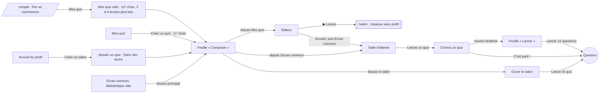

# Le quiz tout prêt, en vrai — rapport de l'expert « animatrice pressée et éditrice de quiz exigeante »

## En bref

Oui, une animatrice qui n'a pas le temps d'écrire lance une bonne soirée en
moins d'une minute, **à condition de passer par la bonne porte** : à l'écran
commun, trois touchers mènent à la première question (« Lancer un quiz » →
« Un quiz tout prêt » → « Lancer 15 questions »). La composition prend moins
d'une seconde. Et les questions sont justes : sur 115 questions lues en
entier, dans sept quiz aux réglages variés, **aucune erreur de fait
avérée**. Il y a une ambiguïté (deux bonnes réponses) et deux imprécisions.
Chaque question a son anecdote, et aucune question ne revient d'une
composition à l'autre.

Trois faiblesses abîment pourtant la promesse de la feuille :

- **Les estimations** : 12 des 19 lues posent un problème (63 %), contre
  13,5 % des QCM. Un quiz « corsé » reçoit « Combien font 6 × 7 ? » ; un
  numéro de vol s'estime « au plus près » ; « 66 » arrive sans son unité,
  les millions d'années.
- **« Des enfants jouent »** : la case filtre sur un âge qui veut dire
  « compréhensible », pas « connaissable ». Il reste 74 % de la base, et
  Tati, Nougaro et Tarantino entrent dans un quiz d'enfants.
- **« Mes quiz » vide** : c'est la porte la plus naturelle, et elle cache le
  quiz tout prêt en douzième position, deux écrans plus bas sur un portable
  et quatre sur un téléphone.

Ce qui rapporterait le plus, chaque fois en quelques lignes :

1. Resserrer les estimations : des marches justes, pas de numéro, pas de
   calcul trivial, pas d'unité effacée.
2. Faire tenir à « Des enfants jouent » ce qu'il promet : les questions
   d'âge 6 d'abord.
3. Mettre le quiz tout prêt en tête de « Ton premier quiz », et faire que la
   salle d'attente avec des invités le lance directement.

## Méthode

- **Quand** : le 11 octobre 2026, de 16 h 27 à 16 h 57 en direct, puis la
  lecture des quiz et l'analyse hors ligne jusqu'à 17 h 15. La charge de la
  machine est restée basse (`uptime` 0,4 à 1,1).
- **Le compte** : Bruno (`bruno`), espace `chez-bruno`, activé par son lien,
  bibliothèque vide. Sur le téléphone, j'ai créé un profil (`bruno-salon`)
  pour la porte du salon : il a ouvert son propre espace vide, `s-um4c7s`.
- **Les appareils** (pilote de l'atelier, préfixe `TABLEE=…/atelier.json`) :
  - `bruno` en `portable` (1366 × 768), puis en `tele` (1920 × 1080) pour la
    seconde partie de la soirée, puis de nouveau en `portable` ;
  - `bruno-tel1` en `petit-telephone` (360 × 640), `chez bruno`.
- **Les fantômes** : cinq dans `chez-bruno` (Marie-Hélène, Jo, Éloïse,
  Grégoire, Nadège) et quatre dans le salon `s-um4c7s` (Lou, Maximilien,
  Inès, Bérénice). Tous arrêtés.
- **Les quiz composés** : sept par la feuille, plus trois recompositions
  pour les redites.

  | Quiz | Réglages | Porte |
  |---|---|---|
  | A | Toutes · progressive · 15 · estimations | « Mes quiz » vide |
  | B | Histoire · facile · 10 · estimations | « Créer un quiz » |
  | C | le même choix, B supprimé | salle d'attente vide |
  | D | « Les années 80 » · progressive · 20 · que des QCM | salon, téléphone |
  | E | Toutes · facile · 15 · estimations · enfants | « Choisis un quiz », télé |
  | F | Géographie, Sciences, Nature · corsée · 30 · estimations | « Créer un quiz » |
  | G | Cinéma & séries · corsée · 15 · estimations | « Créer un quiz » |
  | R1, R2, R3 | Histoire · facile · 10 | redites |

- **Les soirées jouées** :
  - C, puis E, à l'écran commun : C en `portable`, E en `tele`, jusqu'à la
    clôture ;
  - D dans le salon, au téléphone.
- **La lecture** :
  - A, F et E, lues dans l'éditeur par « Copier en liste » ; D au
    téléphone. F, E et D sont gardées dans `quiz-*-editeur-liste*.txt`.
    Celle de A a été lue en séance, puis le quiz supprimé pour vider la
    bibliothèque : `quiz-A-defaut.txt` en garde le contenu. Dans la liste
    de F, l'éditeur montre lui-même la cible des dinosaures sans unité :
    « = 66 ».
  - Les 115 questions de A à G, mises à côté de leur fiche dans la base par
    mon script `lire-quiz.mjs` (API de l'espace et
    `server/content/campagne/*.json`, par l'identifiant `base-…`).
- **Le tirage rejoué hors ligne**, avec les vraies fonctions du serveur
  (`composerUnQuiz`, `cibleDeLEstimation`) sur la base du dépôt :
  `analyse.ts`, `analyse-2.ts`, `estimations-sans-sens.ts` et
  `unites-effacees.ts`, dans mon dossier, résultats dans `analyse*.json`.
  - 103 réglages sur une bibliothèque vide ;
  - 200 et 300 tirages pour les places et les marches des estimations ;
  - 60 recompositions du même choix pour les redites.
- **Le code lu** : `core/quizToutPret.ts`, `shared/quizToutPret.ts`,
  `QuizToutPret.tsx`, `ChoixDuTheme.tsx`, `EditorApp.tsx` (premiers pas),
  `HostApp.tsx`, `HostView.tsx`, `SalonApp.tsx`, `MesQuiz.tsx`,
  `consigneCampagne.ts`, `quiz-tout-pret.test.ts`, et le README (l. 217 et
  « La direction »).
- **Pas couvert** :
  - les mesures réelles de difficulté de la campagne : l'atelier n'a presque
    pas de réponses de campagne, mes marches sont celles de l'a priori ;
  - un vrai téléphone, Safari ;
  - le lecteur d'écran ;
  - la composition depuis une télé branchée par code.

## Constats

### 1. Les estimations ne tiennent pas la promesse de la feuille

- **Où** : `server/src/core/quizToutPret.ts`
  - l. 97-101 : `MARCHES_DES_ESTIMATIONS` ;
  - l. 115-122 : `cibleDeLEstimation` ;
  - l. 129-131 et 331-337 : les places des estimations.
- **Constat** : quatre défauts distincts, tous vus en soirée ou dans
  l'éditeur.
  1. **Un quiz « corsé » prend des estimations faciles.** `corsee: NIVEAUX`
     comprend la marche facile. Sur 300 tirages d'un quiz corsé de 15
     questions, 22 % des estimations sont faciles, et 52 % des quiz en ont
     au moins une. Dans F (« Géographie, Sciences et Nature · 30 questions
     corsées »), trois estimations sur six sont faciles : « Combien font 6 ×
     7 ? » (base-o1tu1ko9), « Combien d'États les États-Unis comptent-ils
     depuis 1959 ? » et les dinosaures. Un quiz « facile » prend de même des
     moyennes : la guerre des Six Jours dans B et C, San Francisco 1906 dans
     le quiz d'enfants. Le commentaire du code dit « comme ses QCM », alors
     que les QCM d'un quiz facile n'ont que des faciles.
  2. **La montée d'un quiz progressif est cassée.** Les estimations sont
     tirées à part puis posées à intervalles fixes, sans égard à leur
     marche. Sur 200 tirages du quiz par défaut (toutes, progressive, 15),
     la question 4, dans les « faciles d'abord », est une estimation
     difficile 36 % du temps. C'était « En quelle année John Coltrane a-t-il
     sorti l'album « A Love Supreme » ? » dans A, et « Combien de lettres
     compte l'alphabet français ? » (facile) tombait en onzième position.
  3. **Des estimations qui ne départagent personne, ou n'ont pas de sens.**
     La règle accepte tout nombre au-dessus de dix.
     - 50 estimations faciles ont un petit entier que tout le monde sait :
       60 minutes, 26 lettres, 31 jours, 6 × 7, « rugby à XIII → 13 ».
       Toute la salle tape le même nombre et finit ex æquo.
     - 13 sont des numéros, où « au plus près » ne veut rien dire : le vol
       815 de « Lost » (tiré dans G), le port 443, le SAMU 15, le
       département 75, le maillot 23 de Jordan.
     - La liste est dans `estimations-sans-sens.ts`.
  4. **Une unité effacée que l'intitulé ne dit pas.** « Il y a combien de
     temps environ les dinosaures non aviens ont-ils disparu ? »
     (base-9vhy1tdd) se joue avec la cible **66, sans unité** : « millions
     d'années » dépasse `MAX_UNIT` (12 caractères) et s'efface. Le
     commentaire suppose que « l'intitulé la dit déjà ». Ici il ne la dit
     pas : qui tape 66 000 000 ou « 65 millions » est à des millions de la
     cible. C'est le seul cas de la base sur 8 unités effacées
     (`unites-effacees.ts`).
- **Preuve** :
  - les quiz F, A, B, C et E dans mon dossier (`quiz-*.txt`) ;
  - `analyse.json` (`estimationsDuProgressif`,
    `estimationsPetitsEntiersFaciles`) et `analyse-2.json` (`corsee`) ;
  - les captures `11`, `12`, `18` et `19` (estimations à l'écran) ;
  - le test `quiz-tout-pret.test.ts:303-311` vérifie qu'une experte ne vient
    que dans un quiz corsé, rien sur une facile ; le test 267-271 n'essaie
    l'effacement que sur un intitulé qui dit l'unité.
- **Qui ça touche, ce que ça coûte** :
  - toute la salle, une fois par estimation. Les estimations font parler la
    salle (c'est pourquoi la case est cochée d'office), et ce sont elles
    qui déçoivent : 12 des 19 lues posent un problème (63 %) ;
  - dans un quiz corsé, « 6 × 7 » fait rire jaune les connaisseurs ;
  - et un « 66 » sans unité fait perdre un joueur qui avait juste.
- **Statut** : bug confirmé (marches, places, unité) · friction (estimations
  sans écart).
- **Piste** :

  ```ts
  // core/quizToutPret.ts
  const MARCHES_DES_ESTIMATIONS: Record<DifficulteDuQuiz, readonly Niveau[]> = {
    facile: ['facile'],                      // un quiz facile ne promet que des faciles
    progressive: ['facile', 'moyen', 'difficile'],
    corsee: ['moyen', 'difficile', 'expert'], // jamais « 6 × 7 » dans un quiz corsé
  }
  /** Un numéro ne s'estime pas : 814 n'est pas « presque » le vol 815. */
  const NUMERO = /\b(num[ée]ro|indicatif|code|port|maillot|dossard)\b/i
  export function cibleDeLEstimation(q: QuestionDeLaBase) {
    // … les gardes d'aujourd'hui, puis :
    if (NUMERO.test(q.texte)) return null
    // Un petit entier que tout le monde sait ne départage personne.
    if (q.meta.difficulte <= 2 && Number.isInteger(valeur.nombre) && valeur.nombre <= 100 && !estUneAnnee(valeur)) return null
    // L'unité trop longue ne s'efface que si l'intitulé la dit ; sinon, pas d'estimation.
    if (Array.from(valeur.unite).length > MAX_UNIT && !ditLUnite(q.texte, valeur.unite)) return null
    // …
  }
  ```

  Puis, avant de les placer, ranger les estimations par marche
  (`estimations.sort((a, b) => NIVEAUX.indexOf(niveau(a)) -
  NIVEAUX.indexOf(niveau(b)))`) : la première, la plus facile, tombe dans
  les faciles. Trois épreuves dans `quiz-tout-pret.test.ts` :
  - pas de facile dans un quiz corsé ;
  - une estimation difficile jamais avant une facile ;
  - un intitulé sans son unité n'en fait pas une estimation.

  La facile à 6 × 7 resterait un bon QCM.
- **Priorité · effort** : P2 · S.

### 2. « Des enfants jouent » promet plus que la base ne sait

- **Où** :
  - la case et sa phrase : `QuizToutPret.tsx:194-200`, « Rien qu'un enfant
    de dix ans ne puisse connaître » ;
  - la promesse ailleurs : `shared/quizToutPret.ts:25-29` (« les questions
    qu'un enfant de dix ans peut connaître ») et `README.md:217` ;
  - le filtre : `core/quizToutPret.ts:282` (`ageMin > AGE_DES_ENFANTS`) ;
  - la définition du champ : `core/consigneCampagne.ts:185`.
- **Constat** : la base définit `ageMin` comme « le plus jeune âge où la
  question est à la fois convenable et **compréhensible** — dans le doute
  entre 10 et 14, mets 10 — ce n'est pas la difficulté ». Rien sur ce qu'un
  enfant connaît.
  - Le filtre « âge ≤ 10 » garde 7 998 questions sur 10 769, soit 74 % de la
    base.
  - Dans un quiz « enfants, facile, 15 », 76 % des questions sont d'âge 10
    (300 tirages, `analyse-2.json`). On y trouve la pop-rock, le cinéma du
    monde, les coulisses, les guerres, la poésie et le théâtre.
  - Mon quiz E, joué à la télé, avait trois questions qu'aucun enfant de
    dix ans ne connaît : Jacques Tati et Monsieur Hulot (base-wz3g1av4),
    Nougaro et « Toulouse » (1967, base-uuir8e3g), et « Qui a réalisé
    « Once Upon a Time… in Hollywood » ? » (base-p45xx6kh), un Tarantino.
- **Preuve** :
  - `quiz-E-enfants-facile-15.txt` ;
  - la capture `17` (Nougaro à l'écran commun, dans « Un peu de tout · 15
    questions faciles », composé avec la case cochée) ;
  - `analyse.json` (`parAge`, `enfantsParNiveau`).
- **Qui ça touche, ce que ça coûte** : la famille qui coche la case pour
  que les enfants jouent contre les grands. Une question sur cinq les
  laisse sans rien à dire, exactement ce que la case promettait d'éviter.
  Le quiz composé ne garde d'ailleurs aucune trace de la case : ni titre,
  ni note.
- **Statut** : bug confirmé (la promesse affichée n'est pas tenue) ·
  tension entre la définition de la base et l'usage de la soirée.
- **Piste** : tirer d'abord ce que la base sait être enfantin, puis le
  reste seulement pour compléter.

  ```ts
  // Ce qu'un enfant connaît : l'âge 6 (771 questions, 686 faciles), puis l'âge 10 à la difficulté 1 (396).
  const pourUnEnfant = (q: QuestionDeLaBase) => q.meta.ageMin <= 6 || (q.meta.ageMin <= 10 && q.meta.difficulte <= 1)
  ```

  Deux passes, comme « fraîches » puis « posées » : les sûres d'abord,
  `ageMin ≤ 10` seulement si la marche manque. Et dire au titre « · en
  famille », pour qu'on retrouve le quiz.

  Si l'on préfère garder le filtre, changer la phrase : « Des questions
  qu'un enfant de dix ans comprend », et l'animatrice sait à quoi
  s'attendre.

  Côté base, les sous-thèmes « chanson-fr », « cinema-fr » et
  « cinema-monde » à `ageMin 10` gagneraient une relecture (skill
  `base-campagne`).
- **Priorité · effort** : P2 · S (le tirage) ; M (relecture des âges).

### 3. Dans « Mes quiz » vide, le quiz tout prêt arrive en douzième

- **Où** : `client/src/views/EditorApp.tsx`
  - l. 3445-3496 : onze modèles en deux rayons ;
  - l. 3527-3546 : puis la rangée « Un quiz tout prêt · Coller une liste ·
    Importer · Créer mon quiz ».

  Le commentaire de la ligne 3397 dit « une bibliothèque vide propose le
  quiz tout prêt d'abord » : il est préchargé d'abord, mais **rendu en
  dernier**.
- **Constat** :
  - Dans « Ton premier quiz », le bouton est un bouton secondaire, sous
    onze cartes de modèles.
  - Il est à 1 335 px sur une page de 1 584 en 1366 × 768 (1,7 écran plus
    bas).
  - Au téléphone, il est à environ 2 440 px sur 2 803 en 360 × 640 (3,8
    écrans plus bas).
  - Le rayon « Pour jouer tout de suite » ne le contient pas.
  - Juste après l'activation, « Par où commencer » (`/compte`) dit « Mes
    quiz : pars d'un quiz **tout fait** ». Or « tout fait », c'est le mot
    des modèles (« Partir d'un modèle — Un quiz tout fait »), qui côtoie
    « Un quiz tout prêt » dans la feuille « Créer un quiz » : deux
    quasi-synonymes pour deux choses différentes.
- **Preuve** :
  - les captures `01` (portable, pleine page) et `02` (téléphone, pleine
    page) ;
  - la capture `03` (« Tout fait » à côté de « tout prêt ») ;
  - `voir` du 16:28:03.
- **Qui ça touche, ce que ça coûte** : la nouvelle animatrice, sur la porte
  que l'accueil du compte lui désigne. Elle voit d'abord « Qui connaît le
  mieux [Prénom] ? », un quiz à écrire, et risque de repartir avec « Culture
  générale » (10 questions), qu'elle aura rejoué dès la deuxième soirée.
- **Statut** : friction.
- **Piste** : une carte en tête de « Ton premier quiz », avant les rayons :

  ```
  ┌ Sans rien écrire ───────────────────────────────────────┐
  │ 🎲 Un quiz tout prêt                                     │
  │ Tiré de 10 769 questions relues : 15 questions, ≈ 8 min  │
  │ [ Composer 15 questions ]   Régler… (catégories, enfants)│
  └─────────────────────────────────────────────────────────┘
  ```

  Et dans « Par où commencer » : « 1. Mes quiz : un quiz tout prêt en un
  geste, un modèle, ou le tien ».
- **Priorité · effort** : P2 · S.

### 4. Entre « Composer » et la première question, des pas de trop

- **Où** :
  - (a) `client/src/components/MesQuiz.tsx:35-36` (le ▶ « Lancer » ouvre
    `/salon?quiz=…`) et `client/src/views/SalonApp.tsx:84-86` et 118-137 ;
  - (b) `client/src/views/HostApp.tsx:1583-1590` ;
  - (c) `client/src/games/quiz/HostView.tsx:194-203` et 248.
- **Constat** :
  - (a) **Le ▶ « Lancer » de la bibliothèque mène à une impasse pour un
    compte d'animateur sans profil**, ce qu'est Bruno à l'activation (« Mon
    profil joueur : À rattacher »). `/salon` demande un profil et affiche
    « Un salon s'ouvre avec ton profil… Me connecter · Créer mon profil »,
    alors qu'on est connecté. « Me connecter » perd le quiz (`?next=/salon`
    seul), et créer un profil ouvrirait un **autre** espace, vide. Le chemin
    qui marche passe par l'accueil (« J'anime » → « Écran commun ») ou par
    « Mon compte » : deux touchers de plus, que rien ne suggère depuis
    l'éditeur ni la bibliothèque, où le menu du bas n'a pas d'« Écran
    commun ».
  - (b) **Dans la salle d'attente d'une bibliothèque vide, la feuille dit
    « Composer », même avec la salle déjà là.** Composé, le quiz attend :
    il faut encore « Lancer un quiz » puis « C'est parti ! ». Rien ne dit
    non plus ce qui a été composé : ni toast, ni titre. « Choisis un quiz »,
    lui, compose et lance d'un seul toucher (« Lancer 15 questions »).
  - (c) **Après le seul quiz de la bibliothèque, déjà joué**, « Choisis un
    quiz » propose en bouton principal « C'est parti ! » sur ce quiz
    (« Joué ce soir »). « Un quiz tout prêt », le geste de « une manche de
    plus », reste un bouton fantôme en haut à droite.
- **Preuve** :
  - captures `05` (l'impasse), `06` et `07` (la salle d'attente, « Composer
    10 questions ») et `14` (télé, « Joué ce soir » + « C'est parti ! ») ;
  - chronologie de la porte 5 plus bas.
- **Qui ça touche, ce que ça coûte** :
  - (a) l'animateur d'avant les profils, ou celui créé par l'administrateur :
    il croit sa soirée prête et tombe sur « Me connecter » ;
  - (b) et (c) deux touchers de plus, devant une salle qui attend.
- **Statut** :
  - (a) bug confirmé, pour les comptes à mot de passe sans profil ;
  - (b) et (c) friction.
- **Piste** :
  - (a) Dans `SalonApp`, sans profil mais avec une session de console
    (`api.auth.me()`), proposer « Ouvrir l'écran commun » (`/host`) au lieu
    de « Me connecter ». Ou faire pointer `adresseDuLancement` vers `/host`
    pour une session de compte.
  - (b) `verbe={connectedCount > 0 ? 'Lancer' : 'Composer'}`, et, composé
    avec des invités, enchaîner `lancerQuiz()` puis le `selectPack` du quiz
    composé, comme le fait déjà « Choisis un quiz ». Dans tous les cas, un
    toast « « Histoire · 10 questions faciles » est prêt ».
  - (c) Quand tous les quiz de la liste sont « Joué ce soir », faire de
    « Un quiz tout prêt » le bouton principal, et de « C'est parti ! » un
    « Rejouer » secondaire.
- **Priorité · effort** : P2 · S pour (a) ; P3 · S pour (b) et (c).

### 5. Le titre d'une époque souffle la réponse

- **Où** : `core/quizToutPret.ts:281` (le filtre du sujet) ; l'écran commun
  affiche le titre du quiz en tête de chaque question.
- **Constat** : dans « Les années 80 · 20 questions » (D), on trouve « En
  quelle année a été créé le GIEC… ? », avec 1972, 1992, 1997 et 1988.
  Seule la bonne réponse tombe dans la décennie que le titre annonce. La
  base en compte 11 de cette sorte (`analyse.json`,
  `souffleesParLEpoque`) : 1 dans les années 50, 5 dans les années 60, 3
  dans les années 70 et 2 dans les années 80.
- **Preuve** : `quiz-D-annees80-progressive-20.txt`, question 9 ;
  `analyse.json`.
- **Qui ça touche, ce que ça coûte** : la salle d'un quiz d'époque, une fois
  par quiz au plus. C'est rare, mais une question gâchée se voit.
- **Statut** : bug confirmé, rare.
- **Piste** : dans `composerUnQuiz`, quand le sujet a des `annees`, écarter
  un QCM dont les réponses sont des années et dont une seule tombe dans
  l'époque. C'est 3 lignes et une épreuve.
- **Priorité · effort** : P3 · S.

### 6. La réponse dans l'intitulé, par sa racine

- **Où** : la base (`core/baseCampagne.ts`, le juge qui refuse la réponse
  écrite dans l'intitulé, mot pour mot seulement), héritée par le quiz tout
  prêt.
- **Constat** : la réponse ne s'écrit pas dans l'intitulé, mais sa racine,
  oui.
  - Vu dans mes quiz : « Quel métier consistait à **allumer** et à éteindre
    les **réverbères**… ? → Allumeur de réverbères » (base-t3t60kd7), « …
    mineurs de charbon, **noircis** par la poussière ? → Les gueules
    noires » (base-72yh776z), « Parthénon d'**Athènes** → Athéna ».
  - Mon heuristique (une racine de 5 lettres que la bonne réponse partage
    avec l'intitulé, et aucun leurre) en relève 198 QCM, soit 1,8 % de la
    base.
  - Sur un échantillon de 40, environ 22 sont de vraies réponses soufflées
    (« strophe de quatre vers → Un quatrain », « Quel Normand, surnommé
    « Maître Jacques »… → Jacques Anquetil », « Quel yacht australien → 
    Australia II »), 9 le sont à moitié (étymologies), 9 sont des faux
    positifs.
  - 83 des 198 sont notées difficiles ou expertes : un quiz « corsé » les
    promet dures, elles sont données.
- **Preuve** : `analyse.json` (`souffleesParLIntitule`) ; l'échantillon
  relu dans ce rapport.
- **Qui ça touche, ce que ça coûte** : environ une question tous les cinq
  quiz. La salle rit, mais la question est perdue.
- **Statut** : friction (qualité de la base).
- **Piste** :
  - un avertissement dans `verifier` et la liste dans `/admin#campagne`, à
    relire, plutôt qu'un refus (les étymologies sont voulues) ;
  - à défaut, `composerUnQuiz` les met en dernier recours.
- **Priorité · effort** : P3 · S (la liste) ; M (la relecture).

### 7. Une question à deux bonnes réponses

- **Où** : base-sx6f0elu (Cinéma & séries), tirée dans D.
- **Constat** : « Quel acteur américain joue le maître nageur Mitch
  Buchannon dans « Alerte à Malibu » ? » La bonne réponse est David
  Hasselhoff, et Dwayne Johnson fait un leurre. Or Dwayne Johnson **est**
  Mitch Buchannon dans le film « Baywatch : Alerte à Malibu » (2017). Le
  joueur qui pense au film a juste et perd ses points.
- **Preuve** : `quiz-D-annees80-progressive-20.txt`, question 14 (rejouée
  au salon, au téléphone).
- **Statut** : bug confirmé (ambiguïté).
- **Piste** : « … dans la **série** « Alerte à Malibu » (1989) ? », et Don
  Johnson à la place de Dwayne Johnson (« Corriger » dans
  `/admin#campagne`, même identifiant).
- **Priorité · effort** : P2 pour cette question · S.

### 8. Relire et retoucher un quiz composé coûte cher

- **Où** : l'éditeur (`EditorApp.tsx`).
- **Constat** :
  - Au téléphone, une question occupe environ 2,5 écrans. Le quiz D (20
    questions) fait 31 613 px de haut, soit **49 écrans de 640**.
    L'intitulé y est coupé à trois lignes, les réponses tronquées
    (« Rencontres du troisième t… »).
  - Il n'existe aucun « Remplacer cette question » : retirer la question
    que l'on n'aime pas fait un quiz de 14, et rien ne tire sa voisine dans
    la base.
  - L'éditeur ne dit pas la marche de chaque question. L'ordre est la
    montée du quiz progressif : le changer la casse sans le savoir.
  - « Copier en liste » est la seule vue compacte, et c'est par elle que
    j'ai lu.
- **Preuve** : captures `26` et la pleine page
  `captures/bruno-tel1/011-editeur-telephone-entier.png` de l'atelier ;
  `grep Remplacer EditorApp.tsx` ne trouve rien.
- **Qui ça touche, ce que ça coûte** : l'éditrice exigeante, celle qui veut
  écarter Tarantino du quiz des enfants avant la soirée. Elle a deux choix :
  supprimer et rester à 14, ou écrire une question à la main.
- **Statut** : idée.
- **Piste** : pour une question `base-…` (identifiant connu), un bouton
  « Une autre » qui appelle
  `POST /api/quiz-tout-pret/remplacer { quizId, questionId }`. Le serveur
  tire une question de la même marche et de la même catégorie, absente de
  la bibliothèque, par le même `composerUnQuiz` borné à 1. Et une pastille
  de marche (facile, moyenne, difficile) sur la carte de la question.
- **Priorité · effort** : P3 · M.

### 9. La feuille : ce que le résumé tait, ce qu'elle promet en vain

- **Où** :
  - le résumé : `QuizToutPret.tsx:125-129` ;
  - les cases : l. 187-200 ;
  - la description du sujet : `ChoixDuTheme.tsx:110` ;
  - la mémoire du choix : `choixRetenu`.
- **Constat** :
  - Le résumé dit « Toutes les catégories · progressive », « 3 catégories ·
    corsée », « Les années 80 · progressive · que des QCM ». Il ne nomme pas
    les catégories, et ne dit **ni la durée** (l'éditeur, lui, dit
    « ≈ 8 min ») **ni le nombre d'estimations**.
  - « Des estimations » est cochée d'office et promet « une question sur 5 ».
    Pourtant 18 réglages sur 103 en livrent moins, sans rien dire. En
    progressive, 15 questions : « Les records » et « Les surnoms » 0 sur 3 ;
    « L'insolite », « Mythes et légendes » et « La Terre et l'espace » 1
    sur 3. Avec « Des enfants jouent », en facile : les inventions, la Terre
    et l'espace, les records, les surnoms, l'insolite et l'enfance, 0 sur 3.
  - La base n'a que 415 estimations possibles : 8 en géographie, 8 en
    nature, 8 au cinéma, 6 en cuisine. Seules 18 questions de géographie
    ont un nombre. Les meilleures estimations de soirée (hauteurs, durées,
    populations) manquent là où on les attend.
  - La description d'un sujet (« De 1980 à 1989, dans toutes les
    catégories ») s'affiche sous la grille des fils rouges. Au téléphone,
    elle est hors de vue quand on touche une époque.
  - Le dernier choix se retient par navigateur : la télé, un appareil neuf
    ou une session rangée repartent des réglages d'office (vu à la télé :
    « Toutes · progressive · 15 » au lieu d'« Histoire · facile · 10 »).
- **Preuve** :
  - captures `04`, `15`, `23` à `25` et `28` ;
  - `analyse.json` (`tirages`) et le décompte des estimations par catégorie.
- **Qui ça touche, ce que ça coûte** : l'animatrice qui veut savoir
  « combien de temps ça dure », et celle qui compte sur des estimations
  qu'elle n'aura pas.
- **Statut** : friction.
- **Piste** : voir « Ce que je changerais à la feuille », plus bas. Pour les
  estimations manquantes, `GET /api/quiz-tout-pret` rend aussi le nombre
  d'estimations possibles par catégorie et par sujet. Côté base, commander
  des questions à nombre (`generer-campagne.ts`, une part « à valeur » par
  catégorie).
- **Priorité · effort** : P3 · S (la feuille) ; M (la base).

### 10. Des marches et des formes à relire

- **Où** : la base, tirée telle quelle.
- **Constat** :
  - « Quelle ville italienne est surnommée la « Sérénissime » ? » est notée
    difficile (base-sh53tasv) ; elle est probablement moyenne pour un
    public français (à vérifier par les mesures).
  - « Vrai ou faux : le bananier est un arbre. » (base-o8u8gtd1) est notée
    experte. Un vrai/faux à une chance sur deux parmi les « expertes » qui
    finissent un quiz corsé, c'est un pile ou face de clôture.
  - Trois tournures :
    - « 2 multiplié dix fois par lui-même » (dix facteurs, c'est neuf
      multiplications) ;
    - « Dans quelle république soviétique se **trouve**-t-elle ? » ;
    - « Comment s'appelle, en français, le nom de famille de Neville ».
- **Preuve** : le tableau des questions, plus bas.
- **Statut** : friction · à vérifier (difficultés).
- **Piste** : pas de vrai/faux dans la marche experte d'un quiz de soirée
  (une ligne dans `composerUnQuiz`) ; le reste par `/admin#campagne`.
- **Priorité · effort** : P3 · S.

### 11. Tension : la base est celle du jeu solo

- **Où** : `CampagneStore.pourLesSoirees`.
- **Constat** : le quiz tout prêt tire dans la base que les profils jouent
  chaque jour en campagne, corrections et carnet de révision compris. Un
  joueur assidu a pu voir, et revoir, une bonne part des questions de la
  soirée. Ce n'est pas un avantage du profil au sens de l'invariant 8
  (c'est du savoir, pas une règle). Mais c'en est l'esprit : celui qui
  « révise » la base arrive avantagé, et l'invité anonyme ne le sait pas.
- **Statut** : tension avec un parti pris (invariant 8, « un profil ne
  donne aucun avantage de jeu »), à arbitrer, pas une correction à faire.
- **Piste** : à la console (portes 4 et 5), la salle est connue. Passer en
  dernier les questions que les profils présents ont déjà vues en campagne
  (`vuesPar`), comme on passe déjà en dernier ce que les soirées ont posé.
- **Priorité · effort** : P3 · M.

### 12. La feuille s'ouvre devant la salle

- **Où** : écran commun (portes 4 et 5).
- **Constat** : composée à l'écran commun, la feuille s'affiche sur la
  télé, devant toute la salle, avec la difficulté choisie. C'est sans gravité,
  mais c'est encore « la télé montre les coulisses » (axe 2 de la première
  tablée).
- **Preuve** : captures `07` et `15`.
- **Statut** : friction · rappel d'un axe connu.
- **Piste** : à la télécommande, la feuille sur le téléphone de
  l'animatrice ; à la télé, « On prépare le prochain quiz… ».
- **Priorité · effort** : P3 · M.

## Mesures et cartes

### Les portes, pas à pas

Heures relevées pendant le parcours. Mes pauses de lecture sont comprises :
les gestes comptent plus que les secondes. « Gestes » désigne les touchers
jusqu'à une question à l'écran, réglages d'office.

| Porte | Étapes relevées | La trouve-t-on ? | Gestes |
|---|---|---|---|
| **1. « Mes quiz » vide** (portable) | 16:28:03 « Mes quiz » · défiler 1,7 écran (3,8 au téléphone) · 16:28:26 « Un quiz tout prêt — tes catégories, ta difficulté » · 16:28:37 « Composer 15 questions » · 16:28:38 l'éditeur (composé en moins d'une seconde) · puis ▶ « Lancer » mène à l'impasse `/salon` (compte sans profil) ; ce qui marche : « Accueil » → « Écran commun » → « Lancer un quiz » → « C'est parti ! » | **Non** : 12ᵉ choix, sous onze modèles | 7 et un défilement |
| **2. « Créer un quiz » → « Sans rien écrire »** (portable) | « Créer un quiz » · « Un quiz tout prêt » (1ᵉʳ choix) · 16:31:13 « Composer 10 questions » · 16:31:14 l'éditeur · puis comme la porte 1 | **Oui**, en tête | 7 |
| **3. Le salon, « Ajouter un quiz »** (profil, téléphone 360 × 640, bibliothèque vide) | 16:42:19 « Créer un salon » · « Ajouter un quiz » (« Sans rien écrire » visible sans défiler) · « Un quiz tout prêt » · 16:42:54 « Composer 20 questions » · 16:43:35 « Ouvrir le salon » · 16:43:43 « Lancer le quiz » · « Prépare-toi… 3 » | **Oui** | 6 |
| **4. « Choisis un quiz »** (télé, après un quiz) | 16:37:02 « Quiz suivant » · « Un quiz tout prêt » (bouton fantôme, en haut à droite) · 16:37:25 « Lancer 15 questions » · 16:37:26 « Préparez vos téléphones… 3 » | Oui, sans insistance | **3** |
| **5. Salle d'attente, bibliothèque vide** (portable, 5 invités) | 16:33:26 « Un quiz tout prêt » (bouton principal ; mon dernier choix retrouvé) · 16:33:31 « Composer 10 questions » · 16:33:42 « Lancer un quiz » · 16:34:25 « C'est parti ! » · 16:34:26 compte à rebours | **Oui** | 4 (2 avec « Lancer ») |



### Les questions à problème

115 questions lues en entier : A 15, B 10, C 10, D 20, E 15, F 30 et
G 15. 25 posent un problème, soit **21,7 %**, dont **8 graves (7,0 %)**. Il
n'y a **aucune erreur de fait avérée** ; on compte une ambiguïté et deux
imprécisions.

Gravité : **P2**, la question est gâchée pour une partie de la salle ;
**P3**, gêne ou mieux à faire. Dans la colonne « Réglée par », *Base* veut
dire la fiche (`/admin#campagne` ou le fichier) et *Tirage* la règle de
`core/quizToutPret.ts`.

| # | Quiz | Identifiant | Question entière (réponses, ✓ la bonne) | Problème | Gravité | Correction proposée | Réglée par |
|---|---|---|---|---|---|---|---|
| 1 | A | base-2ywsxu4d | « En quelle année John Coltrane a-t-il sorti l'album « A Love Supreme » ? » estimation, cible 1965 | difficile (4), posée en 4ᵉ place d'un quiz progressif | P3 | ranger les estimations par marche avant de les placer | Tirage |
| 2 | A | base-3rhcemn5 | « Combien vaut 2 puissance 10, c'est-à-dire 2 multiplié dix fois par lui-même ? » estimation, 1024 | formulation inexacte (dix facteurs = neuf multiplications) ; un calcul plus qu'une estimation | P3 | « … le produit de dix 2 (2 × 2 × … × 2) ? » | Base |
| 3 | A | base-06oh54p9 | « Combien de lettres compte l'alphabet français ? » estimation, 26 lettres | ne départage personne : tout le monde tape 26 | P3 | pas d'estimation pour un petit entier facile ; un QCM | Tirage |
| 4 | A | base-071s14i8 | « À quelle déesse le Parthénon d'Athènes était-il consacré ? » Artémis · Héra · Athéna ✓ · Aphrodite | l'intitulé souffle la réponse (Athènes → Athéna) | P3 | « À quelle déesse le Parthénon était-il consacré ? » | Base |
| 5 | A | base-xdzodb9e | « Quel animateur de TF1 a présenté Le Bigdil, jeu télévisé des années 1990 ? » Dechavanne · Vincent Lagaf' ✓ · Arthur · Pascal Sellem | imprécis : diffusé de fin 1998 à 2004 (à vérifier) | P3 | « … jeu télévisé lancé en 1998 ? » | Base |
| 6 | B | base-t3t60kd7 | « Quel métier consistait à allumer et à éteindre les réverbères de la rue, matin et soir ? » Veilleur de nuit · Ramoneur · Colporteur · Allumeur de réverbères ✓ | la réponse est dans l'intitulé | **P2** | « Avant l'électricité, qui parcourait les rues avec une longue perche, à la tombée de la nuit puis à l'aube ? » | Base |
| 7 | B | base-72yh776z | « Quel surnom donnait-on aux mineurs de charbon, noircis par la poussière ? » Les canuts · Les compagnons · Les gueules noires ✓ · Les forçats | « noircis » souffle « noires » | P3 | « Quel surnom donnait-on aux mineurs de charbon du Nord ? » | Base |
| 8 | B | base-hb8kufat | « En quelle année éclate la guerre des Six Jours, au Proche-Orient ? » estimation, 1967 | moyenne dans un quiz « facile » (mineur) | P3 | `MARCHES_DES_ESTIMATIONS.facile = ['facile']` | Tirage |
| 9 | C | base-hb8kufat | la même, recomposée après la suppression de B | idem ; seule question commune à B et C, B supprimé sans avoir été joué (prévu) | P3 | idem | Tirage |
| 10 | C | base-z1ta859q | « En avril 1986, un réacteur de la centrale de Tchernobyl explose. Dans quelle république soviétique se trouve-t-elle ? » Russie · Biélorussie · Lituanie · Ukraine ✓ | concordance des temps | P3 | « … se trouvait-elle ? » | Base |
| 11 | D | base-hfrdqt54 | « En quelle année a été créé le GIEC, groupe d'experts chargé d'évaluer les connaissances sur le changement climatique ? » 1972 · 1992 · 1997 · 1988 ✓ | dans « Les années 80 », la seule réponse de la décennie : le titre la donne | **P2** | écarter d'un quiz d'époque un tel QCM (11 dans la base) | Tirage |
| 12 | D | base-sx6f0elu | « Quel acteur américain joue le maître nageur Mitch Buchannon dans « Alerte à Malibu » ? » Dwayne Johnson · Mark Harmon · David Hasselhoff ✓ · Patrick Duffy | deux bonnes réponses : Dwayne Johnson dans « Baywatch : Alerte à Malibu » (2017) | **P2** | « … dans la série « Alerte à Malibu » (1989) ? », Don Johnson en leurre | Base |
| 13 | E | base-wz3g1av4 | « Quel acteur-réalisateur a créé le personnage de Monsieur Hulot, grand escogriffe à la pipe et à l'imperméable ? » Étaix · de Funès · Jacques Tati ✓ · Fernandel | « enfants » coché : hors de portée d'un enfant de dix ans | **P2** | `ageMin` 14 ; le tirage des enfants par l'âge 6 | Base, Tirage |
| 14 | E | base-uuir8e3g | « Quelle ville du Sud-Ouest Claude Nougaro a-t-il chantée en 1967 ? » Bordeaux · Montpellier · Toulouse ✓ · Albi | idem | **P2** | idem | Base, Tirage |
| 15 | E | base-p45xx6kh | « Qui a réalisé le film « Once Upon a Time… in Hollywood », sorti en 2019 ? » Fincher · Mangold · Quentin Tarantino ✓ · Whedon | idem, et un film pour adultes (classification à vérifier) | **P2** | `ageMin` 14 au moins | Base, Tirage |
| 16 | E | base-5igfu29d | « En quelle année un violent séisme suivi d'incendies détruit-il une grande partie de San Francisco ? » estimation, 1906 | moyenne dans un quiz facile pour enfants | P3 | comme le n° 8 | Tirage |
| 17 | E | base-nwhjfcwm | « Combien de membres compte l'Académie française ? » estimation, 40 membres | les adultes savent 40 (pas d'écart) ; les enfants n'en ont aucune idée | P3 | en QCM | Tirage |
| 18 | E | base-bu8buvgm | « En quelle année se déroulent finalement les Jeux olympiques d'été de « Tokyo 2020 », reportés à cause de la pandémie ? » estimation, 2021 | l'intitulé donne la réponse : tout le monde tape 2021 | P3 | en QCM, ou « En quelle année se sont tenus les Jeux d'été de Tokyo ? » | Tirage |
| 19 | F | base-o1tu1ko9 | « Combien font 6 × 7 ? » estimation, 42 (facile, âge 6) | dans un quiz **corsé** : triviale, personne n'est départagé | **P2** | `MARCHES_DES_ESTIMATIONS.corsee` sans facile ; pas de calcul facile en estimation | Tirage |
| 20 | F | base-uibb9qwd | « Combien d'États les États-Unis comptent-ils depuis 1959 ? » estimation, 50 États (facile) | triviale dans un quiz corsé | P3 | idem | Tirage |
| 21 | F | base-9vhy1tdd | « Il y a combien de temps environ les dinosaures non aviens ont-ils disparu ? » estimation, cible **66 sans unité** (« millions d'années » effacé) | cible ambiguë : 66 000 000 est à des millions de la cible | **P2** | n'effacer l'unité que si l'intitulé la dit ; ou « …, en millions d'années ? » | Tirage, Base |
| 22 | F | base-sh53tasv | « Quelle ville italienne est surnommée la « Sérénissime » ? » Florence · Gênes · Sienne · Venise ✓ (notée difficile) | difficulté probablement surestimée (à vérifier par les mesures) | P3 | relire sa difficulté | Base |
| 23 | F | base-o8u8gtd1 | « Vrai ou faux : le bananier est un arbre. » Vrai · Faux ✓ (notée experte) | un pile ou face parmi les expertes qui finissent un quiz corsé | P3 | pas de vrai/faux dans la marche experte d'un quiz de soirée | Tirage |
| 24 | G | base-1sbcj81r | « Quel numéro de vol porte l'avion qui s'écrase sur l'île au début de la série « Lost » (2004) ? » estimation, 815 | un numéro ne s'estime pas : 814 n'est pas « presque juste » | P3 | exclure les numéros des estimations (13 dans la base) | Tirage |
| 25 | G | base-fshoej2o | « Comment s'appelle, en français, le nom de famille de Neville, camarade de Harry Potter ? » Finnigan · Londubat ✓ · Dursley · Lovegood | tournure | P3 | « Quel est, en français, le nom de famille de Neville… ? » | Base |

**Le taux, en clair** :

| | Lues | À problème | Dont P2 |
|---|---|---|---|
| QCM | 96 | 13 (13,5 %) | 6 |
| Estimations | 19 | 12 (63 %) | 2 |
| Total | 115 | 25 (21,7 %) | 8 (7,0 %) |

| Par quiz | A | B | C | D | E | F | G |
|---|---|---|---|---|---|---|---|
| À problème | 5/15 | 3/10 | 2/10 | 2/20 | 6/15 | 5/30 | 2/15 |

12 problèmes se règlent dans le seul **tirage** (du code, une fois pour
toutes), 13 dans la **base** (fiche ou fichier). Pour 4 de ces 13, les âges
des enfants et l'unité effacée, le tirage les empêcherait aussi.

Les estimations réussies, elles, font ce que la feuille promet : 1776,
1793, 687 jours sur Mars, les 24 rayons du drapeau indien, « Bambi » en
1942, les premiers Oscars en 1929, le GIEC en 1988 joué en estimation.

### Ce que la base offre, ce que le tirage en fait

Base du dépôt : 10 769 questions, comme l'annonce la feuille (« Tiré de
10 769 questions relues »). Les marches sont celles de l'a priori, sans
mesures (`analyse*.json`).

| Mesure | Valeur |
|---|---|
| Âge minimum 6 / 10 / 14 / 18 | 771 / 7 227 / 2 575 / 196 |
| Marches a priori (facile / moyen / difficile / expert) | 2 684 / 2 903 / 3 002 / 2 180 |
| Retenues par « Des enfants jouent » (âge ≤ 10) | 7 998 (74 %) |
| Quiz « enfants, facile, 15 » : part d'âge 10 | 76 % |
| Estimations possibles | 415 (facile 78, moyen 113, difficile 130, expert 94 ; 169 années) |
| … par catégorie | Culture générale 91 · Sciences 72 · Jeux & pop culture 61 · Autour de la fête 50 · Sport 40 · Histoire 36 · Musique 24 · Arts & lettres 11 · Cinéma 8 · Géographie 8 · Nature 8 · Cuisine 6 |
| … petits entiers faciles (≤ 100) | 50 |
| … numéros et codes | 13 |
| … unité effacée que l'intitulé ne dit pas | 1 (base-9vhy1tdd) |
| Quiz corsé de 15 : estimations faciles | 22 % ; 52 % des quiz en ont au moins une |
| Quiz par défaut : estimation difficile en 4ᵉ place | 36 % (200 tirages) |
| Réglages (103, bibliothèque vide) qui livrent moins de questions que demandé | 0 |
| … qui livrent moins d'estimations que promis | 18 |
| QCM dont la seule année de l'époque est la bonne | 11 |
| QCM à réponse soufflée par sa racine (heuristique) | 198 (1,8 %), environ 55 % de vrais |
| Composition, au serveur | moins d'une seconde |

### Les redites

- **Vécu** :
  - B (Histoire, facile, 10), supprimé sans avoir été joué, puis C, le même
    choix : une seule question commune, l'estimation de 1967. C'est prévu :
    rien de supprimé n'est retenu s'il n'a pas été joué.
  - R1 et R2, recomposés avec C gardé : aucune question commune entre eux
    ni avec B ou C.
  - C joué, puis supprimé, puis R3 recomposé : **aucune** question de C ne
    revient (la mémoire des soirées marche).
- **Le dernier choix** revient à la réouverture de la feuille, sur le même
  navigateur (« Histoire · facile · 10 », puis « 3 catégories · corsée ·
  30 »), pas sur un autre appareil.
- **Simulé** (bibliothèque gardée, 60 recompositions au plus) : zéro
  redite. Les estimations s'épuisent les premières :

  | Choix | Plus toutes ses estimations dès le | Quiz court dès le |
  |---|---|---|
  | Histoire · facile · 10 | 11ᵉ quiz | 43ᵉ |
  | Sport · facile · 15 | 8ᵉ | 30ᵉ |
  | Années 80 · progressive · 20 | 3ᵉ | 12ᵉ |
  | Cuisine · corsée · 15 | 3ᵉ | 41ᵉ |

### Ce que je changerais à la feuille

```
┌ Un quiz tout prêt ─────────────────────────────── Fermer ┐
│ Sur quoi ?  [✦ Toutes] [Culture g.] [Histoire] …          │
│             Ou un sujet ▸  (replié ; sa phrase sous la    │
│             tuile touchée, pas tout en bas)               │
│ Difficulté  (Facile) (Progressive) (Corsée)               │
│ Combien ?   (10) (15) (20) (30)                           │
│ ☑ Des estimations — 3 sur 15                              │
│   « Ce sujet n'a pas d'estimation » quand il n'en a pas,  │
│   case grisée                                             │
│ ☐ Des enfants jouent — des questions qu'un enfant connaît │
│   (âge 6 d'abord ; titre « · en famille »)                │
├───────────────────────────────────────────────────────────┤
│ Histoire et Nature · progressive · ≈ 8 min · 3 estimations│
│ [ 🎲 Composer 15 questions ]   ← « Lancer » dès qu'une    │
│                                  salle attend             │
└───────────────────────────────────────────────────────────┘
```

1. Le résumé nomme les catégories (deux, puis « et N autres », comme le
   titre) et dit la durée et le nombre d'estimations.
2. « Des estimations » dit ce qu'elle livrera, ou qu'il n'y en aura pas.
3. « Des enfants jouent » tient sa phrase : le tirage par l'âge 6
   (constat 2).
4. La phrase d'un sujet s'affiche sous sa tuile, pas sous la dernière
   rangée.
5. Le verbe suit la salle : « Lancer » quand des invités attendent
   (constat 4).
6. Le dernier choix se retient aussi pour l'espace (côté serveur), pour que
   la télé et le téléphone de l'animatrice le partagent.

## Ce qui marche — à ne pas casser

- **La justesse de la base.** 115 questions lues, aucune erreur de fait ;
  des leurres crédibles, des anecdotes vraies et bien choisies, montrées à
  la révélation seulement (captures `10`, `17` et `27`). C'est rare pour
  une base de cette taille, et c'est ce qui rend le quiz tout prêt
  jouable sans relecture.
- **La vitesse.** Moins d'une seconde pour composer. À l'écran commun, trois
  touchers mènent à la première question (« Lancer 15 questions »).
- **Le tour de rôle des catégories.** Le quiz A, en 15 questions, a touché
  les 12 catégories.
- **La montée des QCM.** Elle est respectée : A, D et F ont leurs faciles,
  puis leurs moyennes, puis leurs difficiles, et leurs expertes seulement
  dans un quiz corsé. Aucun réglage ne livre moins que demandé sur une
  bibliothèque vide.
- **Pas de redite.** Rien de la bibliothèque ne revient, un quiz joué puis
  supprimé non plus. C'est ce qui fait du quiz tout prêt un outil de soirées
  répétées, pas d'une seule.
- **La feuille au téléphone.** « Composer N questions » reste collé en bas
  et visible en 360 × 640. Les réglages d'office permettent de composer d'un
  toucher. Le résumé change à chaque toucher (« · que des QCM », « · des
  enfants jouent »). Le dernier choix est retrouvé.
- **Les portes du salon, de « Créer un quiz » et de la salle d'attente
  vide** : le quiz tout prêt y est en tête (« Sans rien écrire », ou le
  bouton principal de la salle d'attente), visible sans défiler, au
  téléphone comme au portable.
- **Les titres.** « Géographie, Sciences et Nature · 30 questions
  corsées », « Histoire · 10 questions faciles (2) » : on retrouve son quiz
  dans la liste.
- **Les réponses mélangées à chaque partie** (« copie de modèle ») : la base
  range la bonne où elle veut, la salle ne le voit jamais.
- **L'écran commun, en 1366 × 768 comme en 1920 × 1080.** La question,
  l'estimation et sa révélation, l'anecdote, « En tête du quiz », le podium
  et la clôture tiennent à l'écran, sans défiler (captures `09` à `13` et
  `16` à `21`). Les axes 2 et 3 de la première tablée tiennent sur ces
  écrans : « Suivante : au clic, 5 s, 10 s, 20 s » dit ce qu'il fera, et la
  console tient sur une ligne.

## Recommandations, dans l'ordre

1. **Resserrer les estimations** : `MARCHES_DES_ESTIMATIONS` sans facile en
   corsé et sans moyenne en facile, pas de numéros, pas de petits entiers
   faciles, pas d'unité effacée que l'intitulé ne dit pas, les estimations
   placées par marche. Trois épreuves dans `quiz-tout-pret.test.ts`.
   (constat 1) — **P2 · S**
2. **« Des enfants jouent » par l'âge 6 d'abord** (puis l'âge 10 à la
   difficulté 1, puis le reste en dernier recours), « · en famille » au
   titre ; ou changer la phrase de la case. (constat 2) — **P2 · S**
3. **Le quiz tout prêt en tête de « Ton premier quiz »**, avec « Composer
   15 questions » d'un toucher, et « Par où commencer » qui le nomme.
   (constat 3) — **P2 · S**
4. **Le ▶ « Lancer » sans impasse** pour un compte sans profil, vers
   l'écran commun. (constat 4a) — **P2 · S**
5. **Corriger base-sx6f0elu** (Alerte à Malibu) et **base-t3t60kd7**
   (allumeur de réverbères), et relire les âges de base-wz3g1av4,
   base-uuir8e3g et base-p45xx6kh. (constats 2, 6 et 7) — **P2 · S**
6. **La salle d'attente vide, avec des invités, compose et lance**
   (« Lancer »), et dit ce qu'elle a composé ; « Un quiz tout prêt » en
   bouton principal quand tout a été joué ce soir. (constats 4b et 4c) —
   **P3 · S**
7. **Écarter d'un quiz d'époque le QCM dont l'époque donne l'année.**
   (constat 5) — **P3 · S**
8. **La feuille dit la durée, les catégories et les estimations
   réelles** ; la phrase du sujet sous sa tuile. (constat 9) — **P3 · S**
9. **La liste des réponses soufflées par leur racine dans `verifier` et
   `/admin#campagne`**, à relire. (constat 6) — **P3 · S puis M**
10. **« Une autre » sur une question tirée de la base**, et sa marche
    visible dans l'éditeur. (constat 8) — **P3 · M**
11. **Commander des questions à nombre** pour la géographie, la nature, le
    cinéma et la cuisine (skill `base-campagne`). (constat 9) — **P3 · M**
12. **Arbitrer la tension avec le jeu solo** : passer en dernier ce que les
    profils présents ont vu en campagne. (constat 11) — **P3 · M**

## Limites

- **Les marches** : je les ai lues dans l'a priori de la base (difficulté
  de 1 à 5), sans les mesures de la campagne, que l'atelier n'a presque
  pas. En production, `niveauDeQuestion` corrige les marches par les
  réponses : les parts de faciles et d'expertes peuvent y bouger un peu.
  Les défauts de règle (les marches des estimations, leurs places, les
  numéros, l'unité) n'en dépendent pas.
- **Le tirage hors ligne** lit la base du dépôt, sans les retraits, sans
  les ajouts de la routine (`campagne_ajouts`) et sans la réserve du quiz
  du jour. Le total coïncide pourtant avec celui de l'atelier (10 769).
- **115 questions** font un échantillon : le taux de 21,7 % a une marge
  large. Les heuristiques (réponses soufflées par la racine, époques) ont
  été vérifiées à la main sur un échantillon, pas une par une.
- **Les faits « à vérifier »** : les dates du Bigdil, la classification de
  « Once Upon a Time… in Hollywood » en France, les difficultés de
  « Sérénissime » et du bananier.
- **Pas vu** : Safari, un vrai téléphone, le clavier réel, le lecteur
  d'écran sur la feuille, une télé branchée par code qui compose, une
  salle de cinquante invités.
- **Le parcours de l'impasse `/salon`** ne vaut que pour un compte à mot de
  passe sans profil rattaché (celui de l'atelier, et ceux d'avant le choix
  du 3 octobre). Un animateur venu par son profil n'y tombe pas : sa porte,
  le salon, marche en 6 gestes.

Les preuves sont dans `export/evaluations/quiz-tout-pret/` :
- `captures/` (28 captures nommées) ;
- `quiz-*.txt|json` (les quiz et leurs fiches) ;
- `quiz-*-editeur-liste*.txt` (lus dans l'éditeur) ;
- `analyse.ts`, `analyse-2.ts`, `estimations-sans-sens.ts` et
  `unites-effacees.ts` (à relancer depuis `server/` par
  `node --import tsx ../export/evaluations/quiz-tout-pret/<script>`) ;
- `lire-quiz.mjs`.
