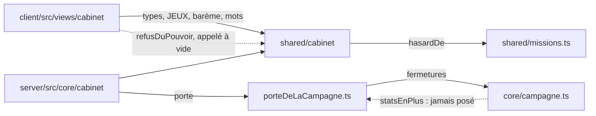

# Le Cabinet de curiosités — rapport de l'expert de la tenue du code (`cabinet-code`)

## En bref

Le code du Cabinet tient comme **un seul code** bien plus qu'on ne l'attendrait de trente lots écrits en parallèle : un barème unique et importé partout, un moule commun aux neuf jeux, un seul module d'outils, une porte étroite vers la campagne, des écrans de jeu qui ne téléchargent pas les règles qui jugent (vérifié sur le paquet construit), aucun `Date.now()`, aucun `autoFocus`, le stockage du navigateur sous `try/catch`, tous les identifiants cités par sa règle présents dans le code, et vingt-trois fichiers de tests qui passent chacun en moins de dix-sept secondes. Ce qui reste est de la **dette de construction**, pas des fautes de conception : des échafaudages de « jeu pas encore livré » devenus morts, deux crochets jamais branchés, une soixantaine de renvois à un document de conception qui n'est pas dans le dépôt, une poignée de chiffres et de phrases recopiés (dont un qui produit un message faux, vu par la tablée et rejoué ici), et des tests de la page qui gardent un texte plutôt qu'un comportement. Les trois retouches les plus rentables : **couper la règle `.claude/rules/cabinet.md`** (68 Ko : lue directement, elle s'arrête à la ligne 69 et perd 39 000 signes de pièges), **retirer les échafaudages et crochets morts** (une centaine de lignes et trois épreuves), et **remplacer les renvois à « la conception »** par les titres de `docs/architecture/decisions.md`.

Quinze constats, tous P3 (aucun P1 ni P2 dans cet angle).

## Méthode

Lecture du code sur la branche `ccr-95f7b600-x1amjl` (72 commits depuis `1babf7d`, 249 fichiers, +44 602 lignes), une heure et demie environ, sur la machine de l'atelier (4 cœurs, charge 0,2 à 1,8 pendant les mesures). Aucun navigateur : l'angle est le code ; le client a été construit une fois dans l'atelier pour lire les morceaux du paquet.

**Lus en entier** : `.claude/skills/tablee/{consignes-audit.md, experts/cabinet-code.md, modele-rapport.md}`, `.claude/rules/{cabinet.md, tests.md, campagne.md}` (et celles qui sont arrivées d'elles-mêmes), `shared/cabinet/{bareme, oeuvres, pouvoirs, musee, vues, partie, lecture, pieces, ouverture, salles (en partie)}.ts`, `shared/cabinet/jeux/{outils, regle, index}.ts`, `shared/horsDeLaBase.ts`, `server/src/core/cabinet/{magasin, vue, tables, ecriture, gardiens, contenu}.ts`, `server/src/core/cabinet/tirages/{index, communs, tas, pari, eclair, mot}.ts`, `server/src/core/porteDeLaCampagne.ts`, `server/src/cabinet.ts`, `client/src/views/CabinetApp.tsx`, `client/src/views/cabinet/{Partie, Musee, Annonce, Cartel, Regles, reveils}.tsx|ts`, `docs/produit/le-cabinet.md`, les titres de `docs/architecture/decisions.md`, des extraits de `server/test/cabinet-ecran.test.ts`, `cabinet-banc.ts`, `chemin-des-imports.ts`, `notes-pour-claude.test.ts`, `server/src/core/campagne.ts` (le diff du Cabinet), `server/src/auth/profiles.ts` (`offrirUnCompagnon`). Parcourus par recherche : le reste de `shared/cabinet/jeux/`, `client/src/views/cabinet/`, les tests `cabinet-*`. Les retours de la tablée du 25 octobre 2026 (`export/tablee/2026-10-25-22h07/retours/`) et les deux rapports déjà rendus (`cabinet-triche`, `cabinet-sobriete`), pour ne rien redire.

**Écrits** (dans `export/evaluations/cabinet-code/`) :
- `exports-morts.sh` → `exports.tsv` : chaque export des fichiers du Cabinet, et combien de fichiers du code, des tests et des scripts le citent.
- `phrases-recopiees.mjs` : les chaînes de plus de 18 signes écrites à la fois côté serveur/shared et côté page (aucune phrase de refus recopiée : seuls des chemins d'import et d'API).
- `fermetures.ts` : la fermeture des imports statiques de quelques modules (par `server/test/chemin-des-imports.ts`).
- `longueurs.cjs` : les fonctions de 40 lignes et plus (compilateur TypeScript), et les exports par module.
- `identifiants-de-la-regle.sh` : chaque identifiant entre accents graves de la règle, cherché dans le code (tous trouvés).
- `assertions-sur-commentaires.mjs` : les assertions des épreuves de la page qui lisent le source tiennent-elles sans les commentaires (oui, toutes).
- `renvois-a-la-conception.txt` : les 58 lignes qui renvoient à la conception absente.
- **`libre-sans-etoile.test.ts`** : reproduction par les routes (échoue aujourd'hui).
- **`mutant-echeance.test.ts`** : un mutant de `Partie.tsx` que l'épreuve de l'échéance ne tue pas (échoue aujourd'hui).
- `dist/` : le client construit (`npx vite build --outDir ../export/evaluations/cabinet-code/dist`), pour lire les morceaux des écrans — effacé après lecture ; la même commande le refait en 6 s.

**Lancés**, un fichier à la fois sous `nice -n 10` : les 19 `cabinet-*.test.ts`, `porte-de-la-campagne`, `tirage-a-la-piece`, `hors-de-la-base`, `campagne-modes`, `campagne-index` (tous verts, durées plus bas) ; puis quatre fois de suite les cinq fichiers qui tirent au hasard (`cabinet-jeux-base`, `-images`, `-neufs`, `cabinet-contenu`, `cabinet-journal`) : vingt passages verts.

**Pas couvert** : la triche, la sobriété et l'équilibre (les trois autres experts) ; `server/scripts/calibrage-cabinet.ts` (1 539 lignes) et `rendu-cabinet.ts` lus en survol seulement ; le CSS du Cabinet (la section de `styles.css`) non relu ; les écrans des jeux du client parcourus par recherche, pas ligne à ligne.

## Constats

### 1. La règle du Cabinet ne se lit plus d'un seul tenant
- **Où** : `.claude/rules/cabinet.md` (100 lignes, 68 254 signes ; la ligne 48 fait 4 223 signes, la 87 4 171, la 91 4 134).
- **Constat** : `CLAUDE.md` demande de lire la règle d'un domaine « directement » quand aucun de ses fichiers n'est ouvert. Lue ainsi, celle du Cabinet s'arrête : l'outil de lecture la coupe à 25 000 jetons (elle en fait 30 861) et ne montre que les lignes 1 à 69. Les lignes 70 à 101 — 38 803 signes, plus de la moitié des pièges : le préfixe `cab:`, la vue née complète, la visite figée, jamais `Date.now()`, la porte, les lots gardés (D9), la dépense, le cadrage, la clôture du lendemain, les deux heures d'un départ, la suppression, les paramètres numérotés, `partiesDuJour`, le tirage, les murs, la page qui ne lit aucune règle, la partie à l'écran, les quatre blocs d'écrans, le réveil, les dix-sept pixels, les gardiens rangés, les Divins, les mots, le catalogue — ne paraissent pas. Elle est la troisième règle du dépôt par la taille au bout d'un jour, et `notes-pour-claude.test.ts` ne borne que `CLAUDE.md`.
- **Preuve** : le premier `Read` de cette session : « PARTIAL view — showing lines 1-69 of 101 total (30861 tokens, cap 25000) ». `wc -c`, `awk` (`export/evaluations/cabinet-code/`, mesures plus bas).
- **Qui ça touche** : chaque agent qui retouchera le Cabinet sans en avoir ouvert un fichier, ou qui suit `CLAUDE.md` à la lettre : il part sans les pièges qui ont coûté le plus cher.
- **Statut** : confirmé (rejoué).
- **Piste** : la couper en deux règles aux `paths:` distincts — `cabinet.md` (shared et serveur) et `cabinet-page.md` (`client/src/views/CabinetApp.tsx`, `client/src/views/cabinet/**`, qui prend les lignes 87 à 96, ~20 000 signes) — et ramener la section « Les fichiers » (18 863 signes) à une ligne par fichier, le détail vivant déjà dans l'en-tête de chaque module. Ajouter à `notes-pour-claude.test.ts` une borne par règle : `assert.ok(texte.length <= 50_000, nom)` (sous le plafond de lecture, environ 2,2 signes par jeton ici).
- **Priorité · effort** : P3 · M.

### 2. Le bilan d'une partie libre dit « les cinq ont payé » quand elle n'a rien rapporté
- **Où** : `server/src/core/cabinet/vue.ts:179` (`bilanDit`).
- **Constat** : la phrase décide « cette partie a-t-elle payé ? » sur sa poussière (`b.poussiere > 0`) au lieu du départ (`d.payee`), et écrit « cinq » en toutes lettres là où le barème dit `LIBRES_QUI_PAIENT`. Une libre qui paie mais finit à zéro étoile (deux poussières par étoile : zéro) dit « Les cinq parties libres du jour ont payé : celle-ci se joue pour le plaisir ». La tablée l'a vu (Hugo, au Détail, `retours/hugo.md`) ; la cause est une règle redérivée d'un mauvais champ et un chiffre recopié — mon angle.
- **Preuve** : `export/evaluations/cabinet-code/libre-sans-etoile.test.ts`, par les routes d'un serveur jetable : la première libre du jour, quittée d'emblée → `bilan.dit` = « Les cinq parties libres du jour ont payé : celle-ci se joue pour le plaisir ». Échoue aujourd'hui.
- **Qui ça touche** : l'invité qui rate une libre parmi les cinq premières : il croit ses libres épuisées et ne rejoue pas pour la poussière.
- **Statut** : bug confirmé (rejoué) — vu d'abord par la tablée.
- **Piste** :
  ```ts
  case 'libre':
    if (d.origine !== 'libre') return 'Tout ton musée est doré : cette partie rapporte de la poussière d’or'
    if (!d.payee) return `Les ${LIBRES_QUI_PAIENT} parties libres du jour ont payé : celle-ci se joue pour le plaisir`
    return b.poussiere > 0 ? `${poussieresDites(b.poussiere)} pour ta partie libre` : 'Aucune étoile cette fois : pas de poussière d’or'
  ```
  La reproduction devient le test de la correction (dans `cabinet-poussiere.test.ts`).
- **Priorité · effort** : P3 · S.

### 3. Soixante renvois à « la conception », un document qui n'est pas dans le dépôt
- **Où** : 36 « § n.n » dans 18 fichiers, 22 « (Dn) » dans 12 fichiers, 7 « la conception », 3 « lot X » ; la règle elle-même (« (D9) », deux fois). Le plus trompeur : `server/src/core/porteDeLaCampagne.ts:2`, « (la conception du Cabinet, D12 — `docs/architecture/decisions.md`) », alors que `decisions.md` ne numérote aucune décision. Aussi `tables.ts:151` (« jusqu'à l'étape 5 », quand le plan de `retours/2026-10-24/le-cabinet.md` en a quatre), `tables.ts:162` (« la conception, § 1.10 »), `ecriture.ts:55` et `:160` (« § 2.3 », « § 2.4 et § 2.6 »), `Partie.tsx:30` (« § 2.2-2.7 de la conception »), `Eclair.tsx:98` (« § 0.2, question 7 »), `vues.ts:22-32` (« lot B3 », « lot C4 », « lot C7 »).
- **Constat** : la fiche le dit en toutes lettres : pas de renvoi à un document absent. Ces renvois ne mènent nulle part, et celui de la porte envoie chercher un numéro qui n'existe pas.
- **Preuve** : `export/evaluations/cabinet-code/renvois-a-la-conception.txt` (58 lignes) ; `grep -n "D[0-9]" docs/architecture/decisions.md` : rien ; les « lots » ne vivent que dans les messages de commit.
- **Qui ça touche** : le relecteur qui veut le pourquoi d'une règle.
- **Statut** : confirmé (lecture).
- **Piste** : un renvoi qui porte un pourquoi devient le titre de sa décision (« Chaque lot d'écriture est gardé par son geste », `decisions.md`) ; les autres s'effacent — le commentaire dit déjà le pourquoi juste à côté dans presque tous les cas. Une épreuve dans `cabinet-catalogue.test.ts` refuse ensuite `/§ ?\d|\(D\d+\)|la conception/` dans le code du Cabinet.
- **Priorité · effort** : P3 · S.

### 4. Les échafaudages d'un « jeu sans écran » sont devenus du code mort
- **Où** : `client/src/views/CabinetApp.tsx:192-210` (`AnnonceEnAttente`) et ses deux appels `:493`, `:516` ; `client/src/views/cabinet/Partie.tsx:144-162` (`ECRANS: Partial<Record<CleDeJeu, …>>`, `ecranDuJeu`) ; `server/src/core/cabinet/tirages/index.ts:67-88` (`TIREURS: Partial<…>`, `if (!tireur) return null`).
- **Constat** : les neuf jeux ont leur écran et leur tireur ; `Partie.tsx:614` l'affirme même (`useALaDemande(ecranDuJeu(depart.jeu)!)`). `AnnonceEnAttente` ne se montre plus jamais, mais vit encore, son texte (« Ses écrans arrivent ici très bientôt »), sa ligne dans la règle (`cabinet.md:48`) et deux épreuves qui le rendent seul (`cabinet-ecran.test.ts:605-613`). Le `Partial` empêche aussi le typage de dire ce qu'il dirait d'un jeu oublié : un dixième `CleDeJeu` sans écran ni tireur compile.
- **Preuve** : chemin du code ; `exports.tsv`.
- **Qui ça touche** : le relecteur ; le prochain jeu, que le compilateur ne protégera pas.
- **Statut** : confirmé (lecture).
- **Piste** : `ECRANS: Record<CleDeJeu, ALaDemande<EcranEfface>>` et `TIREURS: Readonly<Record<CleDeJeu, Tireur>>` ; retirer `AnnonceEnAttente`, ses deux branches, son épreuve, le `!` et le `if (!tireur)`. `JEUX_PRETS` reste le seul drapeau d'un jeu livré (la page dit déjà « bientôt » de ses œuvres).
- **Priorité · effort** : P3 · S.

### 5. Le crochet des paliers (`statsEnPlus`) n'est branché nulle part, et la page produit dit qu'il sert
- **Où** : `server/src/core/porteDeLaCampagne.ts:158-183` (`ChampsDuCabinet = never`, `StatsDuCabinet`, `StatsEnPlus`) ; `server/src/core/campagne.ts:1062` et `:2308-2327` (la plomberie dans `statsDe`) ; `server.ts:518-523` ne pose que `expeditionChange`. `docs/produit/le-cabinet.md:152` : « le trophée L'Explorateur garde ses détenteurs, ses paliers relus aux salles complètes ».
- **Constat** : aucun champ, aucune lecture, aucun branchement : le crochet n'existe que pour `porte-de-la-campagne.test.ts` (`:373`, `:559-578`). La règle le présente comme l'un des « trois crochets » vivants (`cabinet.md:47`), et la page produit affirme une relecture de L'Explorateur aux salles que le code ne fait pas (L'Explorateur lit toujours le niveau d'explorateur, `campagne.ts:2340` ; la porte dit elle-même « y entreront quand… », `:159-163`).
- **Preuve** : `git grep statsEnPlus -- server/src` : déclaré, lu, jamais posé.
- **Qui ça touche** : le lecteur de la documentation ; le relecteur, qui croit un chemin actif.
- **Statut** : confirmé (lecture).
- **Piste** : choisir. Soit retirer le crochet (une soixantaine de lignes et deux épreuves) jusqu'au jour où L'Explorateur se relira aux salles ; soit le brancher maintenant. Dans les deux cas, corriger `le-cabinet.md:152` (« ses paliers se reliront aux salles complètes ») et la ligne de la règle.
- **Priorité · effort** : P3 · S.

### 6. La page produit décrit le Cabinet d'avant-hier
- **Où** : `docs/produit/le-cabinet.md:186` (« Le Pari et l'Éclair s'y jouent ; un jeu qui n'a pas encore son écran s'annonce en attente »), `:158` (« Ce qui vient ensuite — La construction : … le Pari et l'Éclair d'abord, puis… »), `:152` (constat 5).
- **Constat** : les neuf jeux se jouent ; la construction est faite (l'ouverture, elle, reste à venir). La règle, elle, est à jour.
- **Statut** : confirmé (lecture).
- **Piste** : « Les neuf jeux s'y jouent, chacun son écran chargé à la demande » ; « Ce qui vient ensuite » commence à l'ouverture.
- **Priorité · effort** : P3 · S.

### 7. Les trois étoiles d'une manche s'écrivent en dur, malgré `ETOILES_PAR_MANCHE`
- **Où** : `shared/cabinet/pouvoirs.ts:210` (`n < 3`), `:226` (`n === 3 ? 3 + BONUS_DE_MISE…`), `:227` (`Math.min(3, …)`) ; `shared/cabinet/partie.ts:667` (`n === 3`) ; `shared/cabinet/jeux/outils.ts:49` (`Math.min(3, …)`) ; `server/src/core/cabinet/vue.ts:144-145` (`x.naturel === 3`, `x.etoiles - 3`) ; `client/src/views/cabinet/Bilan.tsx:54`, `Partie.tsx:449` (`Math.min(3, …)`) ; `shared/cabinet/jeux/regle.ts:79, 98, 145, 199` (`etoiles(3 - i)`). Et `server/src/core/cabinet/tables.ts:314` (`visite <= 2`, la dernière case de la visite), `shared/cabinet/musee.ts:484` (« Choisis un des neuf jeux »).
- **Constat** : le premier piège de la règle — « un chiffre du Cabinet vit dans `bareme.ts`… jamais ne le recopient » — et `Regles.tsx:97`, `shared/glossaire.ts` importent `ETOILES_PAR_MANCHE`, quand le pli, les pouvoirs, la vue et la page écrivent 3. Le chiffre est en réalité une forme (`VerdictDUneManche.naturel: 0 | 1 | 2 | 3`) : le changer demanderait de toucher au typage, et le barème promet une liberté qu'il n'a pas.
- **Statut** : confirmé (lecture).
- **Piste** : typer la constante (`export const ETOILES_PAR_MANCHE: 3 = 3`) et la lire partout — `Math.min(ETOILES_PAR_MANCHE, …)`, `n === ETOILES_PAR_MANCHE` —, ou la sortir du barème comme une forme (à côté de `Manche = 0 | 1 | 2`), en le disant dans `baremes.md`. Même chose pour `tables.ts:314` (`MANCHES_PAR_PARTIE`… ou `CASES_DE_LA_VISITE - 1`) et « neuf jeux » (`CLES_DES_JEUX.length` en lettres, comme `Regles.tsx:127`).
- **Priorité · effort** : P3 · S.

### 8. Ce que le serveur sait, la page le redérive ; et quelques phrases de refus s'écrivent deux fois
- **Où** :
  - `client/src/views/cabinet/Annonce.tsx:53` — le seuil d'une case de la visite relu au barème (`SEUILS_DES_RARETES[c.enJeu.rarete]`), la règle même de `shared/cabinet/musee.ts:417` (`seuilDe`) : la vue d'une case (`CaseVue`) ne porte pas le seuil que le départ figera.
  - `client/src/views/cabinet/Cartel.tsx:58-63` — `titreAuBilan` devine « Son cartel » d'un bilan relu sans la fin (`relu && issue gagnée`) : un raisonnement de serveur (« elle n'était pas à lui, sans quoi… »), alors que le magasin a la ligne de l'œuvre en mémoire et pourrait dire `devientSonCartel` à chaque lecture (`ligne.serieId === p.id`).
  - `client/src/views/cabinet/Partie.tsx:370` — la page appelle `refusDuPouvoir` avec un état inventé (`servi: 0, aJoue: true, rechanges: 1`) pour obtenir la phrase « Change avant de répondre » : juste aujourd'hui, faux le jour où la règle change l'ordre de ses refus.
  - `client/src/views/cabinet/Musee.tsx:180` — « Ta partie ${JEUX[…].a} t'attend » réécrit à la main le début de `laPartieAttend` (`musee.ts:436`).
  - Au serveur : `magasin.ts:204` (`DEMANDE_ILLISIBLE`) recopie `musee.ts:490` mot pour mot ; `magasin.ts:809` recopie `ILLISIBLE` (`partie.ts:311`) ; « Choisis une partie de la visite » deux fois dans `musee.ts` (`:382`, `:460`) ; et le même fait se dit « déjà faite » (`:461`) et « déjà jouée » (`:384`).
- **Constat** : aucune ne ment aujourd'hui ; chacune est une deuxième copie qui peut évoluer seule — exactement le défaut que la règle a déjà corrigé deux fois (`fondreLesReveils`, les outils des jeux). Le script `phrases-recopiees.mjs` confirme qu'aucune phrase de refus du serveur n'est recopiée dans la page : le reste est bien importé.
- **Statut** : confirmé (lecture).
- **Piste** : `CaseVue.seuil` rempli par `visiteVue` ; `BilanVu.devientSonCartel` posé à chaque lecture où le magasin a la ligne, et `titreAuBilan` ne lit plus que lui ; exporter `CHANGE_AVANT_DE_REPONDRE` de `pouvoirs.ts` ; `laPartieAttend` coupé en deux (`laPartieAttendDit(jeu)` pour le titre, la phrase entière pour le refus) ; `DEMANDE_ILLISIBLE` et `ILLISIBLE` importés ; une seule phrase pour une case déjà commencée.
- **Priorité · effort** : P3 · M.

### 9. Le pouvoir des gardiens est écrit deux fois — et trois de ses lignes trois fois
- **Où** : `shared/cabinet/salles.ts:114-138` (`POUVOIR_DES_GARDIENS`, 23 lignes) ; `:93-99` (`AUTRES_GARDIENS[].pouvoir`) ; `shared/cabinet/pouvoirs.ts:52-61` (`POUVOIR_DE_LA_FAMILLE`).
- **Constat** : la règle dit « le pouvoir d'un gardien est celui de la salle qu'il garde ». Seize des vingt-trois lignes se dérivent de `GARDIENS_DES_SALLES` et `POUVOIR_DE_LA_FAMILLE` ; les cinq « autres » ont leur pouvoir à la fois dans `AUTRES_GARDIENS` et dans la table, dans le même fichier. Seuls les deux du Vestibule (le Coq, la Chimère) demandent une ligne écrite. Un test tient les copies ensemble (`cabinet-catalogue.test.ts:299-303`) au lieu d'une dérivation.
- **Statut** : confirmé (lecture).
- **Piste** : `POUVOIR_DES_GARDIENS_DU_VESTIBULE = { 'lg:coq': 'temps', 'lg:chimere': 'changer' }`, et la `Map` de `pouvoirDuGardien` se construit des salles, du Vestibule et d'`AUTRES_GARDIENS`. `salles.ts` importe `pouvoirs.ts` pour `POUVOIR_DE_LA_FAMILLE`, qui importe `salles.ts` : déplacer `POUVOIR_DE_LA_FAMILLE` dans `salles.ts` (ou `pouvoirDuGardien` dans `pouvoirs.ts`) évite le cycle. Ne plus exporter la table : la règle interdit de la lire par `TABLE[cle]`, mieux vaut qu'on ne puisse pas.
- **Priorité · effort** : P3 · S.

### 10. De petits outils recopiés, dont deux qui ne disent déjà plus la même chose
- **Où** :
  - `leGardien` : `server/src/core/cabinet/vue.ts:85-88` met en minuscule la première lettre de tout nom ; celle de `shared/expedition.ts:4069-4072` seulement un article (« Janus » reste « Janus »). Sans effet aujourd'hui (les trois gardiens de saison ont un article : « La Citrouille », « Le Sapin », « Le Bouquet final »), faux pour le premier sans article.
  - `motsDe` : `server/src/core/cabinet/contenu.ts:90-95` (le juge du contenu, `ecritDans`, n'ouvre que œ et æ) et `shared/cabinet/jeux/indices.ts:99-103` (la saisie, qui ouvre aussi ø, ł, đ, ð, þ, ß, ı — `:79-89`) : le juge et le joueur ne coupent pas les mots pareil.
  - `pluriel` quatre fois (`vue.ts:89`, `pouvoirs.ts:108`, `jeux/indices.ts:210`, `jeux/Indices.tsx:33`), plus `compte` (`Musee.tsx:23`) et `etoilesDites` (`Partie.tsx:282`), les uns avec `formatNumber`, les autres sans.
  - `RARETE_AU_FEMININ` (`Regles.tsx:43`) = `RARETE_DITE` (`components/OeuvrePeinte.tsx:62`, que `Visite.tsx` importe déjà) ; `doucement` deux fois (`jeux/Indices.tsx:67`, `jeux/MotMystere.tsx:197`) quand `components/Niche.tsx:193` exporte `sansMouvement` ; `RADIAN` deux fois (`shared/cabinet/france.ts:30`, `jeux/epingle.ts:102`) ; l'année du départ relue à la main (`lecture.ts:293`) à côté d'`anneeDuDepart` (`partie.ts:175`) ; le dialogue « Signaler une erreur » recopié une cinquième fois (`Partie.tsx:830-844`, après la campagne, l'expédition, les parcours et le quiz du jour).
  - Les règles pures du Cabinet tirent `shared/missions.ts` (450 lignes, le coffre et les missions) pour un générateur pseudo-aléatoire (`hasardDe`, `musee.ts:14`, `partie.ts:44`).
- **Statut** : confirmé (lecture).
- **Piste** : `leGardien` et `nomDuGardien` dans `shared/legendaires.ts`, importés par l'Expédition et le Cabinet ; le juge du contenu passe par `motsUtiles`/`motsDe` de la règle des Indices, qu'il importe déjà ; un `shared/cabinet/mots.ts` (`pluriel`, `poussieresDites`, `etoilesDites`) ; `hasardDe` dans un `shared/hasard.ts` que `missions.ts` réexporte ; un `signalerUneQuestion(serie, position)` partagé par les cinq pages.
- **Priorité · effort** : P3 · M.

### 11. La réponse partie d'elle-même à l'échéance n'est gardée que par son texte
- **Où** : `server/test/cabinet-ecran.test.ts:1772-1796` (« une partie dit son heure au serveur… ») ; le code gardé, `client/src/views/cabinet/Partie.tsx:736-749`.
- **Constat** : l'épreuve lit `Partie.tsx` par expressions régulières. Un mutant dont l'effet rend la main d'emblée — la réponse ne part plus jamais à l'échéance, et la manche reste ouverte jusqu'à ce que le joueur touche quelque chose — passe toutes ses assertions. Le fichier en compte 78 de cette sorte : elles cassent à un renommage et laissent passer ce qu'elles disent garder (aucune ne tient seulement par un commentaire : vérifié). Les morceaux purs (`aLEcheance` de chaque jeu, `chronoMontre`) sont, eux, bien éprouvés ; c'est l'ordonnancement du contrôleur qui ne l'est pas — sans bibliothèque de DOM, un choix du dépôt.
- **Preuve** : `export/evaluations/cabinet-code/mutant-echeance.test.ts` : il copie `Partie.tsx`, remplace `if (!pret || (vue.phase !== 'jouer' && vue.phase !== 'pause')) return` par `if (pret || !pret) return`, rejoue les assertions de l'épreuve sur le vrai code (vertes) puis sur le mutant (vertes aussi) : « le mutant passe toutes les assertions ». Échoue aujourd'hui.
- **Qui ça touche** : une régression de l'échéance passerait la CI ; seule une tablée ou `rendu-cabinet.ts` la verrait.
- **Statut** : confirmé (rejoué) — tension avec le parti pris « très peu de dépendances ».
- **Piste** : sortir l'ordonnancement en fonction pure, éprouvée seule — `aEnvoyerALEcheance(vue, t, pret): { dans: number; manche: Manche } | null` —, et n'en garder dans `Partie.tsx` que le branchement ; puis remplacer, test par test, les assertions de texte par des appels aux fonctions pures quand elles existent (`laReponseTourneLaPage`, `plusRecente` le sont déjà).
- **Priorité · effort** : P3 · M.

### 12. Deux composants de trois cents lignes, et un magasin qui répète sa boucle cinq fois
- **Où** : `client/src/views/CabinetApp.tsx:212` (`CabinetApp`, 346 lignes : la page, le fragment, l'écho, le premier plan, le focus, les cartels, les dépenses, le départ, l'aiguillage des écrans) ; `client/src/views/cabinet/Partie.tsx:590` (`Partie`, 293 lignes) ; `server/src/core/cabinet/magasin.ts` (1 261 lignes, 26 exports) : la même boucle « essai 0, devancé → oublier, relire, rejouer une fois, sinon `X_CROISE` » à `:676`, `:798`, `:975`, `:1021`, `:1090`, et quatre fois `try { batch } catch { oublier ; throw }` ; une écriture hors des lots gardés (`:498`, `UPDATE cabinet_profils … partie = NULL`, quand la règle pose « chaque écriture est un lot gardé » et range les écritures dans `ecriture.ts`, `cabinet.md:41`, `:75`).
- **Constat** : rien de faux ; la fiche nomme ce cas (« une fonction de plusieurs centaines de lignes, `magasin.ts` »). Les décisions de `CabinetApp` sont déjà pures et sorties (`Cartel.tsx`, `ecrans.ts`) : il reste leur branchement, en un seul composant.
- **Statut** : confirmé (lecture) — dette.
- **Piste** : `useCartels(page, aSonCartel)`, `useEcranDuFragment()`, `usePageDuCabinet()` sortis de `CabinetApp` ; dans le magasin, `private async rejouerUneFois<T>(profileId, croise: string, essai: (essai: number) => Promise<T | 'devance'>)`, et `rendreLaPartieIllisible` en `instructionDeLaPartieRendue` dans `ecriture.ts`. L'achat, la dorure, l'échange et le cartel (≈ 250 lignes) pourraient vivre dans un `depenses.ts` à côté.
- **Priorité · effort** : P3 · M.

### 13. D'autres restes : un drapeau toujours vrai, deux fonctions sans appelant, des commentaires de la migration
- **Où** : `server/src/core/cabinet/tables.ts:150-156` et `:200-202` (`EXPEDITION_ENCORE_LUE = true`, « jusqu'à l'étape 5 ») ; `server/src/core/cabinet/tirages/tas.ts:151-154` (`qcmDeToutes`, aucun appelant) ; `shared/cabinet/oeuvres.ts:198-201` (`jeuDeLOeuvre`, aucun appelant) ; des enveloppes qui ne servent qu'aux tests (`refusDuDepart`, `musee.ts:496-500` ; `refusDuGeste`, `partie.ts:558-562` ; `estDuCabinet`, `pieces.ts:82`) ; la migration abandonnée encore citée : `shared/cabinet/ouverture.ts:3-4` (« la migration des joueurs de l'Expédition mesurée à blanc », une condition d'ouverture qui n'existe plus), `server/src/core/cabinet/gardiens.ts:18` (« la page froide, la migration — »).
- **Constat** : la décision du 25 octobre 2026 est bien appliquée au code — ni origine `expedition`, ni crochet de fin qui rapporte, ni version de relecture : le ménage est fait, ces lignes en sont les miettes.
- **Preuve** : `exports.tsv` (colonnes : citations dans le code, dans les tests, dans le fichier même).
- **Statut** : confirmé (lecture).
- **Piste** : retirer le drapeau et garder la lecture tant que l'Expédition se lit (ou la garder sous `EXPEDITION_REMPLACEE`, le vrai drapeau) ; supprimer `qcmDeToutes` et `jeuDeLOeuvre` ; réécrire les deux commentaires.
- **Priorité · effort** : P3 · S.

### 14. Des épreuves en double
- **Où** : `server/test/cabinet-ecran.test.ts` — `fondreLesReveils` éprouvé trois fois (`:3216-3223`, `:3240`, `:3291-3317`, l'import vérifié deux fois mot pour mot) ; `AnnonceEnAttente` rendu seul (`:605-613`, constat 4).
- **Statut** : confirmé (lecture).
- **Piste** : garder l'épreuve de `:3286` (la plus complète), retirer les assertions de `:3216-3223` et `:3240`.
- **Priorité · effort** : P3 · S.

### 15. Trois règles tenues deux fois, en SQL et en mémoire
- **Où** : la série d'un départ (`ecriture.ts:76-88` et `magasin.ts:749-775`, `retenirLeDepart`) ; l'œuvre d'une fin (`ecriture.ts:211-218` et `magasin.ts:249-262`, `ligneApresLaFin`) ; l'échange (`ecriture.ts:340-359` et `magasin.ts:1123-1125`).
- **Constat** : voulu (la mémoire reflète ce que la base vient d'écrire, sans relire) et documenté ; je les ai relues l'une contre l'autre : équivalentes aujourd'hui (le `MAX(COALESCE(serie_jour, ''), ?4)` et le `serieJour > d.jour`, le `COALESCE` des quatre colonnes et les `??`). Mais une retouche d'un seul côté ne rougirait que dans les épreuves à deux serveurs.
- **Statut** : tension (un choix de sobriété).
- **Piste** : une épreuve dans `cabinet-charge.test.ts` qui, après chaque lot (départ, fin, échange), compare le musée gardé au musée relu à froid du même profil (`museeDe` des deux), sur une poignée de cas — la série d'hier, d'avant-hier, une libre ; une œuvre de départ dorée en jouant, un double qui prend son cartel.
- **Priorité · effort** : P3 · S.

## Mesures et cartes

**Les tests, un fichier à la fois** (`nice -n 10`, charge 0,2 à 1,6) — tous verts, aucun près de la minute et demie qui fait couper un fichier :

| Fichier | Épreuves | Durée |
|---|---:|---:|
| cabinet-calibrage | 7 | 16,2 s |
| cabinet-charge | 15 | 8,3 s |
| cabinet-ouverture | 11 | 8,0 s |
| cabinet-poussiere | 20 | 7,8 s |
| cabinet-ecran | 94 | 6,0 s |
| cabinet-routes | 12 | 5,7 s |
| cabinet-jeux-neufs | 34 | 5,2 s |
| cabinet-secret | 12 | 5,1 s |
| cabinet-jeux-images | 34 | 5,0 s |
| cabinet-gardiens, cabinet-journal | 17, 9 | 4,8 s chacun |
| cabinet-pouvoirs | 10 | 4,4 s |
| cabinet-ecran-neufs, cabinet-saisons | 22, 6 | 3,4 s chacun |
| cabinet-jeux-base | 38 | 2,9 s |
| cabinet-chronos | 14 | 2,5 s |
| campagne-modes, campagne-index, hors-de-la-base, porte-de-la-campagne | 2, 2, 5, 9 | 1,5 à 2,0 s |
| cabinet-index, tirage-a-la-piece, cabinet-contenu, cabinet-regles, cabinet-catalogue | 3, 12, 18, 31, 26 | 0,4 à 1,2 s |

Les cinq fichiers qui tirent au hasard, rejoués quatre fois : 20 passages sur 20 verts.

**Les renvois à la conception absente** : 36 « § », 22 « (Dn) », 7 « la conception », 3 « lot X » dans le code ; 2 « (D9) » dans la règle.

**La règle** : 68 254 signes, 100 lignes ; la section « Les fichiers » 18 863 signes ; les lignes 70 à 101, que la lecture directe coupe, 38 803 signes. Par la taille, la troisième règle du dépôt (après `expedition.md`, 134 980, et `qg.md`, 79 568).

**Les fonctions de plus de 100 lignes** (`longueurs.cjs`) : `CabinetApp` 346, `Partie` 293, `Musee` 153, `mountCabinet` 151 (des routes, normal), `Oeuvre` 132, `Annonce` 104, `tirerPourUneEscale` 101, `BilanDeLaPartie` 100. Au serveur du Cabinet, la plus longue est `commencer` (77) : le magasin est long, pas ses méthodes.

**Les exports** (`exports.tsv`, 730 exports) : sans aucun appelant hors de leur fichier ni dans les tests, et cités une seule fois chez eux — `qcmDeToutes`, `jeuDeLOeuvre`, `LA_MEME_QUESTION` (celui-ci voulu : une garde de typage) ; pour les seuls tests — `refusDuDepart`, `refusDuGeste`, `estDuCabinet`, `SORTES_DU_CONTENU`, `motsDuPari`, `POUVOIR_DES_GARDIENS`.

**Le paquet construit** (`dist/`, 556 fichiers en 5,5 s) : les écrans des jeux pèsent 2,7 à 7,4 Ko chacun (le Mot mystère, le plus lourd) ; aucun ne contient une phrase des règles qui jugent (« Ce geste se juge avec sa manche », les refus de `cadreDuDepart`, « Le prix a changé ») — ce que les épreuves déduisent des imports, le paquet le confirme. Le morceau de la page (`CabinetApp`, 65 Ko) ne garde de `pouvoirs.ts` que `refusDuPouvoir`, tiré pour la seule phrase du constat 8.



## Ce qui marche — à ne pas casser

- **Un barème, et des barèmes dits qui s'en composent** (`regle.ts` : `baremeCompte`, `baremeDesErreurs`, `motsDuPari`) : l'annonce, les règles et le glossaire ne promettent rien que le code ne tienne. `Regles.tsx` est un modèle : chaque nombre importé, même `ECHANGES_DITS` typé sur `1`.
- **Le moule des jeux** (`RegleDuJeu`, `trancheLaManche`, le registre exhaustif `REGLES`) et **un seul module d'outils** : la fusion du 25 octobre 2026 tient, et `cabinet-regles.test.ts` la garde.
- **La porte** : le serveur du Cabinet n'importe rien de `core/campagne.ts` (sauf un type), ni du quiz du jour ; `shared/` n'importe rien du serveur ni du client ; aucune phrase de refus n'est recopiée dans la page.
- **La lecture champ par champ** (`lecture.ts`, `tables.ts`) : chaque relecture refait l'objet, et la règle « une clé venue du téléphone se lit par une fonction » est respectée partout où une clé vient de la page.
- **Les conventions du dépôt** : aucun `Date.now()` dans le Cabinet, aucun `autoFocus`, `tronquer` pour le nom tapé, `new Error` nu pour chaque refus, `localStorage` sous `try/catch` (`retenu.ts`), classes en `cab-` ou partagées, jamais « carte » seule à l'écran, et des commentaires en français qui disent pourquoi — souvent avec le bug évité.
- **Les épreuves** : rapides, stables au hasard (vingt passages), et nombreuses à jouer par les routes d'un vrai serveur ; aucune assertion sur le source ne tient par un commentaire ; chaque identifiant de la règle existe dans le code.
- **Le ménage de la migration** : ni origine `expedition` dans `cabinet_oeuvres`, ni crochet qui rapporte, ni version de relecture ; la page de l'Expédition et son départ se ferment par un drapeau à part (`EXPEDITION_REMPLACEE`).

## Recommandations, dans l'ordre — les dix retouches qui rendraient le code le plus net

1. **Couper la règle** (constat 1) — `.claude/rules/cabinet.md` en `cabinet.md` + `cabinet-page.md`, « Les fichiers » à une ligne chacun, une borne de 50 000 signes par règle dans `notes-pour-claude.test.ts`. Retire ~35 000 signes de ce qu'un agent du serveur lit, et rend lisibles les 32 pièges coupés. P3 · M.
2. **Corriger la phrase du bilan libre** (constat 2) — `vue.ts:179`, sur `d.payee` et `LIBRES_QUI_PAIENT` ; la reproduction devient son test. Retire un message faux et un chiffre recopié. P3 · S.
3. **Retirer les échafaudages et les crochets morts** (constats 4, 5, 13) — `AnnonceEnAttente` et son épreuve, les deux `Partial`, le `!`, `statsEnPlus` et sa plomberie (ou le brancher), `EXPEDITION_ENCORE_LUE`, `qcmDeToutes`, `jeuDeLOeuvre`, deux commentaires de la migration. Retire une centaine de lignes et trois épreuves ; le compilateur protège le dixième jeu. P3 · S.
4. **Remplacer les renvois à la conception** (constat 3) — `porteDeLaCampagne.ts`, `ecriture.ts`, `tables.ts`, `Partie.tsx`, les écrans des jeux, `vues.ts`, la règle ; une épreuve qui les refuse. Retire 58 renvois morts. P3 · S.
5. **Mettre la page produit à jour** (constats 5, 6) — `docs/produit/le-cabinet.md:152, 158, 186`. Retire trois affirmations fausses. P3 · S.
6. **Rendre au serveur ce que la page redérive** (constat 8) — `CaseVue.seuil`, `devientSonCartel` à chaque lecture, `CHANGE_AVANT_DE_REPONDRE`, `laPartieAttend` en deux, `DEMANDE_ILLISIBLE`/`ILLISIBLE` importés. Retire de la page trois raisonnements de serveur et du serveur trois phrases en double. P3 · M.
7. **Dériver ce qui se dérive** (constats 7, 9) — `POUVOIR_DES_GARDIENS` réduit au Vestibule, `ETOILES_PAR_MANCHE` typé et lu aux douze endroits qui écrivent 3. Retire 21 lignes de table et une promesse que le barème ne tient pas. P3 · S.
8. **Un seul outil par besoin** (constat 10) — `leGardien` dans `shared/legendaires.ts`, le juge du contenu par la règle des Indices, `shared/cabinet/mots.ts`, `shared/hasard.ts`, `sansMouvement`, `RARETE_DITE`, `RADIAN`, `anneeDuDepart`, un dialogue de signalement partagé. Retire une dizaine de copies, dont deux déjà divergentes. P3 · M.
9. **Alléger `CabinetApp`, `Partie` et le magasin** (constats 11, 12) — trois crochets sortis de `CabinetApp`, l'échéance en fonction pure (qui ferme aussi le constat 11), `rejouerUneFois` au magasin, la partie rendue dans `ecriture.ts`. Retire ~150 lignes répétées et rend l'échéance éprouvable. P3 · M.
10. **Des épreuves de comportement plutôt que de texte** (constats 11, 14, 15) — l'épreuve de l'échéance d'abord, puis les assertions de texte une à une là où une fonction pure existe ; les doublons de `fondreLesReveils` retirés ; une épreuve « mémoire = base » après chaque lot. Retire des faux verts et des faux rouges. P3 · M.

## Limites

Ce rapport ne dit rien de la triche, de la sobriété ni de l'équilibre (trois autres experts), ni du rendu (aucun navigateur lancé). Les constats 7 à 15 sont prouvés par la lecture du code, pas par une reproduction : je n'ai pas modifié de fichier suivi pour les rejouer, et un mutant n'a été écrit que pour le constat 11. La troncature du constat 1 est celle de l'outil de lecture de cette session ; je n'ai pas pu vérifier si la règle chargée d'elle-même (par ses `paths:`) est coupée de la même façon. Les durées des tests dépendent de la charge ; elles valent comme ordre de grandeur, la CI est plus lente. Le CSS du Cabinet, `calibrage-cabinet.ts` et `rendu-cabinet.ts` n'ont été que survolés.

### Hors mission

- **« Revenir au musée » mène à une salle** (la tablée, Hugo : toujours la salle du Devin) : pas rejoué ici ; à rapprocher de l'écho du doigt que `arreterLEcho` arrête (`CabinetApp.tsx:317-320`) — `Musee.tsx` et `Annonce.tsx` gardent des `onClick` nus, couverts par cet arrêt seulement tant que la page est montée.
- Rien d'autre croisé hors de l'angle qui ne soit déjà dans les rapports `cabinet-triche` et `cabinet-sobriete`.
