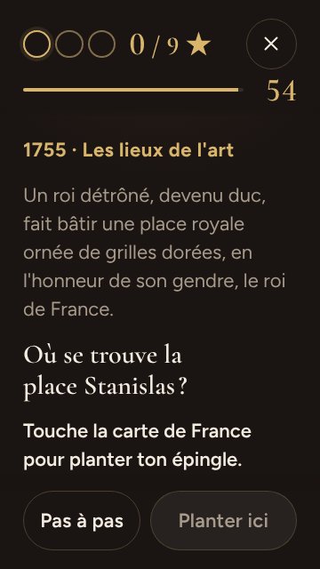
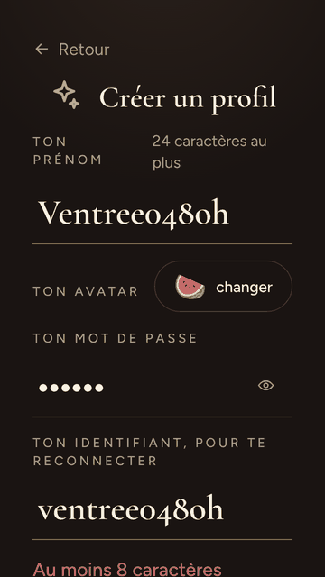
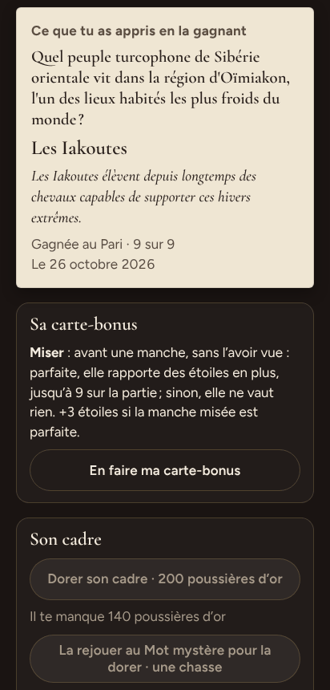
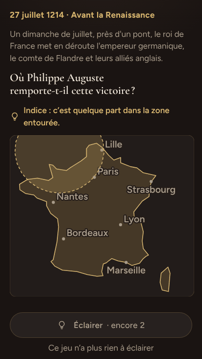

# La deuxième tablée du Cabinet de curiosités — 26 octobre 2026

Les six mêmes personnages que la veille, chacun au téléphone dans son Chromium,
sur un serveur jetable où le Cabinet est ouvert (`npm run tablee --
--sans-animateur`, skill `tablee`, « Le Cabinet de curiosités »). Ils ont joué de
9 h 42 à 9 h 56 et rendu leur retour avant 10 h, sur le client construit au
lancement de la régie (9 h 41, juste après c5d72bc). Ce client portait tous les
lots tirés de la première tablée : `regles-du-serveur`, `fenetres`,
`serveur-sobre`, `detail-et-vues`, `calibrage`, `page-1`, `petits`,
`equilibre-2` et `page-2`, chacun avec sa relecture. Ce qui change aussi,
c'est la tablée elle-même : les agents ignorent des domaines, et hors de ces
domaines un dé décide de ce qu'ils savent, aux parts du joueur « tablée » du
calibrage (θ ≈ +2,5). Leurs étoiles se comparent donc enfin à une ligne.

Leurs retours ont été vérifiés un à un, au pilote sur la régie et dans des
Chromium à part, en quatre familles : la page, les règles, l'équilibre et
l'entrée, soit 33 défauts. Quatre autres ont été vus à la synthèse, en relisant
le code. Les lignes citées sont celles des vérifications. Les lots venus après
(`finitions`, 92e92fa et ed1358b ; C9, ace43cb et 68e3d31) ne corrigent aucun de
ces défauts, mais ont pu décaler quelques lignes de `Partie.tsx`, `Visite.tsx`
et de la section du Cabinet de `styles.css`.

| Qui | Appareil | Ce qu'il cherchait | Comprendre | Lisibilité | Revenir demain | Progresser |
|---|---|---|---|---|---|---|
| Jeanne, 71 ans | 360 × 640, texte à 130 %, profil créé sur place | « le musée » dont parle son petit-fils | 3 → 3 | 3 → 3 | 4 → 4 | 3 → 4 |
| Théo, 27 ans, complétionniste | 412 × 915 | tout compter, tout posséder | 5 → 4 | 4 → 4 | 4 → 5 | 4 → 4 |
| Camille, 45 ans, deutéranope | 412 × 915 | rien qui repose sur la couleur | 4 → 4 | 4 → 4 | 4 → 4 | 3 → 4 |
| Hugo, 30 ans, aveugle | TalkBack (l'arbre de Chrome) | jouer à l'oreille | 4 → 4 | 3,5 → 4 | 4 → 4 | 4 → 3 |
| Lucas, 16 ans | iPhone 390 × 844 | la faille | 4 → 4 | 4 → 4 | 3 → 4 | 3 → 4 |
| Ophélie, 34 ans | 412 × 915, dans le métro, profil créé sur place | trois parties de deux minutes | 4 → 4 | 4 → 4 | 4 → 4 | 3 → 3 |
| **Moyenne** | | | **4,0 → 3,8** | **3,75 → 3,8** | **3,8 → 4,2** | **3,3 → 3,7** |

(La première note est celle du 25 octobre, la seconde celle du 26.)

## En bref

- **La première tablée est presque entièrement corrigée.** Des quinze axes du
  25, dix sont corrigés, et le montrent à la tablée, au journal ou au code.
  Quatre le sont en partie, et ce qui y reste est surtout fait de tensions
  laissées au propriétaire. Un seul demeure : la tenue du code. Une partie
  rechargée revient, « Revenir au musée » revient au musée, « Quitter ? » ne
  vend plus de temps et dit vrai, Retenter existe, et Hugo entend chaque écran.
- **Les notes montent là où il le fallait** : revenir demain passe de 3,8 à 4,2
  (Théo à 5), progresser de 3,3 à 3,7. Comprendre baisse de deux dixièmes :
  Théo trouve « Comment ça marche ? » complet, mais long.
- **Les étoiles tombent sur la ligne.** Hors des domaines ignorés, huit jeux sur
  neuf font à moins d'une étoile près ce que le calibrage prédit pour le joueur
  « tablée ». Le neuvième, le Pari, la dépasse à cause de deux justes trouvées
  au dé de repli. Les 9 sur 9 passent de 51 % des parties à 35 %, et c'est le
  dé qui l'explique, pas un barème durci.
- **Ce qui pèse aujourd'hui** :
  - le Détail est un mur une visite sur trois pour qui ignore la peinture, et
    l'échange qui l'éviterait ne dit pas quel jeu il donne ;
  - l'Épingle, au texte agrandi, s'ouvre sans la carte à l'écran ; au lecteur
    d'écran, elle repart de zéro à chaque manche ;
  - créer un profil : le mot de passe refusé fait paraître le champ de
    l'identifiant, et « Créer mon profil » passe sous le clavier ;
  - une œuvre gagnée à la visite est « à rejouer » à un autre jeu, sans
    explication ;
  - Protéger à la force 3 fait gagner le Détail sans rien savoir, 58 fois
    sur 100.
- **Ce qui ne se mesure pas encore** : la Frise reste la plus généreuse des neuf
  jeux, et le Mot mystère se trouve sans savoir. Le calibrage ne compte ni
  l'époque à la Frise, ni la déduction au Mot : on corrige le modèle avant de
  toucher un barème.

---

## 1. D'une tablée à l'autre

### Les notes et le plaisir

La note de lisibilité de Hugo passe de 3,5 à 4, mais sa note de progression
descend de 4 à 3 : « je ne sais pas ce que j'accumule ». Il entend désormais
tous les écrans, et c'est l'œuvre elle-même qui lui manque (axe 8). Lucas
revient demain « pour la visite et pour dorer » (3 → 4) : il n'a plus de 9 sur
9 sans effort, sauf à la Frise. Jeanne et Camille progressent à 4 : pour Jeanne
grâce à « Tes murs » et au cartel, pour Camille grâce à « encore 6 œuvres pour
la Chouette d'Argent ».

| Le plaisir, sur 5 (moyenne) | 25 octobre | 26 octobre | Ce qui a bougé |
|---|---|---|---|
| Le Mot mystère | 3,7 (6) | **4,5** (6) | quatre 5 sur 5 (Ophélie, Camille, Hugo, Lucas) : le Wordle se joue sans lire |
| La Frise | 3,8 (4) | **4,2** (5) | Jeanne 5, Hugo 5 — « trop facile » pour Théo et Lucas |
| L'Épingle | 3,8 (5) | **4,0** (4) | Théo et Lucas à 5 ; Jeanne et Hugo à 3, et ce sont les deux frictions de l'axe 2 |
| Le Pari | 3,4 (5) | **4,0** (4) | |
| La Réplique | 4,0 (3) | 3,8 (5) | |
| Le Filet | 2,6 (5) | **3,7** (3) | le curseur se glisse et a son grand pas : la note du 25 jugeait surtout le banc |
| Les Indices | 3,7 (3) | 3,3 (3) | |
| L'Éclair | 3,3 (4) | 3,3 (4) | Jeanne à 2 (le temps de lire) |
| Le Détail | 3,2 (5) | **2,6** (5) | Lucas 2, Ophélie 2, Hugo 1 : ils ignorent maintenant la peinture (axe 1) |

### Ce que la première avait trouvé, axe par axe

| # du 25 | L'axe | Où il en est | La preuve |
|---|---|---|---|
| 1 | « Revenir au musée » ouvrait une salle au hasard | **Corrigé** (D6, 3034028) | 44 « Revenir au musée » au journal. Aucun n'est suivi d'un « ouvrir » de rattrapage : le geste suivant vise toujours le musée (« Jouer librement », « La visite du jour », une salle, « Tes murs »). Personne n'a atterri dans une salle sans rapport. |
| 2 | Une partie rechargée se croit perdue | **Corrigé** (page-2, e43037c) | Ophélie recharge en pleine manche du Mot : « la partie m'attendait, même manche, même question ». Lucas : `recharger` à l'Éclair donne « même question, même chrono ». Dans un second onglet, « Ta partie à l'Éclair t'attend » puis « Reprends-la où tu l'as laissée ». |
| 3 | La tête et ses boutons se chevauchent au texte agrandi | **Corrigé** (page-1, aa2240d ; finitions) | À 130 %, « Quitter » se réduit à sa croix, à côté de « 0 / 9 ★ » (capture 01). Jeanne, qui l'avait signalé à chaque manche, n'en parle plus. « Répondre » des Indices a sa colonne en `max-content` (`styles.css:10907`). Personne n'a rejoué les Indices à 130 %. |
| 4 | La question et ce qu'on manipule ne tiennent pas ensemble au petit téléphone | **En partie** | **Mot** : la ligne à taper est entre la tête et le clavier dès le premier essai (Jeanne, 052 : la question, l'essai, la ligne suivante). **Détail** : le tableau se colle sous la tête (`.cab-detail-cadre`) et les titres montent sous lui ; à l'ouverture, seul le premier se voit (Jeanne, 033), comme voulu. **Épingle** : la question collée et la carte tiennent dans la bande, mais rien n'amène la page jusque-là (axe 2). **Révélation** : le pied collé cache encore la fin de « Le savais-tu ? » (Ophélie, Lucas) ; l'arbitrage reste ouvert. **Légende du Mot** : elle reste sous le clavier à 130 % (Jeanne : « aucune légende des couleurs dans la manche »). Ce dernier point n'est pas revérifié. |
| 5 | Les fenêtres et les feuilles laissent filer le focus | **Corrigé** (fenetres, eabbd85) | Hugo entend « Comment ça marche ? » et « Quitter cette partie ? » comme des boîtes de dialogue nommées. Rejoué : le focus se pose sur « Continuer » (`07-quitter.mjs`). Derrière la fenêtre ouverte par erreur chez Lucas, quatre touchers ont été refusés (« Quelque chose recouvre ce bouton ») et aucune manche n'a joué dessous. `feuilles.test.ts:65`. |
| 6 | Le serveur se fige et lit trop | **Corrigé au code** (serveur-sobre, 8aa5167, 176d0f8) | Hors de portée d'une tablée. `cabinet-charge.test.ts` le garde : une tranche de questions au crible par tour de boucle (l. 436), et l'Éclair d'un fidèle qui ne parcourt plus les catégories épuisées (l. 510). |
| 7 | Les règles se taisent au moment où elles comptent | **Corrigé, avec une suite** | La sixième libre dit « Les 5 parties libres du jour ont payé », et « Jouer librement » change son texte (Théo). L'annonce dit « T'en servir ôte le cadre doré » et « Répondre dans le temps en plus ôte le cadre doré » (Théo, 006, 007, 017). La mise prévient : « Tu vises le cadre doré : miser le perdrait » (026). La tête dit « il en faut 5 » (Jeanne, 033 ; Hugo). Le bilan donne ses notes : « +1 : protégée », « éclairée », « changée ». **La suite** : « +10 s à chaque question », écrit pour le Pari, se lit faux à l'Éclair, et une mise perdue titre encore « Reconnu » (axe 6). |
| 8 | « Retenter » promis n'existe pas | **Corrigé** (page-2 ; finitions) | « Après une défaite, le bilan propose tout de suite « Retenter cette œuvre au Filet · une chasse » » (Camille, 018). Lucas a retenté son Détail en chasse. Reste une question neuve : à quel jeu une œuvre se joue (axe 4). |
| 9 | Gagner sans savoir : les leurres du Détail, Éclairer à l'Épingle, Miser | **Corrigé pour les trois** ; un quatrième ouvert | Calibrage du jour, joueur au hasard : 15,4 % de communes au Détail, soit le hasard pur d'un titre sur quatre (15,6 % au calcul exact) : les leurres ne désignent plus le bon. Éclairer 3 à l'Épingle passe de 94,8 % à 31,9 %. `BONUS_DE_MISE` vaut { 1: 2, 2: 3, 3: 3 } (`bareme.ts:172`). Les questions que le Cabinet révèle comptent comme vues partout (a7f8f2f). **Neuf** : Protéger 3 au Détail, 57,8 % (axe 5). |
| 10 | Presque tout à 9 sur 9 pour qui sait | **Le calibrage est corrigé, les tensions sont tranchées en partie** | Le modèle suit la force et lit les cartes offertes et la zone (f0e8f5c). La marche suit l'enjeu, les Indices sont à 2/4 (`bareme.ts:371`), la Frise est serrée pour une épique, la visite va vers le prochain gardien (equilibre-2). À la tablée : 18 parties à 9 sur 9 sur 52 finies et non quittées (35 %), contre 24 sur 47 (51 %), et la ligne tient (plus bas). **Demeurent** : la Frise et le Mot (axe 9). |
| 11 | Quitter, la pause et Protéger | **Corrigé** (equilibre-2, page-2) | `PAUSE_MAX_MS` vaut 10 000 : « Quitter » puis « Continuer » ne coûte que « le temps de la question » (Ophélie, 43 → 42 s ; Lucas, 49 s). « Quitter ? » dit vrai : « Tu repars avec 3 étoiles et 6 poussières d'or » (Théo, 054). Une libre quittée d'emblée : « sans étoile ni poussière d'or » (Lucas). Protéger, le plancher et la série ne comptent qu'une manche répondue (`baremes.md:690`, `cabinet-routes.test.ts:357`). **Neuf** : le bouton plein est celui qui quitte (axe 7). |
| 12 | Les jeux à l'œil et au doigt | **En partie** | Le Détail se dit « à l'œil » à l'annonce (Hugo l'a entendu), mais pas sur la case de la visite (axe 1). L'Épingle a ses pas (Hugo : 3 étoiles près de Paris), mais ils sont lents (axe 2). Le Filet a ses grands pas, et son curseur « se pose au doigt » (Camille). Le banc : `--a` plante « précisément » (Théo) ; « Un cran de moins », Tab puis la flèche, marche (Camille). |
| 13 | Le chemin vers le musée | **Corrigé pour les bugs ; les tensions demeurent** | « En bref » : « parfaites » (Théo), « excellent » (Ophélie). L'accueil d'un profil neuf s'ouvre en haut (3eb8ec0), et personne ne l'a redit. Le bandeau de la fête ne se pose qu'avec son gardien et sa phrase (`Musee.tsx:175`). « Faite » ne promet la chasse que s'il en reste (`Musee.tsx:208`). **Demeurent** : la tuile du Cabinet et l'accueil sans profil (axe 11). |
| 14 | Ce que l'oreille et l'œil daltonien perdent | **Corrigé pour l'essentiel** | Le chrono presse à 10 s, avec un sablier et une barre épaissie (rejoué, captures 61 à 68). « 2 indices sous tes yeux · encore 3 cachés » est annoncé. « Garder 2 étoiles » et « Parier pour 3 étoiles » sont des « noms de boutons parfaits » (Hugo). L'Éclair dit « Juste » ou « Raté » en mots (Camille). Le titre de l'onglet suit l'écran (Hugo). **Restent** : une ligne de barème lue « 4 , 2 étoiles » (Camille), et la lettre tapée qui se perd aux Indices (Hugo), une tension déjà notée. |
| 15 | La tenue du code | **Demeure**, hors de la tablée | `.claude/rules/cabinet.md` pèse toujours 68 Ko d'un seul tenant. Le reste n'a pas été relu ici. |

Les limites du 25 aussi ont bougé. « Des agents qui savent tout » : le dé y
répond (3eb8ec0). Les six l'ont lancé à l'annonce : la chronologie en range 90
lancers. Le pilote vise (`--a`) et refuse d'écrire dans un curseur. Les deux
« Quitter » se distinguent (« Quitter la partie »). Deux défauts du 25 laissés
hors de la vérification sont cette fois vérifiés : le code de secours qui
déborde, et « Créer mon profil » sous le clavier (axe 3).

### Ce qui demeure

- **Le pied collé de la révélation** cache la fin de « Le savais-tu ? » (Ophélie,
  Lucas, comme Lucas et Jeanne la veille). C'est la tension de l'axe 4 du 25,
  qui n'est pas tranchée.
- **L'accueil sans profil ne parle pas du musée, et la tuile du Cabinet se
  cherche** (Jeanne, Ophélie, Théo, Camille). Ce sont des partis pris, mesurés
  cette fois (axe 11).
- **La Frise donne 9 sur 9 à qui raisonne par l'époque** : 12 manches sur 12
  hors des domaines ignorés, dont Lucas, qui pose « à l'instinct » 8 événements
  qu'il ignore (axe 9).
- **« Comment ça marche ? » reste long pour Jeanne**, qui y trouve pourtant le
  lexique qui l'« a sauvée ».
- **Le banc** : un geste enchaîné juste après une révélation se perd encore
  (Théo, Hugo), et une touche colorée du Mot se vise mal (axe 12).

### Ce qui est neuf

La tablée au dé a trouvé ce que des agents omniscients ne pouvaient pas voir :

- le Détail qui ferme la visite à qui ignore la peinture (axe 1) ;
- le Mot mystère qui se trouve sans savoir (axe 9) ;
- l'Éclair d'une seule catégorie (axe 9).

Les corrections du 25 en ont amené d'autres :

- les « Pas à pas » de l'Épingle, qui sont jouables mais lents à l'oreille ;
- la carte de l'Épingle, bornée à la bande, mais qu'on n'y amène pas (axe 2) ;
- « +10 s à chaque question », juste au Pari et faux à l'Éclair ;
- la carte « Prendre son temps », qui dit ce qui ôte le cadre doré, mais pas
  quand ;
- le refus d'Éclairer au mauvais endroit (axe 6) ;
- le Pari sous Prudence (axe 9).

Enfin, une partie de ce qui avait été mis de côté le 25 est vérifié aujourd'hui :
l'entrée du profil (axe 3) et « rejouer » ailleurs (axe 4).

### L'équilibre contre la ligne du calibrage

Chaque manche est rangée d'après le retour de son joueur, recoupé avec la
catégorie du plan figé : hors des domaines ignorés (H), dans un domaine ignoré
(I), ambiguë (X), ou erreur de l'agent (E). Les 52 parties finies et non
quittées des six personnages ont été lues en base, et le calibrage du joueur
« tablée » relancé ce jour
(`export/evaluations/tablee2/equilibre/comparaison.py`, `calibrage-tablee.txt`).

| Jeu | Manches H | Étoiles sur 9, hors ignorance | La ligne « tablée » | Écart | Le 25 (sans dé) | Manches I | Étoiles par manche ignorée | Le hasard du calibrage |
|---|---|---|---|---|---|---|---|---|
| La Frise | 12 | 9,0 | 8,8 | +0,2 | 9 | 0 | — | 0,67 |
| Le Mot mystère | 19 | 8,84 | 8,8 | +0,04 | 8,44 | 5 | **2,0** | **0** |
| L'Éclair | 9 | 8,33 | 8,6 | −0,27 | 8 | 6 | 0,33 | 0,73 |
| Le Pari | 10 | 7,2 | 6,1 | **+1,1** | 6,2 | 7 | 0,57 | 0,53 |
| Le Détail | 9 | 8,0 | 8,0 | 0 | 4,8 | 12 | 0,67 | 0,77 |
| L'Épingle | 16 | 7,69 | 8,0 | −0,31 | 7,2 | 1 | — | 0,33 |
| Le Filet | 5 | 7,8 | 8,0 | −0,2 | 6,17 | 7 | **1,14** | **0,37** |
| Les Indices | 10 | 8,7 | 8,0 | +0,7 | 8,75 | 2 | 0 | 0,13 |
| La Réplique | 12 | 9,0 | 8,2 | +0,8 | 8,75 | 3 | 1,0 | 0,87 |

- **Huit jeux sur neuf tombent à moins d'une étoile de leur ligne**, ce que la
  skill demande. Le Pari la dépasse de 1,1 étoile, à cause de deux justes
  trouvées au dé de repli : la manche 3 de Théo (pari sur un dé 9 au-dessus de
  son seuil de 7, réponse devinée au `de 4`) et la manche 3 de la chasse de Hugo
  (dé 12, devinée). Sans elles, le Pari fait 5,7, à 0,4 de sa ligne. Rien n'est
  donc à changer pour qui sait (statut : faux positif).
- **Le Détail était le jeu qui s'écartait le plus le 25** (4,8 sans dé). Il
  tombe pile sur sa ligne : le modèle du rang selon la force (f0e8f5c) et les
  leurres qui ne désignent plus le bon se rejoignent.
- **Ce que la tablée apprend est dans les manches ignorées.** Le Mot y donne 2,0
  étoiles par manche, là où le calibrage en attend 0 : c'est un défaut du
  modèle (axe 9). Le Filet donne 1,14 contre 0,37, mais l'agent estime avec ce
  qu'il sait (Camille : « je ne la fais pas compter »). L'Éclair donne 0,33
  contre 0,73 : n = 30 affirmations, c'est du bruit, et le leurre choisi y
  ajoute (axe 9).
- **Les dés ont été lancés à l'annonce et suivis**, avec trois fuites qu'il faut
  connaître. L'époque range la Frise (Théo pose le daguerréotype et *Le
  Chanteur de jazz* sur des dés 12). L'estimation du Filet vient de ce que sait
  l'agent. Le Mot se déduit de sa question. S'y ajoute une erreur d'agent
  (Jeanne, Réplique manche 1 : « Marne » sur deux dés qui disaient « sait »),
  écartée.
- **L'économie** : Théo a gagné 160 poussières dans sa journée, le calibrage en
  attend 175 du joueur « tablée ». Ses « 100 jours pour tout dorer » ne
  comptent que la poussière, avec des raretés fausses (34 communes, 29 rares,
  3 maudites, 18 épiques). Au calibrage, tout se dore en 28 jours : 67 cadres en
  jouant, 18 à la poussière. Faux positif. La longue traîne est voulue
  (`le-cabinet.md:104`).

---

## Les axes en un coup d'œil

| # | L'axe | Gravité | Statut | Lot |
|---|---|---|---|---|
| 1 | Le Détail, un mur une visite sur trois, et « Changer de jeu » à l'aveugle | P2 | frictions confirmées | `la-partie-et-la-visite` |
| 2 | L'Épingle au petit téléphone et à l'oreille | P2 | frictions confirmées | `la-partie-et-la-visite`, `l-epingle-et-le-filet` |
| 3 | Créer son profil : le refus qui ouvre l'identifiant, la règle qu'on ne dit qu'après, le code qui déborde | P2 | 2 bugs, 2 frictions | `l-entree-du-profil`, `la-partie-et-la-visite` |
| 4 | Une œuvre « à rejouer » à un jeu où on ne l'a pas gagnée | P2 | friction confirmée | `les-mots-du-musee` |
| 5 | Protéger à la force 3 fait gagner le Détail sans rien savoir | P2 | confirmé | `les-regles-et-leur-mesure` |
| 6 | Ce que la partie dit à contretemps | P3 | frictions ; deux bugs vus à la synthèse | plusieurs |
| 7 | « Quitter ? » met en avant le geste qui perd | P3 | friction confirmée | `la-partie-et-la-visite` |
| 8 | Ce que l'oreille n'entend pas encore | P3 | friction ; tension | `les-mots-du-musee` |
| 9 | Qui sait : la Frise généreuse, le Mot qui se déduit, Prudence et Garder, l'Éclair d'une catégorie | P3 | le modèle à corriger ; tensions | `les-regles-et-leur-mesure` |
| 10 | Des tableaux datés à la décennie | P3 | bug, vu à la synthèse | `les-tableaux-dates` |
| 11 | Les partis pris qui gênent | P3 | tensions | — |
| 12 | Non reproduits, faux positifs, et ce qui vient du banc | — | — | `le-banc-de-la-tablee` |

Les captures sont dans `captures/`. Les lots, leurs fichiers et leurs épreuves
sont à la fin.

---

## 1. Le Détail, un mur une visite sur trois, et « Changer de jeu » à l'aveugle — P2, frictions confirmées

**Ce qui se passe.** Le Détail est le seul des neuf jeux à n'avoir qu'une
catégorie, Arts & lettres. Qui ignore la peinture n'y a donc aucune manche à
savoir : un titre sur quatre au hasard, soit 15,6 % de communes. La rotation
l'impose exactement un jour sur trois : les jeux des deux jours d'avant
prennent six des neuf jeux, il en reste trois (`shared/cabinet/musee.ts:336-340`
et `:370` ; `JOURS_QUI_PASSENT_APRES = 2`). Rejoué sur quinze jours
(`visite-rotation.ts`), c'est 5 jours sur 15, toujours avec les deux mêmes jeux.

L'échappée existe, un échange par jour. Mais :

- la vue ne porte que `{ possible, refus }` (`shared/cabinet/vues.ts:132`,
  `server/src/core/cabinet/vue.ts:607-609`) ;
- le bouton dit « Changer de jeu » sans dire lequel vient, et son nom
  accessible nomme le jeu qui part ;
- l'échange part d'un toucher, sans confirmation (`Visite.tsx:223-227` ;
  `CabinetApp.tsx:463`), alors que la dorure a la sienne (`:460`) ;
- la case du Détail ne dit pas « à l'œil » à l'oreille : l'avertissement
  n'est dit qu'à l'annonce (`Annonce.tsx:308`).

Le serveur, lui, sait quel jeu viendra (`jeuDeLEchange`, `musee.ts:426-432` ;
`magasin.ts:201`, `:645`). Le calibrage échange même en le connaissant
(`calibrage-cabinet.ts:1683-1684`), un oracle que la page n'a pas.

**Qui l'a vécu.**

- Ophélie fait 1 sur 9 et perd la case : elle « n'a pas osé » changer de jeu
  sans savoir.
- Lucas fait 3 sur 9 à la visite, puis encore 3 sur 9 à la retente en chasse.
- Hugo fait 2 sur 9 : « jouer au dé n'est pas jouer ».
- Théo change à l'aveugle (Mot → Éclair), puis lit « Tu as déjà changé un jeu
  aujourd'hui ».

En base, 4 parties du Détail dans un domaine ignoré, aucune gagnée, et deux des
quatre cases manquées de la visite sont celles-là.

**Ce que ça coûte.** La partie du jour et son œuvre, un jour sur trois, et un
geste par jour dépensé sans savoir.

**La piste.**

- **Garder le Détail tel quel** : il mesure ce qu'on sait de la peinture. La
  seconde chance sur le même tableau que propose Lucas porterait le hasard
  au-delà du tiers.
- **Dire le jeu de l'échange** : `echange: { possible: true; jeu: CleDeJeu }`,
  rempli depuis `l.jeuDeLEchange`. Ce n'est pas un secret : c'est l'élément
  suivant de l'ordre du jour, dont la page voit déjà les trois premiers, tiré
  d'un autre fil que les œuvres visées (`${graine}:visite` contre
  `${graine}:cibles`).
- **Le bouton dit « Changer pour Le Filet »**, avec l'`aria-label` « Changer
  Le Détail pour Le Filet ».
- **`echanger` passe par `confirmDialog`** : « Changer Le Détail pour Le
  Filet ? Un seul échange par jour ; l'œuvre en jeu reste la même. »
- **La case d'un jeu qui a un `avertissement` le dit en `sr-only`** sous
  « Changer », ce que demandait la première synthèse (§ 12).

Pour un joueur moyen qui ignore la peinture, la case passe ainsi un jour sur
trois d'environ 16 % à la commune du jeu qui la remplace (70,5 % en médiane des
huit autres jeux).

**L'épreuve.**

- `cabinet-poussiere.test.ts` : `page.visite.echange.jeu` est le jeu que prend
  la case après l'échange.
- `cabinet-ecran.test.ts` : la visite rendue nomme ce jeu dans le bouton, et
  l'échange demande confirmation.
- `cabinet-secret.test.ts` : la vue ne dit toujours aucune œuvre visée.
- Une fois le lot passé, le calibrage lit ce jeu dans la vue, sans oracle.

**À arbitrer** : `JOURS_QUI_PASSENT_APRES` à 1 mêlerait les trios, qui
aujourd'hui ne changent jamais. C'est un choix de produit.

## 2. L'Épingle au petit téléphone et à l'oreille — P2, frictions confirmées

**Au texte agrandi, la carte n'est pas à l'écran à l'ouverture.** Rejoué en
360 × 640 à 130 % avec Concentration (`06-epingle-130.mjs`, capture 01) :

- à l'ouverture, le dessin de la carte commence entre 552 et 616 px, alors que
  le pied collé (« Pas à pas · Planter ici ») commence à 533 px : on ne voit
  rien de la carte ;
- la carte (313 × 273 px) ne tient entière entre la question collée et le pied
  que pour un défilement de 300 à 350 px, ou de 330 à 380 avec une question de
  deux lignes ;
- avec une question de trois lignes, comme celle de Jeanne, la marge tombe à une
  trentaine de pixels.

La correction de la première tablée a donc rendu cette position possible (la
question collée, la carte bornée par `--cab-place`). Mais rien n'amène la page à
cette position ni ne l'y retient. La manche s'ouvre en haut de page
(`Partie.tsx:921-928`), et l'Épingle n'a pas l'équivalent de
`defilementPourLaLigne`, qui fait ce travail au Mot (`MotMystere.tsx:220-239`).
Jeanne a mis quatre gestes à trouver la carte, une quinzaine de secondes de
chrono (041, 042, 043, 045). « Pas à pas » resserre bien la carte sous sa
rangée de flèches (069) ; en 068, c'est la page qui est mal défilée.

**Au lecteur d'écran, chaque manche repart de zéro.** Rejoué sur la régie :

- à « Manche suivante », « Pas à pas » se referme, « Grands pas » n'est plus
  pressé et l'épingle repart du milieu de la France
  (`EPINGLE.localDe: () => ({ epingle: null, grands: false, pasAPas: false })`,
  `Epingle.tsx:259` ; `Epingle.tsx:72`) ;
- un pas vaut 11,1 km et un grand pas 55,6 km, mais la page n'en dit que « ×5 »
  à l'œil et « Grands pas » à l'oreille ;
- les villes repères sont dessinées mais ne se rejoignent pas d'un geste
  (`contourDeLaFrance.ts:45-53`).

Depuis le milieu de la France, trois étoiles (40 km) demandent 18 grands pas
pour Ajaccio, 13 pour Brest ou Nice, plus deux touchers à chaque manche, sous
un chrono de 45 s qui court pendant la lecture du récit. Hugo a mis une
vingtaine de pressions pour Ajaccio et fini à 58 km, deux étoiles, « pile dans
le temps ». À la visite, il fait 1 étoile partout et perd l'œuvre.

**Ce que ça coûte.** Le jeu que Jeanne attendait se joue contre la page. Pour
Hugo, la France entière est à vingt pressions.

**La piste.**

- **La carte.** Elle devient un point d'arrêt du défilement, ce qui laisse lisible
  à l'ouverture le récit, qui porte l'indice. `poserLaBande` (`bande.ts:139-141`),
  qui mesure déjà la tête, le pied et la question, publie aussi `--cab-pied` et
  `--cab-question`. Puis :
  - `html:has(.cab-manche .cab-carte-jouable)` reçoit `scroll-snap-type: y proximity`
    et `scroll-padding` (en haut, la tête et la question ; en bas, le pied) ;
  - la carte reçoit `scroll-snap-align: end`.

  Un geste approximatif vers le bas pose ainsi la carte entière sous la
  question, et le `:has()` lève l'arrêt à la révélation.
- **Les pas** :
  - « Grands pas » et « Pas à pas » sont retenus au profil (`retenu.ts`, sous
    try/catch) et relus par `localDe` ;
  - une rangée « Partir de… » propose un bouton par ville repère, plus un pour
    la Corse : depuis Marseille, Ajaccio est à 6 grands pas ;
  - la taille du pas se dit : « Grands pas, 55 km », et l'aide « un pas fait
    11 km, un grand 55 ».

**L'épreuve.**

- `rendu-cabinet.ts`, en 360 × 640 à 130 % et en 277 × 492 : un défilement de
  la moitié de la carte la pose entière entre la question et le pied.
- `cabinet-ecran.test.ts` relit l'arrêt dans la feuille et les deux mesures
  dans `bande.ts`.
- `cabinet-ecran-neufs.test.ts` :
  - la seconde manche rendue garde « Grands pas » pressé si la première
    l'avait ;
  - depuis la ville la plus proche, `pasDeLEpingle` atteint Corte en dix
    touchers au plus ;
  - l'aide rendue dit « 11 km ».

## 3. Créer son profil — P2, deux bugs et deux frictions confirmés

**Un mot de passe refusé ouvre le champ de l'identifiant.** Le refus du mot de
passe (« Au moins 8 caractères ») passe par la même branche que celui de
l'identifiant : `if (mode === 'inscription') setLoginOuvert(true)`
(`ProfilForm.tsx:197-198`), alors que son commentaire ne vise que le second. Le
champ « Ton identifiant, pour te reconnecter » s'ouvre donc entre le mot de
passe et le message, qui se lit sous l'identifiant (capture 02).

Une fois le mot de passe retapé, le champ et le bouton ne tiennent plus ensemble
au-dessus du clavier : `clavier.ts:37` renonce alors à défiler, et « Créer mon
profil » reste dessous. Mesuré : il faut 422 px pour 384 visibles (360 × 640,
zoom CSS 130) et 331 px pour 295 (277 × 492, zoom de page de Chrome Android).
Sans le champ de l'identifiant, il faut 286 px et 226 px : tout tient.
L'entrée d'une soirée a la même cause (`Entree.tsx:455`, l'erreur l. 493).

**La règle des 8 caractères n'est dite qu'après le refus.** Le champ « Ton mot
de passe » de l'accueil n'a ni tête ni aide (`ProfilForm.tsx:355-366`), alors
que les cinq autres écrans qui font choisir un mot de passe donnent la règle
d'avance (`Entree.tsx:481`, `Secours.tsx:139`, `ChangerMotDePasse.tsx:85`,
`ActivateApp.tsx:91`, `AccountApp.tsx:619`). La documentation le promet aussi
(`le-profil.md:22` ; `baremes.md:1080` : « les écrans le disent »).

**Le code de secours déborde au texte agrandi.** La page fait 367 px pour 360 en
zoom CSS 130. En 277 × 492, le code prend 211 px pour 185 de place. La règle
`.code-secours { font-size: clamp(1.05rem, 5.2vw, 1.35rem) }`
(`styles.css:4390-4398`) suit la largeur de l'écran, pas celle de la carte.

**Et il n'a pas de nom** : « Ton profil est prêt » ne dit jamais « code de
secours », alors que « J'ai oublié mon mot de passe » le demande sous ce nom
(`Secours.tsx:92`, `:113`).

**Qui l'a vécu.** Jeanne, 71 ans : « mimosa » refusé (004). Le pilote a refusé
« Créer mon profil » (« sous le clavier »), et elle a dû comprendre seule qu'il
fallait fermer le clavier. Le code déborde (005, 006), et elle ne sait pas
comment l'appeler. Elle touche « C'est noté » « par politesse », sans l'avoir
noté.

**Ce que ça coûte.** La première minute de qui vient pour le musée, et un code
perdu, c'est un profil perdu.

**La piste.**

- **Le refus** : une fonction pure `refusDeLIdentifiant(e)` dans
  `client/src/components/inscription.ts`. Elle vaut vrai pour une `ApiError` qui
  porte une `suggestion`, ou dont le message dit « identifiant » ou « déjà
  pris ». Elle est appelée à `ProfilForm.tsx:198` et à `Entree.tsx:455`. Un
  refus du mot de passe se dit sous son propre champ (`aria-describedby`).
- **La règle** : en création, le mot de passe prend la tête du prénom, avec
  « 8 caractères au moins ». Pour ne pas allonger la page à 130 %,
  « 24 caractères au plus » quitte la tête du prénom : `Limite` le dit quand
  la limite approche. `le-profil.md:22` suit.
- **Le code** : `container-type: inline-size` sur sa carte, sous une classe à
  elle (`Secours.tsx:15`), et `font-size: min(1.35rem, 7.5cqi)` après le
  `clamp`, gardé pour un navigateur sans unités de conteneur. Essayé dans la
  page : 360 de large en zoom 130, le code dans sa carte en 277, rien ne change
  en 412. Il prend aussi un nom, « Ton code de secours », juste au-dessus.

**L'épreuve.**

- `connexion-claire.test.ts` :
  - `refusDeLIdentifiant` vaut faux sur `passwordProblem('mimosa')`, et vrai
    sur « « camille » est déjà pris » avec sa suggestion et sur « Identifiant :
    2 à 32 caractères… » ;
  - `ProfilForm { creer: true }` contient « 8 caractères au moins » (rouge
    aujourd'hui).
- `petit-ecran.test.ts` : `.code-secours` en `cqi` sous un conteneur, et
  `CodeSecours` dit « code de secours ».
- Au pilote (petit téléphone, zoom 130), un mot de passe de six lettres ne
  montre plus de champ d'identifiant, et le bon mot de passe laisse toucher
  « Créer mon profil » clavier ouvert. La page de « Ton profil est prêt » a
  `scrollWidth` = `innerWidth`.

## 4. Une œuvre « à rejouer » à un jeu où on ne l'a pas gagnée — P2, friction confirmée

**Ce qui se passe.** La fiche d'une œuvre gagnée à la visite dit, sous son
cartel, « Gagnée au Pari · 9 sur 9 », puis propose « La rejouer au Mot mystère
pour la dorer · une chasse » (capture 03). La visite tire ses trois jeux dans
l'ordre du jour, et ses œuvres à part, sans lien entre les deux
(`musee.ts:369-396`). La fiche dit le jeu fixe de l'œuvre (`JEU_DE_L_OEUVRE`,
`oeuvres.ts:175`), avec le verbe « rejouer » (`Oeuvre.tsx:153`, `:240`).

Dans la base de la tablée, 11 des 14 œuvres gagnées à la visite l'ont été à un
autre jeu que leur jeu fixe ; en chasse, 0 sur 5. La retente d'une case, elle,
rejoue le jeu de la case (`musee.ts:552-557`) : une même œuvre a donc deux jeux
selon le chemin. Que chaque œuvre ait son jeu est un parti pris
(`le-cabinet.md:37`). C'est l'écran qui ne le dit pas, et « rejouer » y est faux
huit fois sur neuf.

**Qui l'a vécu.**

- Lucas : Plume, gagnée à l'Épingle, à rejouer à la Frise. « Je ne sais pas si
  c'est voulu. »
- Théo : Fortune, gagnée au Pari, à rejouer au Mot.
- Ophélie : Sang-froid, gagnée à la Réplique, à rejouer au Pari.

Théo et Hugo l'avaient déjà dit le 25.

**Ce que ça coûte.** Une chasse dépensée à un jeu qu'on n'attendait pas, ou une
dorure qu'on ne tente pas.

**La piste.**

- `Oeuvre.tsx:240` : « La jouer à la Frise pour la dorer · une chasse », sans
  « re- ».
- Dessous : « Chaque œuvre a son jeu : la sienne se joue à la Frise. »
- Quand le cartel lu (`EtatDuCartel`, `partie.jeu`) diffère de `o.jeu`, la fiche
  ajoute « La visite l'avait mise en jeu à l'Épingle. ».
- `Regles.tsx`, section « Chaque jour » : « Chaque œuvre a son jeu, où se jouent
  sa chasse et sa dorure ; la visite, elle, la met en jeu au jeu du jour. »

**L'épreuve.** Une œuvre possédée non dorée, dont le cartel porte
`partie.jeu ≠ o.jeu`, rendue. Son texte ne dit plus « La rejouer », nomme son
jeu et dit la phrase sur la visite. La feuille des règles a la ligne neuve.

## 5. Protéger à la force 3 fait gagner le Détail sans rien savoir — P2, confirmé

**Ce qui se passe.** `BONUS_DE_PROTECTION { 1: 1, 2: 1, 3: 2 }` (`bareme.ts:160`)
s'applique aussi à une manche à zéro (`pouvoirs.ts:250`). Une manche juste au
hasard (3 étoiles) plus une manche ratée relevée à 2 font 5 étoiles : une
commune. Au Détail, il suffit qu'un titre sur quatre tombe juste en trois
essais : 1 − (3/4)³ = **57,8 %**.

Le calibrage du jour, joueur au hasard, Protéger aux forces 1 · 2 · 3 :

| Jeu | Forces 1 · 2 · 3 | Sans carte |
|---|---|---|
| Le Détail | 22 · 22 · 62 | 22 |
| La Réplique | 30 · 30 · 45 | 10 |
| L'Éclair | 12 · 12 · 32 | 5 |

La même borne, « une sur trois au plus, la règle posée au nom du propriétaire »
(`baremes.md`, « Le calibrage du Cabinet »), a déjà fermé Éclairer 3 à
l'Épingle et Miser 3 au Détail (`decisions.md`, « Les arbitrages de
l'équilibre », points 4 et 5). Elle ne dit rien de Protéger 3.

Une carte Protéger de force 3 s'obtient sans rien savoir :

- le Scarabée, au trentième jour de série ;
- le Sapin, pour une œuvre gagnée à Noël ;
- Panacée, l'épique du Vestibule, à 700 poussières ;
- et Bastion, Représailles, le Phénix, l'Ouroboros.

**Qui l'a vécu.** Aucun personnage : trouvé au calibrage du jour, en vérifiant
le retour de Théo sur Prudence.

**La piste.** Une manche ratée ne gagne qu'une étoile ; une manche imparfaite
mais non nulle garde le bonus de sa force :
`Math.min(3, n + (n === 0 ? BONUS_D_UNE_MANCHE_RATEE : BONUS_DE_PROTECTION[carte.force]))`,
avec la constante (1) dans `bareme.ts` et sa ligne dans `baremes.md`. La ligne de
Protéger à l'annonce le dit : « +2 étoiles, une seule à une manche ratée ».

Effet chiffré, en communes au hasard : le Détail passe de 57,8 % à 15,6 %, la
Réplique de 42,7 % à 32,3 %, l'Éclair de 32,8 % à 25,6 %. Prudence (+1) et la
commune du Pari ne changent pas. À la force 3, un pari perdu revaut 1 au lieu de
2 : le pari retrouve son risque.

La version du départ suit l'arbitrage 7 (`decisions.md`) : elle reste à 1 tant
qu'aucune partie n'a été jouée hors des bases jetables ; sinon, une version 2
garde la règle d'avant.

**L'épreuve.**

- `cabinet-pouvoirs.test.ts` : sous Protéger 3, [0, 0, 3] donne [1, 0, 3]
  (aujourd'hui [2, 0, 3]), et [2, 0, 3] donne toujours [3, 0, 3].
- `cabinet-calibrage.test.ts` : le joueur au hasard du Détail, sous Protéger 3,
  reste sous 34 % de communes.

## 6. Ce que la partie dit à contretemps — P3

Six phrases, chacune juste ailleurs ou dite trop tard.

- **Une mise perdue titre « Reconnu »** au-dessus de zéro étoile et de « Mise
  perdue » (Théo, 028 ; rejoué, `002-detail-mise-perdue.png`). Le titre vient du
  seul jeu (`detail.ts:283`), la mise n'existe dans la vue que comme une note
  (`vue.ts:166`), et la page pose l'un en `h2`, l'autre dessous
  (`Partie.tsx:600-601`). Même chose au Mot (« Trouvé en 3 essais » sur zéro
  étoile). Le même piège avait été fermé pour le « tableau entier »
  (`detail.ts:281-282`), pas pour la mise.
  - *Piste* : `MancheVue.misee?: 'gagnee' | 'perdue'`, posé dans `manchesDe`.
    Une manche misée perdue a pour `h2` « Mise perdue », le titre du jeu
    dessous, et la règle « Reconnu après un pas : la mise voulait la manche
    parfaite ».
  - *Épreuve* : `cabinet-routes.test.ts` (la vue d'un Détail misé reconnu au
    deuxième cadrage porte `misee: 'perdue'`) et `cabinet-ecran.test.ts` (sa
    révélation ne titre plus « Reconnu » seul ; une mise gagnée garde le titre
    du jeu).
- **« Prendre son temps : +10 s à chaque question »**, mais l'Éclair ne donne
  que 10 s pour ses cinq affirmations (55 → 65 s). Théo et Jeanne attendaient
  dix secondes par affirmation. Le temps en plus s'ajoute à chaque étape
  (`partie.ts:133`, `:379`), et une manche de l'Éclair n'a qu'une étape. Les
  mots, choisis par la correction du 25 pour le Pari et la Réplique, sont les
  mêmes pour tous les jeux (`pouvoirs.ts:58`, `:135`, `:149-153` ;
  `le-cabinet.md:79`).
  - *Piste* : `etapes: 1 | 2` dans `JEUX` (`shared/cabinet/jeux/regle.ts`). La
    carte dit « +10 s à chacune de ses deux questions » au Pari et à la
    Réplique, et « +10 s par manche » ailleurs.
  - *Épreuve* : `cabinet-regles.test.ts` (`JEUX[j].etapes === regleDe(j).etapes`
    pour les neuf) et `cabinet-pouvoirs.test.ts` (« par manche » à l'Éclair,
    « deux questions » au Pari).
- **Rien ne montre où commence le temps qui ôte le cadre doré.** De 64 à 11 s, le
  chrono ne compte que sa piste, son remplissage et ses secondes. La ligne de la
  carte ne change jamais (rejoué en deutéranopie, `04-chrono.mjs`). Le serveur,
  lui, marque le temps en plus dès 8,5 s de la fin en force 1 (18,5 s en force
  2, 28,5 en force 3) : `chronoDe` (`vue.ts:179-183`) n'envoie pas la durée
  normale. Camille : « on peut perdre son cadre doré sans le voir ».
  - *Piste* : `VueDeLaPartie.chrono.enPlusMs`, figé au départ. `TimerBar` reçoit
    une prop facultative `repereMs`, qui pose un trait et hachure la part en plus
    (une forme, pas une couleur) ; la soirée n'en reçoit pas. Passé le repère,
    tant que la partie vise le cadre doré, la ligne de la carte devient « Temps
    en plus : répondre maintenant ôte le cadre doré ». Le trait se pose à 10 s de
    la fin, quand le serveur ne marque qu'à 8,5 : la grâce joue pour le joueur.
  - *Épreuve* : `cabinet-routes.test.ts` (un Éclair sous Concentration porte
    `chrono.enPlusMs` = 10 000) ; `cabinet-ecran.test.ts` (la manche rendue a son
    repère, et `TimerBar` sans `repereMs` rend ce qu'il rend aujourd'hui).
- **« Ce jeu n'a plus rien à éclairer » sous « Éclairer · encore 2 »** (Théo,
  capture 04 ; Lucas au Détail). Le refus ne porte que sur la manche
  (`rienAEclairer`, `outils.ts:98-103`) ; le compteur, sur la partie
  (`pouvoirs.ts:184`, `Partie.tsx:486-491`). `cabinet-pouvoirs.test.ts:130` fige
  exactement ce cas.
  - *Piste* : « Plus rien à éclairer dans cette manche », reporté dans
    `cabinet-catalogue.test.ts:372`, `cabinet-pouvoirs.test.ts:130-131`,
    `cabinet-jeux-base.test.ts:139` et `decisions.md:1847`.
- **« Les affirmations ne vont pas au carnet »** (vu à la synthèse). Théo, Jeanne
  et Camille demandent, chacun de son côté, « quel carnet ? ». La phrase est
  écrite à chaque révélation de l'Éclair (`Eclair.tsx:106`), et aucune page du
  Cabinet ne présente un carnet : c'est le carnet de révision de la campagne
  (`glossaire.md:80`).
  - *Piste* : la retirer, ou dire « Ces affirmations, écrites pour l'Éclair, ne
    reviendront pas en révision dans la campagne ».
  - *Épreuve* : la révélation rendue ne dit plus « au carnet » seul.
- **« Ton filet : de 1 jours à 17 jours »** (Camille ; vu à la synthèse). `dire`
  ajoute l'unité telle quelle (`Filet.tsx:98`).
  - *Piste* : accorder l'unité sous 2 (« 1 jour », « 1,5 jour ») par une
    fonction pure qui connaît les unités invariables (abréviations, « fois »,
    « pas »).
  - *Épreuve* : chaque unité du contenu du Filet, dite à 1.

**Ce que ça coûte.** Rien n'est perdu, mais chaque phrase fait douter d'une
règle juste. Pour la troisième, c'est un cadre doré perdu sans le voir.

## 7. « Quitter ? » met en avant le geste qui perd — P3, friction confirmée

**Ce qui se passe.** Dans la fenêtre « Quitter cette partie ? », « Quitter la
partie » est un gros bouton rouge plein (`btn-danger`, 142 px), et
« Continuer » un contour gris discret (`btn-ghost`, 103 px) (rejoué,
`07-quitter.mjs`). Le focus clavier se pose bien sur « Continuer ». Mais au
doigt, sous une pause bornée à 10 s, c'est le geste qui perd la partie qui
attire l'œil. C'est la convention des 32 dialogues destructifs de
l'application (`Partie.tsx:992` ; `Dialog.tsx:216`, `:228`), qui convient
quand le geste sûr est rare. Ici, le geste sûr est celui qu'on attend.

**Qui l'a vécu.** Ophélie, en sortant du métro (017) : « on touche plus
facilement le plein ».

**La piste.** Ajouter à `confirmDialog` une option `prudent: true` : le
renoncement prend `btn btn-primary`, et la confirmation le contour rouge de
`btn dialog-alternative` (`styles.css:5681-5686`). « Quitter ? » s'en sert.
L'ordre des boutons et le focus ne changent pas.

**L'épreuve.** L'assertion qui fige l'appel (`cabinet-ecran.test.ts:1446`) suit.
`petit-ecran.test.ts:291` reste vert.

## 8. Ce que l'oreille n'entend pas encore — P3

- **Deux cadres vides du Vestibule s'appellent « Commune à la Frise », et aucun
  ne dit « cadre vide »** (Hugo ; rejoué au `lecteur`, et dans le Vestibule
  d'un profil neuf rendu au banc). Le nom du lien n'est fait que de la rareté et
  du jeu (`Salle.tsx:43-58`). La table gelée met deux communes du Vestibule au
  même jeu (`oeuvres.ts:175-194`) : c'est voulu.
  - *Piste* : dans `CaseDuMur`, un `sr-only` « Cadre vide : » en tête, et
    « (1 sur 2) » quand la salle a deux cadres vides de même rareté et de même
    jeu. Rien ne change à l'œil, et rien ne nomme l'œuvre (invariant 1).
  - *Épreuve* : les noms des liens `.cab-vide` du Vestibule d'un profil neuf
    sont tous distincts et commencent par « Cadre vide ».
- **Les œuvres peintes ne sont jamais décrites**, tension. La peinture est en
  `alt=""` (`OeuvrePeinte.tsx:183-190`), et le bloc de l'œuvre gagnée n'a pas de
  titre (`Bilan.tsx:165`). Hugo : « je ne sais pas à quoi ressemblent mes
  œuvres ». Le Détail doit se taire (invariant 1), pas le musée : la page connaît
  déjà les noms, et un cadre vide ne montre rien. Mais il faut écrire 84
  phrases, un choix de contenu. La matière existe, en anglais : `SUJETS`
  (`server/scripts/anime/cartes.ts:97`). Si le propriétaire le veut, une phrase
  par œuvre dans un module à part de `shared/cabinet/`, en `alt` de la seule
  peinture levée, et un `h2` au nom de l'œuvre gagnée.

Le reste de ce que Hugo a relevé est dans « Les limites » : l'accueil sans
`h1`, l'en-tête de manche qui redit les étoiles, le « Le savais-tu ? » du
Détail qui redit le titre.

## 9. Qui sait : la Frise généreuse, le Mot qui se déduit, Prudence et Garder, l'Éclair d'une catégorie — P3

- **La Frise reste la plus généreuse** (friction confirmée). Hors des domaines
  ignorés, 12 manches sur 12 sont à trois étoiles. Lucas fait 9 sur 9 sur « Les
  pièges » et « Le polar », avec 8 événements de ses domaines ignorés posés « à
  l'instinct ». Les frises serrées font aussi 9 sur 9 : Jeanne sur « L'Empire »,
  avec des écarts de 4 ans ; Camille sur « L'informatique ».
  - Le calibrage met la Frise en tête à toute force : 85 % de communes pour
    l'occasionnel, 56,9 % de parties parfaites pour le complétionniste. Mais il
    estime une année inconnue à 0,25 × l'étendue de la frise près
    (`calibrage-cabinet.ts:1257`) : une frise serrée y devient plus facile, et
    `ECART_D_UNE_FRISE_EPIQUE` n'a aucune prise sur le modèle.
  - Aucune épique de Frise n'a été jouée : la tablée suivante ne l'a donc pas
    jugée.
  - *Piste* : d'abord le modèle, un écart en années selon la force
    (≈ 25 × e^(−0,3θ) ans). L'épreuve : pour le joueur moyen, les frises serrées
    donnent moins de parties parfaites que les autres ; aujourd'hui c'est
    l'inverse, 26,9 % contre 24,4.
  - Ensuite, si le modèle le confirme, une frise serrée à tout enjeu
    (`partie.ts:200`, tirée au départ, sans version) : l'occasionnel passerait
    d'environ 41 % à environ 12 % de parties parfaites, et qui sait ne bouge pas.
    Ne pas toucher `ERREURS_DE_LA_FRISE` : [0, 0, 1] coûte plus en confettis
    qu'il ne rapporte.
- **Le Mot se trouve sans savoir** (tension). Six manches jouées « sans savoir »
  ont toutes été trouvées, à 2,0 étoiles par manche : AFRIQUE en 2 essais,
  TRÈFLE en 3, JAPON en 3, CRÊPES en 4, PIXAR en 5. Le modèle ne déduit jamais
  avant le troisième essai et ne donne rien au joueur au hasard
  (`calibrage-cabinet.ts:364-368`, `:1135-1136`). C'est le Wordle voulu, et le
  jeu préféré de la tablée.
  - *Piste* : garder le barème, et corriger le modèle. La déduction commence au
    deuxième essai, et se mesure en préproduction. Le joueur au hasard reçoit la
    déduction du moyen, puisqu'il lit les couleurs.
  - Si la mesure confirme environ 2 étoiles sans savoir, l'essai à poser est
    `ESSAIS_DES_ETOILES` [1, 3, 5] (−5 points de communes à l'occasionnel, rien
    pour qui sait), sous une version du départ.
- **Prudence et Garder, au Pari** (friction confirmée). La manche gardée
  (2 étoiles) est la première imparfaite : Prudence la relève à 3. Trois manches
  gardées font 7, une épique, sans un seul pari (`protege-la-gardee.test.ts`).
  Vers la commune, c'est ce qui sort le Pari du dernier rang (occasionnel :
  21,7 → 62,8 %) : à garder. Vers l'épique, c'est la relève de la gardée qui
  fait presque tout : l'occasionnel passe de 2,1 % d'épiques à 10,7 % sous
  Prudence, et à 3,1 % seulement si la gardée n'est pas relevée. Dans la manche
  où Prudence sert, on ne parie plus.
  - *À arbitrer* : le pli transmet les manches gardées, et Protéger ne relève
    plus qu'une manche ratée ou imparfaite par le jeu, sous une version du
    départ. À défaut, la ligne de Prudence au Pari le dit : « ta première
    manche gardée vaut ★★★ ».
- **L'Éclair d'une seule catégorie** (tension). Une manche ignorée vaut 0 ou 1
  étoile (Théo, Cuisine, 1 sur 5 ; Jeanne, Sport ; Camille, deux fois), mais les
  parties tiennent (6, 5 et 6 sur 9). Au calcul exact, mêler les catégories ne
  rapporte presque rien à qui a des trous et coûte des parties parfaites ; « 3
  justes = ★★ » passerait la commune au hasard au-delà du tiers.
  - *Garder*. Changer tire déjà sa rechange dans une autre catégorie
    (`tirages/eclair.ts:54`), et la catégorie s'affiche avant les
    affirmations. La ligne d'Échange à l'annonce de l'Éclair peut le dire :
    « une manche d'une autre catégorie ».

## 10. Des tableaux datés à la décennie — P3, bug vu à la synthèse

**Ce qui se passe.** La révélation rejouée sur le compte de Théo
(`002-detail-mise-perdue.png`) dit « « Le Fifre », Édouard Manet, 1850 », et
son « Le savais-tu ? » ajoute : « Le tableau fut refusé au Salon de 1866 ». `server/content/details/tableaux.json` (l. 56) porte bien 1850, alors
que le nom même du fichier de l'image dit 1866. `details.ts` lit la date de
Wikidata (`P571`, l. 253 ; `anneeDe`, l. 271) sans sa précision : une date à la
décennie ou au siècle devient la première année de la décennie ou du siècle.

Relu sur les 100 tableaux, au moins huit sont faux, et leurs questions les
contredisent souvent :

| Tableau | En base | Vraie date | Ce qui la contredit |
|---|---|---|---|
| *Le Fifre* | 1850 | 1866 | la question et le nom du fichier |
| *L'Atelier du peintre* | 1850 | 1854-1855 | « grande toile de 1855 » |
| *Un enterrement à Ornans* | 1840 | 1849-1850 | |
| *Le Moine au bord de la mer* | 1800 | 1808-1810 | « achevé en 1810 » ; Ophélie l'a lu « Friedrich 1800 » |
| *Narcisse* | 1600 | vers 1597-1599 | |
| *La Vierge au long cou* | 1600 | 1534-1540 | son peintre est mort en 1540 |
| *La Vocation de saint Matthieu* | 1609 | 1599-1600 | |
| *La Cène* | 1490 | 1495-1498 | |

**Ce que ça coûte.** Une date fausse à la révélation, que son propre « Le
savais-tu ? » contredit. Et des leurres mal choisis, puisque le Détail les
prend parmi les tableaux voisins en années (`VOISINS_EN_ANNEES`).

**La piste.** `details.ts` lit `wikibase:timePrecision`, ne garde une date qu'à
l'année (une précision de 9 au moins), et relève les autres pour qu'on les
écrive à la main. `tableaux.json` prend les années ci-dessus. Le plan figé
garde ses titres : seules les parties qui commencent en profitent.

**L'épreuve.** `cabinet-jeux-images.test.ts` :

- aucun tableau n'est daté après la mort de son peintre (rouge aujourd'hui :
  *La Vierge au long cou*) ;
- les années relevées ici ;
- la lecture de la précision, en fonction pure.

## 11. Les partis pris qui gênent — P3, tensions

- **Les confettis passent sur le texte de la révélation** (Camille, 028, 034,
  039, 058 ; Lucas, 018). Mesuré sur un Pari gagné : les 22 particules passent
  sur les lignes de texte de +0,2 à +1,98 s, puis plus rien à +2,1 s. C'est
  réel, mais bref : les captures de Camille ont été prises 145 à 226 ms après le
  geste, au plus fort de la gerbe. C'est le parti pris des gerbes : une
  récompense qui éclate par-dessus l'écran à chaque bonne réponse
  (`Gerbe.tsx:42-50`, `.gerbe { position: fixed }`). « Réduire les animations »
  l'arrête, et « Ma gerbe » peut l'ôter.
  - *Si le Cabinet doit faire exception* : `GerbeDeJuste dans="bandeau"`, sans
    portail, contenue par `.gerbe-bornee`, et rognée par le bandeau.
- **La zone d'Éclairer, à l'Épingle, sort de la carte** (Théo, capture 04 :
  Bouvines). Mesuré sur les 90 lieux et 396 décalages chacun
  (`zone-tronquee.ts`) :
  - le centre de la zone tombe hors du dessin dans 6 % des cas ;
  - plus du quart du tour de la zone est hors du dessin dans 38 % des cas ;
  - le lieu est à moins de 30 km du bord de la zone dans 18 % des cas.

  C'est le barème du 26 octobre : un rayon de 300 km et un centre décalé de 120
  à 294 km, pour que la zone ne dise jamais le lieu.
  - *Si on veut* : dans `epingleTiree`, retirer le cap tant que le centre sort
    de la France (seules les nouvelles parties changent), puis remesurer avec le
    joueur au hasard qui lit la zone.
- **« Trois parties de deux minutes »**, quand le Mot donne deux minutes par
  manche (Ophélie). Mesuré : 53 parties finies sur 54 tiennent en deux minutes,
  avec des médianes de 29 s (Détail) à 64 s (Mot). La promesse tient. Si le
  propriétaire le veut : « de deux minutes environ », et l'annonce du Mot qui
  dit son chrono, comme celle de l'Éclair.
- **L'accueil sans profil ne parle pas du musée** (Jeanne, Ophélie). Les trois
  boutons ont la même taille : « le plus gros » qu'a vu Ophélie, c'est l'accent
  (`connexion-claire.test.ts:30-37`). Et `/cabinet` sans profil propose déjà
  « Créer mon profil » puis ramène au musée. L'arbitrage du 25 reste ouvert : «
  … le quiz du jour, ton musée et ton salon », sous `cabinetIci()`, sans ligne de
  plus.
- **La tuile du Cabinet se cherche** (Jeanne : trois défilements ; Ophélie :
  coupée par la barre du menu ; Théo, Camille). Lucas et Hugo l'ont trouvée sans
  peine. Elle est la cinquième de « Seul » tant que `EXPEDITION_REMPLACEE` est
  faux, et devient la quatrième avec lui (`AccueilDesRoles.tsx:364-385`).
  Mesuré, l'Expédition ôtée : la tuile est en vue d'emblée en 412 × 915 et en
  390 × 844, mais il faut encore défiler de 0,43 écran en 360 × 640, et de 1,36
  écran à 130 %. Pour un profil neuf, la tuile ne dit pas « À jouer » : le musée
  n'est pas en mémoire. C'est un choix du propriétaire, à regarder quand le
  drapeau tombera.
- **Le Cabinet n'affiche pas de catégorie aux Indices, à la Réplique ni au
  Détail.** Lucas et Hugo voudraient la voir, mais aux Indices ou à la Réplique
  elle serait un indice de plus, que le calibrage ne compte pas. Au Détail, elle
  dirait toujours « Arts & lettres ». Rien sans décision : c'est la consigne de
  la tablée qu'il faut changer (axe 12).

## 12. Non reproduits, faux positifs, et ce qui vient du banc

- **« Le chrono ne presse jamais »** (Camille) : non reproduit. Ses captures
  s'arrêtent à 31 et 17 s. À 10 s, la piste passe en « urgent », s'épaissit de
  3 à 5 px, un sablier paraît et le chiffre prend un trait : des signaux de
  forme (captures 61 à 68). Ce qui reste vrai : dans une manche de 120 s, rien
  ne bouge de 120 à 10 s. *Option* : un seuil de max(10 s, 15 % de la manche).
- **« Éclairer hors de l'écran au Détail »** (Lucas) : non reproduit. En
  390 × 844, à l'ouverture, « Éclairer · encore 1 » est collé au bas de l'écran
  (776-828 px). Il ne passe sous les titres qu'une fois inutile : c'est voulu
  (`Partie.tsx:756-759`). Un détail demeure : collé, il couvre le nom du peintre
  du quatrième titre.
- **La Citrouille en disque irisé vide au bilan** (Théo 010, Ophélie 014,
  Lucas 012) : le banc. Ces trois captures de page entière ont été prises sans
  défiler, entre 9 h 44 et 9 h 45, pendant que six onglets animés tournaient. Au
  processeur ralenti six fois, le disque est vide à +3 s et la citrouille paraît
  à +5 s. Défilée, elle est peinte dès +100 ms. Le décodage d'une image hors
  écran est asynchrone (`Legendaire.tsx:270`). La régie photographie sans
  l'attendre (`regie.ts:1177-1181`), alors que `rendu-cabinet.ts:164-167`
  l'attend déjà.
- **Une lettre du Mot touche autre chose** (vu à la synthèse). Une fois colorée,
  la touche s'appelle « R , bien placée » : `localiser` (`regie.ts:874-886`) ne
  trouve plus « R » exact, et retombe sur le premier bouton dont le nom contient
  un « r ». Chez Lucas, c'était « Quitter », le premier de la page : à 9 h 52 min
  13 s, son « R » (le R d'ORANGE était bien placé) ouvre « Quitter ? », et ses
  quatre gestes suivants sont refusés derrière la fenêtre jusqu'à « Continuer ».
  Il l'a rapporté au « U ». Jeanne y a perdu des lettres de la même façon
  (« R A D » pour RADIO, 053). Le 25, la première tablée l'avait déjà noté (« une touche du Mot
  se vise mal une fois colorée »).
- **La catégorie que la manche n'affiche pas** : une limite de la tablée. Les
  consignes définissent le domaine ignoré par « la catégorie que la manche
  affiche en tête » (`consignes-cabinet.md:99-101`), et cinq jeux n'en affichent
  pas. Jeanne (*Le Dîner de cons*), Ophélie (Perrault) et Théo
  (Brillat-Savarin) ont tranché chacun à leur façon.
- **Les étoiles contre la ligne** et **l'économie « lente »** : deux faux
  positifs (§ 1, « L'équilibre contre la ligne du calibrage »).

---

## Ce qui plaît, et qu'il ne faut pas casser

- **Rien ne repose sur la seule couleur.** Camille l'écrit en tête de son
  retour :
  - au Mot, un trait, un point, la touche barrée, et la légende qui les
    reprend ;
  - à l'Éclair, une coche ou une croix, et « Juste » ou « Raté » ;
  - au Filet, « Dans le filet » ou « À côté » ;
  - les étoiles, pleines contre creuses ;
  - une petite forme à côté de chaque réponse choisie au Pari.
- **L'oreille entend chaque écran.** Hugo cite :
  - le titre de l'onglet qui suit la manche (« La Frise, manche 2 sur 3 ·
    Le Cabinet ») ;
  - un chrono en un seul élément ;
  - « Poser ici, entre « X » et « Y » » à la Frise (5 sur 5) ;
  - les lettres dites au Mot (5 sur 5) ;
  - le nouvel indice annoncé ;
  - « Garder 2 étoiles » et « Parier pour 3 étoiles » ;
  - « Ton épingle : à 210 km au nord-ouest de Lyon » ;
  - et le Détail qui dit d'avance qu'il se joue à l'œil. « Je préfère ça à un
    silence. »
- **Le serveur ne laisse pas de faille** (Lucas : « tout se rattrape
  proprement ») :
  - recharger reprend la même manche ;
  - le retour du navigateur ouvre « Quitter ? » en pause ;
  - un second onglet : « Ce geste est passé : ta partie a continué sans lui » ;
  - le réseau coupé : « Pas de réseau — vérifie ton Wi-Fi ou ta 4G » ;
  - la veille ;
  - le double toucher ;
  - « Il te manque 348 poussières d'or ».
- **L'annonce dit tout avant de commencer** : la règle en une ligne, les
  étoiles, le seuil, ce que la carte ôte (Théo, Ophélie). Théo : « un
  complétionniste peut décider en connaissance de cause ».
- **Le bilan donne la raison de chaque étoile** (« +1 : protégée »,
  « éclairée », « Mise perdue »), et le cartel garde ce qu'on a appris (Théo,
  Ophélie, Camille, Lucas).
- **Le Mot mystère** : quatre 5 sur 5. **L'Épingle** : Théo et Lucas à 5 ; « Ton
  épingle » avant de planter, et la révélation à deux formes.
- **« Tes murs »** : « c'est ce qui m'a le plus touchée » (Jeanne) ; « 3 lieux
  et 7 dates rangés tout seuls : j'ai trouvé ça cool » (Lucas).
- **Les confirmations avant de dépenser** : « Dorer son cadre ? » rassure Jeanne,
  et ni Théo ni Lucas n'ont pu dépenser deux fois.
- **Un but proche** : « Le prochain gardien : La Chouette d'Argent — encore 5
  œuvres », « exactement l'objectif court dont j'ai besoin pour revenir »
  (Théo, revenir demain : 5) ; la Citrouille qui se réveille à la première
  œuvre.
- **« En bref » et « Les mots du Cabinet »** : trois lignes « parfaites »
  (Théo), un lexique qui a « sauvé » Jeanne.
- **« Quitter ? » franc et la pause bornée** (Théo, Ophélie, Lucas). La
  correction de l'axe 7 doit garder sa franchise.

## Les limites de la tablée

- **Ce que le dé mesure, et ce qu'il ne mesure pas.**
  - Le dé à 11/12 est celui d'un joueur du dernier centile (θ ≈ +2,5). Hors de
    leurs trous, les agents font ce que faisait la tablée sans dé (Frise 9 puis
    9, Réplique 8,75 puis 9), et trouvent « trop facile » ce que le calibrage
    dit facile pour eux.
  - Le dé ignore la marche de la question : Ophélie fait 9 sur 9 à un Mot visé
    épique, avec deux questions difficiles.
  - L'ignorance fuit : par l'époque à la Frise, par l'estimation au Filet, par
    la question au Mot.
  - Aucune épique de Frise n'a été jouée.
  - *La prochaine fois* :
    - un seuil par marche (facile 12, moyen 11, difficile 9, expert 5) ;
    - l'ignorance au domaine du contenu, pas seulement à la catégorie
      affichée ;
    - un ou deux personnages au dé de l'occasionnel ;
    - une partie visée épique à la Frise ;
    - au calibrage, un joueur « à trous » (θ 2,5, deux ou trois catégories
      jouées à pile ou face, tout le Détail compris), pour juger enfin les
      manches ignorées.
- **Le pilote** :
  - la lettre qui retombe sur un nom qui la contient (axe 12) ;
  - la demi-seconde de garde après un changement d'écran (`gesteAccepte`),
    croisée par des gestes enchaînés : « Manche suivante » qui rend la
    révélation (Théo), deux « Un indice de plus » qui n'en donnent qu'un, et
    « Garder » puis « Manche suivante » (Hugo) ;
  - la photo d'une page entière, qui n'attend pas ses images.
- **La base mêle les personnages et les profils de vérification** (« Véra », les
  `verif2-*`) : la comparaison ne lit que les six personnages.
- **Le temps de jeu inégal** : Ophélie s'arrête à la visite, qui est sa fiche ;
  Camille n'a pas joué l'Épingle ; le Filet n'a que 5 manches hors ignorance.
- **Chromium seulement.** TalkBack est simulé : Hugo a tapé au clavier physique,
  et le clavier du Mot (28 boutons lus un à un) reste à essayer au doigt. Le
  texte agrandi de la tablée est un `zoom` CSS ; les vérifications de l'entrée
  et de l'Épingle ont aussi mesuré le zoom de page (277 × 492).
- **Restés hors de la vérification** : dits par un personnage, ni rejoués ni
  relus.
  - « Laissé de côté à la fin : 2 erreurs » peu clair (Camille).
  - La Réplique qui titre « Le bon mot » sur trois étoiles dont une protégée, et
    sa source qui se répète (« Les Shadoks · Les Shadoks, de Jacques Rouxel »)
    (Ophélie).
  - Le cartel de l'Éclair : « Quel rappeur… ? Nas » puis « Vrai » (Jeanne).
  - La plage du Filet dont le milieu tombe près de la réponse (Lucas : 1914
    pour 1909).
  - Cinq affirmations fausses sur cinq dans une manche de l'Éclair (Lucas).
  - *One Piece* rangé en « Arts & lettres », Tina Turner en « Jeux & pop
    culture » (Camille).
  - Le cartel qui ne garde qu'une manche (Lucas).
  - La rareté d'une œuvre gagnée dite par sa seule pierre de couleur (Camille).
  - La visée absente de la piste du Filet révélé (Camille).
  - La carte-bonus restée choisie d'une partie à l'autre (Lucas, Camille, et
    Jeanne la veille).
  - « Parier » en doré (Camille, comme Ophélie la veille).
  - L'accueil sans `h1`, et l'en-tête de manche qui redit « 0 / 9 ★ » (Hugo).
  - Le « Le savais-tu ? » du Détail qui redit le titre (Hugo).
  - Une ligne du barème de l'Éclair lue « 4 , 2 étoiles » (Camille).
  - La lettre perdue au début d'une manche des Indices (Hugo, tension notée le
    25).
  - Le compteur « encore X œuvres, environ Y jours » et le prix sur les cadres
    vides, une idée de Théo.

## Les lots

Sept lots, qui ne partagent aucun fichier. La feuille (`styles.css`) n'a qu'un
propriétaire, `la-partie-et-la-visite` : c'est pourquoi la carte de l'Épingle et
le code de secours y vont.

| Lot | Les corrections | Les fichiers |
|---|---|---|
| `la-partie-et-la-visite` | l'échange nommé, confirmé, et l'avertissement de la case (axe 1) ; la carte de l'Épingle en point d'arrêt (axe 2) ; le code de secours qui tient et qui a un nom (axe 3) ; la mise perdue et le repère du temps en plus (axe 6) ; « Quitter ? » prudent (axe 7) | `shared/cabinet/vues.ts`, `server/src/core/cabinet/vue.ts`, `client/src/views/cabinet/Partie.tsx`, `Visite.tsx`, `bande.ts`, `client/src/views/CabinetApp.tsx`, `client/src/components/TimerBar.tsx`, `Dialog.tsx`, `Secours.tsx`, `client/src/styles.css`, `server/scripts/rendu-cabinet.ts`, `server/test/cabinet-ecran.test.ts`, `cabinet-routes.test.ts`, `cabinet-poussiere.test.ts`, `cabinet-secret.test.ts`, `petit-ecran.test.ts` |
| `l-epingle-et-le-filet` | les pas retenus, « Partir de… », la taille du pas (axe 2) ; « 1 jour » (axe 6) | `client/src/views/cabinet/jeux/Epingle.tsx`, `Filet.tsx`, `client/src/views/cabinet/contourDeLaFrance.ts`, `retenu.ts`, `server/test/cabinet-ecran-neufs.test.ts` |
| `l-entree-du-profil` | le refus qui vise l'identifiant, la règle dite d'avance (axe 3) | `client/src/components/ProfilForm.tsx`, `Entree.tsx`, `inscription.ts`, `docs/produit/le-profil.md`, `server/test/connexion-claire.test.ts` |
| `les-mots-du-musee` | « La jouer à… » et « chaque œuvre a son jeu » (axe 4) ; le carnet (axe 6) ; les cadres vides nommés (axe 8) | `client/src/views/cabinet/Oeuvre.tsx`, `Regles.tsx`, `Salle.tsx`, `jeux/Eclair.tsx`, `server/test/cabinet-mots-du-musee.test.ts` (neuf) |
| `les-regles-et-leur-mesure` | Protéger à une manche ratée (axe 5) ; « plus rien à éclairer dans cette manche » et « +10 s par manche » (axe 6) ; le modèle de la Frise et du Mot (axe 9) ; puis le jeu de l'échange lu dans la vue | `shared/cabinet/pouvoirs.ts`, `bareme.ts`, `partie.ts` (la version, si elle monte), `jeux/regle.ts`, `server/scripts/calibrage-cabinet.ts`, `docs/reference/baremes.md`, `docs/architecture/decisions.md`, `docs/produit/le-cabinet.md`, `server/test/cabinet-pouvoirs.test.ts`, `cabinet-regles.test.ts`, `cabinet-catalogue.test.ts`, `cabinet-jeux-base.test.ts`, `cabinet-calibrage.test.ts`, `cabinet-calibrage-modele.test.ts` |
| `les-tableaux-dates` | les dates à l'année (axe 10) | `server/content/details/tableaux.json`, `server/scripts/details.ts`, `server/test/cabinet-jeux-images.test.ts` |
| `le-banc-de-la-tablee` | la photo qui attend ses images, la lettre qui ne retombe plus sur « Quitter », l'ignorance au sujet (axe 12), le dé de la prochaine tablée | `server/scripts/tablee/regie.ts`, `gestes.ts`, `.claude/skills/tablee/consignes-cabinet.md`, `SKILL.md`, `personas/cabinet-ophelie.md`, `.claude/rules/tablee.md`, `server/test/tablee.test.ts` |

**À part, au propriétaire**, sans lot :

- `JOURS_QUI_PASSENT_APRES` à 1 ;
- la frise serrée à tout enjeu, et `ESSAIS_DES_ETOILES` [1, 3, 5] : après la
  mesure ;
- Prudence et Garder ;
- la gerbe bornée au bandeau ;
- la zone de l'Épingle gardée dans la carte ;
- « de deux minutes environ » ;
- « ton musée » à l'accueil, et la tuile ;
- la description des œuvres ;
- le seuil du chrono proportionnel ;
- `MIN_PASSWORD` dans `shared/profil.ts`, avec le refus avant l'envoi (qui
  touche `baremes.md:1080`) ;
- le joueur « à trous » et le joueur au hasard qui lit la zone, au calibrage.

## Ce que contient ce dossier

- `synthese.md` — ce texte ;
- `camille-d.md`, `hugo.md`, `jeanne.md`, `lucas.md`, `ophelie.md`, `theo.md` —
  les retours des six personnages, tels quels ;
- `captures/` — quatre captures, chacune citée plus haut ;
- `constats.json` — les quarante-huit défauts vérifiés, leur verdict et leur
  preuve, ceux de la relecture des régressions compris ;
- `reproductions/` — les épreuves rouges de la relecture des régressions, une
  par constat (leur `README.md` dit comment les lancer).

Les reproductions, les mesures et les captures complètes restent dans
`export/`, qui n'est pas versé :

- `export/tablee/2026-10-26-09h41/` : le journal, la régie, la base, les
  captures des personnages et des vérifications au pilote ;
- `export/evaluations/tablee2/` : `page/`, `regles/`, `equilibre/` et `entree/`,
  leurs scripts, leurs mesures et leurs épreuves.
